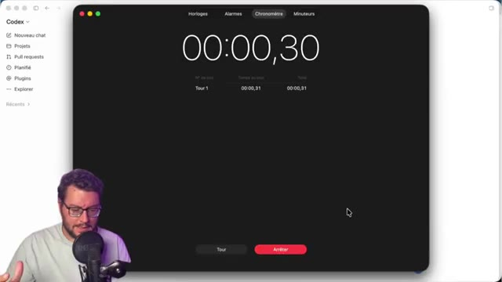

# 🎬 Filmora contre GPT-6 Astra : j'ai testé 2 Workflows de MONTAGE IA

> **Chaîne** : [Labo Des Réseaux](https://www.youtube.com/@labodesreseaux)  
> **Lien YouTube** : [https://www.youtube.com/watch?v=GLauPqEXpBg](https://www.youtube.com/watch?v=GLauPqEXpBg)  
> **Date de publication** : 20260923  
> **Durée** : 14:34  
> **Identifiant vidéo** : `GLauPqEXpBg`  
> **Modèles** : Audio: `whisper-v3-large-turbo` | Vision: `gemini-3.5-flash-lite`  

---

## 📌 Synthèse Exécutive & Outils

### 💡 Résumé
**La vidéo du « Labo Des Réseaux » explore un comparatif technique et créatif inédit opposant le montage humain assisté par les outils natifs de Wondershare Filmora à un workflow entièrement délégué à l'intelligence artificielle via GPT-6 Astra et sa fonction « Computer Use ». L'analyse pose un constat central sur l'évolution du montage vidéo : si l'automatisation de la génération de scripts et du sous-titrage est désormais acquise, le véritable défi réside dans la fragmentation des tâches et la perte de rythme créatif lorsque l'on multiplie les allers-retours entre différents logiciels.**

**À travers une démonstration pas à pas, le créateur détaille les capacités d'édition intelligente intégrées à Filmora, depuis le nettoyage des blancs et des répétitions jusqu'à l'habillage visuel avancé. Il met en lumière l'utilisation des outils natifs tels que la détection des silences, l'édition basée sur le texte, la génération d'images et de vidéos par IA (via des modèles comme Nano Banana Pro ou Seed Dance 2.0), ainsi que le détourage portrait automatique et l'incrustation sur des décors virtuels personnalisés.**

**L'évaluation finale pèse le pour et le contre de chaque approche en termes de temps, de qualité et de coût opérationnel. Le workflow natif s'avère redoutable pour conserver la maîtrise artistique tout en réduisant drastiquement le temps de production, tandis que l'automatisation par agent IA préfigure les méthodes de travail de demain. La vidéo s'achève sur une mise en abyme interactive où le spectateur est invité à deviner quel workflow a réellement façonné l'introduction visionnée.**

### 🛠️ Outils, Modèles & Logiciels Présentés
- **Wondershare Filmora** : Logiciel de montage vidéo principal (édition complète, outils natifs et abonnements avec/sans Watermark).**
- **GPT-6 Astra** : Agent IA doté de la fonctionnalité « Computer Use » pour piloter le projet de montage de A à Z.**
- **Nano Banana Pro** : Modèle d'IA utilisé pour la génération d'arrière-plans et d'images personnalisées.**
- **Seed Dance 2.0** : Modèle d'IA utilisé pour la génération de vidéos (texte-vers-vidéo) et de plans de coupe illustratifs.**
- **Autres modèles de génération mentionnés** : Happy Horse, Filmora, Top Movie 2.5, VIO 3.1.**
- **Outils d'édition intégrés à Filmora** : Détection des silences, édition basée sur le texte, détourage portrait IA, flou de profondeur, amélioration automatique de la lumière et générateur de sous-titres automatiques.**

### 🔑 Points Clés & Enseignements Stratégiques
- Délégation et créativité** : Automatiser l'intégralité du montage sans cadre précis peut diluer le rythme et nuire à la créativité du créateur de contenu.
- Optimisation du temps de base** : Le montage manuel brut prend entre 10 et 12 minutes, tandis que l'utilisation de la détection des silences réduit ce temps à 5-10 minutes, et l'édition par le texte l'optimise à environ 5 minutes.
- Gestion des pistes et clips composés** : Regrouper l'ensemble des plans nettoyés en un « clip composé » simplifie considérablement la manipulation globale du projet sur la timeline.
- Remplacement de décor par IA** : La fonctionnalité d'image IA combinée au détourage portrait permet de s'affranchir d'un studio physique en générant et appliquant un arrière-plan virtuel crédible.
- Profondeur de champ artificielle** : L'application d'un effet de flou de profondeur sur l'arrière-plan généré renforce le réalisme et détache efficacement le sujet principal.
- Correction colorimétrique automatisée** : L'option « amélioration automatique » dans le panneau vidéo ajuste instantanément la lumière et les couleurs pour faire ressortir le personnage, avec une option de réglage manuel fin (température, teinte, vibrance, saturation).
- Génération de B-roll contextuels** : L'utilisation de l'outil texte-vers-vidéo (avec le modèle Seed Dance 2.0) permet de créer rapidement des plans d'illustration sur-mesure adaptés au propos.
- Personnalisation de l'interface** : Il est possible de personnaliser la barre d'outils et d'ajouter des raccourcis rapides (comme la détection des silences) pour fluidifier le flux de travail.
- Dynamisation du montage** : L'ajout de transitions, d'effets de zoom pilotés par des *keyframes* et l'insertion de logos dynamiques (ChatGPT, Filmora) insufflent du rythme, en particulier sur les formats verticaux.
- Sous-titrage automatisé** : La transcription vocale native génère automatiquement des sous-titres synchronisés à l'écran, modifiables et exportables à la volée.
- Mixage et habillage sonore** : Le découpage de la piste audio (via l'option « détacher l'audio ») et l'ajout final d'une musique libre de droits garantissent un rendu professionnel prêt à être publié.

---

## ⏱️ Chronologie & Transcription Complète Audio & Visuelle (Mot pour Mot)

### ⏱️ `[00:00:00 - 00:00:26]` | Segment #01

**🔊 Audio (Transcription Intégrale Mot pour Mot en Français) :**
> A ton avis, l'intro que tu es en train de regarder, est-ce qu'elle a été montée par moi via Wondershare Filmora ou elle a été montée par GPT-6 Astra avec Computer Use ? Aujourd'hui, générer un script, préparer ses médias, générer ses sous-titres avec l'IA, ça n'a rien de compliqué. Le vrai problème, il est ailleurs. On passe d'un outil à l'autre, on réimporte ses fichiers, on reconstruit une partie du projet à chaque étape et quand on délègue tout à l'IA, on perd du rythme et surtout on perd de la créativité.

**👁️ Analyse Visuelle d'Écran (gemini-3.5-flash-lite) :**
**Interface & Outils** : Studio vidéo et B-roll visuel illustratif.
**Contenu textuel & Code** : Illustration vidéo d'une interaction entre un robot et un animal, introduisant le sujet de l'IA.
**Action / Démonstration** : Présentation du sujet et introduction de la problématique sur les outils d'IA au montage.

**Captures d'écran :**
-   
  *⏱️ 00:00:13 — Illustration visuelle générée par IA montrant une main robotique caressant un chat roux.*

---

### ⏱️ `[00:00:26 - 00:00:49]` | Segment #02

**🔊 Audio (Transcription Intégrale Mot pour Mot en Français) :**
> Je vais donc tester deux workflows, tous les deux avec le logiciel Wondershare Filmora. Seulement la différence c'est que dans le premier workflow, j'utiliserai les outils IA natifs disponibles dans Wondershare Filmora. Et donc je garderai la main sur la partie créative du montage. Et dans le second workflow, ici, je ferai appel à GPT-6 Astra pour piloter ce projet de montage dans Filmora de A à Z.

**👁️ Analyse Visuelle d'Écran (gemini-3.5-flash-lite) :**
**Interface & Outils** : Wondershare Filmora (Boîte à outils IA) et interface de chat GPT-6 Astra
**Contenu textuel & Code** : Menu d'outils IA (De l'idée à la vidéo, Image vers vidéo, Extension IA, Texte vers vidéo, Recadrage auto, etc.) et champ de saisie de prompt "Monte ma vidéo, je te laisse faire le..."
**Action / Démonstration** : Présentation comparative de deux workflows de montage : l'un utilisant les outils natifs de Filmora, l'autre faisant appel à GPT-6 Astra.

**Captures d'écran :**
-   
  *⏱️ 00:00:38 — Interface de la boîte à outils IA de Wondershare Filmora montrant diverses options d'intelligence artificielle.*
-   
  *⏱️ 00:00:48 — Interface de l'assistant GPT-6 Astra avec une invite de texte pour le montage vidéo.*

---

### ⏱️ `[00:00:49 - 00:01:17]` | Segment #03

**🔊 Audio (Transcription Intégrale Mot pour Mot en Français) :**
> On va comparer le temps, la qualité, le coût aussi et à la fin tu découvriras quelle version de l'introduction tu es en train de regarder. Petit spoiler, j'ai sélectionné la meilleure. Dans un premier temps, il faut savoir qu'on fait cette vidéo en utilisant le logiciel de montage Wondershare Filmora, car au-delà du fait que la vidéo soit sponsorisée, c'est un logiciel de confiance qu'on a l'habitude de présenter sur la chaîne et qui est parfait pour les créateurs de contenu, qu'ils soient du niveau débutant à expérimenter.

**👁️ Analyse Visuelle d'Écran (gemini-3.5-flash-lite) :**
**Interface & Outils** : Wondershare Filmora
**Contenu textuel & Code** : Boutons de création de projet, Filmora Cloud, Hub des créateurs, outils IA recommandés et liste des projets locaux.
**Action / Démonstration** : Présentation de l'interface du logiciel de montage utilisé pour la réalisation de la vidéo.

**Captures d'écran :**
-   
  *⏱️ 00:01:03 — Écran d'accueil du logiciel de montage Wondershare Filmora affichant les options de création et les projets récents.*
-   
  *⏱️ 00:01:16 — Vue similaire de l'interface principale de Wondershare Filmora avec un carrousel de fonctionnalités IA mis en avant.*

---

### ⏱️ `[00:01:17 - 00:01:39]` | Segment #04

**🔊 Audio (Transcription Intégrale Mot pour Mot en Français) :**
> expérimenté. Le logiciel, au-delà d'être un éditeur complet, permet aussi d'avoir à disposition des outils IA pour son montage. On va le voir d'ailleurs dans l'exemple. Et il est téléchargeable et essayable gratuitement. Par contre, si on veut télécharger notre projet sans Watermark, il faudra choisir parmi les abonnements proposés. Donc en ce moment, il y a une offre de réduction.

**👁️ Analyse Visuelle d'Écran (gemini-3.5-flash-lite) :**
**Interface & Outils** : Navigateur web affichant le site officiel de Wondershare Filmora (page d'achat/tarifs).
**Contenu textuel & Code** : "Choisissez votre formule Filmora", options "Individuels", "Équipe & Business", "Éducation", prix des abonnements (Plan Premium Annuel, Trimestriel, Plan Perpétuel).
**Action / Démonstration** : Le créateur montre la page des tarifs pour expliquer les différentes options d'abonnement sans filigrane (watermark).

**Captures d'écran :**
-   
  *⏱️ 00:01:18 — Page de tarification de Wondershare Filmora montrant les abonnements.*
-   
  *⏱️ 00:01:28 — Page de tarification de Wondershare Filmora avec le curseur sur les options de plans.*
-   
  *⏱️ 00:01:37 — Page web officielle de Wondershare Filmora affichant les différentes formules et offres promotionnelles.*

---

### ⏱️ `[00:01:39 - 00:02:05]` | Segment #05

**🔊 Audio (Transcription Intégrale Mot pour Mot en Français) :**
> Et ensuite, à toi de parcourir le type d'abonnement qui t'irait le mieux. Tu as des forfaits en annuel, en trimestriel ou en perpétuel avec l'ensemble des fonctionnalités en détail qui est indiqué sur chaque abonnement. Ensuite une fois le téléchargement et l'installation fait, tu vas pouvoir créer ton nouveau projet ou pourquoi pas parcourir la boîte à outils qui te permet de voir en détail l'ensemble des fonctionnalités disponibles sur Filmora.

**👁️ Analyse Visuelle d'Écran (gemini-3.5-flash-lite) :**
**Interface & Outils** : Navigateur web et logiciel de montage Wondershare Filmora
**Contenu textuel & Code** : Plans tarifaires (annuel, trimestriel, perpétuel), interface d'accueil du logiciel, vignettes de projets et boîte à outils avec des fonctionnalités IA.
**Action / Démonstration** : Présentation des différentes formules d'abonnement, de la création de projet et exploration de la boîte à outils.

**Captures d'écran :**
-   
  *⏱️ 00:01:40 — Page web affichant les différents abonnements du logiciel Wondershare Filmora (annuel, trimestriel, perpétuel).*
-   
  *⏱️ 00:01:52 — Écran d'accueil principal du logiciel Wondershare Filmora avec la liste des projets locaux et les options de création.*
-   
  *⏱️ 00:02:03 — Vue de la "Boîte à outils" du logiciel Wondershare Filmora présentant divers modules et fonctionnalités IA.*

---

### ⏱️ `[00:02:05 - 00:02:27]` | Segment #06

**🔊 Audio (Transcription Intégrale Mot pour Mot en Français) :**
> On verra ces outils, on peut les utiliser directement sur notre interface principale. Ici donc on va créer un nouveau projet en format 16 neuvième et la première étape ça va être d'importer nos rushs. Donc ici plutôt simple, on n'a qu'un seul rush pour notre introduction vidéo. Mais on pourrait pourquoi pas avoir des dossiers séparés avec l'ensemble des rushs, des sons et des musiques à utiliser.

**👁️ Analyse Visuelle d'Écran (gemini-3.5-flash-lite) :**
**Interface & Outils** : Logiciel de montage vidéo (Wondershare Filmora) et explorateur de fichiers macOS.
**Contenu textuel & Code** : Fenêtre d'importation de médias, panneau "Média de Projet", et fichier vidéo nommé "Introduction pas montée.mp4".
**Action / Démonstration** : Importation d'un fichier vidéo (rush) unique pour démarrer le projet de montage de l'introduction.

**Captures d'écran :**
-   
  *⏱️ 00:02:16 — Interface du logiciel de montage avec une fenêtre de sélection de fichier affichant un rush vidéo d'introduction.*
-   
  *⏱️ 00:02:25 — Même vue de l'interface montrant la sélection du fichier "Introduction pas montée.mp4" dans l'explorateur.*

---

### ⏱️ `[00:02:27 - 00:03:00]` | Segment #07

**🔊 Audio (Transcription Intégrale Mot pour Mot en Français) :**
> Ici on va tout simplement sélectionner notre rush et le déposer pour pouvoir l'importer dans notre bibliothèque de médias qui se trouve en haut à gauche. ensuite pour pouvoir le mettre sur notre timeline qui se trouve juste ici et commencer à effectuer le montage de notre vidéo il suffira de sélectionner et de déposer sur notre timeline à savoir que par exemple si on a plusieurs rushs on pourra en allant ici dans le petit moins réduire notre timeline pour pouvoir avoir une vue d'ensemble supplémentaire et organiser ainsi les rushs les uns après les autres

**👁️ Analyse Visuelle d'Écran (gemini-3.5-flash-lite) :**
**Interface & Outils** : Logiciel de montage vidéo (CapCut)
**Contenu textuel & Code** : Bibliothèque de médias, lecteur de prévisualisation et timeline de montage.
**Action / Démonstration** : Importation d'un rush vidéo et placement sur la timeline pour démarrer le montage.

**Captures d'écran :**
-   
  *⏱️ 00:02:44 — Interface du logiciel de montage montrant l'importation d'un fichier vidéo dans la bibliothèque de médias.*
-   
  *⏱️ 00:02:59 — Glisser-déposer du rush vidéo depuis la bibliothèque vers la timeline du logiciel de montage.*

---

### ⏱️ `[00:03:00 - 00:03:21]` | Segment #08

**🔊 Audio (Transcription Intégrale Mot pour Mot en Français) :**
> et bien sûr on pourra aussi si on souhaite superposer des rushs Sachant qu'on montage, la règle c'est que le rush qui se trouvera sur la ligne supérieure sera celui qui sera disponible à l'écran. Ici d'ailleurs, on a notre retour écran pour pouvoir vérifier l'ensemble des actions qu'on fait et que tout s'est bien passé avant de télécharger notre projet.

**👁️ Analyse Visuelle d'Écran (gemini-3.5-flash-lite) :**
**Interface & Outils** : Présentation orale ou séquence sans interface partagée.
**Contenu textuel & Code** : Explications et conseils de création de contenu / IA.
**Action / Démonstration** : Démonstration et mise en contexte pratique.

---

### ⏱️ `[00:03:21 - 00:03:43]` | Segment #09

**🔊 Audio (Transcription Intégrale Mot pour Mot en Français) :**
> En dessous, on a aussi les pistes audio. Donc là, ma piste audio est collée à celle de ma vidéo. Mais par exemple, si je vais sur clic droit et que je fais détacher l'audio, on verra ma piste audio séparée de ma piste vidéo. Mais là je vais les garder ensemble et on va commencer par la première étape du montage qui va être de supprimer tout ce qui va être blanc et répétition.

**👁️ Analyse Visuelle d'Écran (gemini-3.5-flash-lite) :**
**Interface & Outils** : Présentation orale ou séquence sans interface partagée.
**Contenu textuel & Code** : Explications et conseils de création de contenu / IA.
**Action / Démonstration** : Démonstration et mise en contexte pratique.

---

### ⏱️ `[00:03:43 - 00:04:02]` | Segment #10

**🔊 Audio (Transcription Intégrale Mot pour Mot en Français) :**
> Puisque là la vidéo introduction fait en brut 3 minutes 52 mais il y a des fautes et des répétitions. On va les retirer ensemble. Donc pour cela le moyen le plus classique c'est de se balader sur sa timeline et entre deux espaces faire deux coupes. C'est à dire en sélectionnant par exemple ici la fin de ma première phrase.

**👁️ Analyse Visuelle d'Écran (gemini-3.5-flash-lite) :**
**Interface & Outils** : Présentation orale ou séquence sans interface partagée.
**Contenu textuel & Code** : Explications et conseils de création de contenu / IA.
**Action / Démonstration** : Démonstration et mise en contexte pratique.

---

### ⏱️ `[00:04:02 - 00:04:37]` | Segment #11

**🔊 Audio (Transcription Intégrale Mot pour Mot en Français) :**
> je vais aller dans le petit ciseau ici qui va me permettre de fractionner sur cette timeline et d'aller chercher juste avant le début de ma seconde phrase l'option fractionner que je peux activer avec le raccourci commande B il peut être différent si vous êtes sur PC vous aurez l'indication des raccourcis qui se fait à chaque outil pour pouvoir supprimer ainsi c'est le B à bas du montage mais ça peut être un peu fastidieux c'est pour ça que j'ai la possibilité en sélectionnant ma séquence de faire un clic droit pour aller chercher dans outils d'édition d'intelligence

**👁️ Analyse Visuelle d'Écran (gemini-3.5-flash-lite) :**
**Interface & Outils** : Logiciel de montage vidéo (type Wondershare Filmora).
**Contenu textuel & Code** : Timeline vidéo, curseur de lecture, icône de ciseaux (Fractionner), raccourci clavier Cmd + B, menu contextuel avec options audio et IA.
**Action / Démonstration** : Le créateur montre comment utiliser l'outil de fractionnement pour couper la timeline et présente le raccourci clavier associé.

**Captures d'écran :**
-   
  *⏱️ 00:04:03 — Vue générale de la timeline de montage avec le curseur rouge positionné avant une coupe.*
-   
  *⏱️ 00:04:19 — Gros plan sur l'outil de fractionnement affichant son infobulle d'aide et le raccourci Clavier Commande B.*
-   
  *⏱️ 00:04:35 — Affichage du menu contextuel du logiciel montrant les options d'édition intelligente et de détection.*

---

### ⏱️ `[00:04:37 - 00:05:14]` | Segment #12

**🔊 Audio (Transcription Intégrale Mot pour Mot en Français) :**
> le raccourci détection des silences. Je peux même l'afficher dans mes petits raccourcis qui est juste ici en allant ici dans le petit bouton personnaliser et en ajoutant la détection de silence où je souhaite dans ma barre d'outils. Ainsi je pourrais sélectionner cette détection des silences, définir le seuil de volume, la durée minimum et la zone de buffer pour ainsi analyser et avoir une découpe précise des moments de silence pour pouvoir terminer et d'avoir ainsi ma séquence qui a été coupée automatique entre deux silences.

**👁️ Analyse Visuelle d'Écran (gemini-3.5-flash-lite) :**
**Interface & Outils** : Logiciel de montage vidéo (Wondershare Filmora)
**Contenu textuel & Code** : Menus de détection de silence, curseurs de réglage (seuil du volume, durée minimum, zone buffer), timeline avec piste audio et vidéo.
**Action / Démonstration** : Le créateur montre comment configurer et appliquer la détection de silence sur une séquence vidéo.

**Captures d'écran :**
-   
  *⏱️ 00:04:55 — Interface de l'outil de détection de silence dans le logiciel de montage avec les paramètres de seuil de volume, durée minimum et zone buffer.*
-   
  *⏱️ 00:05:12 — Interface principale du logiciel de montage montrant la timeline découpée et le panneau de prévisualisation de la vidéo.*

---

### ⏱️ `[00:05:14 - 00:05:33]` | Segment #13

**🔊 Audio (Transcription Intégrale Mot pour Mot en Français) :**
> Autre option encore plus précise je trouve, on va faire retour en arrière. C'est cette fois-ci toujours en sélectionnant notre séquence et en allant dans clic droit aller chercher l'outil d'édition basé sur le texte. Ici, en fait, la voix est détectée et tout le texte va être retranscrit pour pouvoir ainsi décider de ce qu'on coupe.

**👁️ Analyse Visuelle d'Écran (gemini-3.5-flash-lite) :**
**Interface & Outils** : DaVinci Resolve (Édition basée sur le texte)
**Contenu textuel & Code** : Transcription textuelle de la vidéo dans le volet de droite et timeline de montage en bas.
**Action / Démonstration** : Le créateur montre l'utilisation de l'édition basée sur le texte pour sélectionner et couper des séquences vidéo directement depuis le texte retranscrit.

**Captures d'écran :**
-   
  *⏱️ 00:05:31 — Interface du logiciel de montage DaVinci Resolve affichant l'outil d'édition basée sur le texte avec la transcription de la voix dans un panneau dédié.*

---

### ⏱️ `[00:05:33 - 00:05:54]` | Segment #14

**🔊 Audio (Transcription Intégrale Mot pour Mot en Français) :**
> Par exemple, ici, la première répétition, l'erreur qui est juste ici. Et une fois donc que notre texte est bon, on peut aussi supprimer tous les clips silencieux pour avoir un montage encore plus précis et l'exporter sur notre timeline pour ainsi avoir celui qui est prêt. Même avec les sous-titres qui sont déjà appliqués, si tu veux, tu peux les supprimer pour avoir seulement ton montage prêt à l'emploi.

**👁️ Analyse Visuelle d'Écran (gemini-3.5-flash-lite) :**
**Interface & Outils** : Logiciel de montage vidéo (Wondershare Filmora).
**Contenu textuel & Code** : Menus Média, Audio, Titres, Transitions, Effets, Filtres, timeline avec pistes vidéo et audio, et aperçu vidéo avec le présentateur.
**Action / Démonstration** : Le créateur montre le résultat final sur la timeline avec les clips et sous-découpages prêts à l'exportation.

**Captures d'écran :**
-   
  *⏱️ 00:05:53 — Interface du logiciel de montage vidéo montrant les médias, le lecteur vidéo et la timeline avec des clips découpés.*

---

### ⏱️ `[00:05:54 - 00:06:14]` | Segment #15

**🔊 Audio (Transcription Intégrale Mot pour Mot en Français) :**
> Donc ça, ça sera pour tout ce qui va être édition de base. Et si on refait l'exercice en chronomètre, en montage manuel, ça nous prendra entre 10 et 12 minutes. En détection des silences, ça nous prendra entre 5 et 10 minutes, puisqu'il faudra quand même supprimer les répétitions. Et avec l'édition par le texte, ici, ça nous prendra 5 minutes.

**👁️ Analyse Visuelle d'Écran (gemini-3.5-flash-lite) :**
**Interface & Outils** : Présentation orale ou séquence sans interface partagée.
**Contenu textuel & Code** : Explications et conseils de création de contenu / IA.
**Action / Démonstration** : Démonstration et mise en contexte pratique.

---

### ⏱️ `[00:06:14 - 00:06:38]` | Segment #16

**🔊 Audio (Transcription Intégrale Mot pour Mot en Français) :**
> Mais ça, c'est vraiment le basique et j'aimerais aller un petit peu plus loin pour faire en sorte que cette introduction, elle soit un petit peu plus habillée. Et ce que je vais faire dans un premier temps, c'est que je vais sélectionner l'ensemble de mes plans, faire un clic droit et je vais créer un clip composé. Cette méthode me permettra maintenant d'avoir un seul bloc que je vais pouvoir retravailler de façon très simple et déjà où il n'y a plus les blancs, les silences et les répétitions.

**👁️ Analyse Visuelle d'Écran (gemini-3.5-flash-lite) :**
**Interface & Outils** : Filmora (ou logiciel de montage similaire)
**Contenu textuel & Code** : Boîte de dialogue "Créer un clip composé", champ "Nommez ce clip composé" avec le texte "Clip composé 1", options "Ratio d'aspect : 16:9 (Format large)", "Résolution : 1920x1080 (Full HD)" et les boutons OK/Annuler.
**Action / Démonstration** : Le créateur nomme le clip composé et s'apprête à valider la création pour regrouper ses plans de montage.

**Captures d'écran :**
-   
  *⏱️ 00:06:37 — Fenêtre modale de création d'un clip composé dans le logiciel de montage avec les options de nom, ratio d'aspect et résolution.*

---

### ⏱️ `[00:06:39 - 00:06:59]` | Segment #17

**🔊 Audio (Transcription Intégrale Mot pour Mot en Français) :**
> Donc j'ai maintenant mon clip composé et pour améliorer ma vidéo, la première chose que je vais faire, c'est que je vais changer le décor qui est un petit peu triste ici. Et pour cela, pas besoin de sortir de Wondershare Filmora. Je peux, en allant dans Mediatek, sélectionner dans Media IA l'option Image IA.

**👁️ Analyse Visuelle d'Écran (gemini-3.5-flash-lite) :**
**Interface & Outils** : Wondershare Filmora
**Contenu textuel & Code** : Projet F, Chronologie principale, onglet Média IA, option Image IA
**Action / Démonstration** : Le créateur montre son projet composé dans la timeline et navigue dans les menus pour accéder aux fonctionnalités d'IA.

**Captures d'écran :**
-   
  *⏱️ 00:06:40 — Interface du logiciel Wondershare Filmora montrant le projet en cours avec la timeline et la fenêtre de prévisualisation.*
-   
  *⏱️ 00:06:49 — Navigation dans le logiciel de montage Wondershare Filmora avec la chronologie principale active.*
-   
  *⏱️ 00:06:57 — Accès au menu "Média IA" et sélection de l'option "Image IA" dans la médiathèque de Wondershare Filmora.*

---

### ⏱️ `[00:06:59 - 00:07:20]` | Segment #18

**🔊 Audio (Transcription Intégrale Mot pour Mot en Français) :**
> Pour pouvoir, ici, en utilisant le modèle que je souhaite, donc moi, par exemple ici, je vais prendre Nano Banana Pro. Pourquoi pas, ici, je vais mettre le logo du Labo des Réseaux. Et j'ai travaillé ici un prompt complet. Je vais sélectionner la qualité, le format et générer avec l'IA. J'en ai d'ailleurs généré un petit peu plus pour avoir plus de choix.

**👁️ Analyse Visuelle d'Écran (gemini-3.5-flash-lite) :**
**Interface & Outils** : Logiciel de montage vidéo (type Filmora) avec panneau Image IA intégré.
**Contenu textuel & Code** : Modèle "Nano Banana Pro", prompt en anglais décrivant un studio YouTube chaleureux avec des plantes, un mur en bois et un néon, ainsi qu'un aperçu visuel généré portant la mention "Generated by AI".
**Action / Démonstration** : Le créateur montre la génération d'une image par IA à l'aide d'un prompt complet et d'un modèle spécifique pour le projet.

**Captures d'écran :**
-   
  *⏱️ 00:07:18 — Interface du logiciel de montage vidéo montrant le panneau de génération d'image par IA avec le modèle Nano Banana Pro, le prompt associé et le résultat généré incluant le logo du Labo des Réseaux.*

---

### ⏱️ `[00:07:21 - 00:07:40]` | Segment #19

**🔊 Audio (Transcription Intégrale Mot pour Mot en Français) :**
> Et je pense que je vais sélectionner celle-ci. En la faisant glisser sur ma timeline, en la faisant correspondre à mon image, je vais me mettre par-dessus. Et sur ma vidéo, je vais sélectionner une option qu'on trouvera ici dans nos raccourcis pour pouvoir faire un découpage portrait de l'IA.

**👁️ Analyse Visuelle d'Écran (gemini-3.5-flash-lite) :**
**Interface & Outils** : Logiciel de montage vidéo (Wondershare Filmora).
**Contenu textuel & Code** : Menus d'édition, timeline principale, pistes vidéo superposées, options d'outils incluant "Fond vert" et "Découpe de portrait par IA".
**Action / Démonstration** : Le créateur montre comment superposer un clip et sélectionne l'outil de détourage par IA dans la barre d'outils.

**Captures d'écran :**
-   
  *⏱️ 00:07:30 — Interface complète du logiciel de montage vidéo montrant la timeline avec les clips superposés et la fenêtre de prévisualisation.*
-   
  *⏱️ 00:07:38 — Gros plan sur la barre d'outils de la timeline affichant le menu contextuel avec l'option "Découpe de portrait par IA".*

---

### ⏱️ `[00:07:41 - 00:08:14]` | Segment #20

**🔊 Audio (Transcription Intégrale Mot pour Mot en Français) :**
> Et ainsi, ici, avoir notre arrière-plan qui s'affiche. alors ici je trouve que ça fonctionne pas trop donc je vais refaire une génération avec l'IA et faire en sorte de mettre le logo sur un côté voilà là on a quelque chose de vraiment sympa donc on voit je suis parfaitement découpé dans ce nouveau décor et cet arrière-plan maintenant je vais le sélectionner et je vais aller dans effet je vais rechercher flou derrière plan et je vais sélectionner là par exemple un flou de profondeur que je vais ajouter à mon arrière-plan je pourrais même en allant ici dans la petite icône régler l'intensité

**👁️ Analyse Visuelle d'Écran (gemini-3.5-flash-lite) :**
**Interface & Outils** : Logiciel de montage vidéo (Wondershare Filmora).
**Contenu textuel & Code** : Menus "Mise en forme IA", options de découpe de portrait, curseurs de flou de profondeur et timeline avec pistes vidéo.
**Action / Démonstration** : Ajustement des paramètres de découpe IA, insertion d'un fond généré par IA et application d'un effet de flou de profondeur.

**Captures d'écran :**
-   
  *⏱️ 00:07:42 — Interface du logiciel de montage avec les options de découpe de portrait par IA sélectionnées.*
-   
  *⏱️ 00:07:57 — Affichage du panneau média avec le nouvel arrière-plan généré par IA intégré dans la timeline.*
-   
  *⏱️ 00:08:12 — Panneau des effets vidéo avec le réglage du flou de profondeur appliqué sur l'arrière-plan.*

---

### ⏱️ `[00:08:14 - 00:08:36]` | Segment #21

**🔊 Audio (Transcription Intégrale Mot pour Mot en Français) :**
> pour réduire la profondeur mais aussi réduire l'intensité pour avoir ce petit effet là et donner de la crédibilité. Ce que je peux faire maintenant aussi c'est travailler la lumière avec un nouvel outil IA, super. Donc pour le trouver facilement je te conseille ici d'aller dans affichage et de passer en mode d'affichage par défaut.

**👁️ Analyse Visuelle d'Écran (gemini-3.5-flash-lite) :**
**Interface & Outils** : Wondershare Filmora
**Contenu textuel & Code** : Menu déroulant Affichage > Mode d'affichage > Défaut, avec aperçu vidéo et timeline en bas.
**Action / Démonstration** : Le créateur montre comment modifier le mode d'affichage dans le logiciel de montage.

**Captures d'écran :**
-   
  *⏱️ 00:08:34 — Capture d'écran montrant le logiciel de montage Wondershare Filmora avec le menu "Affichage" ouvert pour changer le mode d'affichage.*

---

### ⏱️ `[00:08:36 - 00:09:00]` | Segment #22

**🔊 Audio (Transcription Intégrale Mot pour Mot en Français) :**
> Je vais aller ici dans vidéo et dans basique je vais descendre jusqu'à arriver à l'option amélioration automatique automatique que je vais cocher et ainsi les lumières et les couleurs ont été ajustées pour pouvoir faire ressortir le personnage principal. D'ailleurs si je souhaitais moi-même les régler je pourrais aller ici dans couleurs et changer ainsi la température, la teinte, la vibrance ou la saturation comme je le souhaite.

**👁️ Analyse Visuelle d'Écran (gemini-3.5-flash-lite) :**
**Interface & Outils** : Logiciel de montage vidéo (type CapCut ou équivalent).
**Contenu textuel & Code** : Menus Vidéo, Basique, Amélioration automatique et Couleur avec curseurs de réglage (Température, Vibrance, Saturation).
**Action / Démonstration** : Le créateur montre comment activer l'amélioration automatique puis navigue vers les réglages de couleur manuels.

**Captures d'écran :**
-   
  *⏱️ 00:08:37 — Interface du logiciel de montage avec les options vidéo basiques sélectionnées.*
-   
  *⏱️ 00:08:48 — Panneau latéral affichant l'option d'amélioration automatique activée.*
-   
  *⏱️ 00:08:59 — Onglet couleur du panneau de configuration pour les réglages manuels.*

---

### ⏱️ `[00:09:01 - 00:09:24]` | Segment #23

**🔊 Audio (Transcription Intégrale Mot pour Mot en Français) :**
> Ici on va laisser l'IA faire son travail. Donc on est plutôt pas mal, ce qui manque maintenant c'est ajouter des plans de coupe ou des plans d'illustration selon nos propos. Donc ici dans un premier temps j'ai déterminé les coupes et je vais ici ajouter mes plans d'illustration que je vais générer encore une fois grâce à la fonctionnalité Mediatek et les médias IA dans Filmora.

**👁️ Analyse Visuelle d'Écran (gemini-3.5-flash-lite) :**
**Interface & Outils** : Logiciel de montage vidéo (type Filmora ou similaire) avec panneau de timeline et onglets IA.
**Contenu textuel & Code** : Timeline de montage avec pistes vidéo, chutier de médias, aperçu vidéo et panneau de génération d'images IA avec des prompts.
**Action / Démonstration** : Le créateur montre comment il organise ses plans de coupe et génère des illustrations à l'aide de l'intelligence artificielle.

**Captures d'écran :**
-   
  *⏱️ 00:09:12 — Vue générale du logiciel de montage avec la timeline principale et les médias importés.*
-   
  *⏱️ 00:09:22 — Affichage du panneau d'intelligence artificielle pour générer des images et illustrations.*

---

### ⏱️ `[00:09:24 - 00:09:49]` | Segment #24

**🔊 Audio (Transcription Intégrale Mot pour Mot en Français) :**
> Donc j'ai la possibilité d'utiliser des templates, de faire de l'image tout vidéo si j'ai déjà des images de base, de faire du texte tout vidéo. C'est ici ce que je vais faire en marquant une fois le prompt qui va illustrer ma séquence vidéo et en sélectionnant parmi les modèles disponibles. Donc Donc on a le modèle Happy Horse, le modèle Filmora, le modèle Seed Dance 2.0 ou Top Movie 2.5 ou encore VIO 3.1.

**👁️ Analyse Visuelle d'Écran (gemini-3.5-flash-lite) :**
**Interface & Outils** : Présentation orale ou séquence sans interface partagée.
**Contenu textuel & Code** : Explications et conseils de création de contenu / IA.
**Action / Démonstration** : Démonstration et mise en contexte pratique.

---

### ⏱️ `[00:09:50 - 00:10:23]` | Segment #25

**🔊 Audio (Transcription Intégrale Mot pour Mot en Français) :**
> Ici on va prendre le modèle Seed Dance 2.0 et on va marquer notre prompt. Ici j'ai rédigé mon prompt complet, je vais pouvoir générer ma vidéo. Ma vidéo est prête, je vais pouvoir ici la glisser sur ma timeline et me remplacer. Et maintenant ce que je peux faire pour ajouter un peu de rythme, c'est pourquoi pas en ajoutant par exemple des effets zoom, des filtres supplémentaires on a aussi toute une bibliothèque de transitions à disposition on a des transitions IA mais aussi toutes les transitions classiques et à la fin ce que j'aime bien faire surtout quand on travaille sur les formats verticaux

**👁️ Analyse Visuelle d'Écran (gemini-3.5-flash-lite) :**
**Interface & Outils** : Logiciel de montage vidéo (type Wondershare Filmora ou similaire).
**Contenu textuel & Code** : Menus Média, Audio, Titres, Transitions, Effets, Timeline multipiste, aperçu vidéo et panneau latéral.
**Action / Démonstration** : Le créateur montre comment importer la vidéo générée dans la timeline et ajoute des éléments textuels et rythmiques.

**Captures d'écran :**
-   
  *⏱️ 00:10:06 — Interface du logiciel de montage avec la bibliothèque de médias et la timeline principale active.*
-   
  *⏱️ 00:10:22 — Interface du logiciel de montage affichant l'onglet des titres et du texte pour dynamiser la vidéo.*

---

### ⏱️ `[00:10:23 - 00:10:43]` | Segment #26

**🔊 Audio (Transcription Intégrale Mot pour Mot en Français) :**
> c'est d'aller dans l'option titre pour sélectionner les sous-titres créés avec l'IA et générer automatiquement les sous-titres sur sa timeline à partir de la voix pour les avoir qui s'affiche sur ton écran et ce que je vais faire c'est que je vais continuer à ajouter du rythme en mettant les logos de ChatGPT et de Filmora quand je parle d'eux.

**👁️ Analyse Visuelle d'Écran (gemini-3.5-flash-lite) :**
**Interface & Outils** : Wondershare Filmora
**Contenu textuel & Code** : Timeline de montage avec des clips vidéo, le panneau de prévisualisation affichant le youtubeur, et les médias importés incluant les logos de ChatGPT et Filmora.
**Action / Démonstration** : Le créateur montre son interface de montage et positionne les éléments pour ajouter du rythme et des visuels sur la timeline.

**Captures d'écran :**
-   
  *⏱️ 00:10:41 — Interface complète du logiciel de montage vidéo Wondershare Filmora montrant la bibliothèque de médias, le lecteur vidéo avec le créateur, les panneaux de réglages à droite et la timeline en bas.*

---

### ⏱️ `[00:10:43 - 00:11:01]` | Segment #27

**🔊 Audio (Transcription Intégrale Mot pour Mot en Français) :**
> Je vais aussi me servir des keyframes pour pouvoir faire des accélérations sur les zooms à certains moments de la vidéo. Et ensuite, et avant d'exporter, je choisirai une musique libre de droit pour pouvoir l'ajouter. Ainsi, j'ai mon introduction prête. A voir maintenant si c'est celle-ci que je vais utiliser.

**👁️ Analyse Visuelle d'Écran (gemini-3.5-flash-lite) :**
**Interface & Outils** : Présentation orale ou séquence sans interface partagée.
**Contenu textuel & Code** : Explications et conseils de création de contenu / IA.
**Action / Démonstration** : Démonstration et mise en contexte pratique.

---

### ⏱️ `[00:11:01 - 00:11:32]` | Segment #28

**🔊 Audio (Transcription Intégrale Mot pour Mot en Français) :**
> On va passer au test avec ChatGPT Astra et on commence par lancer le chrono. Depuis l'application ChatGPT dans Codex, je sélectionne le modèle Astra. Je l'utilise en mode léger parce que j'ai peur d'atteindre vite les limites de mon abonnement. Et je lui demande sur mon bureau, dans le dossier Wondershare, trouve le fichier vidéo introduction pas monté, ouvre le logiciel de montage Filmora et édite la vidéo, fais en sorte de supprimer les blancs et les répétitions et de rendre l'ensemble dynamique.

**👁️ Analyse Visuelle d'Écran (gemini-3.5-flash-lite) :**
**Interface & Outils** : Codex, application macOS, application de chronomètre.
**Contenu textuel & Code** : Prompt utilisateur demandant de trouver une vidéo sur le bureau dans le dossier Wondershare, d'ouvrir Filmora et de supprimer les blancs et répétitions.
**Action / Démonstration** : Le créateur lance un chronomètre puis soumet une tâche d'automatisation et de montage vidéo à ChatGPT Astra (en mode léger).

**Captures d'écran :**
-   
  *⏱️ 00:11:02 — Affichage du chronomètre sur l'écran de l'ordinateur pendant que le présentateur s'apprête à lancer le test.*
-   
  *⏱️ 00:11:17 — Interface de l'application Codex montrant le prompt soumis à ChatGPT Astra pour éditer une vidéo.*
-   
  *⏱️ 00:11:31 — L'interface de Codex affichant la réponse en cours de l'IA avec la tentative d'ouverture du logiciel Filmora.*

---

### ⏱️ `[00:11:32 - 00:11:51]` | Segment #29

**🔊 Audio (Transcription Intégrale Mot pour Mot en Français) :**
> Je précise qu'en amont, j'ai créé un dossier sur le bureau de mon ordinateur avec le rush non monté à l'intérieur. Donc voilà, Astra est parti. Plusieurs choses à noter pendant ce test. D'abord, j'ai dû régulièrement autoriser Astra à effectuer des actions. Sauvegarde, exportation, surtout en début de projet, difficile de s'éloigner de son PC.

**👁️ Analyse Visuelle d'Écran (gemini-3.5-flash-lite) :**
**Interface & Outils** : Finder (macOS)
**Contenu textuel & Code** : Fenêtre du Finder affichant le dossier "Wondershare" contenant un fichier vidéo nommé "montée.mp4".
**Action / Démonstration** : Le créateur montre le dossier créé sur le bureau contenant le rush non monté avant de lancer le test avec Astra.

**Captures d'écran :**
-   
  *⏱️ 00:11:33 — Capture d'écran montrant le Finder macOS avec un dossier contenant les fichiers vidéo pour le test.*

---

### ⏱️ `[00:11:51 - 00:12:13]` | Segment #30

**🔊 Audio (Transcription Intégrale Mot pour Mot en Français) :**
> Ensuite, le plus gros souci, c'est mon abonnement ChatGPT+, qui limite mon utilisation d'Astra. Tu peux le voir d'ailleurs à plusieurs reprises. J'ai dû attendre que mes crédits d'utilisation se réinitialisent. Bien sûr, il est possible d'acheter des crédits supplémentaires, mais quand on paie déjà un abonnement de chat GPT+, c'est un peu embêtant. J'ai quand même réussi en plusieurs sessions à faire en sorte qu'Astra boucle la première partie du projet.

**👁️ Analyse Visuelle d'Écran (gemini-3.5-flash-lite) :**
**Interface & Outils** : Codex, GPT-6 Astra, Wondershare Filmora Mac.
[DESC_IMAGE_3]
**Contenu textuel & Code** : Demande de contrôle de l'ordinateur, message de quota épuisé (« Vous avez atteint votre limite d'utilisation »), interface de montage vidéo avec transcription textuelle.
**Action / Démonstration** : Le créateur montre la limite d'utilisation de son abonnement IA lors du pilotage automatique du logiciel de montage.

**Captures d'écran :**
-   
  *⏱️ 00:11:52 — Interface de l'assistant IA avec une demande de validation pour contrôler le logiciel Wondershare Filmora Mac.*
-   
  *⏱️ 00:12:02 — Notification de quota épuisé et limite d'utilisation atteinte sur l'interface Codex / GPT-6 Astra.*
-   
  *⏱️ 00:12:12 — Interface du logiciel de montage Wondershare Filmora montrant l'édition basée sur le texte et la timeline vidéo.*

---

### ⏱️ `[00:12:13 - 00:12:34]` | Segment #31

**🔊 Audio (Transcription Intégrale Mot pour Mot en Français) :**
> J'ai abandonné la partie dynamique et je me suis arrêté à la première mission. Supprimer les blancs et les répétitions. Ça a pris donc 24 minutes en 5 sessions différentes. Et voilà le résultat. A ton avis, l'intro que tu es en train de regarder, est-ce qu'elle a été montée par moi via Wondershare Filmora ? Montée par GPT-6 Astra avec Computer Use.

**👁️ Analyse Visuelle d'Écran (gemini-3.5-flash-lite) :**
**Interface & Outils** : Logiciel de montage vidéo (type Wondershare Filmora).
[DESC_CONTENU] Timeline de montage, fenêtres de prévisualisation vidéo, texte transcrit et options d'édition.
**Contenu textuel & Code** : Explications et conseils de création de contenu / IA.
**Action / Démonstration** : Le créateur présente son interface de montage et discute de son workflow assisté par IA.

**Captures d'écran :**
-   
  *⏱️ 00:12:14 — Interface du logiciel de montage affichant une timeline avec des pistes audio/vidéo et un panneau d'édition basé sur le texte.*

---

### ⏱️ `[00:12:34 - 00:12:59]` | Segment #32

**🔊 Audio (Transcription Intégrale Mot pour Mot en Français) :**
> générer un script préparer ses médias générer ses sous titres avec l'IA ça n'a rien de compliqué mais il est ailleurs il a réussi seul à utiliser plusieurs fonctionnalités de film aura pour éditer la vidéo et ça c'est déjà un vrai résultat mais on est loin du montage abouti pour être tout à fait honnête je pense que j'aurais obtenu un meilleur résultat en critiquant son travail et en lui demandant des corrections.

**👁️ Analyse Visuelle d'Écran (gemini-3.5-flash-lite) :**
**Interface & Outils** : Aucun logiciel ou interface technique affiché (plan face caméra uniquement).
**Contenu textuel & Code** : Aucun texte, prompt ou menu visible à l'écran.
**Action / Démonstration** : Le youtubeur s'exprime face caméra en parlant du montage vidéo et de l'utilisation de l'IA.

---

### ⏱️ `[00:13:00 - 00:13:20]` | Segment #33

**🔊 Audio (Transcription Intégrale Mot pour Mot en Français) :**
> Mon prompt manquait peut-être aussi d'orientation et j'ai travaillé sur la version légère du modèle. Il faudrait donc refaire le test peut-être en mode moyen au maximum. Seulement, ça coûtera beaucoup plus de crédit. Et je n'ai pas envie forcément de dépenser 200 euros pour montrer l'introduction d'une minute de ma vidéo. Et donc, c'est là ma principale critique.

**👁️ Analyse Visuelle d'Écran (gemini-3.5-flash-lite) :**
**Interface & Outils** : Interface graphique style montage vidéo, incrustation caméra du youtubeur.
**Contenu textuel & Code** : Textes explicatifs, timeline de montage, visuels illustrant le coût et les performances des outils IA.
**Action / Démonstration** : Le créateur commente les coûts élevés des modes de génération vidéo avancés.

**Captures d'écran :**
-   
  *⏱️ 00:13:01 — Image de synthèse avec le texte 'IMPRESSIONNANT, MAIS INACHEVÉ' et une interface de montage vidéo.*
-   
  *⏱️ 00:13:18 — Illustration avec le texte '200 € POUR UNE INTRO ?' montrant un compteur de vitesse au maximum et des piles de pièces avec une étiquette '200 €'.*

---

### ⏱️ `[00:13:20 - 00:13:40]` | Segment #34

**🔊 Audio (Transcription Intégrale Mot pour Mot en Français) :**
> Le montage IA, via un agent, peut paraître une solution pour gagner du temps. Mais à quel prix ? En optimisant les consignes et les travails en amont, on peut sans doute trouver un bon compromis pour rester rentable. Par exemple, demander à l'IA de travailler sur un format précis. Par contre, en la laissant en roue libre comme je l'ai fait, je doute qu'on obtienne pour l'instant un bon résultat.

**👁️ Analyse Visuelle d'Écran (gemini-3.5-flash-lite) :**
**Interface & Outils** : Wondershare Filmora (graphisme d'illustration)
**Contenu textuel & Code** : Textes : 'CADRER L'IA - Un format précis. Des consignes précises.' et 'EN ROUE LIBRE ? - Le résultat se disperse.' avec une timeline de montage illustrée.
**Action / Démonstration** : Présentation visuelle des deux approches d'utilisation de l'IA en montage : cadrée versus en roue libre.

**Captures d'écran :**
-   
  *⏱️ 00:13:30 — Illustration graphique titrée 'CADRER L'IA' montrant comment des consignes précises permettent d'obtenir des formats ciblés.*
-   
  *⏱️ 00:13:39 — Illustration graphique titrée 'EN ROUE LIBRE ?' montrant une timeline de montage vidéo désorganisée où le résultat se disperse.*

---

### ⏱️ `[00:13:40 - 00:14:04]` | Segment #35

**🔊 Audio (Transcription Intégrale Mot pour Mot en Français) :**
> Et côté créativité, quand j'ai travaillé moi-même sur mes rushs, je ne sais pas si tu te rappelles, comme par exemple avec l'image derrière plan IA, j'ai changé 3 ou 4 fois de direction avant de savoir ce que je voulais vraiment. car je trouve que c'est en s'impliquant dans son projet qu'on obtient finalement la vision finale de celui-ci. Je doute que j'aurais réussi à formuler cette vision dans un prompt sans avoir d'abord travaillé mes rushs moi-même.

**👁️ Analyse Visuelle d'Écran (gemini-3.5-flash-lite) :**
**Interface & Outils** : Logiciel de montage vidéo (Wondershare Filmora)
**Contenu textuel & Code** : Timeline de montage, extraits vidéo, texte 'La vision se trouve en créant' et flux visuels d'IA.
**Action / Démonstration** : Présentation du processus de montage et de la recherche créative sur les rushs.

**Captures d'écran :**
-   
  *⏱️ 00:13:52 — Illustration du processus créatif de montage vidéo avec une timeline affichée à l'écran et le créateur en vignette en bas à gauche.*
-   
  *⏱️ 00:14:02 — Vue similaire montrant l'interface de montage vidéo avec des flux créatifs et le youtubeur présent dans le coin inférieur gauche.*

---

### ⏱️ `[00:14:04 - 00:14:28]` | Segment #36

**🔊 Audio (Transcription Intégrale Mot pour Mot en Français) :**
> Au final, je préfère un logiciel qui intègre des outils IA pour faciliter ton workflow, ce qui permet de co-créer et de garder le contrôle créatif sur ce que tu fais. Et pour ça, Filmora répond bien aux besoins. Des outils IA et la liberté de créativité, c'est ce qu'on demande en tant que créateur. Et si tu veux tester de ton côté Filmora, je te rappelle que le lien pour le télécharger et l'installer gratuitement est en description et en commentaire épinglé.

**👁️ Analyse Visuelle d'Écran (gemini-3.5-flash-lite) :**
**Interface & Outils** : Wondershare Filmora 15 (interface logicielle et site web officiel)
**Contenu textuel & Code** : "Filmora 15", "Montez comme un expert avec Filmora IA", "Commencez gratuitement", "Acheter", timeline de montage vidéo.
**Action / Démonstration** : Le présentateur illustre les capacités de co-création et d'outils IA du logiciel Filmora 15 en présentant son interface et son site web.

**Captures d'écran :**
-   
  *⏱️ 00:14:05 — Interface du logiciel de montage Wondershare Filmora montrant une timeline avec des clips vidéo et audio.*
-   
  *⏱️ 00:14:16 — Page d'accueil officielle du site Wondershare Filmora présentant la version "Filmora 15" avec les options de téléchargement.*
-   
  *⏱️ 00:14:27 — Page d'accueil du site Wondershare Filmora affichant une section interactive "AI Creating" sur le produit Filmora 15.*

---

### ⏱️ `[00:14:29 - 00:14:34]` | Segment #37

**🔊 Audio (Transcription Intégrale Mot pour Mot en Français) :**
> Merci d'avoir suivi ce tuto et je te dis à très bientôt sur le Labo des Réseaux pour une nouvelle vidéo.

**👁️ Analyse Visuelle d'Écran (gemini-3.5-flash-lite) :**
**Interface & Outils** : Site web officiel de Wondershare Filmora 15 (navigateur web).
**Contenu textuel & Code** : "Filmora 15", "Montez comme un expert avec Filmora IA", boutons "Commencez gratuitement" et "Acheter", notes des plateformes (SoftwareHow, G2 Crowd, Capterra).
**Action / Démonstration** : Le créateur présente la page d'accueil de Filmora 15 en conclusion de sa vidéo, en bas de l'écran avec sa webcam.

**Captures d'écran :**
-   
  *⏱️ 00:14:30 — Page d'accueil officielle de Wondershare Filmora 15 présentant les fonctionnalités d'intelligence artificielle.*
-   
  *⏱️ 00:14:31 — Animation sur le site de Filmora 15 illustrant le montage vidéo dynamique avec un rider en BMX.*
-   
  *⏱️ 00:14:32 — Présentation de l'interface multi-écrans de Filmora 15 avec un espace de travail de montage complet.*

---
