# 🎬 Filmora contre GPT-6 Astra : j'ai testé 2 Workflows de MONTAGE IA

> **Chaîne** : [Labo Des Réseaux](https://www.youtube.com/@labodesreseaux)  
> **Lien YouTube** : [https://www.youtube.com/watch?v=GLauPqEXpBg](https://www.youtube.com/watch?v=GLauPqEXpBg)  
> **Date de publication** : 20260923  
> **Durée** : 14:34  
> **Identifiant vidéo** : `GLauPqEXpBg`  
> **Modèles** : Audio: `whisper-v3-large-turbo` | Vision: `gemini-3.5-flash-lite`  

---

## 📌 Synthèse Exécutive & Outils

### 💡 Résumé
**Cette vidéo de la chaîne Labo Des Réseaux explore et compare deux approches distinctes du montage vidéo pour une même introduction : l'utilisation des outils d'intelligence artificielle natifs de Wondershare Filmora versus le pilotage automatisé et agentique du projet de A à Z par un système externe. L'analyse met en lumière la problématique récurrente de la fragmentation des flux de travail en IA, où le passage d'une application à l'autre tend à briser le rythme et à appauvrir la créativité du créateur.**

**Le cœur de la démonstration repose sur un tutoriel pratique et détaillé au sein de Filmora, illustrant comment optimiser drastiquement le temps de post-production. Le créateur y détaille l'importation des rushs, la gestion de la timeline, ainsi que l'utilisation de fonctionnalités avancées comme la détection automatique des silences, l'édition textuelle, la création de clips composés et la génération d'éléments visuels et d'arrière-plans par IA.**

**À travers cette comparaison de workflows évaluant le temps, la qualité et le coût, la vidéo démontre la maturité des suites logicielles traditionnelles intégrant des modules d'IA générative. Le spectateur est ainsi invité à s'interroger sur l'équilibre subtil entre l'automatisation totale et le maintien du contrôle créatif, tout en découvrant au montage final quelle version du flux a réellement été retenue.**

### 🛠️ Outils, Modèles & Logiciels Présentés
- **Wondershare Filmora** : Logiciel de montage vidéo complet, doté d'outils d'intelligence artificielle natifs, disponible sur ordinateur (desktop).**
- **GPT-6 Astra** : Outil d'IA doté de capacités de type *Computer Use* et d'agents virtuels pour piloter des projets de montage.**
- **ChatGPT** : Mentionné pour la génération de scripts et d'éléments textuels.**
- **Modèles de génération d'images et de vidéos IA dans Filmora** : Nano Banana Pro, Seed Dance 2.0, Top Movie 2.5, VIO 3.1, Happy Horse.**
- **CapCut & DaVinci Resolve** : Outils de montage concurrents évoqués indirectement dans l'écosystème du multimédia.**

### 🔑 Points Clés & Enseignements Stratégiques
- Problématique du workflow** : Multiplier les outils fragmentés pour l'IA (génération de scripts, sous-titres, médias) nuit au rythme et à la créativité du monteur en multipliant les réimportations.
- Gestion des abonnements Filmora** : Le logiciel est téléchargeable gratuitement avec une version d'essai, mais nécessite un abonnement (annuel, trimestriel ou perpétuel) pour supprimer le filigrane (*Watermark*).
- Organisation de la timeline** : Utiliser l'outil de réduction de la timeline (bouton moins) pour obtenir une vue d'ensemble globale lorsque le projet comporte de nombreux rushs.
- Hiérarchie des plans** : En montage, le plan placé sur la piste supérieure est prioritaire et s'affiche à l'écran, ce qui permet de gérer facilement les superpositions.
- Détachement audio** : Possibilité de dissocier la piste audio de la vidéo d'un simple clic droit pour un traitement du son affiné.
- Optimisation du déruschage** : Le nettoyage des blancs et des répétitions passe de 10-12 minutes en manuel à 5-10 minutes avec la *détection des silences*, et descend à environ 5 minutes grâce à l'innovante *édition basée sur le texte*.
- Utilisation des clips composés** : Regrouper l'ensemble des plans nettoyés en un clip unique permet de simplifier considérablement les étapes de retouche ultérieures.
- Génération d'arrière-plans par IA** : Le module Mediatek (Media IA / Image IA) permet de créer des décors personnalisés (ex: via Nano Banana Pro) pour remplacer un fond terne.
- Incrustation et effets visuels** : Combinaison du découpage portrait par IA et de l'application d'un effet de flou de profondeur sur l'arrière-plan pour crédibiliser le nouveau décor.
- Amélioration automatique de l'image** : L'activation de l'option d'amélioration automatique dans les paramètres vidéo ajuste instantanément la lumière et les couleurs pour faire ressortir le sujet principal.
- Génération de plans de coupe** : Utilisation de modèles vidéo par IA (comme Seed Dance 2.0) à partir d'un prompt textuel précis pour illustrer visuellement les propos.
- Dynamisation du montage** : Ajout de rythme via des sous-titres automatiques générés par la voix, l'insertion de logos de marques au bon moment, et l'utilisation de *keyframes* pour des zooms accélérés.

---

## ⏱️ Chronologie & Transcription Complète Audio & Visuelle (Mot pour Mot)

### ⏱️ `[00:00:00 - 00:00:26]` | Segment #01

**🔊 Audio (Transcription Intégrale Mot pour Mot en Français) :**
> A ton avis, l'intro que tu es en train de regarder, est-ce qu'elle a été montée par moi via Wondershare Filmora ou elle a été montée par GPT-6 Astra avec Computer Use ? Aujourd'hui, générer un script, préparer ses médias, générer ses sous-titres avec l'IA, ça n'a rien de compliqué. Le vrai problème, il est ailleurs. On passe d'un outil à l'autre, on réimporte ses fichiers, on reconstruit une partie du projet à chaque étape et quand on délègue tout à l'IA, on perd du rythme et surtout on perd de la créativité.

**👁️ Analyse Visuelle d'Écran (gemini-3.5-flash-lite) :**
**Interface & Outils** : Studio vidéo YouTube et illustration multimédia IA.
**Contenu textuel & Code** : Présence du présentateur avec micro et néon de la chaîne, puis image illustrant le thème de l'IA.
**Action / Démonstration** : Introduction du sujet abordant le montage vidéo assisté par l'intelligence artificielle et la complexité des outils.

**Captures d'écran :**
-   
  *⏱️ 00:00:13 — Illustration visuelle d'un chat caressé par une main robotique, faisant référence à l'intelligence artificielle.*

---

### ⏱️ `[00:00:26 - 00:00:49]` | Segment #02

**🔊 Audio (Transcription Intégrale Mot pour Mot en Français) :**
> Je vais donc tester deux workflows, tous les deux avec le logiciel Wondershare Filmora. Seulement la différence c'est que dans le premier workflow, j'utiliserai les outils IA natifs disponibles dans Wondershare Filmora. Et donc je garderai la main sur la partie créative du montage. Et dans le second workflow, ici, je ferai appel à GPT-6 Astra pour piloter ce projet de montage dans Filmora de A à Z.

**👁️ Analyse Visuelle d'Écran (gemini-3.5-flash-lite) :**
**Interface & Outils** : Wondershare Filmora et interface de type ChatGPT / GPT-6 Astra.
**Contenu textuel & Code** : Boîte à outils IA (De l'idée à la vidéo, Image vers vidéo, Extension IA, Texte vers vidéo, Palette de couleurs IA, Graphiques animés, Génération de musique, Recadrage, Tracking, Multicaméra, Découpe de portrait) et champ de prompt "Monte ma vidéo, je te laisse faire le...".
**Action / Démonstration** : Présentation comparative de deux workflows de montage vidéo : l'un utilisant les outils natifs de Filmora, l'autre utilisant une IA externe (GPT-6 Astra).

**Captures d'écran :**
- 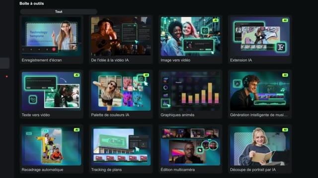  
  *⏱️ 00:00:38 — Interface de la boîte à outils IA du logiciel Wondershare Filmora montrant les différentes fonctionnalités disponibles.*
- 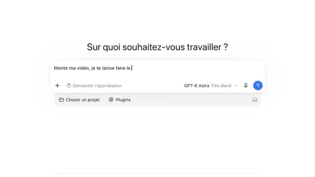  
  *⏱️ 00:00:48 — Interface de saisie de prompt d'une IA (GPT-6 Astra) avec la question "Sur quoi souhaitez-vous travailler ?".*

---

### ⏱️ `[00:00:49 - 00:01:17]` | Segment #03

**🔊 Audio (Transcription Intégrale Mot pour Mot en Français) :**
> On va comparer le temps, la qualité, le coût aussi et à la fin tu découvriras quelle version de l'introduction tu es en train de regarder. Petit spoiler, j'ai sélectionné la meilleure. Dans un premier temps, il faut savoir qu'on fait cette vidéo en utilisant le logiciel de montage Wondershare Filmora, car au-delà du fait que la vidéo soit sponsorisée, c'est un logiciel de confiance qu'on a l'habitude de présenter sur la chaîne et qui est parfait pour les créateurs de contenu, qu'ils soient du niveau débutant à expérimenter.

**👁️ Analyse Visuelle d'Écran (gemini-3.5-flash-lite) :**
**Interface & Outils** : Logiciel de montage vidéo Wondershare Filmora
**Contenu textuel & Code** : Tableau de bord d'accueil, options de création de projet, outils IA (texte vers vidéo, sous-titres, amélioration vidéo) et liste des projets locaux.
**Action / Démonstration** : Présentation du logiciel utilisé pour réaliser la vidéo et exploration de l'interface d'accueil.

**Captures d'écran :**
- 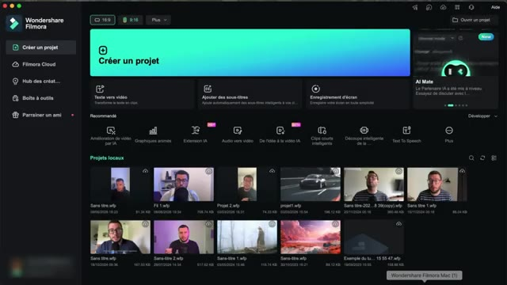  
  *⏱️ 00:01:03 — Interface principale du logiciel de montage Wondershare Filmora montrant le tableau de bord avec les projets récents et les outils d'IA.*
- 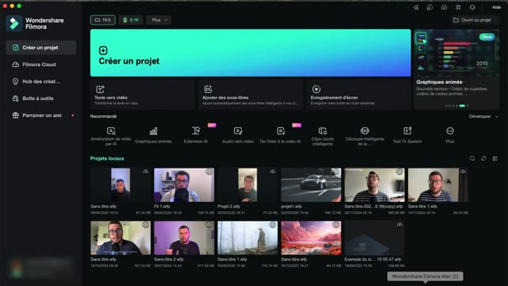  
  *⏱️ 00:01:16 — Interface principale de Wondershare Filmora avec une vue similaire sur le tableau de bord des projets locaux et les options de création.*

---

### ⏱️ `[00:01:17 - 00:01:39]` | Segment #04

**🔊 Audio (Transcription Intégrale Mot pour Mot en Français) :**
> expérimenté. Le logiciel, au-delà d'être un éditeur complet, permet aussi d'avoir à disposition des outils IA pour son montage. On va le voir d'ailleurs dans l'exemple. Et il est téléchargeable et essayable gratuitement. Par contre, si on veut télécharger notre projet sans Watermark, il faudra choisir parmi les abonnements proposés. Donc en ce moment, il y a une offre de réduction.

**👁️ Analyse Visuelle d'Écran (gemini-3.5-flash-lite) :**
**Interface & Outils** : Navigateur web affichant le site officiel de Wondershare Filmora (page d'achat/tarifs).
**Contenu textuel & Code** : "Choisissez votre formule Filmora", "OFFRE SPÉCIALE : JUSQU'À -20 %", "Plan Premium - Annuel (7,5 €/mois)", "Plan Perpétuel (79,99 €)".
**Action / Démonstration** : Présentation des différentes formules tarifaires du logiciel pour enlever le filigrane (Watermark).

**Captures d'écran :**
- 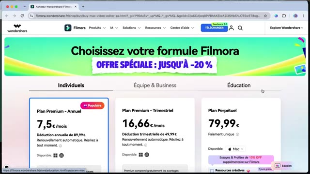  
  *⏱️ 00:01:18 — Page de tarification de Wondershare Filmora montrant les abonnements individuels.*
- 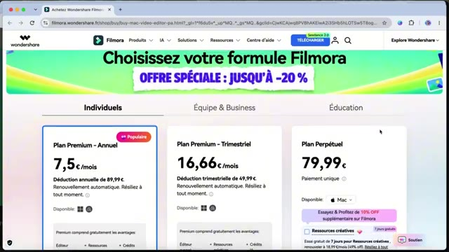  
  *⏱️ 00:01:28 — Page de tarification de Filmora affichant les plans d'abonnement (Annuel, Trimestriel, Perpétuel).*
- 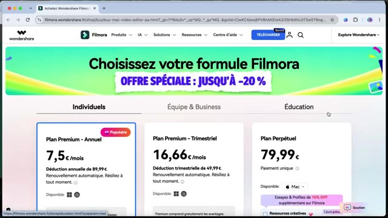  
  *⏱️ 00:01:37 — Page des formules Filmora mettant en avant l'offre spéciale et les différentes options de licence.*

---

### ⏱️ `[00:01:39 - 00:02:05]` | Segment #05

**🔊 Audio (Transcription Intégrale Mot pour Mot en Français) :**
> Et ensuite, à toi de parcourir le type d'abonnement qui t'irait le mieux. Tu as des forfaits en annuel, en trimestriel ou en perpétuel avec l'ensemble des fonctionnalités en détail qui est indiqué sur chaque abonnement. Ensuite une fois le téléchargement et l'installation fait, tu vas pouvoir créer ton nouveau projet ou pourquoi pas parcourir la boîte à outils qui te permet de voir en détail l'ensemble des fonctionnalités disponibles sur Filmora.

**👁️ Analyse Visuelle d'Écran (gemini-3.5-flash-lite) :**
**Interface & Outils** : Navigateur web (image 1) et application logicielle Wondershare Filmora (images 2 et 3).
**Contenu textuel & Code** : Tarifs d'abonnements, boutons d'achat, miniatures de projets récents, options de création rapide et grille d'outils IA.
**Action / Démonstration** : Présentation des offres tarifaires, création d'un projet et navigation dans la boîte à outils.

**Captures d'écran :**
- 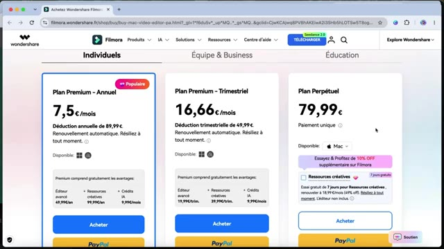  
  *⏱️ 00:01:40 — Page web affichant les différents abonnements Wondershare Filmora (annuel, trimestriel, perpétuel).*
- 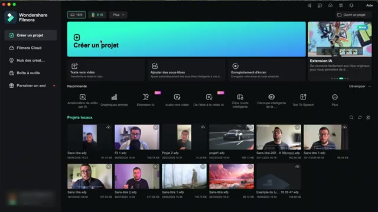  
  *⏱️ 00:01:52 — Interface d'accueil du logiciel Wondershare Filmora avec la liste des projets locaux et les options de création.*
- 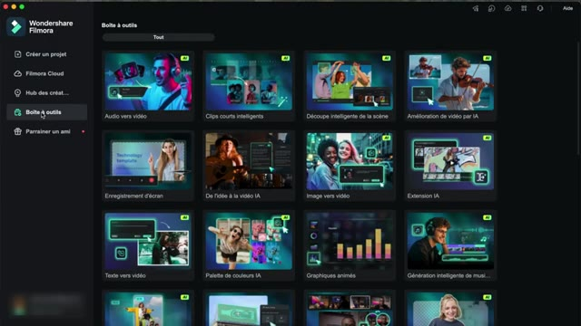  
  *⏱️ 00:02:03 — Vue de la "Boîte à outils" du logiciel Wondershare Filmora présentant de multiples fonctionnalités d'IA.*

---

### ⏱️ `[00:02:05 - 00:02:27]` | Segment #06

**🔊 Audio (Transcription Intégrale Mot pour Mot en Français) :**
> On verra ces outils, on peut les utiliser directement sur notre interface principale. Ici donc on va créer un nouveau projet en format 16 neuvième et la première étape ça va être d'importer nos rushs. Donc ici plutôt simple, on n'a qu'un seul rush pour notre introduction vidéo. Mais on pourrait pourquoi pas avoir des dossiers séparés avec l'ensemble des rushs, des sons et des musiques à utiliser.

**👁️ Analyse Visuelle d'Écran (gemini-3.5-flash-lite) :**
**Interface & Outils** : Interface de logiciel de montage vidéo (type Filmora / Wondershare).
**Contenu textuel & Code** : Fenêtre de sélection de fichiers système macOS superposée à l'application, montrant le fichier vidéo brut 'Introduction pas montée.mp4'.
**Action / Démonstration** : Le créateur montre la sélection et l'importation du rush vidéo initial pour débuter le montage.

**Captures d'écran :**
- 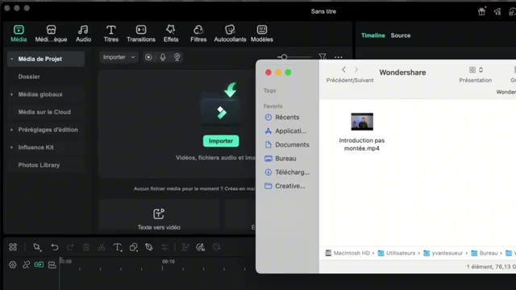  
  *⏱️ 00:02:16 — Interface du logiciel de montage avec la fenêtre d'importation de fichiers ouverte, affichant le fichier 'Introduction pas montée.mp4'.*
- 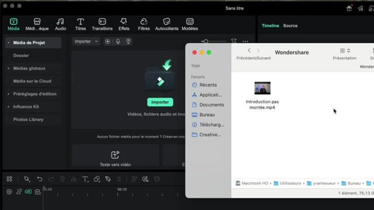  
  *⏱️ 00:02:25 — Vue similaire montrant le processus d'importation des rushs vidéo dans l'interface principale du logiciel.*

---

### ⏱️ `[00:02:27 - 00:03:00]` | Segment #07

**🔊 Audio (Transcription Intégrale Mot pour Mot en Français) :**
> Ici on va tout simplement sélectionner notre rush et le déposer pour pouvoir l'importer dans notre bibliothèque de médias qui se trouve en haut à gauche. ensuite pour pouvoir le mettre sur notre timeline qui se trouve juste ici et commencer à effectuer le montage de notre vidéo il suffira de sélectionner et de déposer sur notre timeline à savoir que par exemple si on a plusieurs rushs on pourra en allant ici dans le petit moins réduire notre timeline pour pouvoir avoir une vue d'ensemble supplémentaire et organiser ainsi les rushs les uns après les autres

**👁️ Analyse Visuelle d'Écran (gemini-3.5-flash-lite) :**
**Interface & Outils** : Logiciel de montage vidéo (type Wondershare Filmora).
**Contenu textuel & Code** : Bibliothèque de médias, panneau de prévisualisation, timeline avec pistes vidéo et audio.
**Action / Démonstration** : Importation d'un rush dans la bibliothèque de médias puis glisser-déposer sur la timeline.

**Captures d'écran :**
- 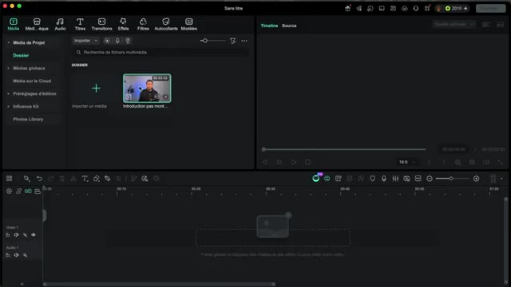  
  *⏱️ 00:02:44 — Interface du logiciel de montage avec la bibliothèque de médias en haut à gauche et la timeline vide en bas.*
- 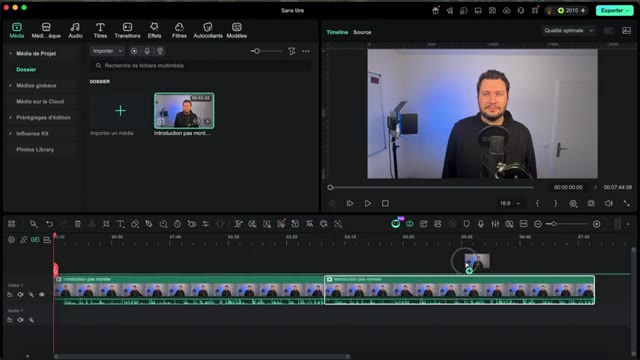  
  *⏱️ 00:02:59 — Le rush vidéo importé est maintenant placé et visible sur la timeline du logiciel de montage.*

---

### ⏱️ `[00:03:00 - 00:03:21]` | Segment #08

**🔊 Audio (Transcription Intégrale Mot pour Mot en Français) :**
> et bien sûr on pourra aussi si on souhaite superposer des rushs Sachant qu'on montage, la règle c'est que le rush qui se trouvera sur la ligne supérieure sera celui qui sera disponible à l'écran. Ici d'ailleurs, on a notre retour écran pour pouvoir vérifier l'ensemble des actions qu'on fait et que tout s'est bien passé avant de télécharger notre projet.

**👁️ Analyse Visuelle d'Écran (gemini-3.5-flash-lite) :**
**Interface & Outils** : Présentation orale ou séquence sans interface partagée.
**Contenu textuel & Code** : Explications et conseils de création de contenu / IA.
**Action / Démonstration** : Démonstration et mise en contexte pratique.

---

### ⏱️ `[00:03:21 - 00:03:43]` | Segment #09

**🔊 Audio (Transcription Intégrale Mot pour Mot en Français) :**
> En dessous, on a aussi les pistes audio. Donc là, ma piste audio est collée à celle de ma vidéo. Mais par exemple, si je vais sur clic droit et que je fais détacher l'audio, on verra ma piste audio séparée de ma piste vidéo. Mais là je vais les garder ensemble et on va commencer par la première étape du montage qui va être de supprimer tout ce qui va être blanc et répétition.

**👁️ Analyse Visuelle d'Écran (gemini-3.5-flash-lite) :**
**Interface & Outils** : Présentation orale ou séquence sans interface partagée.
**Contenu textuel & Code** : Explications et conseils de création de contenu / IA.
**Action / Démonstration** : Démonstration et mise en contexte pratique.

---

### ⏱️ `[00:03:43 - 00:04:02]` | Segment #10

**🔊 Audio (Transcription Intégrale Mot pour Mot en Français) :**
> Puisque là la vidéo introduction fait en brut 3 minutes 52 mais il y a des fautes et des répétitions. On va les retirer ensemble. Donc pour cela le moyen le plus classique c'est de se balader sur sa timeline et entre deux espaces faire deux coupes. C'est à dire en sélectionnant par exemple ici la fin de ma première phrase.

**👁️ Analyse Visuelle d'Écran (gemini-3.5-flash-lite) :**
**Interface & Outils** : Présentation orale ou séquence sans interface partagée.
**Contenu textuel & Code** : Explications et conseils de création de contenu / IA.
**Action / Démonstration** : Démonstration et mise en contexte pratique.

---

### ⏱️ `[00:04:02 - 00:04:37]` | Segment #11

**🔊 Audio (Transcription Intégrale Mot pour Mot en Français) :**
> je vais aller dans le petit ciseau ici qui va me permettre de fractionner sur cette timeline et d'aller chercher juste avant le début de ma seconde phrase l'option fractionner que je peux activer avec le raccourci commande B il peut être différent si vous êtes sur PC vous aurez l'indication des raccourcis qui se fait à chaque outil pour pouvoir supprimer ainsi c'est le B à bas du montage mais ça peut être un peu fastidieux c'est pour ça que j'ai la possibilité en sélectionnant ma séquence de faire un clic droit pour aller chercher dans outils d'édition d'intelligence

**👁️ Analyse Visuelle d'Écran (gemini-3.5-flash-lite) :**
**Interface & Outils** : Logiciel de montage vidéo (type Wondershare Filmora).
**Contenu textuel & Code** : Menus d'édition, timeline vidéo/audio, icônes d'outils, infobulle de raccourci clavier 'Fractionner'.
**Action / Démonstration** : Le créateur survole et sélectionne l'outil de fractionnement pour couper un clip sur la timeline, puis explore les menus contextuels.

**Captures d'écran :**
- 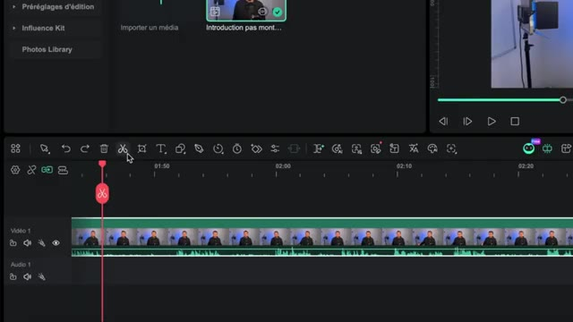  
  *⏱️ 00:04:03 — Vue générale de la timeline d'un logiciel de montage vidéo avec le curseur rouge et l'outil ciseaux survolé.*
- 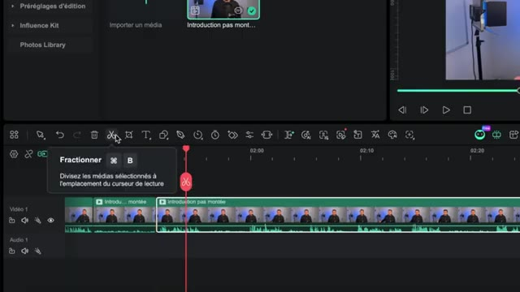  
  *⏱️ 00:04:19 — Affichage de l'infobulle de l'outil 'Fractionner' avec le raccourci clavier associé (Commande + B) sur la timeline.*
- 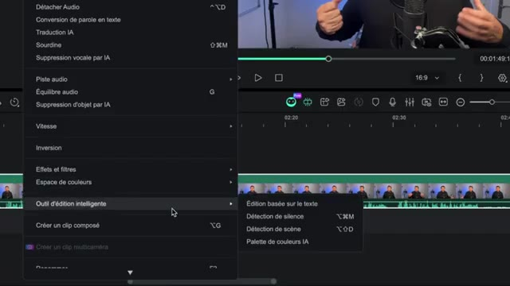  
  *⏱️ 00:04:35 — Ouverture d'un menu contextuel affichant les options d'édition avancées et l'outil d'édition intelligente.*

---

### ⏱️ `[00:04:37 - 00:05:14]` | Segment #12

**🔊 Audio (Transcription Intégrale Mot pour Mot en Français) :**
> le raccourci détection des silences. Je peux même l'afficher dans mes petits raccourcis qui est juste ici en allant ici dans le petit bouton personnaliser et en ajoutant la détection de silence où je souhaite dans ma barre d'outils. Ainsi je pourrais sélectionner cette détection des silences, définir le seuil de volume, la durée minimum et la zone de buffer pour ainsi analyser et avoir une découpe précise des moments de silence pour pouvoir terminer et d'avoir ainsi ma séquence qui a été coupée automatique entre deux silences.

**👁️ Analyse Visuelle d'Écran (gemini-3.5-flash-lite) :**
**Interface & Outils** : Logiciel de montage vidéo (Wondershare Filmora).
**Contenu textuel & Code** : Menus de détection de silences, curseurs de réglages (seuil du volume, durée minimum, zone buffer) et timeline audio/vidéo.
**Action / Démonstration** : Le créateur montre comment configurer et utiliser l'outil de détection des silences dans son logiciel de montage.

**Captures d'écran :**
- 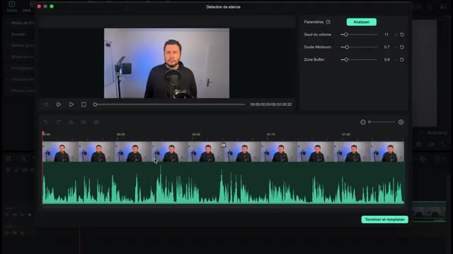  
  *⏱️ 00:04:55 — Interface de l'outil de détection de silences avec réglages de seuil, durée minimum et zone buffer.*
- 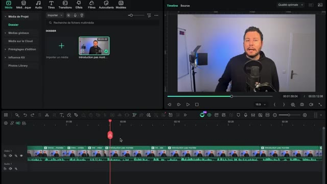  
  *⏱️ 00:05:12 — Interface principale du logiciel de montage avec la timeline et la barre d'outils de personnalisation.*

---

### ⏱️ `[00:05:14 - 00:05:33]` | Segment #13

**🔊 Audio (Transcription Intégrale Mot pour Mot en Français) :**
> Autre option encore plus précise je trouve, on va faire retour en arrière. C'est cette fois-ci toujours en sélectionnant notre séquence et en allant dans clic droit aller chercher l'outil d'édition basé sur le texte. Ici, en fait, la voix est détectée et tout le texte va être retranscrit pour pouvoir ainsi décider de ce qu'on coupe.

**👁️ Analyse Visuelle d'Écran (gemini-3.5-flash-lite) :**
**Interface & Outils** : DaVinci Resolve
**Contenu textuel & Code** : Fenêtre d'édition basée sur le texte avec transcription de la voix, lecteur vidéo à gauche et timeline en bas.
**Action / Démonstration** : Le créateur montre comment utiliser l'édition basée sur le texte pour sélectionner et couper des séquences vidéo.

**Captures d'écran :**
- 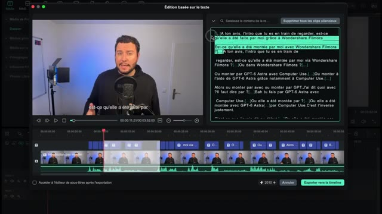  
  *⏱️ 00:05:31 — Interface du logiciel de montage DaVinci Resolve montrant l'outil d'édition basé sur le texte avec transcription automatique de la voix.*

---

### ⏱️ `[00:05:33 - 00:05:54]` | Segment #14

**🔊 Audio (Transcription Intégrale Mot pour Mot en Français) :**
> Par exemple, ici, la première répétition, l'erreur qui est juste ici. Et une fois donc que notre texte est bon, on peut aussi supprimer tous les clips silencieux pour avoir un montage encore plus précis et l'exporter sur notre timeline pour ainsi avoir celui qui est prêt. Même avec les sous-titres qui sont déjà appliqués, si tu veux, tu peux les supprimer pour avoir seulement ton montage prêt à l'emploi.

**👁️ Analyse Visuelle d'Écran (gemini-3.5-flash-lite) :**
**Interface & Outils** : Logiciel de montage vidéo (Wondershare Filmora).
**Contenu textuel & Code** : Menus Média, Titres, Transitions, Effets, Filtres, dossiers de médias et timeline avec pistes vidéo et audio.
**Action / Démonstration** : Le créateur montre l'interface du logiciel de montage après avoir exporté le projet avec les sous-titres et les coupes.

**Captures d'écran :**
- 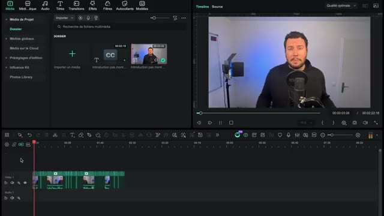  
  *⏱️ 00:05:53 — Interface du logiciel de montage vidéo montrant les médias importés, le lecteur vidéo avec le créateur, et la timeline en bas.*

---

### ⏱️ `[00:05:54 - 00:06:14]` | Segment #15

**🔊 Audio (Transcription Intégrale Mot pour Mot en Français) :**
> Donc ça, ça sera pour tout ce qui va être édition de base. Et si on refait l'exercice en chronomètre, en montage manuel, ça nous prendra entre 10 et 12 minutes. En détection des silences, ça nous prendra entre 5 et 10 minutes, puisqu'il faudra quand même supprimer les répétitions. Et avec l'édition par le texte, ici, ça nous prendra 5 minutes.

**👁️ Analyse Visuelle d'Écran (gemini-3.5-flash-lite) :**
**Interface & Outils** : Présentation orale ou séquence sans interface partagée.
**Contenu textuel & Code** : Explications et conseils de création de contenu / IA.
**Action / Démonstration** : Démonstration et mise en contexte pratique.

---

### ⏱️ `[00:06:14 - 00:06:38]` | Segment #16

**🔊 Audio (Transcription Intégrale Mot pour Mot en Français) :**
> Mais ça, c'est vraiment le basique et j'aimerais aller un petit peu plus loin pour faire en sorte que cette introduction, elle soit un petit peu plus habillée. Et ce que je vais faire dans un premier temps, c'est que je vais sélectionner l'ensemble de mes plans, faire un clic droit et je vais créer un clip composé. Cette méthode me permettra maintenant d'avoir un seul bloc que je vais pouvoir retravailler de façon très simple et déjà où il n'y a plus les blancs, les silences et les répétitions.

**👁️ Analyse Visuelle d'Écran (gemini-3.5-flash-lite) :**
**Interface & Outils** : Filmora (ou logiciel de montage équivalent)
**Contenu textuel & Code** : Boîte de dialogue "Créer un clip composé" avec le champ "Clip composé 1", ratio d'aspect 16:9, résolution 1920x1080 (Full HD), et boutons OK / Annuler.
**Action / Démonstration** : Le créateur nomme et valide la création d'un clip composé pour regrouper plusieurs plans de la timeline.

**Captures d'écran :**
- 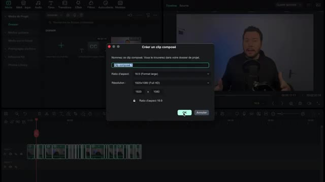  
  *⏱️ 00:06:37 — Fenêtre de dialogue pour nommer et configurer un clip composé dans le logiciel de montage vidéo.*

---

### ⏱️ `[00:06:39 - 00:06:59]` | Segment #17

**🔊 Audio (Transcription Intégrale Mot pour Mot en Français) :**
> Donc j'ai maintenant mon clip composé et pour améliorer ma vidéo, la première chose que je vais faire, c'est que je vais changer le décor qui est un petit peu triste ici. Et pour cela, pas besoin de sortir de Wondershare Filmora. Je peux, en allant dans Mediatek, sélectionner dans Media IA l'option Image IA.

**👁️ Analyse Visuelle d'Écran (gemini-3.5-flash-lite) :**
**Interface & Outils** : Logiciel de montage vidéo Wondershare Filmora.
**Contenu textuel & Code** : Menus de l'application, timeline principale, fenêtre d'aperçu vidéo, options de Média IA (Inspiration vidéo, Image vers vidéo, Texte vers vidéo, Image IA).
**Action / Démonstration** : Le créateur montre son projet de montage et navigue dans les options de l'intelligence artificielle pour modifier le décor.

**Captures d'écran :**
- 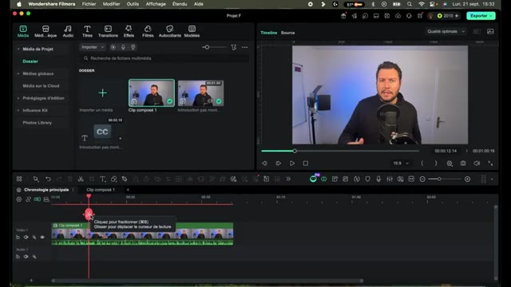  
  *⏱️ 00:06:40 — Interface du logiciel Wondershare Filmora montrant le projet en cours avec le clip composé sur la timeline et l'aperçu vidéo.*
- 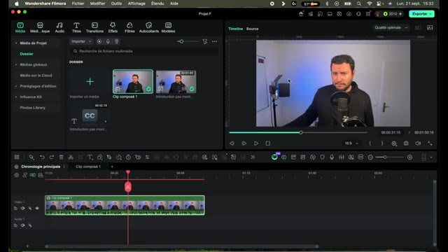  
  *⏱️ 00:06:49 — Poursuite de la lecture du clip composé sur la timeline de Wondershare Filmora.*
- 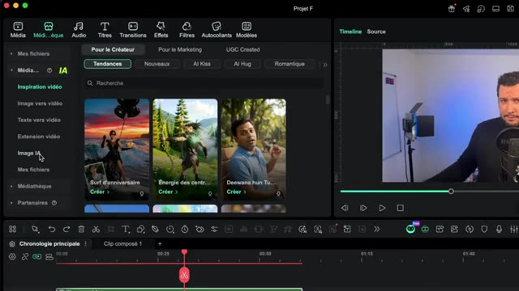  
  *⏱️ 00:06:57 — Navigation dans les menus de Wondershare Filmora vers l'onglet Média IA pour sélectionner l'option Image IA.*

---

### ⏱️ `[00:06:59 - 00:07:20]` | Segment #18

**🔊 Audio (Transcription Intégrale Mot pour Mot en Français) :**
> Pour pouvoir, ici, en utilisant le modèle que je souhaite, donc moi, par exemple ici, je vais prendre Nano Banana Pro. Pourquoi pas, ici, je vais mettre le logo du Labo des Réseaux. Et j'ai travaillé ici un prompt complet. Je vais sélectionner la qualité, le format et générer avec l'IA. J'en ai d'ailleurs généré un petit peu plus pour avoir plus de choix.

**👁️ Analyse Visuelle d'Écran (gemini-3.5-flash-lite) :**
**Interface & Outils** : Logiciel de montage vidéo (type Wondershare Filmora) avec module IA intégré.
**Contenu textuel & Code** : Modèle IA 'Nano Banana Pro', prompt en anglais pour générer un arrière-plan de studio YouTube avec un mur en bois et des plantes, et un aperçu vidéo avec la mention 'Generated by AI'.
**Action / Démonstration** : Le créateur présente l'utilisation du générateur d'image par IA intégré au logiciel de montage pour créer des visuels ou décors personnalisés.

**Captures d'écran :**
- 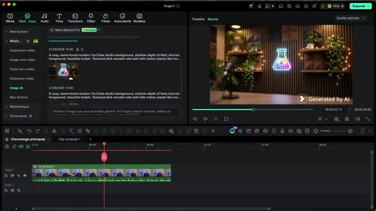  
  *⏱️ 00:07:18 — Interface du logiciel de montage montrant le panneau de génération d'image par IA 'Image IA' avec le modèle Nano Banana Pro et le résultat de l'image générée dans le lecteur.*

---

### ⏱️ `[00:07:21 - 00:07:40]` | Segment #19

**🔊 Audio (Transcription Intégrale Mot pour Mot en Français) :**
> Et je pense que je vais sélectionner celle-ci. En la faisant glisser sur ma timeline, en la faisant correspondre à mon image, je vais me mettre par-dessus. Et sur ma vidéo, je vais sélectionner une option qu'on trouvera ici dans nos raccourcis pour pouvoir faire un découpage portrait de l'IA.

**👁️ Analyse Visuelle d'Écran (gemini-3.5-flash-lite) :**
**Interface & Outils** : Logiciel de montage vidéo (type Wondershare Filmora).
**Contenu textuel & Code** : Menus d'édition, timeline chronologique, options rapides incluant "Fond vert" et "Découpe de portrait par IA".
**Action / Démonstration** : Le créateur positionne un clip sur sa timeline et sélectionne l'outil de découpe de portrait par intelligence artificielle pour détourer son sujet.

**Captures d'écran :**
- 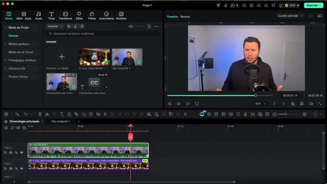  
  *⏱️ 00:07:30 — Interface complète du logiciel de montage vidéo montrant la timeline avec les clips superposés.*
- 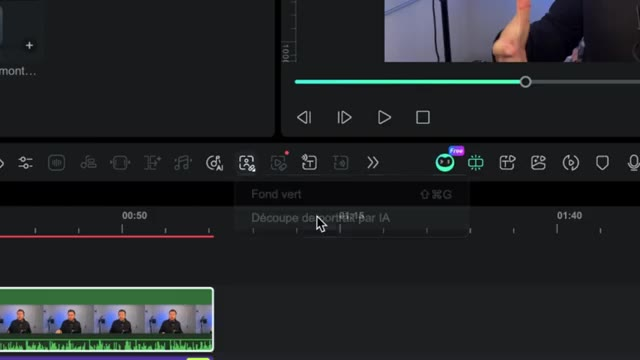  
  *⏱️ 00:07:38 — Gros plan sur la barre d'outils de la timeline affichant le menu contextuel avec l'option "Découpe de portrait par IA".*

---

### ⏱️ `[00:07:41 - 00:08:14]` | Segment #20

**🔊 Audio (Transcription Intégrale Mot pour Mot en Français) :**
> Et ainsi, ici, avoir notre arrière-plan qui s'affiche. alors ici je trouve que ça fonctionne pas trop donc je vais refaire une génération avec l'IA et faire en sorte de mettre le logo sur un côté voilà là on a quelque chose de vraiment sympa donc on voit je suis parfaitement découpé dans ce nouveau décor et cet arrière-plan maintenant je vais le sélectionner et je vais aller dans effet je vais rechercher flou derrière plan et je vais sélectionner là par exemple un flou de profondeur que je vais ajouter à mon arrière-plan je pourrais même en allant ici dans la petite icône régler l'intensité

**👁️ Analyse Visuelle d'Écran (gemini-3.5-flash-lite) :**
**Interface & Outils** : Interface du logiciel de montage vidéo Wondershare Filmora sur macOS.
**Contenu textuel & Code** : Menus de "Mise en forme IA", options de "Découpe de portrait par IA", timeline avec pistes vidéo, et panneau d'effets (flou de profondeur).
**Action / Démonstration** : Le créateur ajuste le détourage du sujet, intègre un arrière-plan généré par IA et applique un effet de profondeur de champ.

**Captures d'écran :**
- 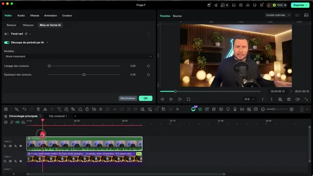  
  *⏱️ 00:07:42 — Le créateur montre les réglages de découpe de portrait par IA et le positionnement de l'arrière-plan sur la timeline.*
- 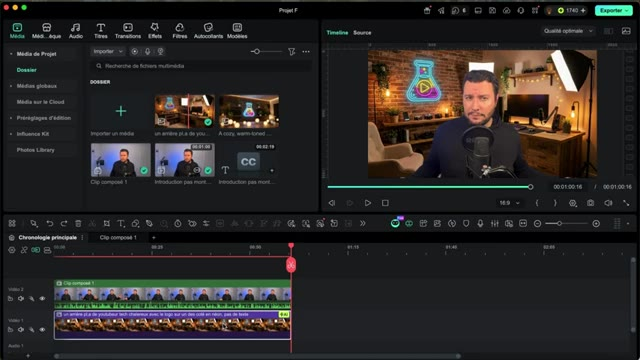  
  *⏱️ 00:07:57 — Le panneau multimédia affiche le nouveau décor généré par IA intégré à la timeline du projet.*
- 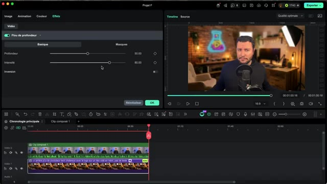  
  *⏱️ 00:08:12 — Le panneau des effets montre l'outil de flou de profondeur appliqué pour détacher le sujet de son arrière-plan.*

---

### ⏱️ `[00:08:14 - 00:08:36]` | Segment #21

**🔊 Audio (Transcription Intégrale Mot pour Mot en Français) :**
> pour réduire la profondeur mais aussi réduire l'intensité pour avoir ce petit effet là et donner de la crédibilité. Ce que je peux faire maintenant aussi c'est travailler la lumière avec un nouvel outil IA, super. Donc pour le trouver facilement je te conseille ici d'aller dans affichage et de passer en mode d'affichage par défaut.

**👁️ Analyse Visuelle d'Écran (gemini-3.5-flash-lite) :**
**Interface & Outils** : Logiciel de montage vidéo (Wondershare Filmora)
**Contenu textuel & Code** : Menu déroulant Affichage, option Mode d'affichage, sous-menu avec les choix Défaut, Organiser, Timeline, Courte vidéo, Classique.
**Action / Démonstration** : Le créateur montre comment changer le mode d'affichage de l'interface pour retrouver la disposition par défaut.

**Captures d'écran :**
- 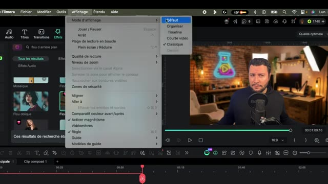  
  *⏱️ 00:08:34 — Capture d'écran montrant le menu 'Affichage' et l'option 'Mode d'affichage > Défaut' dans le logiciel de montage vidéo.*

---

### ⏱️ `[00:08:36 - 00:09:00]` | Segment #22

**🔊 Audio (Transcription Intégrale Mot pour Mot en Français) :**
> Je vais aller ici dans vidéo et dans basique je vais descendre jusqu'à arriver à l'option amélioration automatique automatique que je vais cocher et ainsi les lumières et les couleurs ont été ajustées pour pouvoir faire ressortir le personnage principal. D'ailleurs si je souhaitais moi-même les régler je pourrais aller ici dans couleurs et changer ainsi la température, la teinte, la vibrance ou la saturation comme je le souhaite.

**👁️ Analyse Visuelle d'Écran (gemini-3.5-flash-lite) :**
**Interface & Outils** : Logiciel de montage vidéo (type CapCut desktop)
**Contenu textuel & Code** : Menus Vidéo, Basique, Amélioration automatique, Couleur, curseurs de saturation et de lumière
**Action / Démonstration** : Navigation dans les menus de réglage vidéo et activation de l'amélioration automatique, puis passage aux réglages de couleur manuels.

**Captures d'écran :**
- 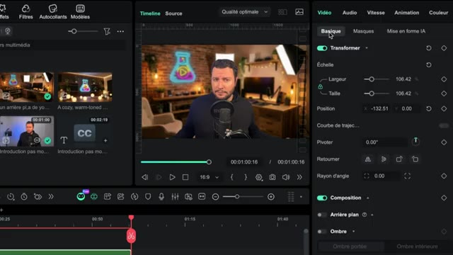  
  *⏱️ 00:08:37 — Interface du logiciel de montage montrant le panneau 'Vidéo' et l'onglet 'Basique' avec les options de transformation et composition.*
- 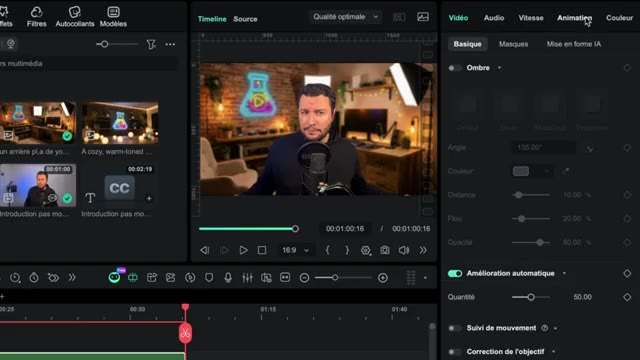  
  *⏱️ 00:08:48 — Panneau des réglages vidéo défilé vers le bas affichant l'option 'Amélioration automatique' activée.*
- 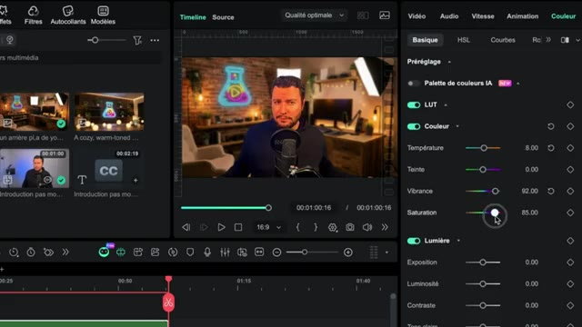  
  *⏱️ 00:08:59 — Onglet 'Couleur' du logiciel de montage affichant les réglages de température, vibrance, saturation et lumière.*

---

### ⏱️ `[00:09:01 - 00:09:24]` | Segment #23

**🔊 Audio (Transcription Intégrale Mot pour Mot en Français) :**
> Ici on va laisser l'IA faire son travail. Donc on est plutôt pas mal, ce qui manque maintenant c'est ajouter des plans de coupe ou des plans d'illustration selon nos propos. Donc ici dans un premier temps j'ai déterminé les coupes et je vais ici ajouter mes plans d'illustration que je vais générer encore une fois grâce à la fonctionnalité Mediatek et les médias IA dans Filmora.

**👁️ Analyse Visuelle d'Écran (gemini-3.5-flash-lite) :**
**Interface & Outils** : Logiciel de montage vidéo (type Wondershare Filmora ou similaire) avec panneau Mediatek / IA et timeline.
**Contenu textuel & Code** : Timeline de montage avec clips vidéo et pistes audio, panneau de prévisualisation, et section de génération d'images IA avec prompts.
**Action / Démonstration** : Le créateur montre comment il organise ses plans de coupe et génère des illustrations visuelles à l'aide des fonctionnalités d'IA du logiciel.

**Captures d'écran :**
- 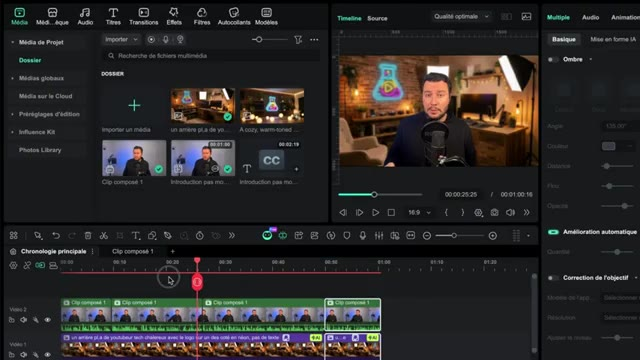  
  *⏱️ 00:09:12 — Vue d'ensemble du logiciel de montage montrant la timeline principale et les médias de projet.*
- 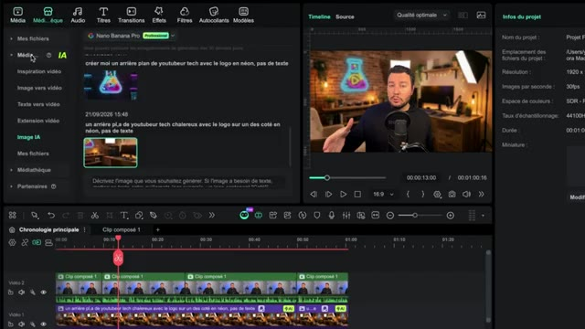  
  *⏱️ 00:09:22 — Interface du logiciel affichant le panneau Mediatek et les options de génération d'images par IA.*

---

### ⏱️ `[00:09:24 - 00:09:49]` | Segment #24

**🔊 Audio (Transcription Intégrale Mot pour Mot en Français) :**
> Donc j'ai la possibilité d'utiliser des templates, de faire de l'image tout vidéo si j'ai déjà des images de base, de faire du texte tout vidéo. C'est ici ce que je vais faire en marquant une fois le prompt qui va illustrer ma séquence vidéo et en sélectionnant parmi les modèles disponibles. Donc Donc on a le modèle Happy Horse, le modèle Filmora, le modèle Seed Dance 2.0 ou Top Movie 2.5 ou encore VIO 3.1.

**👁️ Analyse Visuelle d'Écran (gemini-3.5-flash-lite) :**
**Interface & Outils** : Présentation orale ou séquence sans interface partagée.
**Contenu textuel & Code** : Explications et conseils de création de contenu / IA.
**Action / Démonstration** : Démonstration et mise en contexte pratique.

---

### ⏱️ `[00:09:50 - 00:10:23]` | Segment #25

**🔊 Audio (Transcription Intégrale Mot pour Mot en Français) :**
> Ici on va prendre le modèle Seed Dance 2.0 et on va marquer notre prompt. Ici j'ai rédigé mon prompt complet, je vais pouvoir générer ma vidéo. Ma vidéo est prête, je vais pouvoir ici la glisser sur ma timeline et me remplacer. Et maintenant ce que je peux faire pour ajouter un peu de rythme, c'est pourquoi pas en ajoutant par exemple des effets zoom, des filtres supplémentaires on a aussi toute une bibliothèque de transitions à disposition on a des transitions IA mais aussi toutes les transitions classiques et à la fin ce que j'aime bien faire surtout quand on travaille sur les formats verticaux

**👁️ Analyse Visuelle d'Écran (gemini-3.5-flash-lite) :**
**Interface & Outils** : Logiciel de montage vidéo (type Wondershare Filmora)
**Contenu textuel & Code** : Menus Média, Audio, Titres, Transitions, Effets, chronologie principale et prévisualisation vidéo.
**Action / Démonstration** : Le créateur montre comment importer un clip généré par IA dans sa bibliothèque de médias et l'ajouter à la timeline de montage.

**Captures d'écran :**
- 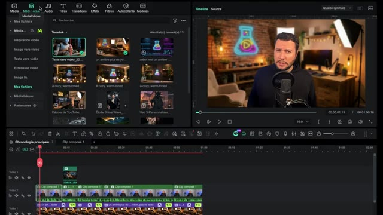  
  *⏱️ 00:10:06 — Interface du logiciel de montage avec la bibliothèque de médias affichée et la chronologie principale en bas.*
- 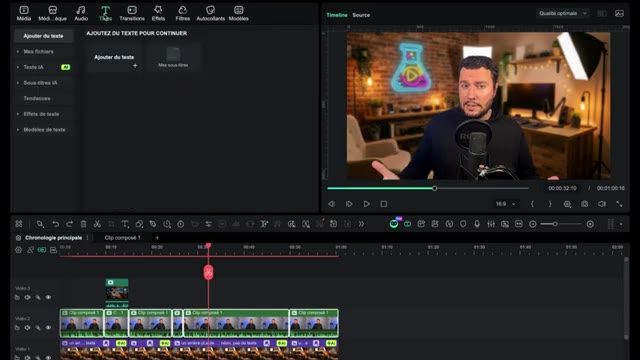  
  *⏱️ 00:10:22 — Interface du logiciel de montage avec le menu 'Titres' sélectionné dans le panneau supérieur.*

---

### ⏱️ `[00:10:23 - 00:10:43]` | Segment #26

**🔊 Audio (Transcription Intégrale Mot pour Mot en Français) :**
> c'est d'aller dans l'option titre pour sélectionner les sous-titres créés avec l'IA et générer automatiquement les sous-titres sur sa timeline à partir de la voix pour les avoir qui s'affiche sur ton écran et ce que je vais faire c'est que je vais continuer à ajouter du rythme en mettant les logos de ChatGPT et de Filmora quand je parle d'eux.

**👁️ Analyse Visuelle d'Écran (gemini-3.5-flash-lite) :**
**Interface & Outils** : Filmora (logiciel de montage vidéo)
**Contenu textuel & Code** : Timeline de montage avec des clips, médias importés incluant les logos de ChatGPT et Filmora, panneau de configuration vidéo à droite.
**Action / Démonstration** : Le créateur montre son écran de montage pour illustrer l'ajout de logos et d'éléments dynamiques sur la timeline.

**Captures d'écran :**
- 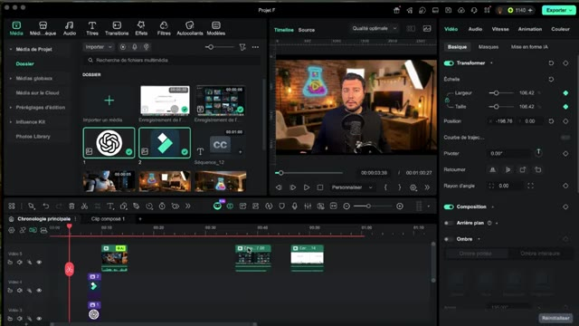  
  *⏱️ 00:10:41 — Interface complète du logiciel de montage Filmora avec la médiathèque, la fenêtre de prévisualisation et la timeline principale en cours d'utilisation.*

---

### ⏱️ `[00:10:43 - 00:11:01]` | Segment #27

**🔊 Audio (Transcription Intégrale Mot pour Mot en Français) :**
> Je vais aussi me servir des keyframes pour pouvoir faire des accélérations sur les zooms à certains moments de la vidéo. Et ensuite, et avant d'exporter, je choisirai une musique libre de droit pour pouvoir l'ajouter. Ainsi, j'ai mon introduction prête. A voir maintenant si c'est celle-ci que je vais utiliser.

**👁️ Analyse Visuelle d'Écran (gemini-3.5-flash-lite) :**
**Interface & Outils** : Présentation orale ou séquence sans interface partagée.
**Contenu textuel & Code** : Explications et conseils de création de contenu / IA.
**Action / Démonstration** : Démonstration et mise en contexte pratique.

---

### ⏱️ `[00:11:01 - 00:11:32]` | Segment #28

**🔊 Audio (Transcription Intégrale Mot pour Mot en Français) :**
> On va passer au test avec ChatGPT Astra et on commence par lancer le chrono. Depuis l'application ChatGPT dans Codex, je sélectionne le modèle Astra. Je l'utilise en mode léger parce que j'ai peur d'atteindre vite les limites de mon abonnement. Et je lui demande sur mon bureau, dans le dossier Wondershare, trouve le fichier vidéo introduction pas monté, ouvre le logiciel de montage Filmora et édite la vidéo, fais en sorte de supprimer les blancs et les répétitions et de rendre l'ensemble dynamique.

**👁️ Analyse Visuelle d'Écran (gemini-3.5-flash-lite) :**
**Interface & Outils** : Application Codex, interface de ChatGPT Astra
**Contenu textuel & Code** : Prompt : "Sur mon bureau, dans le dossier Wondershare, trouve le fichier vidéo 'Introduction pas montée', ouvre le logiciel de montage Filmora et édite la vidéo..." ; modèle sélectionné : "GPT-6 Astra Léger"
**Action / Démonstration** : Le créateur envoie le prompt à l'agent IA ChatGPT Astra pour tester ses capacités d'automatisation des tâches sur ordinateur.

**Captures d'écran :**
- 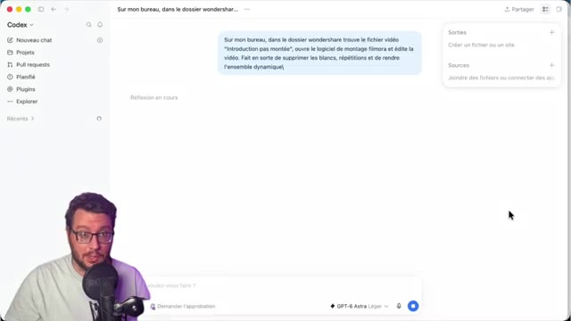  
  *⏱️ 00:11:17 — Interface de l'application Codex avec le prompt envoyé à ChatGPT Astra pour automatiser le montage vidéo.*
- 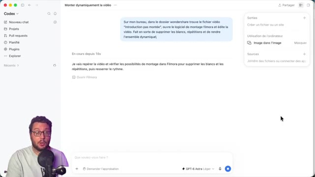  
  *⏱️ 00:11:31 — Réponse en cours de ChatGPT Astra dans Codex, expliquant les étapes pour repérer la vidéo et l'éditer dans Filmora.*

---

### ⏱️ `[00:11:32 - 00:11:51]` | Segment #29

**🔊 Audio (Transcription Intégrale Mot pour Mot en Français) :**
> Je précise qu'en amont, j'ai créé un dossier sur le bureau de mon ordinateur avec le rush non monté à l'intérieur. Donc voilà, Astra est parti. Plusieurs choses à noter pendant ce test. D'abord, j'ai dû régulièrement autoriser Astra à effectuer des actions. Sauvegarde, exportation, surtout en début de projet, difficile de s'éloigner de son PC.

**👁️ Analyse Visuelle d'Écran (gemini-3.5-flash-lite) :**
**Interface & Outils** : Finder (macOS)
**Contenu textuel & Code** : Un dossier 'Wondershare' contenant un fichier vidéo 'montée.mp4' et un fichier 'Introduction.pas'.
**Action / Démonstration** : Le créateur montre le dossier contenant le rush non monté préparé sur son bureau avant de lancer le test.

**Captures d'écran :**
- 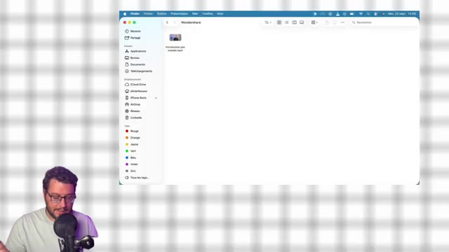  
  *⏱️ 00:11:33 — Fenêtre du Finder sous macOS affichant un dossier nommé 'Wondershare' contenant un fichier vidéo non monté (rush).*

---

### ⏱️ `[00:11:51 - 00:12:13]` | Segment #30

**🔊 Audio (Transcription Intégrale Mot pour Mot en Français) :**
> Ensuite, le plus gros souci, c'est mon abonnement ChatGPT+, qui limite mon utilisation d'Astra. Tu peux le voir d'ailleurs à plusieurs reprises. J'ai dû attendre que mes crédits d'utilisation se réinitialisent. Bien sûr, il est possible d'acheter des crédits supplémentaires, mais quand on paie déjà un abonnement de chat GPT+, c'est un peu embêtant. J'ai quand même réussi en plusieurs sessions à faire en sorte qu'Astra boucle la première partie du projet.

**👁️ Analyse Visuelle d'Écran (gemini-3.5-flash-lite) :**
**Interface & Outils** : Codex (interface agentique), Wondershare Filmora.
**Contenu textuel & Code** : Prompts de pilotage automatique, messages d'erreur de quota d'utilisation, transcriptions textuelles de la vidéo.
**Action / Démonstration** : Le créateur montre l'automatisation du montage par l'IA et illustre la limite de quota atteinte sur son abonnement.

**Captures d'écran :**
- 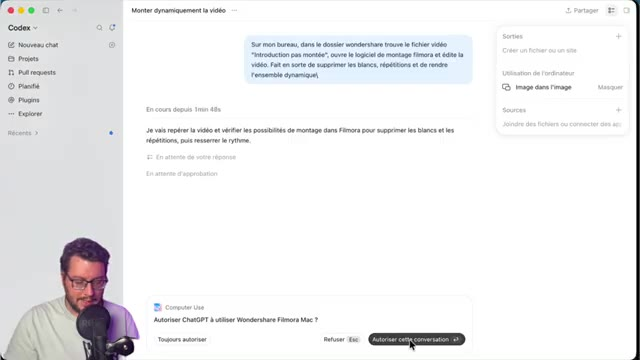  
  *⏱️ 00:11:52 — Interface de l'assistant IA montrant une invite de commande pour automatiser le montage vidéo dans Filmora.*
- 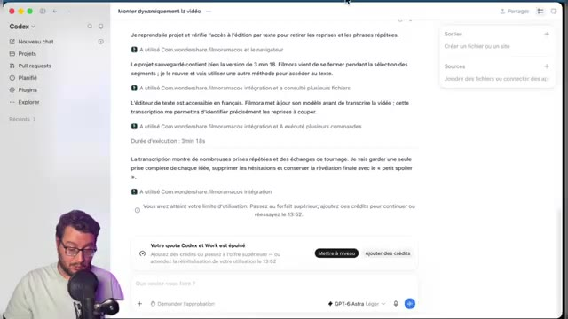  
  *⏱️ 00:12:02 — Capture de l'interface affichant un message de quota épuisé pour l'utilisation de l'assistant Astra.*
- 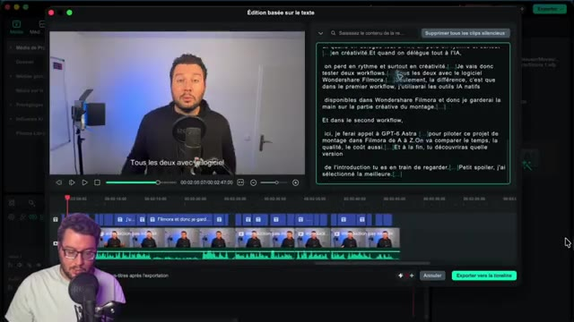  
  *⏱️ 00:12:12 — Interface du logiciel de montage vidéo Wondershare Filmora avec la fonctionnalité d'édition basée sur le texte.*

---

### ⏱️ `[00:12:13 - 00:12:34]` | Segment #31

**🔊 Audio (Transcription Intégrale Mot pour Mot en Français) :**
> J'ai abandonné la partie dynamique et je me suis arrêté à la première mission. Supprimer les blancs et les répétitions. Ça a pris donc 24 minutes en 5 sessions différentes. Et voilà le résultat. A ton avis, l'intro que tu es en train de regarder, est-ce qu'elle a été montée par moi via Wondershare Filmora ? Montée par GPT-6 Astra avec Computer Use.

**👁️ Analyse Visuelle d'Écran (gemini-3.5-flash-lite) :**
**Interface & Outils** : Logiciel de montage vidéo (Wondershare Filmora / Édition basée sur le texte)
**Contenu textuel & Code** : Timeline de montage, transcription textuelle, lecteur vidéo intégré et options d'exportation.
**Action / Démonstration** : Le créateur explique son processus de montage et compare différentes méthodes de réalisation.

**Captures d'écran :**
- 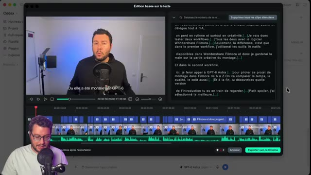  
  *⏱️ 00:12:14 — Capture d'écran montrant l'interface de montage vidéo avec une fenêtre d'édition basée sur le texte et une timeline.*

---

### ⏱️ `[00:12:34 - 00:12:59]` | Segment #32

**🔊 Audio (Transcription Intégrale Mot pour Mot en Français) :**
> générer un script préparer ses médias générer ses sous titres avec l'IA ça n'a rien de compliqué mais il est ailleurs il a réussi seul à utiliser plusieurs fonctionnalités de film aura pour éditer la vidéo et ça c'est déjà un vrai résultat mais on est loin du montage abouti pour être tout à fait honnête je pense que j'aurais obtenu un meilleur résultat en critiquant son travail et en lui demandant des corrections.

**👁️ Analyse Visuelle d'Écran (gemini-3.5-flash-lite) :**
**Interface & Outils** : AUCUNE
**Contenu textuel & Code** : AUCUNE
**Action / Démonstration** : Le créateur parle face caméra pour commenter le travail réalisé.

---

### ⏱️ `[00:13:00 - 00:13:20]` | Segment #33

**🔊 Audio (Transcription Intégrale Mot pour Mot en Français) :**
> Mon prompt manquait peut-être aussi d'orientation et j'ai travaillé sur la version légère du modèle. Il faudrait donc refaire le test peut-être en mode moyen au maximum. Seulement, ça coûtera beaucoup plus de crédit. Et je n'ai pas envie forcément de dépenser 200 euros pour montrer l'introduction d'une minute de ma vidéo. Et donc, c'est là ma principale critique.

**👁️ Analyse Visuelle d'Écran (gemini-3.5-flash-lite) :**
**Interface & Outils** : Studio virtuel / Wondershare Filmora (graphismes d'illustration)
**Contenu textuel & Code** : Textes : "IMPRESSIONNANT, MAIS INACHEVÉ" et "200 € POUR UNE INTRO ? Mode maximum. Crédits maximum. Coût maximum."
**Action / Démonstration** : Le créateur commente les limites financières et techniques des modèles d'IA pour la réalisation d'une introduction.

**Captures d'écran :**
- 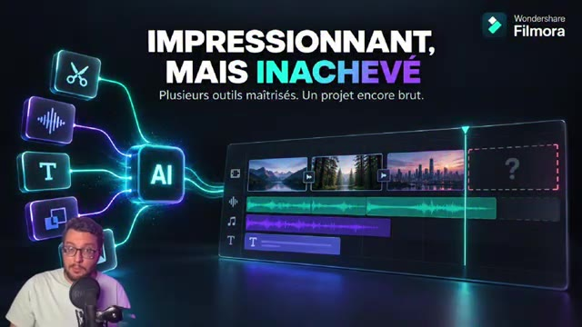  
  *⏱️ 00:13:01 — Vue d'ensemble du présentateur avec une infographie illustrant un projet de montage vidéo assisté par IA.*
- 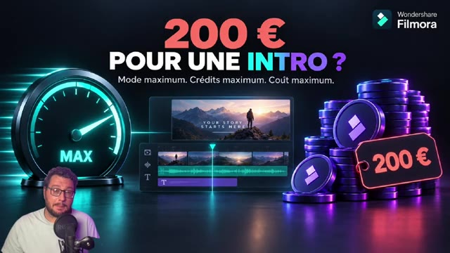  
  *⏱️ 00:13:18 — Illustration représentant le coût élevé (200 €) lié aux réglages maximaux d'un modèle d'IA pour une introduction vidéo.*

---

### ⏱️ `[00:13:20 - 00:13:40]` | Segment #34

**🔊 Audio (Transcription Intégrale Mot pour Mot en Français) :**
> Le montage IA, via un agent, peut paraître une solution pour gagner du temps. Mais à quel prix ? En optimisant les consignes et les travails en amont, on peut sans doute trouver un bon compromis pour rester rentable. Par exemple, demander à l'IA de travailler sur un format précis. Par contre, en la laissant en roue libre comme je l'ai fait, je doute qu'on obtienne pour l'instant un bon résultat.

**👁️ Analyse Visuelle d'Écran (gemini-3.5-flash-lite) :**
**Interface & Outils** : Logiciel de montage vidéo Wondershare Filmora.
**Contenu textuel & Code** : Textes explicatifs, illustrations de flux de travail IA, timeline de montage et icônes d'avertissement.
**Action / Démonstration** : Le créateur présente les avantages de cadrer l'IA par rapport au risque de la laisser en roue libre.

**Captures d'écran :**
- 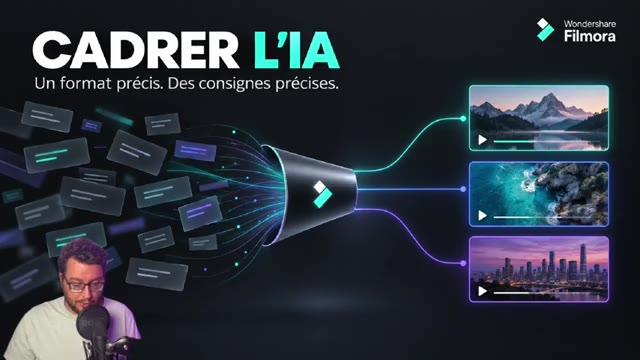  
  *⏱️ 00:13:30 — Illustration graphique titrée 'CADRER L'IA' montrant comment des consignes précises permettent d'obtenir des formats ciblés.*
-   
  *⏱️ 00:13:39 — Illustration graphique titrée 'EN ROUE LIBRE ?' montrant une timeline de montage désorganisée avec des symboles d'alerte.*

---

### ⏱️ `[00:13:40 - 00:14:04]` | Segment #35

**🔊 Audio (Transcription Intégrale Mot pour Mot en Français) :**
> Et côté créativité, quand j'ai travaillé moi-même sur mes rushs, je ne sais pas si tu te rappelles, comme par exemple avec l'image derrière plan IA, j'ai changé 3 ou 4 fois de direction avant de savoir ce que je voulais vraiment. car je trouve que c'est en s'impliquant dans son projet qu'on obtient finalement la vision finale de celui-ci. Je doute que j'aurais réussi à formuler cette vision dans un prompt sans avoir d'abord travaillé mes rushs moi-même.

**👁️ Analyse Visuelle d'Écran (gemini-3.5-flash-lite) :**
**Interface & Outils** : Wondershare Filmora
**Contenu textuel & Code** : Timeline de montage vidéo, pistes audio et vidéo, curseur de lecture, et visuels thématiques liés au processus créatif ("La vision se trouve en créant").
**Action / Démonstration** : Présentation du processus de montage et de la flexibilité créative lors du travail sur les rushs vidéo.

**Captures d'écran :**
-   
  *⏱️ 00:13:52 — Interface de montage vidéo avec timeline et illustration du processus créatif assisté par IA.*
-   
  *⏱️ 00:14:02 — Vue similaire de l'interface de montage avec le créateur incrusté en bas à gauche.*

---

### ⏱️ `[00:14:04 - 00:14:28]` | Segment #36

**🔊 Audio (Transcription Intégrale Mot pour Mot en Français) :**
> Au final, je préfère un logiciel qui intègre des outils IA pour faciliter ton workflow, ce qui permet de co-créer et de garder le contrôle créatif sur ce que tu fais. Et pour ça, Filmora répond bien aux besoins. Des outils IA et la liberté de créativité, c'est ce qu'on demande en tant que créateur. Et si tu veux tester de ton côté Filmora, je te rappelle que le lien pour le télécharger et l'installer gratuitement est en description et en commentaire épinglé.

**👁️ Analyse Visuelle d'Écran (gemini-3.5-flash-lite) :**
**Interface & Outils** : Logiciel Wondershare Filmora et site web officiel de Filmora.
**Contenu textuel & Code** : Timeline de montage vidéo, boutons "Commencez gratuitement" et "Acheter", mentions "Filmora 15", "Montez comme un expert avec Filmora IA".
**Action / Démonstration** : Le créateur présente l'interface de montage de Filmora puis redirige l'audience vers la page d'accueil officielle du logiciel pour le tester.

**Captures d'écran :**
-   
  *⏱️ 00:14:05 — Interface du logiciel de montage Wondershare Filmora montrant une timeline avec des clips vidéo et audio.*
-   
  *⏱️ 00:14:16 — Page d'accueil officielle du site Wondershare Filmora 15 présentant le slogan "Montez comme un expert avec Filmora IA".*
-   
  *⏱️ 00:14:27 — Page web de Filmora 15 affichant une démonstration des fonctionnalités de création assistée par intelligence artificielle (AI Creating).*

---

### ⏱️ `[00:14:29 - 00:14:34]` | Segment #37

**🔊 Audio (Transcription Intégrale Mot pour Mot en Français) :**
> Merci d'avoir suivi ce tuto et je te dis à très bientôt sur le Labo des Réseaux pour une nouvelle vidéo.

**👁️ Analyse Visuelle d'Écran (gemini-3.5-flash-lite) :**
**Interface & Outils** : Site web Wondershare Filmora
**Contenu textuel & Code** : Texte "Filmora 15 - Montez comme un expert avec Filmora IA", boutons "Commencez gratuitement" et "Acheter"
**Action / Démonstration** : Le présentateur conclut la vidéo en affichant la page officielle du logiciel Filmora 15.

**Captures d'écran :**
-   
  *⏱️ 00:14:30 — Page d'accueil du site Wondershare Filmora 15 avec le présentateur en bas à gauche.*
-   
  *⏱️ 00:14:31 — Affichage de la page de présentation du logiciel de montage Filmora 15 sur le web.*
-   
  *⏱️ 00:14:32 — Présentation des fonctionnalités de montage assisté par IA de Filmora 15.*

---
