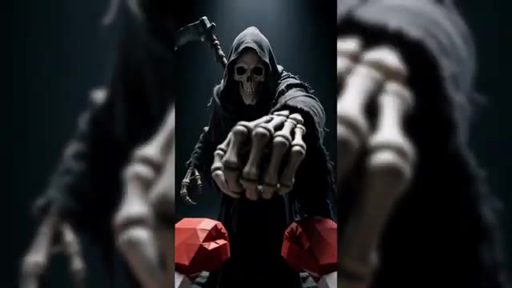
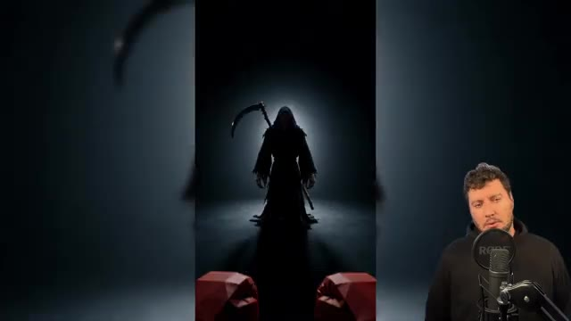

# 🎬 10 Plans IMPOSSIBLES à réaliser avec Seedance 2.5

> **Chaîne** : [Labo Des Réseaux](https://www.youtube.com/@labodesreseaux)  
> **Lien YouTube** : [https://www.youtube.com/watch?v=aCP21Uh03zo](https://www.youtube.com/watch?v=aCP21Uh03zo)  
> **Date de publication** : 20260924  
> **Durée** : 16:36  
> **Identifiant vidéo** : `aCP21Uh03zo`  
> **Modèles** : Audio: `whisper-v3-large-turbo` | Vision: `gemini-3.5-flash-lite`  

---

## 📌 Synthèse Exécutive & Outils

### 💡 Résumé
**Cette vidéo de la chaîne « Labo Des Réseaux » explore en profondeur le modèle de génération vidéo SeedDance 2.5, en démontrant sa capacité à produire des plans d'un niveau cinématographique autrefois réservés à des équipes lourdes et des semaines de post-production.** Le créateur met en lumière le décalage entre l'utilisation basique grand public et le potentiel réel de l'outil, soulignant que 90 % des utilisateurs passent à côté de ses fonctionnalités avancées. À travers dix cas pratiques complexes, il dévoile des techniques professionnelles pour contourner les limites de l'IA et obtenir un contrôle artistique total sur les productions.

**L'analyse s'appuie sur la plateforme partenaire Artlist et son module AI Toolkit pour centraliser l'accès aux derniers modèles du marché et exploiter les capacités spécifiques de SeedDance 2.5.** Le vidéaste détaille la configuration technique du modèle, qui accepte jusqu'à 50 éléments de référence (images, clips vidéo, audios) et génère des séquences de 4 à 30 secondes en un seul prompt. Il démontre comment structurer des plans complexes — allant du dézoom orbital au timelapse, en passant par l'animation de personnages et le montage vidéo par l'IA — en combinant des instructions textuelles précises et des outils externes.

**La valeur pratique de la démonstration réside dans l'utilisation de méthodologies de pointe pour piloter précisément les rendus de l'IA.** Qu'il s'agisse d'utiliser des assistants textuels comme Claude ou ChatGPT pour rédiger des prompts structurés par tranches horaires, de tracer des trajectoires de caméra sur des images ou d'importer des maquettes 3D issues de Blender, chaque technique vise à éliminer le hasard de la génération. Le créateur conclut en soulignant que SeedDance 2.5 s'impose non seulement comme un générateur, mais aussi comme un outil surpuissant d'édition, de retouche et de clonage vocal, adapté tant aux standards du cinéma qu'aux formats courts des réseaux sociaux.

---

### 🛠️ Outils, Modèles & Logiciels Présentés
- **SeedDance 2.5** (Modèle principal de génération vidéo)**
- **Artlist** (Plateforme partenaire, agrégateur de modèles IA et hébergeur de l'AI Toolkit)**
- **AI Toolkit** (Section d'Artlist regroupant les modèles d'IA)**
- **Nano Banana Pro** (Modèle de génération d'images)**
- **Seed Dream 5.0 Pro** (Modèle de génération d'images)**
- **GPT Image 2.5** (Modèle de génération d'images)**
- **Kling 3.0** (Modèle de génération vidéo)**
- **One 3.0** (Modèle vidéo)**
- **Minimax H3** (Modèle vidéo)**
- **VIO 3.1** (Modèle vidéo)**
- **Artlist Studio** (Assistant de montage et de création de courts-métrages)**
- **Flow** (Outil de création de workflows personnalisés d'Artlist)**
- **Claude** (Assistant textuel IA d'Anthropic pour la rédaction de prompts)**
- **ChatGPT** (Assistant textuel IA pour la structuration de prompts et de maquettes)**
- **Aperçu (macOS)** (Visionneuse d'images utilisée pour tracer des trajectoires de caméras)**
- **Blender** (Logiciel 3D utilisé pour construire des mouvements de caméra et des volumes gris)**
- **ElevenLabs** (Outil de création d'audios de référence pour le clonage vocal)**
- ****

### 🔑 Points Clés & Enseignements Stratégiques
- Capacités de génération étendues :** SeedDance 2.5 permet de produire de 4 à 30 secondes de vidéo en un seul prompt, en gérant aussi bien le multi-plan que le plan-séquence en résolution 1080p.
- Gestion massive des références :** Le modèle accepte jusqu'à 50 références par génération (30 images, 10 clips vidéo et 10 fichiers audio), tirées de la bibliothèque d'assets ou importées directement depuis l'ordinateur.
- Technique de découpage temporel :** Pour réussir des mouvements complexes comme un dézoom orbital sans intervention humaine de coupe, il est indispensable de structurer le prompt par tranches de temps chiffrées (ex: seconde 0 à 3, 3 à 6, etc.) pour donner un rythme précis à l'IA.
- Optimisation des prompts par des LLM :** L'utilisation d'assistants comme Claude ou ChatGPT (préféré en anglais pour limiter les erreurs d'interprétation) permet de formaliser des directives de mise en scène complexes et d'éviter les approximations du langage naturel.
- Guidage visuel par superposition :** Tracer un parcours en rouge sur une image de référence (via un aperçu) permet d'indiquer la trajectoire souhaitée d'une caméra, bien que cette méthode trouve ses limites pour les mouvements ultra-précis.
- Pilotage 3D avancé via Blender :** Pour un contrôle total et reproductible des mouvements de caméra (zooms, 360°, dézooms), il est possible de concevoir une maquette 3D simplifiée (volumes gris sans texture) et d'utiliser cette vidéo de référence pour guider SeedDance 2.5.
- Technique Start Frame / End Frame pour Timelapse :** La cohérence d'un timelapse (ex: jardin transformé) s'obtient en générant une image de départ, puis en l'utilisant comme référence stricte pour créer l'image d'arrivée avec le même cadrage.
- Clonage vocal intégré :** SeedDance 2.5 est capable d'analyser un fichier audio de référence (provenant d'ElevenLabs) pour cloner la voix et l'appliquer au texte exact saisi dans le prompt, assurant une parfaite intégration avec l'ambiance sonore.
- Storyboard et planches de référence :** L'utilisation de planches multi-vues (ex: 4 angles ou storyboards de 5 à 6 cases) garantit la cohérence d'un personnage principal sur de longs travellings ou des plans-séquences prolongés.
- Capacités d'édition et de retouche :** Le modèle excelle dans l'édition vidéo en modifiant des éléments contextuels de plans existants, tels que la météo (passer au jour de pluie, ajouter un parapluie) ou les transitions jour/nuit.
- Gestion dynamique des styles et du POV :** Il est possible de mélanger les styles artistiques et de gérer des points de vue subjectifs (POV) au sein d'un même prompt en minutant précisément les changements pour les formats verticaux (Shorts, Reels).

---

## ⏱️ Chronologie & Transcription Complète Audio & Visuelle (Mot pour Mot)

### ⏱️ `[00:00:01 - 00:00:38]` | Segment #01

**🔊 Audio (Transcription Intégrale Mot pour Mot en Français) :**
> Si Dance 2.5 c'est fou on atteint le niveau cinéma. Ce modèle il entre déjà dans la fabrication des films, des séries, des publicités d'aujourd'hui. Un plan qui avant demandait une équipe, une grue, trois semaines de post-production. Tu le sors maintenant en dix minutes assis derrière ton pc. Sur le papier tout le monde peut maintenant faire des

**👁️ Analyse Visuelle d'Écran (gemini-3.5-flash-lite) :**
**Interface & Outils** : Lecteur vidéo / extraits de démonstration du modèle Seedance 2.5
**Contenu textuel & Code** : Mention textuelle "Seedance 2.5" en incrustation bas-gauche sur tous les plans visuels présentés.
**Action / Démonstration** : Présentation d'exemples vidéo illustrant la qualité cinématographique et la variété des styles générés par l'IA.

---

### ⏱️ `[00:00:38 - 00:01:02]` | Segment #02

**🔊 Audio (Transcription Intégrale Mot pour Mot en Français) :**
> vidéos de malade. Tout le monde ? En réalité la grande majorité des utilisateurs passent à côté de 90% de ce que Seed Dance 2.5 sait faire. Et c'est justement ce que j'avais envie de te partager dans cette vidéo. 10 plans impossibles entre techniques, fonctionnalités cachées et astuces perso pour qu'à la fin tu maîtrises Seed Dance 2.5 comme un pro.

**👁️ Analyse Visuelle d'Écran (gemini-3.5-flash-lite) :**
**Interface & Outils** : Vidéo YouTube avec incrustation d'un présentateur sur fond vert (chroma key) et habillage graphique (bandeau Seedance 2.5).
**Contenu textuel & Code** : Exemples de vidéos générées par Seedance 2.5 illustrant les capacités du modèle, surmontées du texte '10 plans impossibles'.
**Action / Démonstration** : Le créateur présente visuellement des exemples de vidéos générées par Seedance 2.5 tout en s'exprimant face caméra.

**Captures d'écran :**
-   
  *⏱️ 00:00:39 — Animation montrant deux personnages de dos sur un toit face à un coucher de soleil, avec le logo 'Seedance 2.5' en bas à gauche.*
-   
  *⏱️ 00:00:50 — Scène de rue urbaine générée par IA avec le présentateur incrusté en bas à droite et le logo 'Seedance 2.5'.*
-   
  *⏱️ 00:01:00 — Présentation d'un jardin en rénovation avec le texte incrusté '10 plans impossibles' et le présentateur en bas à droite.*

---

### ⏱️ `[00:01:02 - 00:01:23]` | Segment #03

**🔊 Audio (Transcription Intégrale Mot pour Mot en Français) :**
> Pour commencer il me fallait un endroit où Seed Dance 2.5 tourne avec toutes ses fonctionnalités. Et ça a été rendu possible par Artlist, le partenaire de cette vidéo. Tu connais peut-être Artlist pour ses musiques et ses banques d'images. Mais c'est aussi devenu un excellent agrégateur de modèles IA, avec en plus de très bons outils maison.

**👁️ Analyse Visuelle d'Écran (gemini-3.5-flash-lite) :**
**Interface & Outils** : Site web Artlist
**Contenu textuel & Code** : Slogan "Make your best creative work with AI", boutons "Start Free Now", et logos des modèles (Sora, Veo, Kling, Seedance, GPT Image, Lyria, ElevenLabs).
**Action / Démonstration** : Présentation de la plateforme Artlist en tant qu'agrégateur de modèles IA pour les créateurs.

**Captures d'écran :**
-   
  *⏱️ 00:01:12 — Page d'accueil du site web Artlist avec le titre principal Make your best creative work with AI.*
-   
  *⏱️ 00:01:22 — Page d'accueil du site web Artlist affichant une vidéo en arrière-plan et les logos des modèles IA intégrés.*

---

### ⏱️ `[00:01:23 - 00:01:50]` | Segment #04

**🔊 Audio (Transcription Intégrale Mot pour Mot en Français) :**
> Pour les modèles, ça se passe dans la section AI Toolkit. Tu accéderas à la plupart des modèles images et vidéos du marché dans leur dernière version. Côté images, on a Nano Banana Pro, Seed Dream 5.0 Pro ou encore GPT Image 2.5. Côté vidéo, Kling 3.0, One 3.0, Minimax H3, VIO 3.1 et celui qui nous intéresse aujourd'hui, Seed Dance 2.5.

**👁️ Analyse Visuelle d'Écran (gemini-3.5-flash-lite) :**
**Interface & Outils** : Interface web de la plateforme Artlist (section AI Toolkit).
**Contenu textuel & Code** : Menus de sélection de modèles IA, options de génération d'images et de vidéos (Seedance 2.5, Veo 3.1, Luma Ray 3.2), paramètres de format et de résolution.
**Action / Démonstration** : Navigation à travers les différents outils et modèles IA disponibles sur la plateforme Artlist pour la création de contenu vidéo et image.

**Captures d'écran :**
-   
  *⏱️ 00:01:24 — Page d'accueil de la plateforme Artlist mettant en avant la section 'AI Toolkit'.*
-   
  *⏱️ 00:01:37 — Interface de génération 'Start with your idea' avec le menu déroulant des formats (Image, Video, Voiceover, Music).*
-   
  *⏱️ 00:01:48 — Fenêtre de sélection des modèles d'intelligence artificielle avec Seedance 2.5 en surbrillance.*

---

### ⏱️ `[00:01:50 - 00:02:14]` | Segment #05

**🔊 Audio (Transcription Intégrale Mot pour Mot en Français) :**
> Les versions antérieures restent tout de même toujours accessibles et elles coûtent moins de crédit, ça c'est toujours pratique. Au-delà des modèles, il y a des outils pensés pour la création. Artlist Studio, un assistant pour monter tes séquences et fabriquer ton court-métrage. Et Flow qui te permet de construire tes propres workflows que tu pourras réutiliser d'un projet à l'autre, parfait pour les agences et les professionnels de l'IA.

**👁️ Analyse Visuelle d'Écran (gemini-3.5-flash-lite) :**
**Interface & Outils** : Artlist Studio (Interface Web / Application)
**Contenu textuel & Code** : Projet "Rooftop Chase", aperçu vidéo d'un personnage barbu, timeline des plans (Shot 1 à Shot 10) et menu latéral gauche.
**Action / Démonstration** : Le présentateur présente l'outil Artlist Studio pour monter des séquences et fabriquer un court-métrage.

**Captures d'écran :**
-   
  *⏱️ 00:02:02 — Interface d'Artlist Studio affichant un projet de court-métrage avec la timeline des plans et l'aperçu vidéo d'un personnage.*

---

### ⏱️ `[00:02:14 - 00:02:33]` | Segment #06

**🔊 Audio (Transcription Intégrale Mot pour Mot en Français) :**
> Il y a aussi des templates IA, de la génération audio, une connexion MCP. Bref, je te conseille d'y faire un tour. En plus en ce moment il y a des offres d'abonnement très intéressantes avec accès illimité sur certains modèles. Le lien est en description et en commentaire épinglé. Allez on est sur Artlist dans l'onglet AI Toolkit.

**👁️ Analyse Visuelle d'Écran (gemini-3.5-flash-lite) :**
**Interface & Outils** : Site web Artlist (Artlist Flows, AI Toolkit, page de tarification)
**Contenu textuel & Code** : Nœuds de génération d'images, grilles de prix avec crédits et options d'abonnement, interface de prompt "Start with your idea".
**Action / Démonstration** : Présentation des workflows IA, des grilles tarifaires et des fonctionnalités d'abonnement d'Artlist par le créateur.

**Captures d'écran :**
-   
  *⏱️ 00:02:15 — Interface d'Artlist Flows montrant un générateur d'images basé sur l'IA sous forme de nœuds.*
-   
  *⏱️ 00:02:23 — Grille tarifaire des abonnements d'Artlist (AI Starter, AI Core, AI Creator, Custom Business) avec le présentateur à droite.*
-   
  *⏱️ 00:02:31 — Page principale de l'onglet AI Toolkit d'Artlist avec le champ de prompt et des exemples de créations, le présentateur apparaissant dans le coin inférieur droit.*

---

### ⏱️ `[00:02:33 - 00:02:54]` | Segment #07

**🔊 Audio (Transcription Intégrale Mot pour Mot en Français) :**
> On sélectionne le mode vidéo et on choisit notre modèle Seed Dance 2.5. Un mot rapide sur les caractéristiques de Seed Dance 2.5. La durée d'abord avec Seed Dance tu génères de 4 à 30 secondes en un seul prompt. Il sait aussi bien faire du multi-plan comme du plan séquence. Côté résolution, sur Artlist, on a une version jusqu'à 1080p.

**👁️ Analyse Visuelle d'Écran (gemini-3.5-flash-lite) :**
**Interface & Outils** : Présentation vidéo sur fond noir avec branding Seed Dance 2.5 et Artlist, incluant l'incrustation du vidéaste.
**Contenu textuel & Code** : Texte « Seeddance 2.5 sur Artlist », « Durée de génération 4-30s » avec une barre de progression, et spécifications de résolution « 1080p Full HD • maximum actuel du modèle ».
**Action / Démonstration** : Le créateur présente les caractéristiques techniques clés du modèle Seed Dance 2.5 (durée et résolution).

**Captures d'écran :**
-   
  *⏱️ 00:02:43 — Écran récapitulatif montrant la durée de génération de 4 à 30 secondes pour Seed Dance 2.5 sur Artlist, avec le présentateur incrusté en bas à droite.*
-   
  *⏱️ 00:02:52 — Écran récapitulatif indiquant la résolution maximale de 1080p Full HD pour Seed Dance 2.5 sur Artlist, avec le présentateur à côté d'un aperçu vidéo.*

---

### ⏱️ `[00:02:54 - 00:03:14]` | Segment #08

**🔊 Audio (Transcription Intégrale Mot pour Mot en Français) :**
> C'est la résolution maximum en ce moment et on espère que la 4K arrive bientôt. Côté référence, on monte jusqu'à 50 par génération, 30 images, 10 clips vidéo, 10 fichiers audio. Ce qui est pratique avec Artlist, tu peux piocher directement dans ta bibliothèque d'assets pour les références et tu pourras aussi charger tes propres fichiers depuis ton ordinateur.

**👁️ Analyse Visuelle d'Écran (gemini-3.5-flash-lite) :**
**Interface & Outils** : Présentation orale ou séquence sans interface partagée.
**Contenu textuel & Code** : Explications et conseils de création de contenu / IA.
**Action / Démonstration** : Démonstration et mise en contexte pratique.

---

### ⏱️ `[00:03:14 - 00:03:37]` | Segment #09

**🔊 Audio (Transcription Intégrale Mot pour Mot en Français) :**
> Avec SeedDance, on a quelque chose de vraiment intéressant sur les références audio. j'en dis pas plus, on le verra plus tard dans cette vidéo. Et concernant les références vidéo, ça ouvre la porte à l'édition vidéo par IA. Là aussi, on le verra plus tard dans cette vidéo. Mais pour la première vidéo impossible, je voulais te montrer ce que le modèle a dans le ventre en texte ou vidéo classique.

**👁️ Analyse Visuelle d'Écran (gemini-3.5-flash-lite) :**
**Interface & Outils** : Aucun (plan face caméra)
**Contenu textuel & Code** : Aucun élément textuel ou visuel technique à l'écran
**Action / Démonstration** : Le présentateur parle au public pour annoncer la suite de la vidéo.

---

### ⏱️ `[00:03:40 - 00:03:58]` | Segment #10

**🔊 Audio (Transcription Intégrale Mot pour Mot en Français) :**
> Ici, on va utiliser des plages de temps chiffrées pour gagner en précision. Je veux que la caméra parte d'une goutte de pluie et recule jusqu'à voir la Terre depuis son orbite. Aucune coupe, un dézoom parfaitement fluide. L'astuce pour réussir ce dézoom impossible, c'est de donner le rythme à seat dance.

**👁️ Analyse Visuelle d'Écran (gemini-3.5-flash-lite) :**
**Interface & Outils** : Présentation orale ou séquence sans interface partagée.
**Contenu textuel & Code** : Explications et conseils de création de contenu / IA.
**Action / Démonstration** : Démonstration et mise en contexte pratique.

---

### ⏱️ `[00:03:58 - 00:04:21]` | Segment #11

**🔊 Audio (Transcription Intégrale Mot pour Mot en Français) :**
> Seconde 0 à 3 la fenêtre, seconde 3 à 6 la rue, seconde 6 à 9 la ville. Sans ça, le modèle risque de traîner ou mal gérer le rythme du dézoom. Pour la rédaction du prompt lui-même, tu n'es pas obligé de faire tout à la main. Si tu as ton idée et ta direction, des IA comme Claude ou ChatGPT peuvent t'assister. Ici j'ai demandé à Claude de m'écrire le prompt Seed Dance 2.5 avec ses directives.

**👁️ Analyse Visuelle d'Écran (gemini-3.5-flash-lite) :**
**Interface & Outils** : Interface web de Claude (Anthropic)
**Contenu textuel & Code** : Texte du prompt demandant à Claude : "Écris-moi un prompt pour Seedance 2.5 en anglais. La scène : la caméra part d'une goutte de pluie sur une vitre et recule jusqu'à voir la Terre depuis l'orbite..."
**Action / Démonstration** : Le créateur montre l'utilisation de l'intelligence artificielle Claude pour concevoir et rédiger le prompt détaillé nécessaire au générateur vidéo.

**Captures d'écran :**
-   
  *⏱️ 00:04:09 — Interface de l'assistant IA Claude affichant un prompt rédigé en français pour demander un prompt vidéo (Seedance 2.5).*
-   
  *⏱️ 00:04:19 — Interface de l'assistant IA Claude avec la même vue sur le prompt demandant de créer un découpage en tranches de trois secondes.*

---

### ⏱️ `[00:04:21 - 00:04:39]` | Segment #12

**🔊 Audio (Transcription Intégrale Mot pour Mot en Français) :**
> La caméra part d'une goutte de pluie et recule jusqu'à voir la terre depuis son orbite, sans aucune coupe, avec un dézoom fluide et j'ai précisé le rythme par tranche de 3 secondes. J'ai aussi demandé le prompt en anglais. Le modèle comprend bien français mais l'anglais limite les erreurs d'interprétation.

**👁️ Analyse Visuelle d'Écran (gemini-3.5-flash-lite) :**
**Interface & Outils** : Artlist (AI Toolkit)
**Contenu textuel & Code** : Prompt en anglais détaillant le plan séquence par tranches de 3 secondes (0-3 sec, 3-6 sec, etc.) de la goutte de pluie vers l'orbite terrestre, avec réglages vidéo (Seedance 2.5, 16:9, 720p, 10 Sec) et bouton "Generate".
**Action / Démonstration** : Le créateur montre le prompt structuré par intervalles de temps pour guider la génération vidéo par IA.

**Captures d'écran :**
-   
  *⏱️ 00:04:38 — Interface de la plateforme Artlist affichant le prompt textuel détaillé du dézoom fluide de la goutte de pluie jusqu'à la Terre.*

---

### ⏱️ `[00:04:54 - 00:05:29]` | Segment #13

**🔊 Audio (Transcription Intégrale Mot pour Mot en Français) :**
> L'effet est bien maîtrisé, le timing des scènes a bien aidé niveau rythme. c'est une super technique. D'ailleurs mettre un nouvel événement visible toutes les trois secondes c'est une règle de base pour un bon rythme à l'écran. Sur Atleast il y a également une option pour améliorer tes promptes, pratique pour gagner en précision à partir d'une idée simple et si tu ne veux pas passer par cloud. Et ne t'inquiète pas j'ai créé un guide complet qui reprend mes explications, mes astuces et mes techniques sur SeedDance 2.5 ainsi que tous les prompts présents dans cette vidéo. Il est disponible gratuitement via le lien en description.

**👁️ Analyse Visuelle d'Écran (gemini-3.5-flash-lite) :**
**Interface & Outils** : Navigateur web, plateforme Artlist (AI Toolkit).
[DESC_IMAGE_1] Gros plan du présentateur avec une illustration de goutte d'eau en arrière-plan.
[DESC_IMAGE_2] Interface de la plateforme Artlist montrant l'outil de génération vidéo et la zone de saisie de prompt 'Start with your idea'.
[DESC_IMAGE_3] Page de présentation du guide gratuit 'Seedance 2.5 Guide' avec couverture et bouton de téléchargement.
**Contenu textuel & Code** : Champ de prompt détaillé en français pour la génération de vidéo, réglages Seedance 2.5, et page de téléchargement du guide '10 techniques pour des vidéos impossibles'.
**Action / Démonstration** : Présentation de l'interface de l'outil IA d'Artlist pour l'amélioration des prompts et proposition d'un guide pratique à télécharger.

**Captures d'écran :**
-   
  *⏱️ 00:05:12 — Interface de la plateforme Artlist montrant l'outil de génération vidéo et la zone de saisie de prompt 'Start with your idea'.*
-   
  *⏱️ 00:05:27 — Page de présentation du guide gratuit 'Seedance 2.5 Guide' avec couverture et bouton de téléchargement.*

---

### ⏱️ `[00:05:31 - 00:05:54]` | Segment #14

**🔊 Audio (Transcription Intégrale Mot pour Mot en Français) :**
> Pour la deuxième vidéo, je veux un plan aérien sur un boulevard parisien avec un chat de 40 mètres de haut. Mais surtout, je veux décider moi-même du mouvement de caméra. Alors, je ne l'ai pas écrit, je l'ai dessiné. J'ai généré l'image du chat dans la rue avec Nano Banana Pro. Je l'ai ouvert avec l'aperçu de mon Mac et j'ai tracé le trajet du drone en rouge par-dessus.

**👁️ Analyse Visuelle d'Écran (gemini-3.5-flash-lite) :**
**Interface & Outils** : Aperçu (macOS)
**Contenu textuel & Code** : Image aérienne d'un chat géant au milieu d'un boulevard parisien avec un tracé rouge annoté "Départ" et "Arrivée".
**Action / Démonstration** : Le créateur montre l'utilisation de l'application Aperçu sur Mac pour dessiner manuellement le trajet de la caméra sur l'image générée.

**Captures d'écran :**
-   
  *⏱️ 00:05:52 — Capture d'écran de l'application Aperçu sur Mac montrant une image générée d'un chat géant dans une rue de Paris avec un tracé rouge dessiné pour indiquer le trajet du drone.*

---

### ⏱️ `[00:05:54 - 00:06:22]` | Segment #15

**🔊 Audio (Transcription Intégrale Mot pour Mot en Français) :**
> J'ai ajouté aussi l'indication de la case départ et de la case arrivée. Pour le prompt, je me suis fait aider par Claude. Je lui ai demandé d'indiquer à Seed Dance que la ligne rouge est la trajectoire de la caméra, en précisant que c'est une consigne de mise en scène, et pas un élément à afficher. Le résultat n'est pas mal du tout, mais pour être honnête, je n'ai pas exactement la précision que je souhaitais.

**👁️ Analyse Visuelle d'Écran (gemini-3.5-flash-lite) :**
**Interface & Outils** : Interface web de génération vidéo (Artlist / Seedance 2.5).
**Contenu textuel & Code** : Panneau de prompt affichant : "The output video contains no red line, no drawn line of any colour, no text... Model: Seedance 2.5, Aspect ratio: 16:9, Quality: 720p".
**Action / Démonstration** : Le créateur montre le résultat vidéo obtenu sur l'interface après application du prompt généré avec l'aide de Claude.

**Captures d'écran :**
-   
  *⏱️ 00:06:08 — Interface d'un outil de génération vidéo par IA montrant le résultat d'une vidéo avec un chat géant surplombant une rue de Paris et le prompt textuel associé.*

---

### ⏱️ `[00:06:22 - 00:06:44]` | Segment #16

**🔊 Audio (Transcription Intégrale Mot pour Mot en Français) :**
> Le trait rouge sur une référence, c'est bien pour une trajectoire simple. Mais pour un mouvement précis et reproductible, il faut monter d'un cran. Là, j'ai construit le mouvement dans Blender. Si tu ne connais pas bien l'outil, tu peux faire comme moi et te faire aider par ChatGPT ou Claude. Là, j'ai réalisé une vidéo très simple, pas de texture, pas de lumière, que des volumes gris.

**👁️ Analyse Visuelle d'Écran (gemini-3.5-flash-lite) :**
**Interface & Outils** : Logiciel Blender
**Contenu textuel & Code** : Interface 3D de Blender, hiérarchie de scènes, paramètres de transformation, objets 3D non texturés (boîtes grises).
**Action / Démonstration** : Le créateur montre la construction d'un mouvement 3D simple sous Blender pour préparer un repère visuel précis.

**Captures d'écran :**
-   
  *⏱️ 00:06:33 — Interface du logiciel 3D Blender affichant une scène simple en niveaux de gris avec des formes géométriques basiques (cubes, plans).*
-   
  *⏱️ 00:06:42 — Gros plan en caméra 3D sur un bloc géométrique rectangulaire simple sans texture.*

---

### ⏱️ `[00:06:44 - 00:07:04]` | Segment #17

**🔊 Audio (Transcription Intégrale Mot pour Mot en Français) :**
> La seule chose qui m'importe, c'est le mouvement de la caméra. Un zoom vers la boîte, un tour complet à 360 degrés et un dézoom, 12 secondes au total. Je charge maintenant cette vidéo en référence sur Artlist. Et pour le prompt, j'ai demandé à Claude d'indiquer à SidDance de suivre le mouvement de la caméra de la vidéo de référence.

**👁️ Analyse Visuelle d'Écran (gemini-3.5-flash-lite) :**
**Interface & Outils** : Artlist (outil IA de génération vidéo)
**Contenu textuel & Code** : Menu d'options d'importation de fichiers et champ de prompt textuel détaillant le suivi de trajectoire de caméra.
**Action / Démonstration** : Chargement d'une vidéo de référence et insertion d'un prompt pour guider le mouvement de caméra.

**Captures d'écran :**
-   
  *⏱️ 00:06:54 — Interface d'Artlist montrant le menu déroulant d'ajout de référence (« Video Reference », « Image Reference », etc.).*
-   
  *⏱️ 00:07:02 — Interface d'Artlist avec le prompt généré par Claude intégrant la référence vidéo et le modèle Seedance 2.5.*

---

### ⏱️ `[00:07:04 - 00:07:24]` | Segment #18

**🔊 Audio (Transcription Intégrale Mot pour Mot en Français) :**
> En lui décrivant le décor et les éléments que je voulais, une boîte d'allumettes sur un bureau. Voilà le résultat. Et si on met la vidéo de référence et le rendu côte à côte, c'est juste parfait.

**👁️ Analyse Visuelle d'Écran (gemini-3.5-flash-lite) :**
**Interface & Outils** : Vidéo de démonstration et incrustation du présentateur.
**Contenu textuel & Code** : Boîte d'allumettes sur un bureau en bois dans un décor sombre et chaleureux.
**Action / Démonstration** : Le créateur montre le résultat visuel généré par l'intelligence artificielle.

---

### ⏱️ `[00:07:24 - 00:07:43]` | Segment #19

**🔊 Audio (Transcription Intégrale Mot pour Mot en Français) :**
> Diriger un plan à partir d'une maquette 3D, c'est une vraie technique avancée de cinéma. Pouvoir le faire chez soi avec Blender et Seed Dance 2.5, c'est juste dingue. Ici, on utilise le principe Start Frame, End Frame. Avec, on va créer un effet Timelapse.

**👁️ Analyse Visuelle d'Écran (gemini-3.5-flash-lite) :**
**Interface & Outils** : Seed Dance 2.5 (Artlist)
**Contenu textuel & Code** : Texte : "Principe de génération - Start frame + end frame - Seedance crée le mouvement entre les deux états." Schéma explicatif avec Start Frame et End Frame.
**Action / Démonstration** : Le créateur présente et explique le principe technique de transition continue entre deux images clés dans Seed Dance 2.5.

**Captures d'écran :**
-   
  *⏱️ 00:07:41 — Diapositive explicative de l'interface Seed Dance 2.5 détaillant le principe de génération par image clé de début (Start frame) et de fin (End frame).*

---

### ⏱️ `[00:07:43 - 00:08:06]` | Segment #20

**🔊 Audio (Transcription Intégrale Mot pour Mot en Français) :**
> Parfait pour du contenu réseau sociaux. J'ai commencé à créer des images de référence sur Artlist avec Nano Banana Pro. Un jardin en friche, puis le même jardin entretenu avec en plus une nouvelle terrasse et un coin barbecue. Avec l'aide de Claude, j'ai écrit mon prompt Seed Dance 2.5 qui génère le timelapse d'un jardinier qui nettoie ce jardin et construit la terrasse et le barbecue.

**👁️ Analyse Visuelle d'Écran (gemini-3.5-flash-lite) :**
**Interface & Outils** : Artlist (AI Toolkit / Générateur d'images et vidéos)
**Contenu textuel & Code** : Prompts détaillés en anglais pour la génération d'images et de vidéos, paramètres du modèle (Nano Banana 2, Seed Dance 2.5, format 16:9, résolution 2K, mode draft 480p).
**Action / Démonstration** : Le créateur montre la configuration des prompts et des paramètres sur Artlist pour générer les images de référence et la vidéo timelapse du jardin.

**Captures d'écran :**
-   
  *⏱️ 00:07:54 — Interface d'Artlist affichant le résultat de génération d'image avec le prompt détaillé pour le jardin et les réglages de modèle.*
-   
  *⏱️ 00:08:04 — Interface d'Artlist montrant le prompt complet pour 'Seed Dance 2.5' décrivant la transformation d'un jardin par un jardinier sur plusieurs secondes.*

---

### ⏱️ `[00:08:06 - 00:08:25]` | Segment #21

**🔊 Audio (Transcription Intégrale Mot pour Mot en Français) :**
> Le point critique, les deux images doivent avoir exactement le même cadrage. J'ai donc généré d'abord l'image de départ, puis j'ai utilisé cette image en référence dans une deuxième génération Nano Banana Pro pour créer l'image d'arrivée. Le résultat est bluffant et ce n'est qu'une idée parmi tous les types de timelapse que tu peux faire.

**👁️ Analyse Visuelle d'Écran (gemini-3.5-flash-lite) :**
**Interface & Outils** : Interface de gestion de bibliothèque multimédia (type Artlist / générateur IA).
**Contenu textuel & Code** : Galerie d'images miniatures incluant des personnages, des masques, et deux photos de jardin (une version propre et aménagée, une version en friche) montrant un cadrage identique.
**Action / Démonstration** : Le créateur démontre la génération d'images avec un cadrage identique pour créer un effet de timelapse avant/après.

**Captures d'écran :**
-   
  *⏱️ 00:08:07 — Interface d'une application montrant une bibliothèque de médias avec des images générées par IA, incluant des paysages avant/après.*
-   
  *⏱️ 00:08:15 — Vue légèrement actualisée de la bibliothèque de médias avec un curseur repositionné sur l'interface de l'outil.*

---

### ⏱️ `[00:08:26 - 00:08:46]` | Segment #22

**🔊 Audio (Transcription Intégrale Mot pour Mot en Français) :**
> Pour cette cinquième vidéo, on part sur une scène d'anime japonais.

**👁️ Analyse Visuelle d'Écran (gemini-3.5-flash-lite) :**
**Interface & Outils** : Interface web Seedance 2.5 / Artlist
**Contenu textuel & Code** : Titre 'Une scène d'anime au coucher du soleil', description 'Deux lycéens de dos sur un toit.', et visuel schématique d'une scène d'anime.
**Action / Démonstration** : Présentation de la cinquième vidéo sur une scène d'anime japonais au coucher du soleil.

**Captures d'écran :**
-   
  *⏱️ 00:08:44 — Interface de présentation Seedance 2.5 sur Artlist avec le titre 'Une scène d'anime au coucher du soleil'.*

---

### ⏱️ `[00:08:46 - 00:09:05]` | Segment #23

**🔊 Audio (Transcription Intégrale Mot pour Mot en Français) :**
> Deux lycéens de dos sur un toit au coucher de soleil. Rien de compliqué en somme. Sauf qu'on vient y ajouter une réplique en français. Et pour ça, on va utiliser un audio de référence. J'ai créé un audio de référence sur Artlist avec Elevenlabs. Mais cet audio, il n'a rien à voir avec le dialogue de ma vidéo. Et c'est justement le but.

**👁️ Analyse Visuelle d'Écran (gemini-3.5-flash-lite) :**
**Interface & Outils** : Interface web d'Artlist (AI Toolkit)
**Contenu textuel & Code** : Zone de texte avec un prompt en français, options de voix (Eleven v3, French), et bouton 'Generate' cliqué.
**Action / Démonstration** : Le créateur montre l'interface d'Artlist où l'on saisit le texte et les paramètres pour générer l'audio avec une voix de référence.

**Captures d'écran :**
-   
  *⏱️ 00:09:03 — Interface de la plateforme Artlist montrant la zone de saisie pour démarrer un projet, avec un champ de texte et le bouton 'Generate'.*

---

### ⏱️ `[00:09:05 - 00:09:29]` | Segment #24

**🔊 Audio (Transcription Intégrale Mot pour Mot en Français) :**
> Si Dance 2.5 a une particularité, il est capable de cloner la voix que tu lui donnes en référence et l'utiliser avec la phrase que tu vas écrire dans ton prompt. Ça permet de gagner en précision, ça permet aussi à ce que la voix s'intègre parfaitement avec l'ambiance sonore de la vidéo. Il faut donc lui donner un extrait de voix bien clair et écrire la phrase exacte que ton personnage doit prononcer dans le prompt.

**👁️ Analyse Visuelle d'Écran (gemini-3.5-flash-lite) :**
**Interface & Outils** : Présentation vidéo graphique avec charte graphique de la chaîne et logo Artlist.
**Contenu textuel & Code** : Textes explicatifs sur le clonage vocal, graphiques d'ondes sonores stylisées et consignes étape par étape ("Voix bien claire", "Phrase exacte").
**Action / Démonstration** : Présentation des spécificités techniques et des bonnes pratiques d'utilisation de la fonction de clonage vocal de Seedance 2.5.

**Captures d'écran :**
-   
  *⏱️ 00:09:06 — Diapositive explicative montrant le fonctionnement du clonage vocal avec Seedance 2.5 (voix de référence convertie en texte via le prompt).*
-   
  *⏱️ 00:09:17 — Diapositive détaillant les deux consignes essentielles pour Seedance 2.5 : une voix bien claire et une phrase exacte dans le prompt.*

---

### ⏱️ `[00:09:29 - 00:09:59]` | Segment #25

**🔊 Audio (Transcription Intégrale Mot pour Mot en Français) :**
> Je sélectionne donc mon audio en référence. On l'écoute juste avant. Hé, mais c'est pas du tout ce que je voulais faire. La réplique est écrite dans le prompt. Tu la vois ici. J'ai aussi donné des indications de jeu au personnage, notamment sur l'émotion. Et voilà le résultat. Alors, t'as décidé de partir, c'est ça ?

**👁️ Analyse Visuelle d'Écran (gemini-3.5-flash-lite) :**
**Interface & Outils** : Artlist (AI Toolkit / Générateur vidéo)
**Contenu textuel & Code** : Prompt textuel détaillé décrivant la scène animée 2D, les directives de jeu d'acteur, l'ambiance sonore, et la référence audio "@aud1".
**Action / Démonstration** : Le créateur montre la structure complète de son prompt et le résultat généré par l'intelligence artificielle.

**Captures d'écran :**
-   
  *⏱️ 00:09:30 — Interface de l'outil d'IA d'Artlist montrant les paramètres du prompt pour la génération de vidéo avec référence audio.*
-   
  *⏱️ 00:09:44 — Suite du prompt détaillé avec la réplique en français sélectionnée ("Alors tu as décidé de partir, c'est ça ?").*
-   
  *⏱️ 00:09:58 — Résultat visuel généré montrant un personnage d'anime en pleurs avec un coucher de soleil en arrière-plan.*

---

### ⏱️ `[00:09:59 - 00:10:21]` | Segment #26

**🔊 Audio (Transcription Intégrale Mot pour Mot en Français) :**
> Seed Dance 2.5 a parfois du mal avec le français. surtout quand un mot sort du vocabulaire courant, comme par exemple avec de l'argot ou des expressions particulières. Mais cette technique, un audio de référence et un prompt précis, donne de bons résultats. L'objectif ici, c'est un long travelling sur un personnage qui reste cohérent du début à la fin.

**👁️ Analyse Visuelle d'Écran (gemini-3.5-flash-lite) :**
**Interface & Outils** : Interface web de Seedance 2.5 sur Artlist, diapositive graphique de présentation.
**Contenu textuel & Code** : Texte du prompt (« @aud1 is a voice reference... »), paramètres du modèle (Seedance 2.5, Aspect ratio 16:9, Quality 720p), et schéma explicatif d'un mouvement de caméra en travelling.
**Action / Démonstration** : Le créateur illustre l'utilisation de l'outil Seedance 2.5 pour générer des vidéos avec des prompts précis et commente le mouvement de caméra en travelling.

**Captures d'écran :**
-   
  *⏱️ 00:10:00 — Interface de l'outil Seedance 2.5 sur Artlist montrant un générateur de vidéo avec un prompt textuel en anglais et des paramètres réglés sur 16:9 et 720p, illustrant une scène de style anime au crépuscule.*
-   
  *⏱️ 00:10:10 — Gros plan sur l'interface de Seedance 2.5 montrant l'évolution du mouvement de caméra et du personnage larmoyant dans la scène animée en cours de génération.*
-   
  *⏱️ 00:10:19 — Diapositive de présentation titrée 'Long travelling' avec le youtubeur face caméra, expliquant le concept d'un plan continu où le sujet reste à l'écran du début à la fin.*

---

### ⏱️ `[00:10:21 - 00:11:11]` | Segment #27

**🔊 Audio (Transcription Intégrale Mot pour Mot en Français) :**
> Pour aider le modèle, je lui donne en référence une planche 4 vues de mon personnage. Celle-ci contient différents angles, on part sur 30 secondes, un seul plan, aucune coupe, notre héroïne en ciré jaune créée avec Nano Banana Pro, elle va fuir à travers 5 décors différents. Voyons ce que ça donne. Alors c'est pas mal, là j'ai vraiment misé sur le personnage et sa cohérence.

**👁️ Analyse Visuelle d'Écran (gemini-3.5-flash-lite) :**
**Interface & Outils** : Lecteur vidéo / incrustation de la webcam du créateur.
**Contenu textuel & Code** : Génération vidéo IA montrant une héroïne fuyant à travers différents décors.
**Action / Démonstration** : Le créateur montre un exemple de vidéo générée à partir d'une planche de référence.

---

### ⏱️ `[00:11:12 - 00:11:32]` | Segment #28

**🔊 Audio (Transcription Intégrale Mot pour Mot en Français) :**
> J'ai aussi donné dans le prompt des indications précises sur les mouvements de caméra et le plan séquence en général. Et cette planche de référence, elle me fait penser à une autre technique, le storyboard. Tu donnes une planche qui illustre les différentes scènes que tu veux dans ta vidéo. Et avec Seed Dance 2.5 qui monte jusqu'à 30 secondes, tu peux très bien lui donner un storyboard de 5 ou 6 cases.

**👁️ Analyse Visuelle d'Écran (gemini-3.5-flash-lite) :**
**Interface & Outils** : Vidéo YouTube incrustée avec le présentateur en bas à droite
**Contenu textuel & Code** : Séquence vidéo générée par IA montrant un plan séquence avec des mouvements de caméra fluides et rapides
**Action / Démonstration** : Le créateur commente une démonstration visuelle d'un plan séquence d'IA générative sans afficher d'interface logicielle spécifique.

---

### ⏱️ `[00:11:32 - 00:12:06]` | Segment #29

**🔊 Audio (Transcription Intégrale Mot pour Mot en Français) :**
> Seed Dance 2.5 ce n'est pas que de la création, c'est aussi un outil surpuissant pour l'édition et la retouche. Et la meilleure preuve que je peux te donner c'est le changement de météo sur un plan. J'ai d'abord créé un plan de référence. Une femme qui marche dans la rue. En prenant cette vidéo de référence j'ai changé la météo pour faire tomber de la pluie et ensuite lui faire ouvrir un parapluie en conséquence. Voilà le résultat. C'est une vraie prouesse et dans mon expérience professionnelle

**👁️ Analyse Visuelle d'Écran (gemini-3.5-flash-lite) :**
**Interface & Outils** : Interface web d'Artlist / Outil Seedance 2.5
**Contenu textuel & Code** : Prompt textuel décrivant la scène d'une femme marchant en ville, paramètres techniques (Seedance 2.5, 1280x720, 16:9, 12 sec, MP4)
**Action / Démonstration** : Le créateur montre la vidéo de référence originale d'une femme marchant dans la rue, puis applique une modification pour changer la météo (pluie et parapluie).

**Captures d'écran :**
-   
  *⏱️ 00:11:49 — Capture de l'interface d'Artlist montrant la prévisualisation vidéo d'une femme marchant dans la rue avec les détails du prompt et les réglages de Seedance 2.5.*
-   
  *⏱️ 00:12:04 — Comparaison à l'écran montrant le présentateur en bas à droite, la vidéo originale en haut, et la nouvelle version modifiée avec la pluie et un parapluie ouvert en grand format.*

---

### ⏱️ `[00:12:06 - 00:12:40]` | Segment #30

**🔊 Audio (Transcription Intégrale Mot pour Mot en Français) :**
> récente sur des projets où on me demandait de changer la météo voire passer du jour à la nuit Seed Dance 2.5 a parfaitement géré. Dans cette vidéo on va mettre en avant deux forces du modèle la gestion du pov et le changement de style en pleine génération l'idée je suis un boxeur et à chaque coup que je prends le décor change autour de moi j'ai travaillé imprompte avec plusieurs styles et une chute un peu drôle et j'ai pensé la vidéo pour le format vertical encore une fois c'est parfait pour les réseaux sociaux. Pour plus de précision je donne une image de référence du

**👁️ Analyse Visuelle d'Écran (gemini-3.5-flash-lite) :**
**Interface & Outils** : Artlist (AI Toolkit / Seedance 2.5)
**Contenu textuel & Code** : Texte du prompt descriptif ("Four punches land in this video...", "Photographic realism", "stop-motion modelling clay"), paramètres de génération (Seedance 2.5, 9:16, 720p, 15 Sec).
**Action / Démonstration** : Le créateur présente l'interface et le prompt complexe utilisé pour tester la gestion du POV et le changement de style en pleine génération sur Artlist.

**Captures d'écran :**
-   
  *⏱️ 00:12:39 — Interface de la plateforme Artlist (AI Toolkit) montrant un prompt détaillé pour générer une vidéo en POV de boxe avec des changements de style à chaque impact.*

---

### ⏱️ `[00:12:40 - 00:13:17]` | Segment #31

**🔊 Audio (Transcription Intégrale Mot pour Mot en Français) :**
> boxer et encore une fois j'ai minuté les changements pour que le modèle ne parte pas dans tous les sens. Voilà le résultat. Techniquement très intéressant si tu veux mélanger les styles, travailler des projets plus artistiques, plus psychédéliques ou abstraits. Seed Dance 2.5 c'est donc gérer plusieurs styles et ça même au sein du même prompt. Le POV c'est aussi une

**👁️ Analyse Visuelle d'Écran (gemini-3.5-flash-lite) :**
**Interface & Outils** : Vidéo générée par intelligence artificielle (Seed Dance 2.5) intégrée dans une mise en page style Reels/Shorts avec incrustation du créateur.
**Contenu textuel & Code** : Visuels générés par IA illustrant un personnage fantastique de squelette boxeur avec des gants rouges.
**Action / Démonstration** : Le créateur présente le résultat de sa génération minutée avec des changements de style et de plan (Seed Dance 2.5).

**Captures d'écran :**
-   
  *⏱️ 00:12:59 — Génération vidéo IA montrant un squelette encapuchonné (la Faucheuse) avec des gants de boxe rouges, en gros plan face caméra.*
-   
  *⏱️ 00:13:16 — Génération vidéo IA montrant la même silhouette de la Faucheuse en plan large, avec le présentateur visible en bas à droite face à son micro.*

---

### ⏱️ `[00:13:17 - 00:13:35]` | Segment #32

**🔊 Audio (Transcription Intégrale Mot pour Mot en Français) :**
> Une approche de réalisation intéressante, bien maîtrisée par Seed Dance 2.5. Sur cette vidéo, on repart sur de l'édition. Cette fois pour ajouter des éléments qui n'existaient pas. Très pratiques pour modifier un plan en post-production. Ici, c'est ma première vidéo générée aussi avec Seed Dance 2.5.

**👁️ Analyse Visuelle d'Écran (gemini-3.5-flash-lite) :**
**Interface & Outils** : Présentation vidéo au format standard avec infographies textuelles et incrustation du présentateur.
**Contenu textuel & Code** : Titres et sous-titres : 'Seed Dance 2.5 SUR ARTLIST', 'VIDÉO 9 • LE BRAQUAGE', 'Ajouter ce qui n'existait pas', 'De l'édition générative pour modifier un plan existant', 'AJOUT D'ÉLÉMENTS EN POST-PRODUCTION'.
**Action / Démonstration** : Le créateur présente une diapositive théorique expliquant l'édition générative et l'ajout d'éléments inexistants à l'aide de l'outil Seed Dance 2.5.

**Captures d'écran :**
-   
  *⏱️ 00:13:26 — Diapositive de présentation officielle 'Seed Dance 2.5' sur Artlist, titrée 'Ajouter ce qui n'existait pas : De l'édition générative pour modifier un plan existant', illustrée par un schéma d'ajout d'éléments.*

---

### ⏱️ `[00:13:36 - 00:14:12]` | Segment #33

**🔊 Audio (Transcription Intégrale Mot pour Mot en Français) :**
> Et finalement, mon but, ça va être d'équiper les cambrioleurs de masques. J'ai donc créé des masques de clown avec Nano Banana Pro. Et avec un prompt assez simple et ma nouvelle image de référence, je vais demander à Seed Dance d'équiper les cambrioleurs avec ses nouveaux masques. Voyons le résultat. Si on compare les deux vidéos, on voit bien que seuls les masques ont changé.

**👁️ Analyse Visuelle d'Écran (gemini-3.5-flash-lite) :**
**Interface & Outils** : Logiciel de montage vidéo et comparateur de vidéos générées par IA.
**Contenu textuel & Code** : Séquence vidéo comparative montrant la modification d'une scène de cambriolage par ajout de masques de clown via IA.
**Action / Démonstration** : Le créateur compare visuellement le résultat avant et après l'application de la modification par IA sur les masques des personnages.

**Captures d'écran :**
-   
  *⏱️ 00:13:54 — Comparaison vidéo montrant les cambrioleurs équipés de masques de clown générés par IA.*
-   
  *⏱️ 00:14:10 — Grille de comparaison de différentes versions de la scène du cambriolage avec le présentateur en bas à droite.*

---

### ⏱️ `[00:14:12 - 00:14:30]` | Segment #34

**🔊 Audio (Transcription Intégrale Mot pour Mot en Français) :**
> Pouvoir faire de l'édition aussi précise avec Seed Dance 2.5, c'est vraiment un atout. Pour aller encore plus loin dans l'édition, j'ai voulu finir par la reproduction d'une trend. C'est la reprise d'un passage du clip Storm. En ce moment on voit cet effet partout sur Instagram.

**👁️ Analyse Visuelle d'Écran (gemini-3.5-flash-lite) :**
**Interface & Outils** : Interface de présentation Artlist (Seed Dance 2.5).
**Contenu textuel & Code** : Texte affiché : 'VIDÉO 10 • REPRODUIRE UNE TREND', 'Réinterpréter une trend Instagram', 'Un passage de clip devient une nouvelle scène', schémas de conversion 'PASSAGE DU CLIP' vers 'NOUVELLE VERSION', et la mention 'MÊME DYNAMIQUE • NOUVEAUX ÉLÉMENTS'.
**Action / Démonstration** : Le créateur introduit la dernière étape de son tutoriel consistant à réinterpréter ou reproduire une trend Instagram populaire à l'aide de Seed Dance 2.5.

**Captures d'écran :**
-   
  *⏱️ 00:14:21 — Diapositive de présentation Artlist avec le titre 'Réinterpréter une trend Instagram : Un passage de clip devient une nouvelle scène' utilisant Seed Dance 2.5.*
-   
  *⏱️ 00:14:29 — Diapositive de présentation Artlist avec le titre 'Réinterpréter une trend Instagram : Un passage de clip devient une nouvelle scène' utilisant Seed Dance 2.5.*

---

### ⏱️ `[00:14:30 - 00:14:51]` | Segment #35

**🔊 Audio (Transcription Intégrale Mot pour Mot en Français) :**
> On a préparé nos références. J'ai pris Marco en multi-angle, un glacier dont on va prendre la tenue et la glace que Marco va tenir à la place de la cigarette. Ce n'est vraiment pas évident, il faut bien indiquer au modèle que puisque c'est une glace, l'action de fumée du clip original doit disparaître. Et pour gagner en précision, j'ai demandé à Claude de me préparer un prompt en JSON.

**👁️ Analyse Visuelle d'Écran (gemini-3.5-flash-lite) :**
**Interface & Outils** : Claude (interface de chat textuel et d'assistance IA).
**Contenu textuel & Code** : Texte de prompt détaillé en anglais décrivant les modifications à apporter à la vidéo (références @Image 1, @Image 2, @Image 3, position, posture, remplacement de la cigarette par la glace, et vêtements de la foule).
**Action / Démonstration** : Le créateur montre le prompt rédigé sur l'interface de Claude pour préparer et guider la génération de la vidéo par l'IA.

**Captures d'écran :**
-   
  *⏱️ 00:14:50 — Interface de l'assistant IA Claude affichant un prompt détaillé pour la génération vidéo.*

---

### ⏱️ `[00:14:51 - 00:15:37]` | Segment #36

**🔊 Audio (Transcription Intégrale Mot pour Mot en Français) :**
> En général quand j'ai beaucoup d'éléments à modifier en édition, je privilégie le JSON. Petite astuce si un jour tu bloques, donne ton prompt à Claude ou TchaGPT et demande-lui une version JSON. Ça débloque parfois la situation. Voilà le résultat. Bon alors c'est sans la musique parce qu'avec YouTube je ne peux pas la mettre pour des questions de droits d'auteur.

**👁️ Analyse Visuelle d'Écran (gemini-3.5-flash-lite) :**
**Interface & Outils** : Lecteur vidéo / Montage vidéo (pas d'interface logicielle active affichée)
**Contenu textuel & Code** : Séquence vidéo modifiée avec des choristes en arrière-plan et un inset comparatif.
**Action / Démonstration** : Le créateur montre le résultat visuel final de son édition après application des modifications.

---

### ⏱️ `[00:15:37 - 00:15:57]` | Segment #37

**🔊 Audio (Transcription Intégrale Mot pour Mot en Français) :**
> Mais sur Instagram ou TikTok c'est parfait si la musique est disponible dans leur bibliothèque. Si on met les deux clips côte à côte, le résultat en édition est vraiment impressionnant. Alors que retenir de ces 10 prompts impossibles ? Seed Dance 2.5 donne le meilleur de lui-même quand on est précis. Un prompt minuté, des références bien choisies, des consignes claires.

**👁️ Analyse Visuelle d'Écran (gemini-3.5-flash-lite) :**
**Interface & Outils** : Studio d'enregistrement YouTube sans interface logicielle spécifique visible.
**Contenu textuel & Code** : Exemples de vidéos générées par IA et plans du présentateur avec micro Røde.
**Action / Démonstration** : Le créateur commente les résultats et les meilleures pratiques d'utilisation de Seed Dance 2.5.

---

### ⏱️ `[00:15:57 - 00:16:16]` | Segment #38

**🔊 Audio (Transcription Intégrale Mot pour Mot en Français) :**
> La clé d'un prompt réussi ne se trouve pas forcément dans la qualité du texte, mais dans le travail sur tes références. La planche, l'image annotée, la scène Blender, la piste audio. Finalement, on adopte les mêmes méthodes que l'industrie du cinéma, avec un vrai travail de préparation avant le tournage d'une scène. Voilà, j'espère que la vidéo t'a plu.

**👁️ Analyse Visuelle d'Écran (gemini-3.5-flash-lite) :**
**Interface & Outils** : Studio vidéo personnel et incrustation d'images de référence visuelle.
**Contenu textuel & Code** : Pas d'interface logicielle ni de texte affiché à l'écran, uniquement des visuels de référence et le présentateur.
**Action / Démonstration** : Le créateur conclut sa vidéo en parlant des méthodes de travail inspirées de l'industrie du cinéma.

---

### ⏱️ `[00:16:17 - 00:16:36]` | Segment #39

**🔊 Audio (Transcription Intégrale Mot pour Mot en Français) :**
> Si tu veux essayer Artlist à ton tour, le lien est en description et commentaires épinglés. Jette un œil aux abonnements, il y a en plus en ce moment des offres avec des modèles en accès illimité. En description tu trouveras aussi un lien vers le guide gratuit sur SeedDance 2.5 avec tous les prompts et toutes les techniques de cette vidéo. Merci et à bientôt sur le Labo des Réseaux.

**👁️ Analyse Visuelle d'Écran (gemini-3.5-flash-lite) :**
**Interface & Outils** : Site web Artlist
**Contenu textuel & Code** : Tarifs d'abonnement IA, crédits, descriptions du guide gratuit Seeddance 2.5
**Action / Démonstration** : Le présentateur présente les offres d'abonnements d'Artlist et le guide gratuit Seeddance 2.5.

**Captures d'écran :**
-   
  *⏱️ 00:16:18 — Page d'accueil du site Web Artlist mettant en avant la création avec l'IA.*
-   
  *⏱️ 00:16:26 — Grille des tarifs d'abonnements d'Artlist pour l'IA (AI Starter, AI Core, AI Creator, Custom Business).*
-   
  *⏱️ 00:16:35 — Page de téléchargement du guide gratuit 'Seeddance 2.5 Guide' proposant 10 techniques pour des vidéos.*

---
