# 🎬 10 Plans IMPOSSIBLES à réaliser avec Seedance 2.5

> **Chaîne** : [Labo Des Réseaux](https://www.youtube.com/@labodesreseaux)  
> **Lien YouTube** : [https://www.youtube.com/watch?v=aCP21Uh03zo](https://www.youtube.com/watch?v=aCP21Uh03zo)  
> **Date de publication** : 20260924  
> **Durée** : 16:36  
> **Identifiant vidéo** : `aCP21Uh03zo`  
> **Modèles** : Audio: `whisper-v3-large-turbo` | Vision: `gemini-3.5-flash-lite`  

---

## 📌 Synthèse Exécutive & Outils

### 💡 Résumé
**Dans cette vidéo, le créateur de la chaîne « Labo Des Réseaux » explore en profondeur le modèle de génération vidéo Seedance 2.5 à travers dix cas pratiques et « plans impossibles ». Il démontre comment cet outil, comparable aux standards de production cinématographique, permet de réaliser en quelques minutes des séquences complexes nécessitant habituellement des équipes lourdes, des grues de tournage et des semaines de post-production. L'analyse met en avant le rôle de la plateforme Artlist et de son écosystème (AI Toolkit, Studio, Flows) comme environnement central pour exploiter pleinement ces technologies.**

**Au-delà de la simple génération textuelle, la vidéo se positionne comme un tutoriel avancé axé sur le contrôle de la mise en scène et la maîtrise des fonctionnalités cachées de Seedance 2.5. Le présentateur détaille des techniques de direction artistique pointues, telles que l'utilisation de plages de temps chiffrées pour rythmer les dézooms, le guidage de la caméra via des tracés manuels, l'importation de maquettes 3D filaires issues de Blender, ou encore l'exploitation du clonage vocal et de références multiples pour assurer la cohérence visuelle sur de longues durées.**

**L'analyse conclut sur la polyvalence exceptionnelle de Seedance 2.5, qui s'impose non seulement comme un moteur de création pure, mais également comme un outil surpuissant d'édition, de retouche et de transformation (changement de météo, modification de styles en plein vol, gestion du POV). Le créateur souligne que, malgré une courbe d'apprentissage et des subtilités linguistiques à dompter, une utilisation méthodique et structurée permet aux créateurs de contenu et aux professionnels d'atteindre un niveau de qualité inédit pour les formats courts et les réseaux sociaux.**

### 🛠️ Outils, Modèles & Logiciels Présentés
- **Seedance 2.5 :** Modèle phare de génération et d'édition vidéo par IA (gestion multi-plan, plan-séquence, audio-référence).**
- **Artlist :** Plateforme partenaire et agrégateur de modèles IA, incluant l'onglet *AI Toolkit*, *Artlist Studio*, des templates et des outils de génération audio.**
- **Nano Banana Pro :** Modèle de génération d'images haute qualité utilisé pour les textures et assets visuels.**
- **Seed Dream 5.0 Pro :** Modèle d'image alternatif mentionné dans la bibliothèque Artlist.**
- **GPT Image 2.5 :** Modèle d'génération d'images.**
- **Kling 3.0 / One 3.0 / Minimax H3 / VIO 3.1 :** Modèles vidéo alternatifs disponibles sur la plateforme.**
- **Claude & ChatGPT :** Assistants conversationnels utilisés pour la rédaction, l'optimisation et la structuration des prompts complexes.**
- **Blender :** Logiciel de modélisation et d'animation 3D utilisé pour concevoir des mouvements de caméra cinématiques et précis.**
- **Aperçu (macOS) :** Outil natif utilisé pour tracer des trajectoires de caméras en rouge sur des images de référence.**
- **ElevenLabs :** Outil de génération et de synthèse vocale utilisé pour créer les audios de référence.**

### 🔑 Points Clés & Enseignements Stratégiques
- Gestion de la durée et résolution :** Seedance 2.5 génère de 4 à 30 secondes en un seul prompt, en supportant une résolution maximale de 1080p sur la plateforme Artlist.
- Puissance des références multiples :** Le modèle accepte jusqu'à 50 éléments par génération (30 images, 10 clips vidéo, 10 fichiers audio), permettant une personnalisation et une cohérence accrues.
- Rythme par plages horaires chiffrées :** Pour structurer des mouvements amples (comme un dézoom spatial), diviser le prompt par tranches de secondes (ex: 0-3s, 3-6s) évite que le modèle ne perde le fil ou gère mal le tempo.
- Rédaction de prompts en anglais :** Bien que le modèle comprenne le français, l'utilisation de l'anglais est recommandée pour limiter les erreurs d'interprétation sémantique.
- Guidage par tracé visuel simple :** Dessiner un trajet de caméra en rouge sur une image de référence (via Aperçu sur Mac) permet d'orienter grossièrement le mouvement d'un drone ou d'un sujet.
- Contrôle cinématique avancé via Blender :** L'exportation de volumes gris et de mouvements de caméra 3D depuis Blender vers Seedance 2.5 garantit une précision reproductible de niveau professionnel.
- Technique des images Start/End Frame :** Indispensable pour créer des timelapses fluides (comme l'évolution d'un jardin) en maintenant un cadrage rigoureusement identique entre le point de départ et d'arrivée.
- Clonage et intégration vocale :** Seedance 2.5 est capable de cloner un audio de référence (provenant d'ElevenLabs) pour l'appliquer à une nouvelle réplique textuelle, garantissant une parfaite fusion avec l'ambiance sonore.
- Utilisation de planches de personnages (Storyboard) :** Fournir une planche de quatre vues ou un storyboard de plusieurs cases aide le modèle à maintenir la cohérence d'un héros sur un plan-séquence étendu.
- Édition et retouche vidéo par IA :** Le modèle excelle dans la modification de plans existants, permettant de changer dynamiquement la météo (passer de la rue sèche à la pluie) ou d'ajouter des accessoires en cours de route.
- Mélange de styles et gestion du POV :** Seedance 2.5 gère le changement de styles artistiques au sein d'un même prompt et maîtrise les vues à la première personne (POV), idéales pour les formats verticaux des réseaux sociaux.

---

## ⏱️ Chronologie & Transcription Complète Audio & Visuelle (Mot pour Mot)

### ⏱️ `[00:00:01 - 00:00:38]` | Segment #01

**🔊 Audio (Transcription Intégrale Mot pour Mot en Français) :**
> Si Dance 2.5 c'est fou on atteint le niveau cinéma. Ce modèle il entre déjà dans la fabrication des films, des séries, des publicités d'aujourd'hui. Un plan qui avant demandait une équipe, une grue, trois semaines de post-production. Tu le sors maintenant en dix minutes assis derrière ton pc. Sur le papier tout le monde peut maintenant faire des

**👁️ Analyse Visuelle d'Écran (gemini-3.5-flash-lite) :**
**Interface & Outils** : Vidéo générée par intelligence artificielle (Seedance 2.5)
**Contenu textuel & Code** : Filigrane Seedance 2.5 affiché en bas à gauche sur des plans vidéo de démonstration
**Action / Démonstration** : Présentation de exemples de clips vidéo générés par le modèle Seedance 2.5 illustrant sa qualité cinématographique

---

### ⏱️ `[00:00:38 - 00:01:02]` | Segment #02

**🔊 Audio (Transcription Intégrale Mot pour Mot en Français) :**
> vidéos de malade. Tout le monde ? En réalité la grande majorité des utilisateurs passent à côté de 90% de ce que Seed Dance 2.5 sait faire. Et c'est justement ce que j'avais envie de te partager dans cette vidéo. 10 plans impossibles entre techniques, fonctionnalités cachées et astuces perso pour qu'à la fin tu maîtrises Seed Dance 2.5 comme un pro.

**👁️ Analyse Visuelle d'Écran (gemini-3.5-flash-lite) :**
**Interface & Outils** : Vidéo YouTube avec incrustation du présentateur (picture-in-picture) et superpositions graphiques.
**Contenu textuel & Code** : Texte incrusté 'Seedance 2.5' et '10 plans impossibles' illustrant les capacités du générateur vidéo.
**Action / Démonstration** : Le présentateur introduit les techniques et fonctionnalités cachées de Seed Dance 2.5 à travers des exemples visuels.

**Captures d'écran :**
- 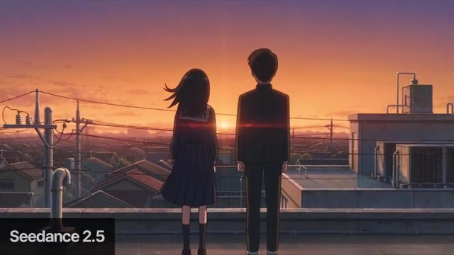  
  *⏱️ 00:00:39 — Animation montrant deux personnages de dos sur un toit face à un coucher de soleil, avec le logo 'Seedance 2.5' en bas à gauche.*
- 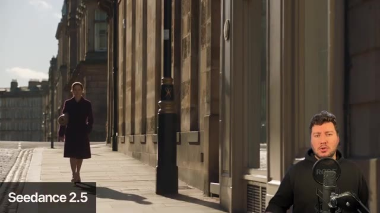  
  *⏱️ 00:00:50 — Scène de rue avec une personne marchant, le créateur dans l'encadré en bas à droite et le texte 'Seedance 2.5'.*
- 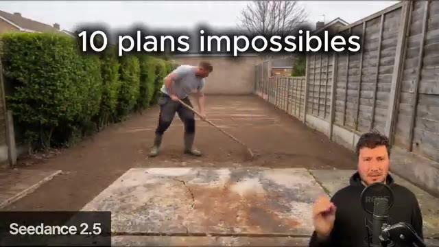  
  *⏱️ 00:01:00 — Démonstration d'un plan de jardin avec le texte '10 plans impossibles' affiché à l'écran et le créateur visible en bas à droite.*

---

### ⏱️ `[00:01:02 - 00:01:23]` | Segment #03

**🔊 Audio (Transcription Intégrale Mot pour Mot en Français) :**
> Pour commencer il me fallait un endroit où Seed Dance 2.5 tourne avec toutes ses fonctionnalités. Et ça a été rendu possible par Artlist, le partenaire de cette vidéo. Tu connais peut-être Artlist pour ses musiques et ses banques d'images. Mais c'est aussi devenu un excellent agrégateur de modèles IA, avec en plus de très bons outils maison.

**👁️ Analyse Visuelle d'Écran (gemini-3.5-flash-lite) :**
**Interface & Outils** : Navigateur web (site officiel d'Artlist).
**Contenu textuel & Code** : Le site met en avant différents modèles d'IA intégrés (Sora, Veo, Kling, Seedance, ElevenLabs, etc.) et un bouton jaune 'Start Free Now'.
**Action / Démonstration** : Le présentateur introduit la plateforme partenaire Artlist en montrant sa page d'accueil et ses fonctionnalités d'agrégateur de modèles IA.

**Captures d'écran :**
- 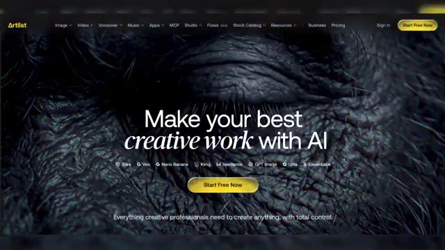  
  *⏱️ 00:01:12 — Page d'accueil du site Artlist affichant le slogan 'Make your best creative work with AI' avec en arrière-plan un œil en gros plan.*
- 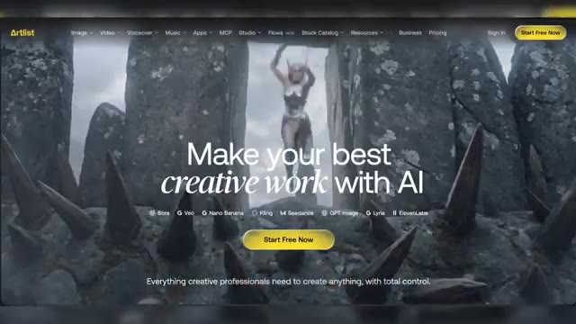  
  *⏱️ 00:01:22 — Page d'accueil du site Artlist affichant le slogan 'Make your best creative work with AI' avec en arrière-plan une scène fantastique/mythologique animée.*

---

### ⏱️ `[00:01:23 - 00:01:50]` | Segment #04

**🔊 Audio (Transcription Intégrale Mot pour Mot en Français) :**
> Pour les modèles, ça se passe dans la section AI Toolkit. Tu accéderas à la plupart des modèles images et vidéos du marché dans leur dernière version. Côté images, on a Nano Banana Pro, Seed Dream 5.0 Pro ou encore GPT Image 2.5. Côté vidéo, Kling 3.0, One 3.0, Minimax H3, VIO 3.1 et celui qui nous intéresse aujourd'hui, Seed Dance 2.5.

**👁️ Analyse Visuelle d'Écran (gemini-3.5-flash-lite) :**
**Interface & Outils** : Interface web d'Artlist (AI Toolkit)
**Contenu textuel & Code** : Menus de sélection de modèles (Seedance 2.5, Veo 3.1, etc.), options de génération vidéo/image, paramètres de durée et de résolution.
**Action / Démonstration** : Navigation dans l'AI Toolkit pour présenter la sélection de modèles d'IA disponibles sur la plateforme.

**Captures d'écran :**
- 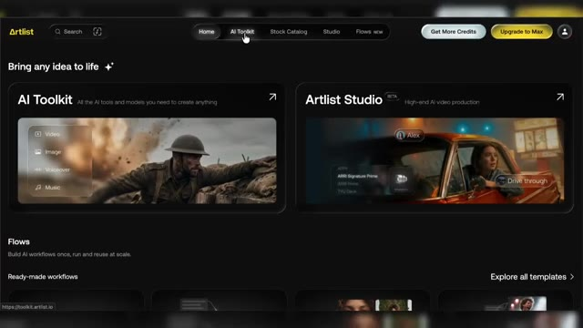  
  *⏱️ 00:01:24 — Page d'accueil de la plateforme Artlist montrant l'accès à l'AI Toolkit et l'Artlist Studio.*
- 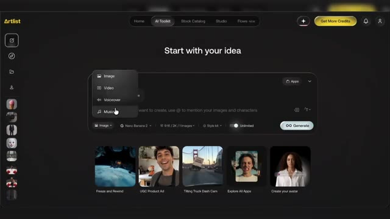  
  *⏱️ 00:01:37 — Interface de génération de contenu de l'AI Toolkit avec un menu déroulant permettant de choisir entre Image, Video, Voiceover et Music.*
- 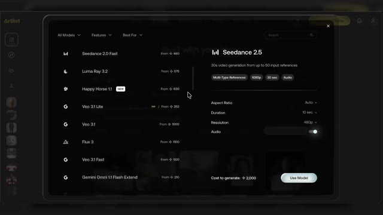  
  *⏱️ 00:01:48 — Fenêtre de sélection des modèles d'intelligence artificielle affichant Seedance 2.5, Seedance 2.0 Fast, Luma Ray 3.2, Veo 3.1 et d'autres options de configuration (Aspect Ratio, Duration, Resolution, Audio).*

---

### ⏱️ `[00:01:50 - 00:02:14]` | Segment #05

**🔊 Audio (Transcription Intégrale Mot pour Mot en Français) :**
> Les versions antérieures restent tout de même toujours accessibles et elles coûtent moins de crédit, ça c'est toujours pratique. Au-delà des modèles, il y a des outils pensés pour la création. Artlist Studio, un assistant pour monter tes séquences et fabriquer ton court-métrage. Et Flow qui te permet de construire tes propres workflows que tu pourras réutiliser d'un projet à l'autre, parfait pour les agences et les professionnels de l'IA.

**👁️ Analyse Visuelle d'Écran (gemini-3.5-flash-lite) :**
**Interface & Outils** : Artlist Studio (interface web / application de création vidéo).
**Contenu textuel & Code** : Projet 'Rooftop Chase', lecteur vidéo central, timeline horizontale découpée en images clés et section inférieure affichant une galerie de plans ('Shot 1' à 'Shot 10').
**Action / Démonstration** : Présentation et démonstration de l'outil Artlist Studio pour la gestion et le montage des séquences de court-métrage.

**Captures d'écran :**
- 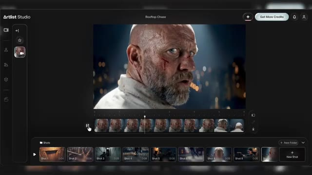  
  *⏱️ 00:02:02 — Interface d'Artlist Studio montrant le projet 'Rooftop Chase' avec la timeline des plans et la liste des 'Shots'.*

---

### ⏱️ `[00:02:14 - 00:02:33]` | Segment #06

**🔊 Audio (Transcription Intégrale Mot pour Mot en Français) :**
> Il y a aussi des templates IA, de la génération audio, une connexion MCP. Bref, je te conseille d'y faire un tour. En plus en ce moment il y a des offres d'abonnement très intéressantes avec accès illimité sur certains modèles. Le lien est en description et en commentaire épinglé. Allez on est sur Artlist dans l'onglet AI Toolkit.

**👁️ Analyse Visuelle d'Écran (gemini-3.5-flash-lite) :**
**Interface & Outils** : Site web Artlist (onglets AI Toolkit, Flows, page de tarification)
**Contenu textuel & Code** : Formules d'abonnement avec crédits et options illimitées, interface de génération d'images par IA, workflows visuels.
**Action / Démonstration** : Le créateur présente l'interface d'Artlist AI Toolkit, les workflows (Flows) et commente les offres d'abonnement disponibles.

**Captures d'écran :**
- 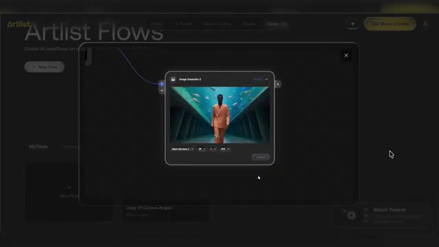  
  *⏱️ 00:02:15 — Interface d'Artlist Flows montrant un générateur d'images basé sur l'IA sous forme de nœuds.*
- 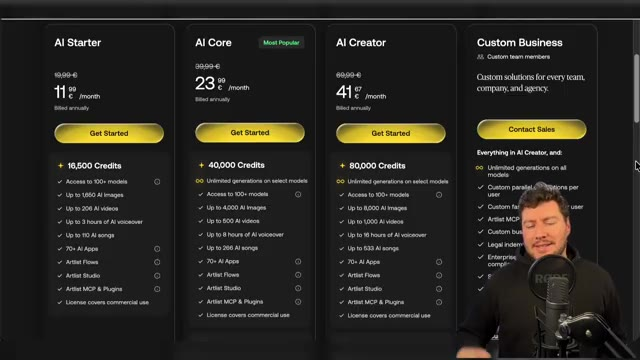  
  *⏱️ 00:02:23 — Page de tarification d'Artlist affichant les différentes formules d'abonnement (AI Starter, AI Core, AI Creator, Custom Business) avec le présentateur en bas à droite.*
- 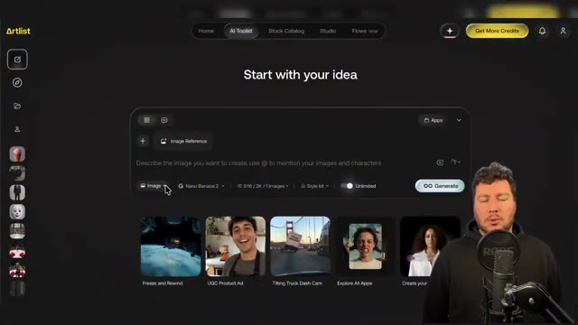  
  *⏱️ 00:02:31 — Interface de l'onglet AI Toolkit sur Artlist avec la zone de saisie pour générer des images et des aperçus de créations en bas.*

---

### ⏱️ `[00:02:33 - 00:02:54]` | Segment #07

**🔊 Audio (Transcription Intégrale Mot pour Mot en Français) :**
> On sélectionne le mode vidéo et on choisit notre modèle Seed Dance 2.5. Un mot rapide sur les caractéristiques de Seed Dance 2.5. La durée d'abord avec Seed Dance tu génères de 4 à 30 secondes en un seul prompt. Il sait aussi bien faire du multi-plan comme du plan séquence. Côté résolution, sur Artlist, on a une version jusqu'à 1080p.

**👁️ Analyse Visuelle d'Écran (gemini-3.5-flash-lite) :**
**Interface & Outils** : Présentation vidéo Artlist / Seed Dance 2.5 avec incrustation du présentateur.
**Contenu textuel & Code** : Textes informatifs : "Seeddance 2.5 sur Artlist", "Durée de génération : 4-30 s", "1080p Full HD • maximum actuel du modèle", "4K : pas encore disponible".
**Action / Démonstration** : Le présentateur détaille les caractéristiques techniques du modèle Seed Dance 2.5, notamment la durée et la résolution.

**Captures d'écran :**
- 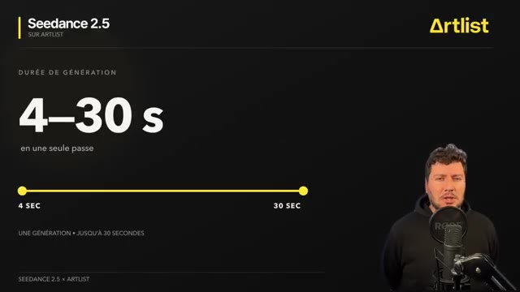  
  *⏱️ 00:02:43 — Écran récapitulatif montrant la durée de génération de 4 à 30 secondes pour Seed Dance 2.5 sur Artlist.*
- 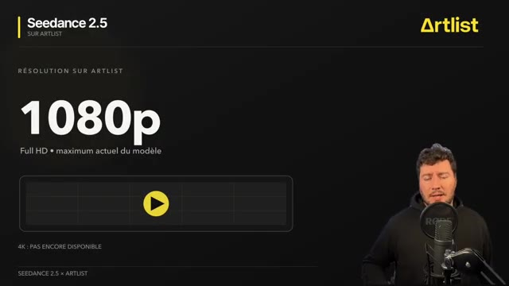  
  *⏱️ 00:02:52 — Écran récapitulatif indiquant la résolution maximale de 1080p Full HD pour Seed Dance 2.5 sur Artlist.*

---

### ⏱️ `[00:02:54 - 00:03:14]` | Segment #08

**🔊 Audio (Transcription Intégrale Mot pour Mot en Français) :**
> C'est la résolution maximum en ce moment et on espère que la 4K arrive bientôt. Côté référence, on monte jusqu'à 50 par génération, 30 images, 10 clips vidéo, 10 fichiers audio. Ce qui est pratique avec Artlist, tu peux piocher directement dans ta bibliothèque d'assets pour les références et tu pourras aussi charger tes propres fichiers depuis ton ordinateur.

**👁️ Analyse Visuelle d'Écran (gemini-3.5-flash-lite) :**
**Interface & Outils** : Présentation orale ou séquence sans interface partagée.
**Contenu textuel & Code** : Explications et conseils de création de contenu / IA.
**Action / Démonstration** : Démonstration et mise en contexte pratique.

---

### ⏱️ `[00:03:14 - 00:03:37]` | Segment #09

**🔊 Audio (Transcription Intégrale Mot pour Mot en Français) :**
> Avec SeedDance, on a quelque chose de vraiment intéressant sur les références audio. j'en dis pas plus, on le verra plus tard dans cette vidéo. Et concernant les références vidéo, ça ouvre la porte à l'édition vidéo par IA. Là aussi, on le verra plus tard dans cette vidéo. Mais pour la première vidéo impossible, je voulais te montrer ce que le modèle a dans le ventre en texte ou vidéo classique.

**👁️ Analyse Visuelle d'Écran (gemini-3.5-flash-lite) :**
**Interface & Outils** : Aucun
**Contenu textuel & Code** : Aucun
**Action / Démonstration** : Le présentateur s'adresse directement au public pour introduire la suite de la vidéo.

---

### ⏱️ `[00:03:40 - 00:03:58]` | Segment #10

**🔊 Audio (Transcription Intégrale Mot pour Mot en Français) :**
> Ici, on va utiliser des plages de temps chiffrées pour gagner en précision. Je veux que la caméra parte d'une goutte de pluie et recule jusqu'à voir la Terre depuis son orbite. Aucune coupe, un dézoom parfaitement fluide. L'astuce pour réussir ce dézoom impossible, c'est de donner le rythme à seat dance.

**👁️ Analyse Visuelle d'Écran (gemini-3.5-flash-lite) :**
**Interface & Outils** : Présentation orale ou séquence sans interface partagée.
**Contenu textuel & Code** : Explications et conseils de création de contenu / IA.
**Action / Démonstration** : Démonstration et mise en contexte pratique.

---

### ⏱️ `[00:03:58 - 00:04:21]` | Segment #11

**🔊 Audio (Transcription Intégrale Mot pour Mot en Français) :**
> Seconde 0 à 3 la fenêtre, seconde 3 à 6 la rue, seconde 6 à 9 la ville. Sans ça, le modèle risque de traîner ou mal gérer le rythme du dézoom. Pour la rédaction du prompt lui-même, tu n'es pas obligé de faire tout à la main. Si tu as ton idée et ta direction, des IA comme Claude ou ChatGPT peuvent t'assister. Ici j'ai demandé à Claude de m'écrire le prompt Seed Dance 2.5 avec ses directives.

**👁️ Analyse Visuelle d'Écran (gemini-3.5-flash-lite) :**
**Interface & Outils** : Interface web de Claude (Anthropic).
**Contenu textuel & Code** : Texte du prompt : "Écris-moi un prompt pour Seedance 2.5 en anglais. La scène : la caméra part d'une goutte de pluie sur une vitre et recule jusqu'à voir la Terre depuis l'orbite..."
**Action / Démonstration** : Le créateur montre l'utilisation de l'outil conversationnel Claude pour générer et structurer le prompt détaillé de la vidéo.

**Captures d'écran :**
- 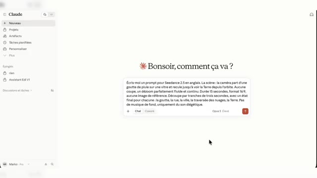  
  *⏱️ 00:04:09 — Interface de l'assistant IA Claude affichant un prompt rédigé demandant la création d'un scénario vidéo de dézoom.*
-   
  *⏱️ 00:04:19 — Vue identique de l'interface de Claude montrant la formulation détaillée du prompt pour Seedance 2.5.*

---

### ⏱️ `[00:04:21 - 00:04:39]` | Segment #12

**🔊 Audio (Transcription Intégrale Mot pour Mot en Français) :**
> La caméra part d'une goutte de pluie et recule jusqu'à voir la terre depuis son orbite, sans aucune coupe, avec un dézoom fluide et j'ai précisé le rythme par tranche de 3 secondes. J'ai aussi demandé le prompt en anglais. Le modèle comprend bien français mais l'anglais limite les erreurs d'interprétation.

**👁️ Analyse Visuelle d'Écran (gemini-3.5-flash-lite) :**
**Interface & Outils** : Artlist AI Toolkit / Générateur vidéo en ligne
**Contenu textuel & Code** : Texte du prompt en anglais décrivant les actions par tranches (0-3 sec, 3-6 sec, etc.) jusqu'à la vue de la Terre depuis l'orbite, options de réglage (Seedance 2.5, 16:9, 720p, 10 Sec) et bouton "Generate".
**Action / Démonstration** : Le créateur montre le prompt rédigé en anglais pour limiter les erreurs d'interprétation du modèle d'IA vidéo.

**Captures d'écran :**
- 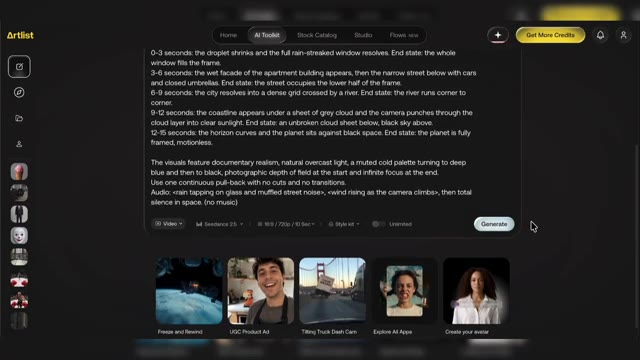  
  *⏱️ 00:04:38 — Interface du générateur vidéo Artlist affichant le prompt en anglais détaillé par tranches de 3 secondes pour un effet de dézoom de la goutte de pluie jusqu'à l'espace.*

---

### ⏱️ `[00:04:54 - 00:05:29]` | Segment #13

**🔊 Audio (Transcription Intégrale Mot pour Mot en Français) :**
> L'effet est bien maîtrisé, le timing des scènes a bien aidé niveau rythme. c'est une super technique. D'ailleurs mettre un nouvel événement visible toutes les trois secondes c'est une règle de base pour un bon rythme à l'écran. Sur Atleast il y a également une option pour améliorer tes promptes, pratique pour gagner en précision à partir d'une idée simple et si tu ne veux pas passer par cloud. Et ne t'inquiète pas j'ai créé un guide complet qui reprend mes explications, mes astuces et mes techniques sur SeedDance 2.5 ainsi que tous les prompts présents dans cette vidéo. Il est disponible gratuitement via le lien en description.

**👁️ Analyse Visuelle d'Écran (gemini-3.5-flash-lite) :**
**Interface & Outils** : Site web d'Artlist (AI Toolkit)
**Contenu textuel & Code** : Champ de prompt avec le texte descriptif de la scène de la goutte d'eau et de la Terre, et page de téléchargement du guide Seedance 2.5.
**Action / Démonstration** : Le présentateur montre l'interface d'amélioration de prompt sur Artlist puis présente le guide gratuit de Seedance 2.5.

**Captures d'écran :**
- 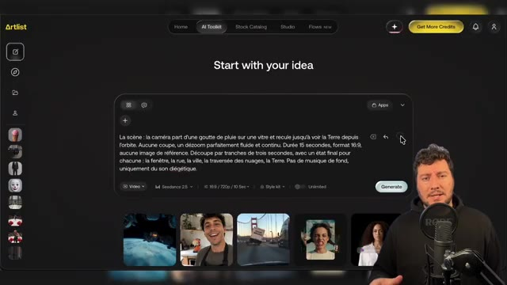  
  *⏱️ 00:05:12 — Interface de la plateforme Artlist montrant un champ de saisie de prompt (« Start with your idea »).*
- 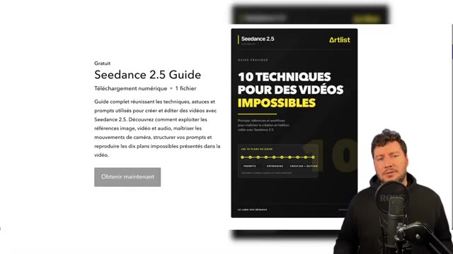  
  *⏱️ 00:05:27 — Page de présentation du « Seedance 2.5 Guide » avec un bouton de téléchargement.*

---

### ⏱️ `[00:05:31 - 00:05:54]` | Segment #14

**🔊 Audio (Transcription Intégrale Mot pour Mot en Français) :**
> Pour la deuxième vidéo, je veux un plan aérien sur un boulevard parisien avec un chat de 40 mètres de haut. Mais surtout, je veux décider moi-même du mouvement de caméra. Alors, je ne l'ai pas écrit, je l'ai dessiné. J'ai généré l'image du chat dans la rue avec Nano Banana Pro. Je l'ai ouvert avec l'aperçu de mon Mac et j'ai tracé le trajet du drone en rouge par-dessus.

**👁️ Analyse Visuelle d'Écran (gemini-3.5-flash-lite) :**
**Interface & Outils** : Aperçu (macOS), Présentation vidéo Seedance 2.5 / Artlist
**Contenu textuel & Code** : Image générée d'un chat géant dans une rue de Paris annotée à main levée en rouge avec les repères 'Départ' et 'Arrivée'.
**Action / Démonstration** : Le créateur montre comment il a dessiné le trajet du drone directement sur l'image générée ouverte dans l'application Aperçu de son Mac.

**Captures d'écran :**
- 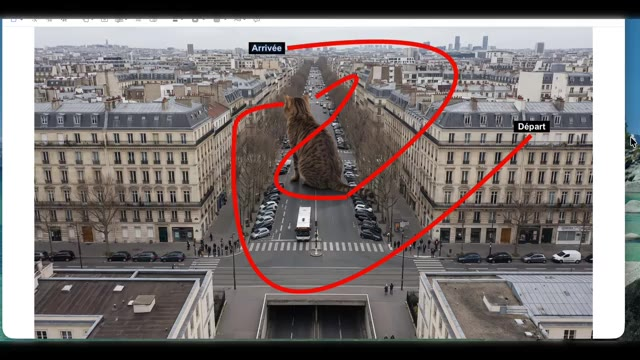  
  *⏱️ 00:05:52 — Capture d'écran de l'application 'Aperçu' sur Mac montrant une image aérienne d'un chat géant dans Paris avec des tracés rouges de trajectoire et les mentions 'Départ' et 'Arrivée'.*

---

### ⏱️ `[00:05:54 - 00:06:22]` | Segment #15

**🔊 Audio (Transcription Intégrale Mot pour Mot en Français) :**
> J'ai ajouté aussi l'indication de la case départ et de la case arrivée. Pour le prompt, je me suis fait aider par Claude. Je lui ai demandé d'indiquer à Seed Dance que la ligne rouge est la trajectoire de la caméra, en précisant que c'est une consigne de mise en scène, et pas un élément à afficher. Le résultat n'est pas mal du tout, mais pour être honnête, je n'ai pas exactement la précision que je souhaitais.

**👁️ Analyse Visuelle d'Écran (gemini-3.5-flash-lite) :**
**Interface & Outils** : Générateur vidéo en ligne (Artlist / Seedance).
**Contenu textuel & Code** : Texte du prompt indiquant que la vidéo ne doit contenir aucune ligne rouge ni élément graphique, et paramètres (Seedance 2.5, format 16:9, qualité 720p).
**Action / Démonstration** : Le créateur montre le résultat vidéo obtenu grâce au prompt optimisé avec Claude.

**Captures d'écran :**
- 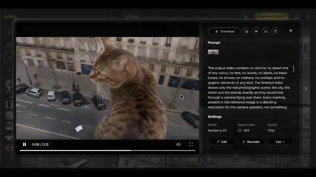  
  *⏱️ 00:06:08 — Interface du générateur vidéo montrant le résultat de la génération avec le prompt textuel et les réglages.*

---

### ⏱️ `[00:06:22 - 00:06:44]` | Segment #16

**🔊 Audio (Transcription Intégrale Mot pour Mot en Français) :**
> Le trait rouge sur une référence, c'est bien pour une trajectoire simple. Mais pour un mouvement précis et reproductible, il faut monter d'un cran. Là, j'ai construit le mouvement dans Blender. Si tu ne connais pas bien l'outil, tu peux faire comme moi et te faire aider par ChatGPT ou Claude. Là, j'ai réalisé une vidéo très simple, pas de texture, pas de lumière, que des volumes gris.

**👁️ Analyse Visuelle d'Écran (gemini-3.5-flash-lite) :**
**Interface & Outils** : Blender 3.2.1 LTS
**Contenu textuel & Code** : Interface de modélisation 3D avec objets géométriques gris (cube, plans), panneau des propriétés à droite et timeline en bas.
**Action / Démonstration** : Le créateur montre la construction d'un mouvement simple en 3D dans Blender sans texture.

**Captures d'écran :**
- 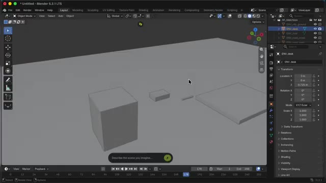  
  *⏱️ 00:06:33 — Interface du logiciel 3D Blender affichant une scène simple en niveaux de gris.*
- 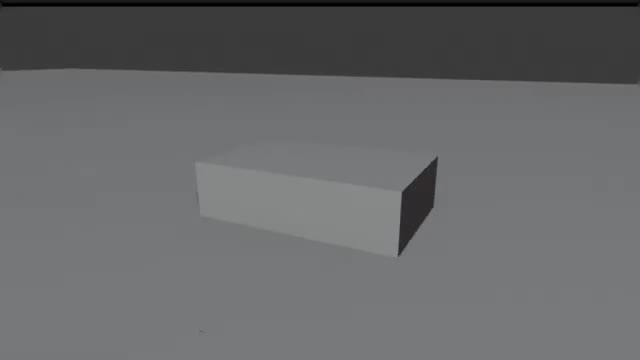  
  *⏱️ 00:06:42 — Gros plan sur un objet 3D rectangulaire minimaliste et sans texture dans Blender.*

---

### ⏱️ `[00:06:44 - 00:07:04]` | Segment #17

**🔊 Audio (Transcription Intégrale Mot pour Mot en Français) :**
> La seule chose qui m'importe, c'est le mouvement de la caméra. Un zoom vers la boîte, un tour complet à 360 degrés et un dézoom, 12 secondes au total. Je charge maintenant cette vidéo en référence sur Artlist. Et pour le prompt, j'ai demandé à Claude d'indiquer à SidDance de suivre le mouvement de la caméra de la vidéo de référence.

**👁️ Analyse Visuelle d'Écran (gemini-3.5-flash-lite) :**
**Interface & Outils** : Artlist (AI Toolkit)
**Contenu textuel & Code** : Menu d'options de génération (Start & End Frame, Image Reference, Video Reference, Audio File, Character) et champ de prompt textuel.
**Action / Démonstration** : Importation d'une vidéo de référence et saisie d'un prompt pour guider le mouvement de caméra de l'IA.

**Captures d'écran :**
- 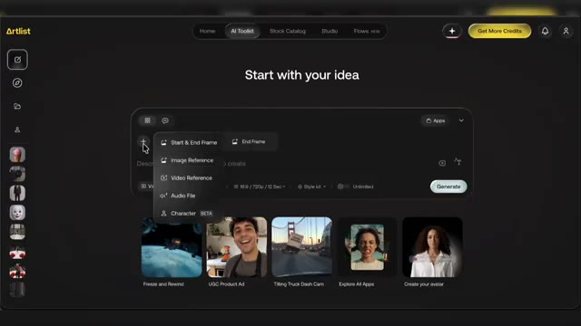  
  *⏱️ 00:06:54 — Interface d'Artlist montrant le menu d'ajout de référence avec l'option 'Video Reference' sélectionnée.*
- 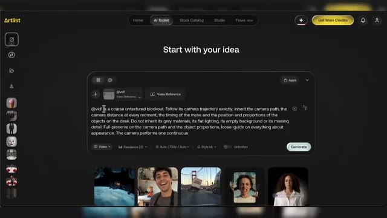  
  *⏱️ 00:07:02 — Interface d'Artlist affichant le prompt textuel demandant à Seedance de suivre la trajectoire de la caméra de la vidéo de référence.*

---

### ⏱️ `[00:07:04 - 00:07:24]` | Segment #18

**🔊 Audio (Transcription Intégrale Mot pour Mot en Français) :**
> En lui décrivant le décor et les éléments que je voulais, une boîte d'allumettes sur un bureau. Voilà le résultat. Et si on met la vidéo de référence et le rendu côte à côte, c'est juste parfait.

**👁️ Analyse Visuelle d'Écran (gemini-3.5-flash-lite) :**
**Interface & Outils** : Aucun logiciel ou interface visible.
**Contenu textuel & Code** : Aucun texte ou réglage affiché, uniquement le visuel de la boîte d'allumettes générée.
**Action / Démonstration** : Le créateur montre le résultat visuel généré par l'IA illustrant la description du décor.

---

### ⏱️ `[00:07:24 - 00:07:43]` | Segment #19

**🔊 Audio (Transcription Intégrale Mot pour Mot en Français) :**
> Diriger un plan à partir d'une maquette 3D, c'est une vraie technique avancée de cinéma. Pouvoir le faire chez soi avec Blender et Seed Dance 2.5, c'est juste dingue. Ici, on utilise le principe Start Frame, End Frame. Avec, on va créer un effet Timelapse.

**👁️ Analyse Visuelle d'Écran (gemini-3.5-flash-lite) :**
**Interface & Outils** : Interface de présentation vidéo / diapositive explicative Seeddance 2.5 sur Artlist.
**Contenu textuel & Code** : Textes : 'Start frame + end frame', 'Seedance crée le mouvement entre les deux états', 'DEUX IMAGES • UNE TRANSITION CONTINUE', 'VIDÉO 4 : LE JARDIN × SEEDDANCE 2.5'.
**Action / Démonstration** : Le créateur explique le principe d'animation par images clés de début et de fin pour générer une transition fluide avec Seed Dance 2.5.

**Captures d'écran :**
- 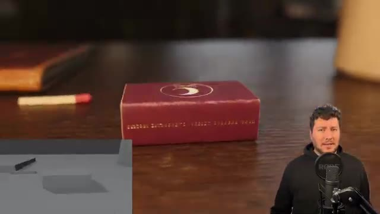  
  *⏱️ 00:07:25 — Présentation d'un plan tourné avec une maquette 3D incrustée en bas à gauche de l'écran.*
- 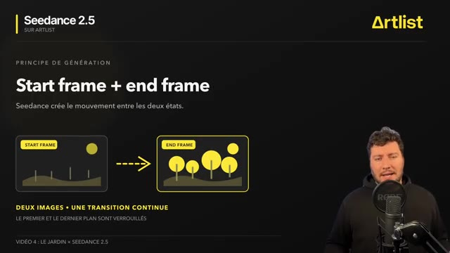  
  *⏱️ 00:07:41 — Schéma explicatif sur fond noir détaillant le principe 'Start frame + end frame' avec Seed Dance 2.5.*

---

### ⏱️ `[00:07:43 - 00:08:06]` | Segment #20

**🔊 Audio (Transcription Intégrale Mot pour Mot en Français) :**
> Parfait pour du contenu réseau sociaux. J'ai commencé à créer des images de référence sur Artlist avec Nano Banana Pro. Un jardin en friche, puis le même jardin entretenu avec en plus une nouvelle terrasse et un coin barbecue. Avec l'aide de Claude, j'ai écrit mon prompt Seed Dance 2.5 qui génère le timelapse d'un jardinier qui nettoie ce jardin et construit la terrasse et le barbecue.

**👁️ Analyse Visuelle d'Écran (gemini-3.5-flash-lite) :**
**Interface & Outils** : Artlist (outil de génération d'images et vidéos par IA)
**Contenu textuel & Code** : Textes de prompts détaillés en anglais, réglages de modèles (Nano Banana 2, Seedance 2.5), paramètres de format (16:9, 2K) et options de génération vidéo.
**Action / Démonstration** : Le créateur montre la création et l'affinage des prompts d'image et de vidéo sur Artlist pour planifier la transformation du jardin.

**Captures d'écran :**
- 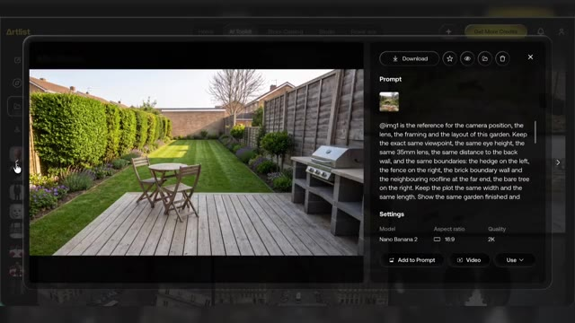  
  *⏱️ 00:07:54 — Interface d'Artlist affichant l'image générée d'un jardin entretenu avec terrasse et barbecue, accompagnée du panneau de prompt textuel et des réglages du modèle Nano Banana 2.*
- 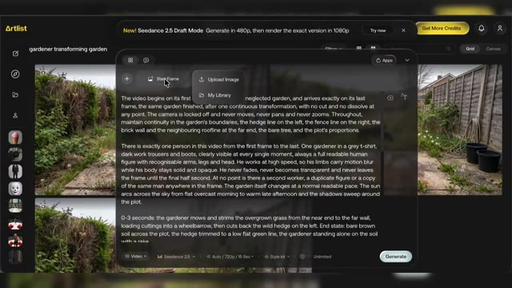  
  *⏱️ 00:08:04 — Interface d'Artlist montrant la rédaction d'un prompt détaillé pour Seed Dance 2.5 décrivant la transformation d'un jardin en friche en jardin entretenu par un jardinier.*

---

### ⏱️ `[00:08:06 - 00:08:25]` | Segment #21

**🔊 Audio (Transcription Intégrale Mot pour Mot en Français) :**
> Le point critique, les deux images doivent avoir exactement le même cadrage. J'ai donc généré d'abord l'image de départ, puis j'ai utilisé cette image en référence dans une deuxième génération Nano Banana Pro pour créer l'image d'arrivée. Le résultat est bluffant et ce n'est qu'une idée parmi tous les types de timelapse que tu peux faire.

**👁️ Analyse Visuelle d'Écran (gemini-3.5-flash-lite) :**
**Interface & Outils** : Application web / Interface utilisateur de gestion de bibliothèque multimédia (Artlist ou similaire).
**Contenu textuel & Code** : Galerie de miniatures classées dans "My Library", avec des images avant/après d'un jardin et des personnages sous différents angles.
**Action / Démonstration** : Le créateur présente l'interface et la bibliothèque d'images générées servant à réaliser le timelapse avec le même cadrage.

**Captures d'écran :**
- 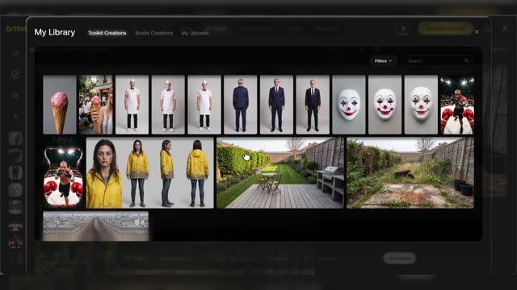  
  *⏱️ 00:08:07 — Interface d'une application montrant une galerie d'images avec des exemples de génération d'IA (personnages, décors de jardin).*
- 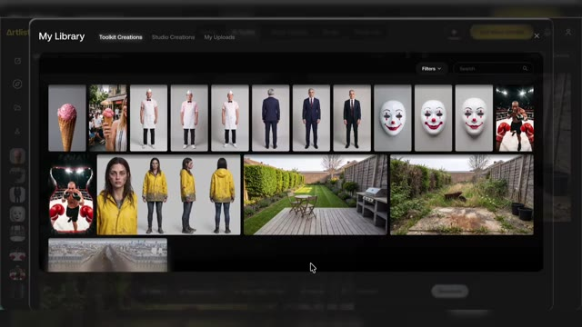  
  *⏱️ 00:08:15 — Poursuite de la navigation dans la galerie d'images de l'interface avec les miniatures de projets.*

---

### ⏱️ `[00:08:26 - 00:08:46]` | Segment #22

**🔊 Audio (Transcription Intégrale Mot pour Mot en Français) :**
> Pour cette cinquième vidéo, on part sur une scène d'anime japonais.

**👁️ Analyse Visuelle d'Écran (gemini-3.5-flash-lite) :**
**Interface & Outils** : Seedance 2.5 / Artlist
**Contenu textuel & Code** : Vidéo 5 : Dialogue sur les toits / Titre : Une scène d'anime au coucher du soleil / Description : Deux lycéens de dos sur un toit / Tags : Scène simple, ambiance japonaise, plan fixe.
**Action / Démonstration** : Le créateur présente le projet numéro 5 inspiré d'une scène d'anime japonais.

**Captures d'écran :**
- 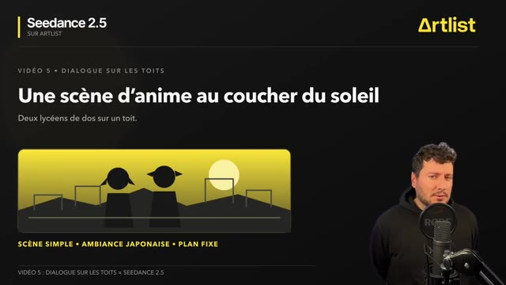  
  *⏱️ 00:08:44 — Interface de présentation Seedance 2.5 sur Artlist avec le titre 'Une scène d'anime au coucher du soleil'.*

---

### ⏱️ `[00:08:46 - 00:09:05]` | Segment #23

**🔊 Audio (Transcription Intégrale Mot pour Mot en Français) :**
> Deux lycéens de dos sur un toit au coucher de soleil. Rien de compliqué en somme. Sauf qu'on vient y ajouter une réplique en français. Et pour ça, on va utiliser un audio de référence. J'ai créé un audio de référence sur Artlist avec Elevenlabs. Mais cet audio, il n'a rien à voir avec le dialogue de ma vidéo. Et c'est justement le but.

**👁️ Analyse Visuelle d'Écran (gemini-3.5-flash-lite) :**
**Interface & Outils** : Interface web Artlist (AI Toolkit)
**Contenu textuel & Code** : Champ de texte avec un prompt en français et options de voix (Eleven v3, French, Generate)
**Action / Démonstration** : Le créateur montre l'interface d'Artlist où il configure son idée et prépare la génération audio/vidéo.

**Captures d'écran :**
- 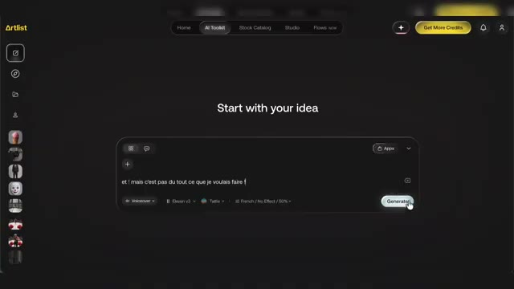  
  *⏱️ 00:09:03 — Interface de la plateforme Artlist montrant la zone de saisie pour démarrer un projet avec le bouton Generate.*

---

### ⏱️ `[00:09:05 - 00:09:29]` | Segment #24

**🔊 Audio (Transcription Intégrale Mot pour Mot en Français) :**
> Si Dance 2.5 a une particularité, il est capable de cloner la voix que tu lui donnes en référence et l'utiliser avec la phrase que tu vas écrire dans ton prompt. Ça permet de gagner en précision, ça permet aussi à ce que la voix s'intègre parfaitement avec l'ambiance sonore de la vidéo. Il faut donc lui donner un extrait de voix bien clair et écrire la phrase exacte que ton personnage doit prononcer dans le prompt.

**👁️ Analyse Visuelle d'Écran (gemini-3.5-flash-lite) :**
**Interface & Outils** : Interface graphique de présentation vidéo de la chaîne 'Labo Des Réseaux' sur Seedance 2.5.
**Contenu textuel & Code** : Texte explicatif : "La voix est clonée", "Deux consignes essentielles", "Voix bien claire" et "Phrase exacte" dans le prompt.
**Action / Démonstration** : Présentation des spécificités techniques et des bonnes pratiques pour le clonage vocal avec l'outil Seedance 2.5.

**Captures d'écran :**
- 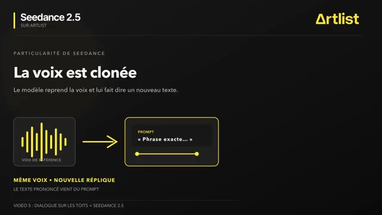  
  *⏱️ 00:09:06 — Écran graphique explicatif sur Seedance 2.5 montrant le clonage vocal où une voix de référence est transformée via un prompt.*
- 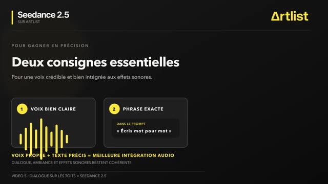  
  *⏱️ 00:09:17 — Écran graphique détaillant les deux consignes essentielles pour Seedance 2.5 : fournir une voix bien claire et rédiger la phrase exacte dans le prompt.*

---

### ⏱️ `[00:09:29 - 00:09:59]` | Segment #25

**🔊 Audio (Transcription Intégrale Mot pour Mot en Français) :**
> Je sélectionne donc mon audio en référence. On l'écoute juste avant. Hé, mais c'est pas du tout ce que je voulais faire. La réplique est écrite dans le prompt. Tu la vois ici. J'ai aussi donné des indications de jeu au personnage, notamment sur l'émotion. Et voilà le résultat. Alors, t'as décidé de partir, c'est ça ?

**👁️ Analyse Visuelle d'Écran (gemini-3.5-flash-lite) :**
**Interface & Outils** : Artlist (plateforme de création et d'outils IA)
**Contenu textuel & Code** : Interface de prompt avec référence audio (@aud1), descriptions détaillées de scènes animées, instructions de dialogue (« Alors tu as décidé de partir, c'est ça »).
**Action / Démonstration** : Le créateur montre la structure d'un prompt complexe combinant référence audio et directives émotionnelles pour la génération de vidéo par IA.

**Captures d'écran :**
- 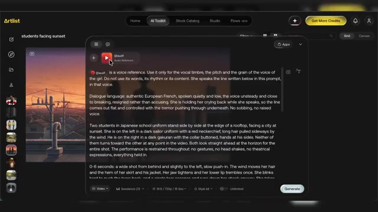  
  *⏱️ 00:09:30 — Interface de l'outil IA sur Artlist montrant les paramètres du prompt pour la génération vidéo.*
- 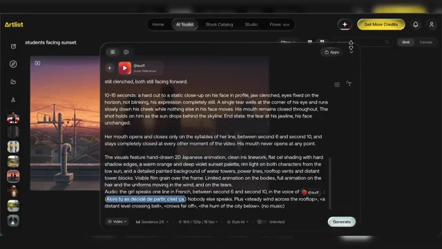  
  *⏱️ 00:09:44 — Suite du prompt textuel détaillant les instructions de scène, le style d'animation et la réplique en français.*
- 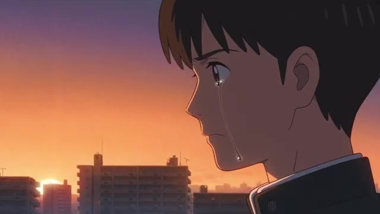  
  *⏱️ 00:09:58 — Résultat de la génération vidéo montrant un personnage en gros plan avec une larme à l'œil sur fond de coucher de soleil.*

---

### ⏱️ `[00:09:59 - 00:10:21]` | Segment #26

**🔊 Audio (Transcription Intégrale Mot pour Mot en Français) :**
> Seed Dance 2.5 a parfois du mal avec le français. surtout quand un mot sort du vocabulaire courant, comme par exemple avec de l'argot ou des expressions particulières. Mais cette technique, un audio de référence et un prompt précis, donne de bons résultats. L'objectif ici, c'est un long travelling sur un personnage qui reste cohérent du début à la fin.

**👁️ Analyse Visuelle d'Écran (gemini-3.5-flash-lite) :**
**Interface & Outils** : Interface web d'Artlist (générateur Seedance 2.5) et présentation vidéo.
**Contenu textuel & Code** : Textes descriptifs de prompt en anglais, réglages (Model: Seedance 2.5, Aspect ratio: 16:9, Quality: 720p) et infographie sur le mouvement de caméra.
**Action / Démonstration** : Le créateur illustre l'utilisation de Seedance 2.5 pour générer des plans cohérents avec des prompts spécifiques et commente les résultats.

**Captures d'écran :**
- 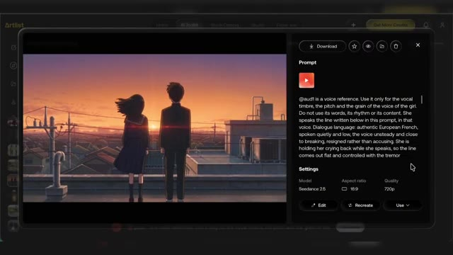  
  *⏱️ 00:10:00 — Interface de génération vidéo montrant un plan large animé et un prompt détaillé sur Artlist avec Seedance 2.5.*
- 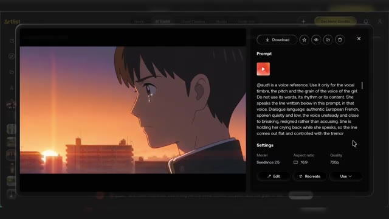  
  *⏱️ 00:10:10 — Gros plan du personnage dans la même interface de Seedance 2.5 sur Artlist, illustrant la cohérence visuelle.*
- 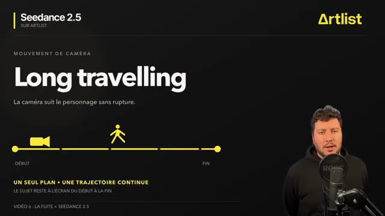  
  *⏱️ 00:10:19 — Diapositive explicative sur le 'Long travelling' avec Seedance 2.5 et le présentateur en bas à droite.*

---

### ⏱️ `[00:10:21 - 00:11:11]` | Segment #27

**🔊 Audio (Transcription Intégrale Mot pour Mot en Français) :**
> Pour aider le modèle, je lui donne en référence une planche 4 vues de mon personnage. Celle-ci contient différents angles, on part sur 30 secondes, un seul plan, aucune coupe, notre héroïne en ciré jaune créée avec Nano Banana Pro, elle va fuir à travers 5 décors différents. Voyons ce que ça donne. Alors c'est pas mal, là j'ai vraiment misé sur le personnage et sa cohérence.

**👁️ Analyse Visuelle d'Écran (gemini-3.5-flash-lite) :**
**Interface & Outils** : Lecteur vidéo / Sortie de génération IA
**Contenu textuel & Code** : Séquence vidéo générée par IA montrant un personnage en ciré jaune fuyant à travers différents décors.
**Action / Démonstration** : Présentation des résultats de génération vidéo par le créateur.

---

### ⏱️ `[00:11:12 - 00:11:32]` | Segment #28

**🔊 Audio (Transcription Intégrale Mot pour Mot en Français) :**
> J'ai aussi donné dans le prompt des indications précises sur les mouvements de caméra et le plan séquence en général. Et cette planche de référence, elle me fait penser à une autre technique, le storyboard. Tu donnes une planche qui illustre les différentes scènes que tu veux dans ta vidéo. Et avec Seed Dance 2.5 qui monte jusqu'à 30 secondes, tu peux très bien lui donner un storyboard de 5 ou 6 cases.

**👁️ Analyse Visuelle d'Écran (gemini-3.5-flash-lite) :**
**Interface & Outils** : Incrustation vidéo sur fond vert (chroma key) avec un présentateur en coin inférieur droit.
**Contenu textuel & Code** : Vidéo illustrative de mouvements de caméra continus générés par intelligence artificielle.
**Action / Démonstration** : Le youtubeur commente les capacités de génération vidéo en plan-séquence de Seed Dance 2.5.

---

### ⏱️ `[00:11:32 - 00:12:06]` | Segment #29

**🔊 Audio (Transcription Intégrale Mot pour Mot en Français) :**
> Seed Dance 2.5 ce n'est pas que de la création, c'est aussi un outil surpuissant pour l'édition et la retouche. Et la meilleure preuve que je peux te donner c'est le changement de météo sur un plan. J'ai d'abord créé un plan de référence. Une femme qui marche dans la rue. En prenant cette vidéo de référence j'ai changé la météo pour faire tomber de la pluie et ensuite lui faire ouvrir un parapluie en conséquence. Voilà le résultat. C'est une vraie prouesse et dans mon expérience professionnelle

**👁️ Analyse Visuelle d'Écran (gemini-3.5-flash-lite) :**
**Interface & Outils** : Interface web d'Artlist / Seedance 2.5 et retour caméra du studio du créateur.
**Contenu textuel & Code** : Prompt textuel décrivant la scène de la femme marchant dans la rue, paramètres de configuration (Seedance 2.5, 1280x720, 12s, MP4) et aperçu vidéo comparatif avant/après.
**Action / Démonstration** : Le créateur présente l'interface de l'outil et montre le résultat concret de la modification de la météo (ajout d'un parapluie et de pluie) à partir d'un plan de référence existant.

**Captures d'écran :**
- 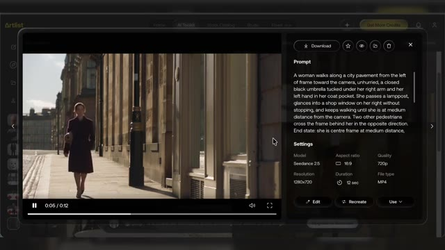  
  *⏱️ 00:11:49 — Interface de la plateforme Artlist montrant le lecteur vidéo du plan de référence d'une femme marchant dans la rue, avec le panneau latéral détaillant le prompt textuel et les paramètres de génération Seedance 2.5.*
- 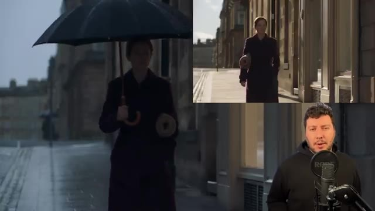  
  *⏱️ 00:12:04 — Comparatif en picture-in-picture montrant le plan de référence original en haut à droite et la nouvelle version modifiée avec un parapluie et une ambiance pluvieuse à gauche, pendant que le présentateur commente le résultat.*

---

### ⏱️ `[00:12:06 - 00:12:40]` | Segment #30

**🔊 Audio (Transcription Intégrale Mot pour Mot en Français) :**
> récente sur des projets où on me demandait de changer la météo voire passer du jour à la nuit Seed Dance 2.5 a parfaitement géré. Dans cette vidéo on va mettre en avant deux forces du modèle la gestion du pov et le changement de style en pleine génération l'idée je suis un boxeur et à chaque coup que je prends le décor change autour de moi j'ai travaillé imprompte avec plusieurs styles et une chute un peu drôle et j'ai pensé la vidéo pour le format vertical encore une fois c'est parfait pour les réseaux sociaux. Pour plus de précision je donne une image de référence du

**👁️ Analyse Visuelle d'Écran (gemini-3.5-flash-lite) :**
**Interface & Outils** : Plateforme Artlist (AI Toolkit / Générateur vidéo)
**Contenu textuel & Code** : Prompt textuel décrivant un combat de boxe en POV avec des changements de style à chaque coup : « Four punches land in this video... », choix du modèle « Seedance 2.5 », format 9:16, 720p, 15 Sec.
**Action / Démonstration** : Le créateur montre l'interface de génération vidéo et détaille le prompt textuel utilisé pour tester la gestion du POV et le changement de style en pleine génération.

**Captures d'écran :**
- 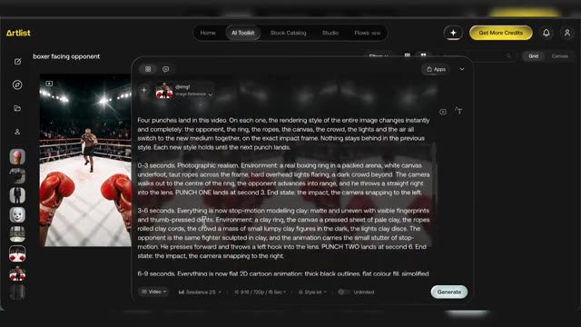  
  *⏱️ 00:12:39 — Interface de la plateforme Artlist montrant l'éditeur de génération vidéo par IA avec un prompt détaillé sur un combat de boxe en POV et les réglages de Seedance 2.5.*

---

### ⏱️ `[00:12:40 - 00:13:17]` | Segment #31

**🔊 Audio (Transcription Intégrale Mot pour Mot en Français) :**
> boxer et encore une fois j'ai minuté les changements pour que le modèle ne parte pas dans tous les sens. Voilà le résultat. Techniquement très intéressant si tu veux mélanger les styles, travailler des projets plus artistiques, plus psychédéliques ou abstraits. Seed Dance 2.5 c'est donc gérer plusieurs styles et ça même au sein du même prompt. Le POV c'est aussi une

**👁️ Analyse Visuelle d'Écran (gemini-3.5-flash-lite) :**
**Interface & Outils** : Vidéo de démonstration et vue face caméra du créateur.
**Contenu textuel & Code** : Animation verticale montrant un personnage squelettique boxant.
**Action / Démonstration** : Le créateur montre le résultat visuel obtenu avec l'outil Seed Dance 2.5.

---

### ⏱️ `[00:13:17 - 00:13:35]` | Segment #32

**🔊 Audio (Transcription Intégrale Mot pour Mot en Français) :**
> Une approche de réalisation intéressante, bien maîtrisée par Seed Dance 2.5. Sur cette vidéo, on repart sur de l'édition. Cette fois pour ajouter des éléments qui n'existaient pas. Très pratiques pour modifier un plan en post-production. Ici, c'est ma première vidéo générée aussi avec Seed Dance 2.5.

**👁️ Analyse Visuelle d'Écran (gemini-3.5-flash-lite) :**
**Interface & Outils** : Présentation vidéo Seed Dance 2.5 sur Artlist.
**Contenu textuel & Code** : Textes : 'SEEDANCE 2.5', 'VIDÉO 9 • LE BRAQUAGE', 'Ajouter ce qui n'existait pas', 'AJOUT D'ÉLÉMENTS EN POST-PRODUCTION'.
**Action / Démonstration** : Le créateur présente l'outil Seed Dance 2.5 et sa capacité d'édition générative pour ajouter des éléments inexistants dans un plan.

**Captures d'écran :**
- 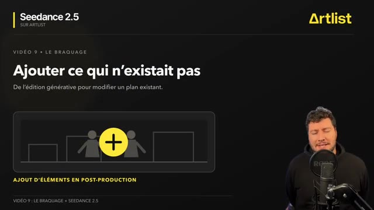  
  *⏱️ 00:13:26 — Diapositive de présentation de Seed Dance 2.5 intitulée 'Ajouter ce qui n'existait pas'.*

---

### ⏱️ `[00:13:36 - 00:14:12]` | Segment #33

**🔊 Audio (Transcription Intégrale Mot pour Mot en Français) :**
> Et finalement, mon but, ça va être d'équiper les cambrioleurs de masques. J'ai donc créé des masques de clown avec Nano Banana Pro. Et avec un prompt assez simple et ma nouvelle image de référence, je vais demander à Seed Dance d'équiper les cambrioleurs avec ses nouveaux masques. Voyons le résultat. Si on compare les deux vidéos, on voit bien que seuls les masques ont changé.

**👁️ Analyse Visuelle d'Écran (gemini-3.5-flash-lite) :**
**Interface & Outils** : Logiciel de montage vidéo avec affichage multi-fenêtres et comparatif avant/après.
**Contenu textuel & Code** : Vidéo de démonstration illustrant le remplacement de cagoules par des masques de clown sur des personnages.
**Action / Démonstration** : Le créateur compare le résultat de la transformation vidéo effectuée avec Seed Dance et Nano Banana Pro.

**Captures d'écran :**
- 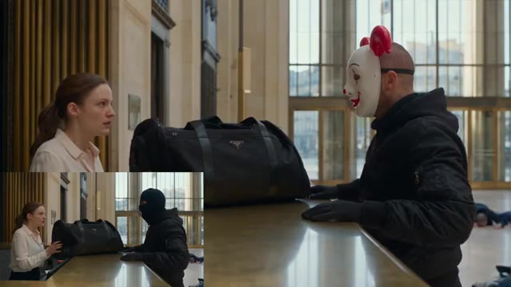  
  *⏱️ 00:13:54 — Comparaison vidéo avant/après montrant un cambrioleur portant un masque de clown généré par IA.*
- 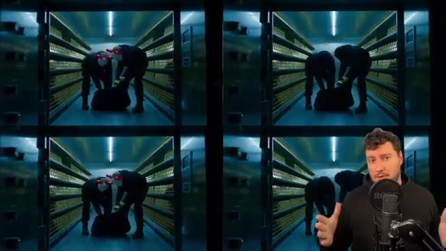  
  *⏱️ 00:14:10 — Grille vidéo multi-écrans avec le présentateur en bas à droite analysant les différentes variations générées.*

---

### ⏱️ `[00:14:12 - 00:14:30]` | Segment #34

**🔊 Audio (Transcription Intégrale Mot pour Mot en Français) :**
> Pouvoir faire de l'édition aussi précise avec Seed Dance 2.5, c'est vraiment un atout. Pour aller encore plus loin dans l'édition, j'ai voulu finir par la reproduction d'une trend. C'est la reprise d'un passage du clip Storm. En ce moment on voit cet effet partout sur Instagram.

**👁️ Analyse Visuelle d'Écran (gemini-3.5-flash-lite) :**
**Interface & Outils** : Présentation vidéo Artlist avec incrustation du créateur (face-cam).
**Contenu textuel & Code** : Texte à l'écran : "Seedance 2.5 sur Artlist", "Vidéo 10 : Reproduire une trend", "Réinterpréter une trend Instagram", "Un passage de clip devient une nouvelle scène", "Même dynamique • Nouveaux éléments", schémas "Passage du clip" vers "Nouvelle version".
**Action / Démonstration** : Le créateur introduit la dernière étape de la vidéo : la reproduction et la réinterprétation d'une trend populaire d'Instagram.

**Captures d'écran :**
- 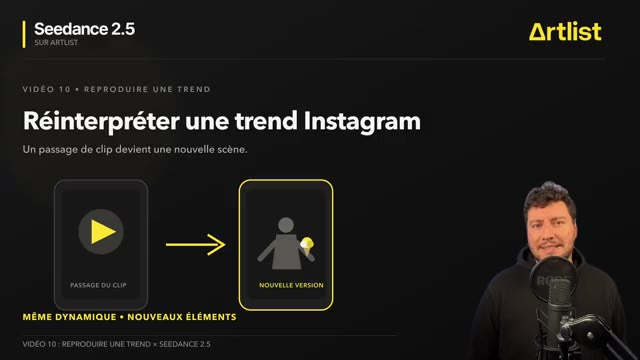  
  *⏱️ 00:14:21 — Diapositive de présentation Artlist avec le titre 'Réinterpréter une trend Instagram' et le sous-titre 'Un passage de clip devient une nouvelle scène'.*
- 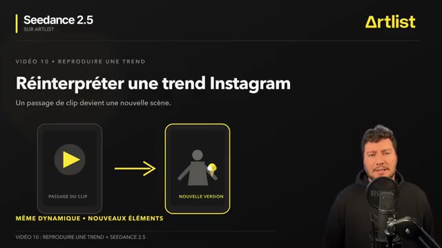  
  *⏱️ 00:14:29 — Diapositive de présentation Artlist identique montrant le concept de réinterprétation d'une trend Instagram avec Seed Dance 2.5.*

---

### ⏱️ `[00:14:30 - 00:14:51]` | Segment #35

**🔊 Audio (Transcription Intégrale Mot pour Mot en Français) :**
> On a préparé nos références. J'ai pris Marco en multi-angle, un glacier dont on va prendre la tenue et la glace que Marco va tenir à la place de la cigarette. Ce n'est vraiment pas évident, il faut bien indiquer au modèle que puisque c'est une glace, l'action de fumée du clip original doit disparaître. Et pour gagner en précision, j'ai demandé à Claude de me préparer un prompt en JSON.

**👁️ Analyse Visuelle d'Écran (gemini-3.5-flash-lite) :**
**Interface & Outils** : Interface web de l'assistant IA Claude.
**Contenu textuel & Code** : Prompt détaillé rédigé en anglais décrivant les références (@Image 1, @Image 2, @Image 3), les consignes de remplacement du personnage, de la glace et des costumes de la foule.
**Action / Démonstration** : Le créateur montre la rédaction et l'optimisation d'un prompt complexe via l'assistant Claude pour préparer la génération vidéo.

**Captures d'écran :**
- 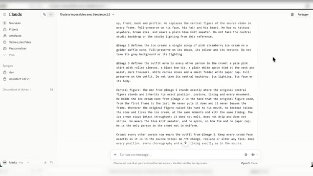  
  *⏱️ 00:14:50 — Interface de l'assistant textuel Claude affichant un prompt détaillé pour guider le modèle vidéo (Seedance 2.5).*

---

### ⏱️ `[00:14:51 - 00:15:37]` | Segment #36

**🔊 Audio (Transcription Intégrale Mot pour Mot en Français) :**
> En général quand j'ai beaucoup d'éléments à modifier en édition, je privilégie le JSON. Petite astuce si un jour tu bloques, donne ton prompt à Claude ou TchaGPT et demande-lui une version JSON. Ça débloque parfois la situation. Voilà le résultat. Bon alors c'est sans la musique parce qu'avec YouTube je ne peux pas la mettre pour des questions de droits d'auteur.

**👁️ Analyse Visuelle d'Écran (gemini-3.5-flash-lite) :**
**Interface & Outils** : Extrait vidéo diffusé à l'écran, pas d'interface logicielle technique.
**Contenu textuel & Code** : Vidéo visuelle avec des personnages en uniforme et un encart incrusté.
**Action / Démonstration** : Le créateur présente le résultat final de son montage vidéo.

---

### ⏱️ `[00:15:37 - 00:15:57]` | Segment #37

**🔊 Audio (Transcription Intégrale Mot pour Mot en Français) :**
> Mais sur Instagram ou TikTok c'est parfait si la musique est disponible dans leur bibliothèque. Si on met les deux clips côte à côte, le résultat en édition est vraiment impressionnant. Alors que retenir de ces 10 prompts impossibles ? Seed Dance 2.5 donne le meilleur de lui-même quand on est précis. Un prompt minuté, des références bien choisies, des consignes claires.

**👁️ Analyse Visuelle d'Écran (gemini-3.5-flash-lite) :**
**Interface & Outils** : Studio d'enregistrement personnel / Caméra face caméra du YouTubeur
**Contenu textuel & Code** : Aucun texte d'interface, simple plan de présentation du vidéaste avec visuels d'illustration en fond ou en incrustation.
**Action / Démonstration** : Le créateur présente ses conclusions sur l'utilisation de l'outil Seed Dance 2.5 et discute des résultats vidéo obtenus.

---

### ⏱️ `[00:15:57 - 00:16:16]` | Segment #38

**🔊 Audio (Transcription Intégrale Mot pour Mot en Français) :**
> La clé d'un prompt réussi ne se trouve pas forcément dans la qualité du texte, mais dans le travail sur tes références. La planche, l'image annotée, la scène Blender, la piste audio. Finalement, on adopte les mêmes méthodes que l'industrie du cinéma, avec un vrai travail de préparation avant le tournage d'une scène. Voilà, j'espère que la vidéo t'a plu.

**👁️ Analyse Visuelle d'Écran (gemini-3.5-flash-lite) :**
**Interface & Outils** : Studio vidéo et incrustation (chroma key / picture-in-picture) sur fond neutre ou virtuel.
**Contenu textuel & Code** : Aucun élément d'interface technique ou de logiciel n'est affiché à l'écran, uniquement le présentateur et des illustrations visuelles.
[DESC_IMAGE_1] Le présentateur conclut sa vidéo en parlant face caméra, illustré par des visuels thématiques.
[DESC_IMAGE_2] Le présentateur conclut sa vidéo en parlant face caméra, illustré par des visuels thématiques.
[DESC_IMAGE_3] Le présentateur conclut sa vidéo en parlant face caméra, illustré par des visuels thématiques.
**Action / Démonstration** : Démonstration et mise en contexte pratique.

---

### ⏱️ `[00:16:17 - 00:16:36]` | Segment #39

**🔊 Audio (Transcription Intégrale Mot pour Mot en Français) :**
> Si tu veux essayer Artlist à ton tour, le lien est en description et commentaires épinglés. Jette un œil aux abonnements, il y a en plus en ce moment des offres avec des modèles en accès illimité. En description tu trouveras aussi un lien vers le guide gratuit sur SeedDance 2.5 avec tous les prompts et toutes les techniques de cette vidéo. Merci et à bientôt sur le Labo des Réseaux.

**👁️ Analyse Visuelle d'Écran (gemini-3.5-flash-lite) :**
**Interface & Outils** : Navigateur web affichant la plateforme Artlist et sa page de présentation des offres et ressources.
**Contenu textuel & Code** : Noms des abonnements (AI Starter à 11,99€, AI Core à 23,99€, AI Creator à 41,67€), quotas de crédits, et description du guide gratuit Seeddance 2.5.
**Action / Démonstration** : Le présentateur montre à l'écran les différentes offres d'abonnements d'Artlist ainsi que le guide gratuit disponible en téléchargement.

**Captures d'écran :**
- 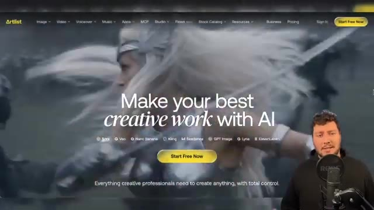  
  *⏱️ 00:16:18 — Page d'accueil du site Artlist avec le slogan 'Make your best creative work with AI' et les logos des modèles intégrés.*
-   
  *⏱️ 00:16:26 — Grille comparative des abonnements Artlist (AI Starter, AI Core, AI Creator, Custom Business) avec les détails des crédits et des fonctionnalités.*
-   
  *⏱️ 00:16:35 — Page de téléchargement du guide gratuit 'Seeddance 2.5 Guide' présentant les 10 techniques pour des vidéos impossibles.*

---
