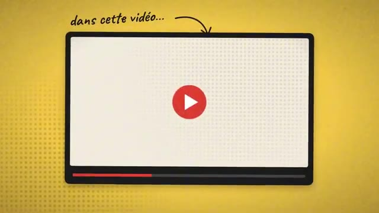
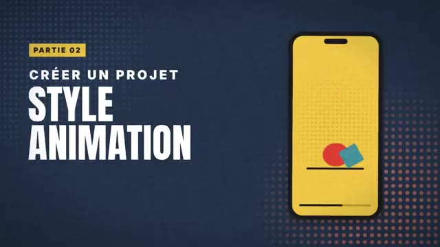
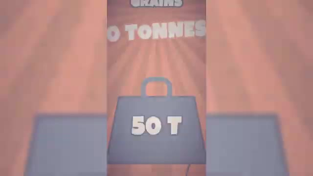
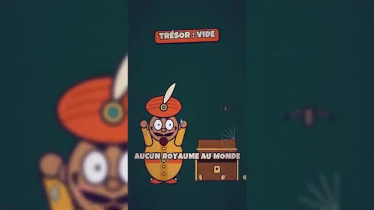
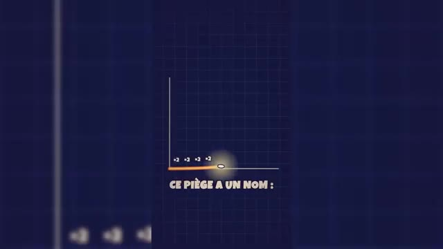
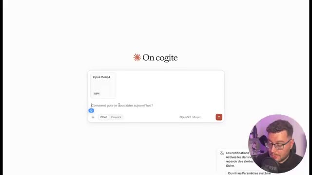

# 🎬 Claude Opus 5.5 : Motion Design, Animation, Montage Vidéo, un PROMPT et il se DÉBROUILLE

> **Chaîne** : [Labo Des Réseaux](https://www.youtube.com/@labodesreseaux)  
> **Lien YouTube** : [https://www.youtube.com/watch?v=2Ned0kvFNqM](https://www.youtube.com/watch?v=2Ned0kvFNqM)  
> **Date de publication** : 20260926  
> **Durée** : 10:51  
> **Identifiant vidéo** : `2Ned0kvFNqM`  
> **Modèles** : Audio: `whisper-v3-large-turbo` | Vision: `gemini-3.5-flash-lite`  

---

## 📌 Synthèse Exécutive & Outils

### 💡 Résumé
Dans cette vidéo, le créateur de la chaîne **Labo Des Réseaux** explore les capacités révolutionnaires de **Claude Opus 5.5 (modèle d'Anthropic)** en matière de **motion design, d'animation et de montage vidéo**. L'outil permet de générer des séquences animées complexes, des intros percutantes et des montages verticaux complets (TikTok, Reels, Shorts) directement à partir d'un simple prompt textuel, sans nécessiter de compétences en code, de MCP ou de logiciels tiers complexes. Le modèle procède en écrivant du code pour dessiner et animer chaque image avant de convertir le tout en fichier MP4 téléchargeable.

Le test s'articule autour de trois cas d'usage principaux : la création d'une introduction stylisée (avec ou sans voix off générée par l'IA), la production d'un dessin animé éducatif de format court entièrement autonome (sur l'histoire du grain de riz et de la croissance exponentielle), et l'enrichissement d'une vidéo "talking head" (face cam) brute en y intégrant un habillage dynamique en 3D motion design. Le créateur détaille sa méthode itérative, soulignant l'importance cruciale de **fournir un contexte précis, des références artistiques, des chartes graphiques et un découpage scène par scène** pour éviter l'effet "générique" et standardisé propre aux productions d'IA de masse.

Malgré un temps de traitement allant de 8 à 30 minutes selon la complexité et quelques micro-défauts de transition ou de cohérence narrative, le résultat final s'avère **bluffant et immédiatement publiable**. Le créateur conclut sur une note nuancée : si cet outil démocratise l'accès au motion design et fluidifie les workflows de création de contenu, il prédit une **surproduction potentielle de contenus similaires** sur les réseaux sociaux. Il encourage l'utilisation de l'API d'Opus 5.5 pour automatiser et coupler le modèle à d'autres solutions de pointe (voix off pro, génération d'assets visuels) afin de conserver une réelle singularité créative.

### 🛠️ Outils, Modèles & Logiciels Présentés
- **Claude Opus 5.5** (Modèle d'intelligence artificielle d'Anthropic / Abonnement Claude Pro et accès API)**
- **Claude.ai** (Interface de chat et espace de travail)**
- **Claude Code** / Espace Coworks (Environnements d'utilisation et d'automatisation)**
- **Eleven Labs** (Mentionné pour l'intégration future de voix off professionnelles via API)**
- **XFIL** (Mentionné pour la génération d'assets visuels via API)**
- **Plateformes de formats verticaux** (TikTok, Instagram Reels, YouTube Shorts)**

### 🔑 Points Clés & Enseignements Stratégiques
- Fonctionnement technique novateur :** Claude Opus 5.5 ne se contente pas de générer de la vidéo brute, il code les éléments graphiques et les anime frame par frame (comme une page web animée) avant de les exporter automatiquement au format MP4.
- Accessibilité sans compétences requises :** La création d'animations motion design complexes, d'intros de vidéos ou le montage de formats courts ne nécessite plus de maîtriser des logiciels lourds, des MCP ou des abonnements à des suites logicielles spécialisées.
- L'impératif du contexte et du prompting avancé :** Pour contrer l'effet "générique" (effet ChatGPT), il est indispensable d'alimenter l'IA en contexte précis : charte graphique, codes couleurs, style visuel (ex: style Vox), fiches de personnages de référence et découpage rigoureux scène par scène.
- Gestion des temps de rendu :** Les générations prennent du temps (compter entre 8 et 30 minutes selon la complexité et le niveau d'effort demandé au modèle), ce qui nécessite d'intégrer cette latence dans son flux de production.
- Intégration transparente sur vidéos "Talking Head" :** Le modèle est capable d'analyser une vidéo de type face cam (tournée en format vertical 9:16ème) et d'y superposer un habillage en motion design rythmé tout en conservant la piste audio originale du narrateur.
- Création de contenus narratifs automatisés :** Capacité à concevoir de A à Z des histoires éducatives rythmées pour le format court (comme la démonstration de la croissance exponentielle avec l'analogie du jeu d'échecs).
- Optimisation par l'API :** Pour industrialiser et professionnaliser le workflow, l'utilisation de l'API d'Opus 5.5 via des scripts ou des environnements comme Claude Code permet d'automatiser les tâches répétitives.
- Couplage multi-IA (Workflow pro) :** Le système peut être optimisé en branchant des API externes spécialisées pour la voix off (ex: Eleven Labs) ou la génération d'images et de vidéos (ex: modèles XFIL).
- Risque de saturation des réseaux sociaux :** La facilité de génération d'animations via un simple prompt menace d'entraîner une surproduction de contenus visuellement standardisés, obligeant les créateurs à soigner leur direction artistique pour se démarquer.
- Valeur persistante des vrais motion designers :** Face à l'homogénéisation des styles générés par l'IA, le travail sur-mesure de véritables professionnels du motion design gagnera encore plus en valeur et en singularité.

---

## ⏱️ Chronologie & Transcription Complète Audio & Visuelle (Mot pour Mot)

### ⏱️ `[00:00:00 - 00:00:21]` | Segment #01

**🔊 Audio (Transcription Intégrale Mot pour Mot en Français) :**
> Créer sa petite animation, sa séquence de motion design pour illustrer sa vidéo ou même confier le montage de son TikTok Reels ou Short YouTube, Claude vient de le rendre possible, tout cela sans MCP, sans abonnement supplémentaire, juste en utilisant son dernier modèle, Opus 5.5. La preuve avec cette intro de vidéo et d'autres exemples faciles à reproduire, je te montre tout de suite.

**👁️ Analyse Visuelle d'Écran (gemini-3.5-flash-lite) :**
**Interface & Outils** : Style visuel de papier découpé et animation graphique façon motion design (type Vox ou explicatif).
**Contenu textuel & Code** : Textes et graphismes : 'ANIMATION', logo 'CLAUDE', 'MARKO', 'DÉMONSTRATION', 'PROMPTS - RENDUS' et fenêtres de code ou de prévisualisation.
**Action / Démonstration** : Le créateur présente visuellement la création d'animations et de séquences de motion design générées par intelligence artificielle.

**Captures d'écran :**
-   
  *⏱️ 00:00:01 — Une animation de type motion design minimaliste sur fond quadrillé avec une timeline de montage en bas et le mot 'ANIMATION'.*
-   
  *⏱️ 00:00:11 — Le logo animé de Claude sous forme d'étoile stylisée à branches multiples dans un cercle sur fond papier quadrillé.*
-   
  *⏱️ 00:00:20 — Un personnage en papier découpé nommé Marko montrant du doigt des exemples de prompts et de rendus visuels de motion design.*

---

### ⏱️ `[00:00:22 - 00:00:42]` | Segment #02

**🔊 Audio (Transcription Intégrale Mot pour Mot en Français) :**
> Car oui, cette introduction a été réalisée par Claude Opus 5.5 juste à partir d'un prompt. Le nouveau modèle d'Anthropic impressionne. Et dans cette vidéo, on va s'intéresser à ses capacités de motion design. On verra donc comment j'ai réalisé cette introduction de vidéo, mais aussi comment créer un projet dans le style animation pour les réseaux.

**👁️ Analyse Visuelle d'Écran (gemini-3.5-flash-lite) :**
**Interface & Outils** : Style graphique d'animation, habillage vidéo pour les réseaux sociaux.
**Contenu textuel & Code** : Textes explicatifs, icône YouTube, maquette de smartphone avec formes géométriques.
**Action / Démonstration** : Présentation du plan de la vidéo et introduction aux techniques de motion design et d'animation pour réseaux sociaux.

**Captures d'écran :**
-   
  *⏱️ 00:00:32 — Animation graphique au format paysage avec le texte « dans cette vidéo... » et une icône de lecture YouTube.*
-   
  *⏱️ 00:00:41 — Écran de transition montrant le titre « PARTIE 02 : CRÉER UN PROJET STYLE ANIMATION » à côté d'une maquette de smartphone affichant des formes géométriques animées.*

---

### ⏱️ `[00:00:42 - 00:01:05]` | Segment #03

**🔊 Audio (Transcription Intégrale Mot pour Mot en Français) :**
> Et dans une dernière partie, on verra si Opus 5.5 peut nous monter un Reels, un Short, un TikTok pour nos réseaux, en mélangeant face cam et motion design. Pour rappel, pour utiliser le nouveau modèle Opus 5.5, il nous faudra à minimum un abonnement Cloud Pro. Ainsi, on pourra le charger dans notre chat ou dans l'espace Coworks, ainsi si on veut le sélectionner sur Cloud Code.

**👁️ Analyse Visuelle d'Écran (gemini-3.5-flash-lite) :**
**Interface & Outils** : Site web de Claude (claude.ai)
**Contenu textuel & Code** : Offres d'abonnement Free (0 €), Pro (15 €) et Max (à partir de 90 €) ; interface de chat Claude avec option de sélection de modèle.
**Action / Démonstration** : Le créateur montre la page des tarifs pour l'abonnement Pro requis puis présente l'interface de discussion avec le sélecteur de modèle.

**Captures d'écran :**
-   
  *⏱️ 00:00:54 — Page des tarifs du site Claude montrant les offres Free, Pro et Max.*
-   
  *⏱️ 00:01:04 — Interface de Claude avec le champ de saisie 'Qu'est-ce qui mijote, Marko ?' et les boutons Chat et Cowork.*

---

### ⏱️ `[00:01:05 - 00:01:24]` | Segment #04

**🔊 Audio (Transcription Intégrale Mot pour Mot en Français) :**
> Les exemples que je vais présenter ici se font via l'abonnement Pro, mais bien sûr, si tu as besoin de plus de crédit, Opus 5.5 est aussi disponible en API, on en reparle en fin de vidéo. Donc déjà, à froid, j'ai voulu lui demander tout simplement, créez-moi une introduction de vidéo en motion design, reprenant le texte suivant. C'est tout.

**👁️ Analyse Visuelle d'Écran (gemini-3.5-flash-lite) :**
**Interface & Outils** : Présentation orale ou séquence sans interface partagée.
**Contenu textuel & Code** : Explications et conseils de création de contenu / IA.
**Action / Démonstration** : Démonstration et mise en contexte pratique.

---

### ⏱️ `[00:01:24 - 00:01:42]` | Segment #05

**🔊 Audio (Transcription Intégrale Mot pour Mot en Français) :**
> Et là, Opus 5 s'est mis en route et il a commencé à me coder la vidéo. Alors quand je dis coder la vidéo, qu'est-ce qui se passe en fait ? Il va coder les images, puis les animer frame par frame pour les transformer en rendu animation web qu'il va par la suite transformer en MP4 et nous proposer de le télécharger.

**👁️ Analyse Visuelle d'Écran (gemini-3.5-flash-lite) :**
**Interface & Outils** : Présentation orale ou séquence sans interface partagée.
**Contenu textuel & Code** : Explications et conseils de création de contenu / IA.
**Action / Démonstration** : Démonstration et mise en contexte pratique.

---

### ⏱️ `[00:01:42 - 00:02:02]` | Segment #06

**🔊 Audio (Transcription Intégrale Mot pour Mot en Français) :**
> Donc je résume simplement. Bien sûr, il y a beaucoup plus de procédés que ça. Mais ce qu'il faut savoir, c'est que toi, en tant qu'utilisateur, tu as juste à attendre pour avoir ton animation motion design créée ici au bout de 8 minutes et téléchargeable. Donc là avec vraiment très très peu d'informations, j'ai déjà une intro complète.

**👁️ Analyse Visuelle d'Écran (gemini-3.5-flash-lite) :**
**Interface & Outils** : Interface web de l'outil Claude (Claude.ai) et lecteur vidéo en plein écran avec incrustation de la webcam du créateur.
**Contenu textuel & Code** : Fichiers partagés incluant 'Intro claude opus55 16x9 (MP4)', 'Intro claude opus55 source (HTML)', minuterie de génération (~8 minutes), et texte animé 'Créer sa petite animation'.
**Action / Démonstration** : Le créateur présente le résultat final de l'animation motion design générée automatiquement et met en avant le bouton de téléchargement du fichier MP4.

**Captures d'écran :**
-   
  *⏱️ 00:01:52 — Interface de l'outil Claude (Claude.ai/cowork) montrant un fichier vidéo MP4 généré ('Intro claude opus55 16x9') prêt à être téléchargé après environ 8 minutes de traitement.*
-   
  *⏱️ 00:02:00 — Aperçu en plein écran de l'animation motion design générée, affichant le texte 'Créer sa petite animation' avec une esthétique professionnelle et soignée.*

---

### ⏱️ `[00:02:02 - 00:02:30]` | Segment #07

**🔊 Audio (Transcription Intégrale Mot pour Mot en Français) :**
> Alors je n'ai pas de voix off sur cette intro, donc je vais continuer la conversation et demander si Claude peut me rajouter une voix off. Et là incroyable, sans même que je branche en API un logiciel comme Eleven Labs, j'aurai ma vidéo disponible avec une voix off. Bien sûr, il n'y aura pas d'émotion et ça ne sera pas trop professionnel. Mais si on la lance, créer sa petite animation, sa séquence de motion design, pour illustrer sa vidéo, ou même confier le montage de son TikTok, réel ou short YouTube.

**👁️ Analyse Visuelle d'Écran (gemini-3.5-flash-lite) :**
**Interface & Outils** : Interface web de Claude (Anthropic) et timeline de montage vidéo.
**Contenu textuel & Code** : Texte de discussion avec l'IA sur la voix off, boutons de téléchargement pour "Intro claude opus55 16x9 voixoff" et "Voixoff intro seule", lecteur audio avec curseur de progression.
**Action / Démonstration** : Le créateur présente l'interface de l'IA Claude qui a généré automatiquement la voix off et la vidéo pour l'intro.

**Captures d'écran :**
-   
  *⏱️ 00:02:16 — Interface de l'assistant IA Claude affichant une conversation textuelle avec des fichiers audio téléchargeables et un lecteur audio intégré.*

---

### ⏱️ `[00:02:31 - 00:02:52]` | Segment #08

**🔊 Audio (Transcription Intégrale Mot pour Mot en Français) :**
> Le résultat est là. Alors, par contre, ce résultat, même s'il est sympathique, il est très générique. Et on risque fort de rencontrer le phénomène affiche chat GPT si on prend tous de manière simple pour avoir son motion design. C'est pour ça que dans un second temps, j'ai voulu recréer l'intro en lui donnant beaucoup plus de contexte.

**👁️ Analyse Visuelle d'Écran (gemini-3.5-flash-lite) :**
**Interface & Outils** : Interface web de l'assistant IA Claude.ai
**Contenu textuel & Code** : Prompt de direction artistique pour la vidéo, palette de couleurs, description des personnages, éléments graphiques et structure des scènes.
**Action / Démonstration** : Le créateur montre le prompt enrichi fourni à l'IA pour générer une intro de motion design plus personnalisée.

**Captures d'écran :**
-   
  *⏱️ 00:02:50 — Interface du site Claude.ai montrant un prompt détaillé de direction artistique pour la création de vidéo.*

---

### ⏱️ `[00:02:52 - 00:03:15]` | Segment #09

**🔊 Audio (Transcription Intégrale Mot pour Mot en Français) :**
> Et ici quand je parle de contexte, c'est surtout que je lui ai donné un style propre, ici le style Vox, avec des formes géométriques épurées, typographies, bol de sens et rive, et un collage texturé gris visible en fond, stop motion subtil, une palette de couleurs avec les codes couleurs pour l'accompagner, une indication sur les transitions globales, je lui ai donné aussi une indication de voix off, les effets sonores, et très important, je lui ai donné des références.

**👁️ Analyse Visuelle d'Écran (gemini-3.5-flash-lite) :**
**Interface & Outils** : Document texte / Interface de rédaction ou de prise de notes.
**Contenu textuel & Code** : Texte descriptif de direction artistique (style Vox, typographie bold sans-serif, palette de couleurs, transitions globales, scène 1, scène 3).
**Action / Démonstration** : Le créateur présente et commente son document de direction artistique et de scénarisation vidéo.

**Captures d'écran :**
-   
  *⏱️ 00:02:53 — Capture d'écran montrant un document textuel décrivant la direction artistique de style Vox avec des codes couleurs.*
-   
  *⏱️ 00:03:03 — Capture d'écran montrant la suite du document textuel détaillant les transitions globales et les éléments graphiques.*
-   
  *⏱️ 00:03:14 — Capture d'écran affichant la section du document sur la scène 3 et la description des visuels avec du texte sélectionné.*

---

### ⏱️ `[00:03:15 - 00:03:36]` | Segment #10

**🔊 Audio (Transcription Intégrale Mot pour Mot en Français) :**
> Je vais donner une fiche caractère référence pour essayer de me créer un motion design. Et j'ai aussi donné le logo de Claude puisqu'il est mentionné dans la vidéo. Ensuite pour pouvoir maîtriser ce qui se passe à l'écran, j'ai refait scène par scène avec le redattage de celle-ci pour bien avoir ce qui s'affiche avec le texte qui est dit. Je génère. Ici j'en ai une pour une dizaine de minutes.

**👁️ Analyse Visuelle d'Écran (gemini-3.5-flash-lite) :**
**Interface & Outils** : Interface web de Claude AI / Cowork
**Contenu textuel & Code** : Prompt de direction artistique (style Vox), codes couleur, progression des tâches (construire l'animation, générer les SFX, vérifier les images).
**Action / Démonstration** : Le créateur montre la configuration et le suivi de la création du motion design via l'intelligence artificielle Claude.

**Captures d'écran :**
-   
  *⏱️ 00:03:25 — Interface de l'outil Claude montrant le prompt de configuration de la direction artistique et la palette de couleurs pour le motion design.*
-   
  *⏱️ 00:03:34 — Progression de la tâche en cours avec l'affichage des étapes et des commandes exécutées dans l'interface de Claude.*

---

### ⏱️ `[00:03:36 - 00:04:01]` | Segment #11

**🔊 Audio (Transcription Intégrale Mot pour Mot en Français) :**
> Il a pris la décision de ne pas me mettre les lunettes parce que sur le point que j'avais fourni j'avais dit avec des lunettes mais la photo n'avait pas de lunettes. donc très très bien, et il a ajouté un petit texte supplémentaire, donc prise d'initiative de sa part, pourquoi pas, et en téléchargeant la vidéo et en la lançant, c'est celle que tu as vue en introduction de cette vidéo. On continue les tests avec cette fois-ci la volonté de créer un format récurrent sur TikTok 100% animé.

**👁️ Analyse Visuelle d'Écran (gemini-3.5-flash-lite) :**
**Interface & Outils** : Lecteur vidéo (QuickTime ou similaire) avec barre de progression et timeline audio/vidéo.
**Contenu textuel & Code** : Un visuel de type Polaroid avec des formes géométriques et le mot "ANIMATION", ainsi qu'une timeline avec une piste audio et un bloc orange "ANIMATION".
**Action / Démonstration** : Le créateur visionne la vidéo générée pour analyser le résultat de l'animation.

**Captures d'écran :**
-   
  *⏱️ 00:03:49 — Capture d'écran montrant le lecteur vidéo et une timeline avec une animation en cours de lecture.*

---

### ⏱️ `[00:04:02 - 00:04:37]` | Segment #12

**🔊 Audio (Transcription Intégrale Mot pour Mot en Français) :**
> Dans un premier temps travail préparatoire, je vais demander de me trouver une histoire pour un dessin animé éducatif d'une minute au format TikTok, prendre une histoire connue avec un hook fort et une révélation à la fin. opus 5 réfléchit donc moi je les mets en moyen sachant qu'on peut le mettre aussi en élevé mais ça va user beaucoup plus de crédit néanmoins on n'a pas la même sensation qu'on a avec gpt6 astra et en termes de crédit on a le sentiment de pouvoir faire beaucoup plus de choses même si astra a sorti les modèles sol et luna récemment et il m'a sorti une histoire que je pourrais modifier je pourrais donner des références ici là je vais laisser travailler en paix pour

**👁️ Analyse Visuelle d'Écran (gemini-3.5-flash-lite) :**
**Interface & Outils** : Interface web de l'assistant IA (Claude / Cowork) avec panneau latéral de contexte et de progression.
**Contenu textuel & Code** : Prompts textuels pour la création d'un dessin animé éducatif TikTok, suggestions d'histoires (croissance exponentielle, Semmelweis, Ératosthène), et logs d'exécution de commandes.
**Action / Démonstration** : Le créateur rédige et envoie des prompts successifs à l'IA pour concevoir et structurer le contenu d'une vidéo courte éducative.

**Captures d'écran :**
-   
  *⏱️ 00:04:03 — Saisie d'un prompt initial dans l'interface de l'IA (On cogite / Claude) pour demander une histoire éducative au format TikTok.*
-   
  *⏱️ 00:04:20 — Affichage de la réponse de l'IA proposant une histoire et des suggestions, avec un second prompt utilisateur en bas pour définir la direction artistique.*
-   
  *⏱️ 00:04:36 — Exécution de commandes et d'outils (TTS, proxy) par l'agent IA suite au nouveau prompt sur la direction artistique.*

---

### ⏱️ `[00:04:38 - 00:05:11]` | Segment #13

**🔊 Audio (Transcription Intégrale Mot pour Mot en Français) :**
> avoir mon petit dessin animé en motion design d'une minute on est parti voix off essais sonores tout est en train de se créer on va accélérer la vidéo ici on en a eu pour 27 minutes de travail donc c'est quand même assez conséquent si on veut le mettre en place dans un workflow répété faudra plutôt se tourner vers une automatisation avec le code et l'api on va pouvoir télécharger et regarder le reste droit a failli perdre tout son royaume à cause d'un seul grain de riz il y a très longtemps en inde un vieux sage invente un jeu tout nouveau les échecs Magnifique. Demande-moi ce que tu veux.

**👁️ Analyse Visuelle d'Écran (gemini-3.5-flash-lite) :**
**Interface & Outils** : Lecteur vidéo / Sortie de génération de motion design.
**Contenu textuel & Code** : Personnage animé en 2D sur fond rayonné orange avec des confettis, texte "DEMANDE-MOI CE QUE" affiché.
**Action / Démonstration** : Présentation du résultat final du motion design créé automatiquement (dessin animé de type format vertical/Reels/Shorts).

**Captures d'écran :**
-   
  *⏱️ 00:05:09 — Animation du petit dessin animé en motion design généré, affichant un personnage style magicien/génie avec du texte incrusté en bas.*

---

### ⏱️ `[00:05:11 - 00:05:31]` | Segment #14

**🔊 Audio (Transcription Intégrale Mot pour Mot en Français) :**
> Un grain de riz sur la première case. Deux sur la deuxième. Quatre sur la troisième. Et tu doubles jusqu'à la dernière. Ah, c'est tout. Accord. Case 10, 512 grains. Une poignée. Case 21, plus d'un million de grains. Case 32, plus de 2 milliards.

**👁️ Analyse Visuelle d'Écran (gemini-3.5-flash-lite) :**
**Interface & Outils** : Graphismes animés au format vertical (style Shorts/Reels) illustrant le problème mathématique du riz sur l'échiquier.
**Contenu textuel & Code** : Textes : "LA RÈGLE DU SAGE", "SUR LA PREMIÈRE CASE", "C'EST TOUT ?", "CASE 32", "884 443 379", "CASE TRENTE-DEUX".
**Action / Démonstration** : Explication animée de la progression géométrique des grains de riz sur l'échiquier.

**Captures d'écran :**
-   
  *⏱️ 00:05:12 — Illustration d'un échiquier avec le texte "LA RÈGLE DU SAGE" et "SUR LA PREMIÈRE CASE" montrant un grain de riz.*
-   
  *⏱️ 00:05:30 — Affichage du chiffre pour la "CASE 32" avec des illustrations de chariot de riz et de silo.*

---

### ⏱️ `[00:05:32 - 00:05:53]` | Segment #15

**🔊 Audio (Transcription Intégrale Mot pour Mot en Français) :**
> 50 tonnes. Et il reste encore 32 cases. Au total, 18 milliards de milliards de grains. des siècles de toute la récolte mondiale de riz. Aucun royaume au monde ne peut payer ça. Alors le roi a une idée. D'accord, mais tu les comptes toi-même, un par un. Ce piège a un nom, la croissance exponentielle.

**👁️ Analyse Visuelle d'Écran (gemini-3.5-flash-lite) :**
**Interface & Outils** : Animation vidéo explicative (style motion design).
**Contenu textuel & Code** : Textes : '50 TONNES', 'TRÉSOR : VIDE', 'AUCUN ROYAUME AU MONDE', 'CE PIÈGE A UN NOM'.
**Action / Démonstration** : Animation visuelle illustrant l'accumulation de poids de riz, l'appauvrissement du royaume et l'introduction graphique de la notion de croissance exponentielle.

**Captures d'écran :**
-   
  *⏱️ 00:05:33 — Illustration graphique du poids de riz accumulé affichant '50 Tonnes'.*
-   
  *⏱️ 00:05:42 — Animation montrant un roi désespéré devant un coffre vide et l'indication 'TRÉSOR : VIDE'.*
-   
  *⏱️ 00:05:51 — Graphique animé illustrant la progression mathématique avec le texte 'CE PIÈGE A UN NOM'.*

---

### ⏱️ `[00:05:53 - 00:06:16]` | Segment #16

**🔊 Audio (Transcription Intégrale Mot pour Mot en Français) :**
> Et c'est exactement comme ça qu'une vidéo devient virale. Alors déjà en termes de rendu, on est sur des motion design proches du dessin animé. Donc ça c'est assez sympa, le hook est bien travaillé. L'histoire par contre je trouve elle est assez décousue, la voix off n'est pas trop adaptée. Et au final j'aurais peut-être dû relire certains passages parce que je pense qu'il manque des petits bouts pour pouvoir assembler le tableau.

**👁️ Analyse Visuelle d'Écran (gemini-3.5-flash-lite) :**
**Interface & Outils** : Vidéo de démonstration au format vertical (Short/Reel) avec incrustation webcam du créateur.
**Contenu textuel & Code** : Textes incrustés à l'écran : "EN INDE, IL Y A LONGTEMPS", "IL Y A TRÈS LONGTEMPS", "LA RÈGLE DU SAGE", "DEUX SUR LA DEUXIÈME."
**Action / Démonstration** : Le créateur analyse et commente un exemple de vidéo virale au format vertical présentant une histoire animée.

---

### ⏱️ `[00:06:16 - 00:06:35]` | Segment #17

**🔊 Audio (Transcription Intégrale Mot pour Mot en Français) :**
> Mais franchement sur un travail autonome d'une minute c'est assez surprenant. Surtout la façon d'animer les personnages au motion design que je trouve très rigolo. Donc le format court ça marche et imaginons maintenant on souhaite vraiment le travailler. Dans le cas présent j'ai tourné ma vidéo style vertical pour TikTok, Instagram et Youtube.

**👁️ Analyse Visuelle d'Écran (gemini-3.5-flash-lite) :**
**Interface & Outils** : Interface web de l'outil conversationnel "On cogite"
**Contenu textuel & Code** : Fichier vidéo "Opus 55.mp4" chargé, champ de texte avec le prompt "Voici ma vidéo", modèle sélectionné "Opus 5.5 Moyen"
**Action / Démonstration** : Importation et préparation d'un fichier vidéo dans l'interface de l'outil "On cogite" pour analyse ou traitement.

**Captures d'écran :**
-   
  *⏱️ 00:06:26 — Interface de l'outil "On cogite" avec un fichier vidéo importé ("Opus 55.mp4") et une zone de texte.*
-   
  *⏱️ 00:06:34 — Interface de l'outil "On cogite" avec le créateur en incrustation à gauche, tapant le message "Voici ma vidéo".*

---

### ⏱️ `[00:06:35 - 00:06:54]` | Segment #18

**🔊 Audio (Transcription Intégrale Mot pour Mot en Français) :**
> Qui présente justement le motion design grâce à Opus 5.5. Et donc je vais donner cette vidéo où il n'y a aucun montage, aucune animation, aucune motion design. C'est seulement moi qui parle devant la caméra. Voici ma vidéo format 9-16ème qui présente les nouveautés de motion design d'Opus 5.5.

**👁️ Analyse Visuelle d'Écran (gemini-3.5-flash-lite) :**
**Interface & Outils** : Interface web de l'outil d'intelligence artificielle 'On cogite' (Opus 5.5).
**Contenu textuel & Code** : Fichier vidéo 'Opus 55.mp4' joint dans le chat avec un prompt textuel décrivant la modification en format 9:16.
**Action / Démonstration** : Le créateur écrit un prompt pour demander à Opus 5.5 d'ajouter du motion design à une vidéo face caméra.

**Captures d'écran :**
-   
  *⏱️ 00:06:45 — Interface d'un assistant IA montrant l'import d'une vidéo MP4 et un prompt de modification.*
-   
  *⏱️ 00:06:53 — Suite de la rédaction du prompt détaillant la demande de motion design scène par scène.*

---

### ⏱️ `[00:06:55 - 00:07:14]` | Segment #19

**🔊 Audio (Transcription Intégrale Mot pour Mot en Français) :**
> Je voudrais que tu refasses la vidéo pour inclure justement du motion design. Avant tout je souhaite que tu reprends l'ensemble du script, que tu détailles ce qui se passe scène par scène. Comme ça on peut corriger ensemble. et je voudrais un style 3D motion design avec beaucoup de rythme et bien expliqué sur les parties techniques avec des schémas animés.

**👁️ Analyse Visuelle d'Écran (gemini-3.5-flash-lite) :**
**Interface & Outils** : Présentation orale ou séquence sans interface partagée.
**Contenu textuel & Code** : Explications et conseils de création de contenu / IA.
**Action / Démonstration** : Démonstration et mise en contexte pratique.

---

### ⏱️ `[00:07:14 - 00:07:33]` | Segment #20

**🔊 Audio (Transcription Intégrale Mot pour Mot en Français) :**
> Ma vidéo a été analysée, j'ai mon découpage qui a été fait, une direction artistique a été proposée et je suis d'accord même s'il me demande de changer le texte, je lui dis non non non, je ne veux pas du tout changer le texte et je veux que tu reprennes ma voix de narrateur. Je ne sais pas si c'est possible, on va voir tout de suite en le soumettant et là on laisse travailler l'IA.

**👁️ Analyse Visuelle d'Écran (gemini-3.5-flash-lite) :**
**Interface & Outils** : Présentation orale ou séquence sans interface partagée.
**Contenu textuel & Code** : Explications et conseils de création de contenu / IA.
**Action / Démonstration** : Démonstration et mise en contexte pratique.

---

### ⏱️ `[00:07:33 - 00:07:53]` | Segment #21

**🔊 Audio (Transcription Intégrale Mot pour Mot en Français) :**
> Alors ici, on a dû relancer Claude une deuxième fois parce que la limite d'action avait été atteinte pour la réponse. Donc, j'ai redemandé de continuer et la vidéo est prête. Alors là, le travail m'a pris un petit peu plus de 30 minutes. Donc, encore une fois, il faut avoir bien ça à l'esprit. La solution n'est pas magique. Elle demande du travail de contexte en amont.

**👁️ Analyse Visuelle d'Écran (gemini-3.5-flash-lite) :**
**Interface & Outils** : Présentation orale ou séquence sans interface partagée.
**Contenu textuel & Code** : Explications et conseils de création de contenu / IA.
**Action / Démonstration** : Démonstration et mise en contexte pratique.

---

### ⏱️ `[00:07:53 - 00:08:13]` | Segment #22

**🔊 Audio (Transcription Intégrale Mot pour Mot en Français) :**
> Elle demande du temps. Mais à la fin, on va voir le résultat en téléchargeant et en le lançant. Est-ce que ça ne vous a plus besoin de logiciel ou de compétences pour faire du motion design ? Une phrase avec Opus 5.5, Claude crée ta vidéo, ton animation. Et même pas besoin de skills de MCP ou d'abonnements supplémentaires. Non, non, en une seule phrase tu as ta vidéo, comme c'est intro en motion design.

**👁️ Analyse Visuelle d'Écran (gemini-3.5-flash-lite) :**
**Interface & Outils** : Vidéo au format vertical (Shorts/Reels) avec éléments graphiques incrustés (bulles de texte et animations de l'interface).
**Contenu textuel & Code** : Textes incrustés 'OPUS 5.5', '1 phrase', 'Une intro 3D néon violet sur l', '1 VIDÉO', et 'rendu_motion.mp4'.
**Action / Démonstration** : Le présentateur explique les capacités de l'outil et montre des animations textuelles illustrant le processus de création par IA.

---

### ⏱️ `[00:08:14 - 00:08:34]` | Segment #23

**🔊 Audio (Transcription Intégrale Mot pour Mot en Français) :**
> Dynamiser tes présentations, illustrer un passage de ta vidéo, créer du contenu viral pour tes réseaux. Les possibilités sont infinies, mais si un seul prompt te suffit, encore faut-il réussir à le structurer, pour ne pas avoir la même bouillie que tout le monde va générer. Alors tu vas devoir donner du contexte, des références et une direction artistique. Bref, être le plus précis possible.

**👁️ Analyse Visuelle d'Écran (gemini-3.5-flash-lite) :**
**Interface & Outils** : Interface vidéo verticale de type YouTube Shorts / Reels avec animations graphiques et incrustation webcam.
**Contenu textuel & Code** : Textes : 'Tes présentations', 'Ton prompt', 'Un prompt structuré', 'Direction artistique', 'Références', 'Contexte'.
**Action / Démonstration** : Le créateur explique la structure idéale d'un prompt avec un visuel de blocs empilés.

**Captures d'écran :**
-   
  *⏱️ 00:08:32 — Schéma animé en blocs empilés représentant les composants d'un prompt structuré (Direction artistique, Références, Contexte).*

---

### ⏱️ `[00:08:34 - 00:08:52]` | Segment #24

**🔊 Audio (Transcription Intégrale Mot pour Mot en Français) :**
> Ensuite, Clodopus 5 écrit du code qui dessine et anime chaque image comme une page web animée et Clod te transforme le tout en fichier MP4 téléchargé. Assur, tu peux améliorer le workflow en ajoutant en API des voix off pro ou encore des images et vidéos IA générées par les meilleurs modèles du marché.

**👁️ Analyse Visuelle d'Écran (gemini-3.5-flash-lite) :**
**Interface & Outils** : Interface graphique animée de présentation de workflow d'intelligence artificielle.
**Contenu textuel & Code** : Textes : "Claude Opus 5.5", "Il écrit du code", "Export en MP4", "Améliorer le workflow", "Voix off pro", "Images et vidéos IA".
**Action / Démonstration** : Présentation étape par étape du fonctionnement de Claude Opus 5.5 pour la génération de code animé et son exportation vidéo.

**Captures d'écran :**
-   
  *⏱️ 00:08:35 — Illustration animée montrant Claude Opus 5.5 en train d'écrire du code.*
-   
  *⏱️ 00:08:43 — Animation illustrant l'exportation du résultat en fichier MP4.*
-   
  *⏱️ 00:08:50 — Schéma d'amélioration du workflow intégrant des voix off pro, des images et des vidéos IA via API.*

---

### ⏱️ `[00:08:52 - 00:09:16]` | Segment #25

**🔊 Audio (Transcription Intégrale Mot pour Mot en Français) :**
> Bref, le résultat peut être très variable et c'est sûr qu'on va être un peu inondé sur les réseaux. Une bonne façon aussi de rappeler que le contenu pro animé par de vrais motion designers fera encore plus la différence. Alors je suis agréablement surpris. Il a gardé ma vidéo et mon audio original en incluant dedans le motion design et en mettant du rythme, en bien expliquant l'ensemble des schémas.

**👁️ Analyse Visuelle d'Écran (gemini-3.5-flash-lite) :**
**Interface & Outils** : Studio d'enregistrement personnel / format vidéo vertical type Reel ou Short YouTube avec habillage graphique animé.
**Contenu textuel & Code** : Textes incrustés dynamiquement : 'Résultat variable', 'De vrais motion designers font encore plus la différence', 'Même pas besoin de', 'OPUS 5.5'.
**Action / Démonstration** : Le créateur commente l'impact des outils d'IA et de l'automatisation sur les réseaux sociaux, illustré par des sous-titres animés et des graphismes.

---

### ⏱️ `[00:09:17 - 00:09:43]` | Segment #26

**🔊 Audio (Transcription Intégrale Mot pour Mot en Français) :**
> Franchement tout est clair. Il y a peut-être 2-3 défauts de transition et puis à la fin on voit aussi qu'il arrive du mal à illustrer cette toute dernière partie. mais franchement le livrable est là, je vais pouvoir le publier sur les réseaux sans aucun souci. C'est très impressionnant et j'en viens donc à cette conclusion que ça peut être un outil pour nous accompagner lors de présentations, lors de vidéos éducatives ou pour nous assister dans le montage pour expliquer des parties en motion design.

**👁️ Analyse Visuelle d'Écran (gemini-3.5-flash-lite) :**
**Interface & Outils** : Studio vidéo et graphismes incrustés de type tutoriel.
**Contenu textuel & Code** : Texte '1 VIDÉO', barre de progression 'rendu_motion.mp4' et encadré 'Ton prompt'.
**Action / Démonstration** : Le créateur présente ses conclusions sur l'outil testé dans la vidéo.

---

### ⏱️ `[00:09:43 - 00:10:02]` | Segment #27

**🔊 Audio (Transcription Intégrale Mot pour Mot en Français) :**
> Comme je le dis dans ce petit reel TikTok, est-ce qu'on ne va pas assister à une surproduction de ce type de vidéos et du coup, on va arriver à des résultats qui vont se ressembler tous avec des techniques de prompt qui vont être partagées et des styles qui vont se copier les uns les autres. Donc voilà, là c'est tout nouveau, c'est tout frais. On va en entendre parler sur les réseaux.

**👁️ Analyse Visuelle d'Écran (gemini-3.5-flash-lite) :**
**Interface & Outils** : AUCUNE
**Contenu textuel & Code** : AUCUN
**Action / Démonstration** : AUCUNE

---

### ⏱️ `[00:10:03 - 00:10:28]` | Segment #28

**🔊 Audio (Transcription Intégrale Mot pour Mot en Français) :**
> Est-ce qu'au final, ça ne va pas perdre de son charme et à force d'être utilisé, ça va être mis de côté par les viewers ? C'est quand même une super solution. Le prix en API, si on veut l'intégrer à un workflow cloud code dans une automatisation, sachant qu'en API, on peut brancher une voix off, par exemple, d'11Labs ou de fiches audio et pourquoi pas aussi l'API de XFIL pour pouvoir générer ces assets avec les meilleurs modèles du marché.

**👁️ Analyse Visuelle d'Écran (gemini-3.5-flash-lite) :**
**Interface & Outils** : Site web de Claude (Anthropic) - section Tarifs API.
**Contenu textuel & Code** : Tableaux de prix pour les modèles Fable 5.1, Opus 5.5, Sonnet 5 et Haiku 4.5 avec les détails de mise en cache, d'entrée et de sortie.
**Action / Démonstration** : Le créateur présente les tarifs des différentes API de Claude pour illustrer leur intégration dans des workflows cloud.

**Captures d'écran :**
-   
  *⏱️ 00:10:16 — Page web de tarification de l'API Claude montrant les différents modèles (Fable, Opus, Sonnet, Haiku) et leurs coûts en tokens.*
-   
  *⏱️ 00:10:27 — Page web de tarification de l'API Claude montrant les différents modèles (Fable, Opus, Sonnet, Haiku) et leurs coûts en tokens.*

---

### ⏱️ `[00:10:29 - 00:10:50]` | Segment #29

**🔊 Audio (Transcription Intégrale Mot pour Mot en Français) :**
> Ça, je pense, on en fera une vidéo dédiée. Et bien sûr, ce modèle Opus 5.5, il ne va pas que servir à faire du motion design. Il est très bon aussi dans tout ce qui va être création d'applications, création de sites internet, dans le code et dans les automatisations. Bref, à vous de le tester de votre côté. Merci d'avoir suivi ce tuto et je te dis à très bientôt sur le Labo des Réseaux pour de nouvelles vidéos.

**👁️ Analyse Visuelle d'Écran (gemini-3.5-flash-lite) :**
**Interface & Outils** : Aucune interface logicielle ou web affichée, plan de type "talking head".
**Contenu textuel & Code** : Aucun texte, prompt ou menu visible à l'écran.
**Action / Démonstration** : Le créateur conclut le tutoriel et remercie les spectateurs.

---
