# 🎬 Claude Opus 5.5 : Motion Design, Animation, Montage Vidéo, un PROMPT et il se DÉBROUILLE

> **Chaîne** : [Labo Des Réseaux](https://www.youtube.com/@labodesreseaux)  
> **Lien YouTube** : [https://www.youtube.com/watch?v=2Ned0kvFNqM](https://www.youtube.com/watch?v=2Ned0kvFNqM)  
> **Date de publication** : 20260926  
> **Durée** : 10:51  
> **Identifiant vidéo** : `2Ned0kvFNqM`  
> **Modèles** : Audio: `whisper-v3-large-turbo` | Vision: `gemini-3.5-flash-lite`  

---

## 📌 Synthèse Exécutive & Outils

### 💡 Résumé
Dans cette vidéo, **le Labo des Réseaux** explore les capacités révolutionnaires en motion design et en montage vidéo de **Claude Opus 5.5**, le tout nouveau modèle d'Anthropic accessible via un abonnement Claude Pro ou en API. Le créateur démontre comment générer des animations fluides, des introductions dynamiques et des vidéos verticales (Shorts, Reels, TikTok) **uniquement à partir de prompts textuels**, sans nécessiter de compétences complexes en graphisme, de MCP ou de logiciels de montage additionnels. Le processus s'appuie sur la génération de code (façon page web animée image par image) convertie directement en fichier MP4.

À travers plusieurs cas pratiques progressifs — de la simple introduction générique à la création complète d'un mini dessin animé éducatif d'une minute sur l'histoire des échecs, jusqu'à l'intégration de motion design par-dessus une séquence *face cam* existante — le vidéaste met en lumière la puissance et l'autonomie du modèle. Il aborde également les contraintes techniques, notamment les temps de rendu oscillant entre 8 et 30 minutes selon la complexité, ainsi que la nécessité absolue de structurer ses prompts avec précision (direction artistique, contexte, codes couleurs, références) pour éviter le piège du contenu générique et uniforme.

En conclusion, le créateur se montre agréablement surpris par la qualité des livrables, capables d'intégrer la voix off originale et d'animer des schémas techniques avec beaucoup de rythme. Toutefois, il soulève des questions stratégiques cruciales face au risque de **surproduction de contenus standardisés** sur les réseaux sociaux. Si l'outil s'impose comme un assistant redoutable pour dynamiser des présentations ou automatiser une partie du montage via l'API couplée à d'autres solutions (ElevenLabs), le véritable savoir-faire humain et la direction artistique singulière resteront indispensables pour se démarquer.

### 🛠️ Outils, Modèles & Logiciels Présentés
- **Claude Opus 5.5** (Modèle phare d'Anthropic, disponible via Claude Pro, l'espace Coworks, Claude Code ou en API)**
- **ElevenLabs** (Mentionné pour l'intégration future de voix off professionnelles via API)**
- **XFIL / Modèles de génération d'images et vidéos IA** (Cités pour l'enrichissement futur des workflows automatisés)**
- **Plateformes de diffusion** : TikTok, Instagram (Reels), YouTube (Shorts)**

### 🔑 Points Clés & Enseignements Stratégiques
- Accessibilité inédite :** Claude Opus 5.5 permet de créer des séquences de motion design et de gérer le montage de vidéos courtes directement par le texte, sans abonnement ou outil de montage supplémentaire.
- Fonctionnement technique sous le capot :** Le modèle code les visuels et les anime frame par frame comme une application web interactive, avant de compiler le tout en un fichier MP4 téléchargeable.
- Gestion des prérequis d'abonnement :** L'utilisation directe de l'outil nécessite à minima un abonnement Claude Pro, mais l'accès en API est recommandé pour industrialiser les flux de travail à grande échelle.
- Piège du contenu générique (« Effet ChatGPT ») :** Un prompt simpliste produit des résultats très basiques et uniformes ; il est impératif d'injecter du contexte, des palettes de couleurs, des contraintes stylistiques et des références précises.
- Méthodologie de prompt avancée :** Pour les projets complexes (style Vox ou 3D), structurer le prompt scène par scène avec le minutage précis garantit un rendu visuel aligné avec le script narratif.
- Autonomie sur les formats narratifs :** Le modèle est capable de concevoir de zéro l'histoire d'un dessin animé éducatif (avec *hook* et rebondissement) optimisée pour les formats verticaux d'une minute.
- Temps de traitement et patience :** Les rendus demandent un temps de calcul conséquent (variant de 8 minutes pour une intro simple à près de 30 minutes pour une animation narrative complète).
- Intégration sur vidéo *Face Cam* :** Le modèle peut analyser une vidéo brute existante au format 9:16ème et y incruster dynamiquement des graphismes animés et des schémas explicatifs tout en préservant la voix du narrateur.
- Limitations audio natives :** La voix off générée nativement par Claude reste fonctionnelle mais manque d'émotions et de professionnalisme, d'où l'intérêt de la coupler à des solutions spécialisées via API.
- Optimisation par automatisation (API) :** Pour les créateurs cherchant à industrialiser la production, brancher Opus 5.5 en API (via Claude Code) avec des générateurs de voix pro et des moteurs d'images IA constitue le workflow d'avenir ultime.
- Risque de saturation des réseaux :** L'accessibilité de ces techniques prophétise une vague de surproduction de vidéos aux codes visuels similaires, ce qui exigera une exigence accrue des créateurs pour capter l'attention des spectateurs.

---

## ⏱️ Chronologie & Transcription Complète Audio & Visuelle (Mot pour Mot)

### ⏱️ `[00:00:00 - 00:00:21]` | Segment #01

**🔊 Audio (Transcription Intégrale Mot pour Mot en Français) :**
> Créer sa petite animation, sa séquence de motion design pour illustrer sa vidéo ou même confier le montage de son TikTok Reels ou Short YouTube, Claude vient de le rendre possible, tout cela sans MCP, sans abonnement supplémentaire, juste en utilisant son dernier modèle, Opus 5.5. La preuve avec cette intro de vidéo et d'autres exemples faciles à reproduire, je te montre tout de suite.

**👁️ Analyse Visuelle d'Écran (gemini-3.5-flash-lite) :**
**Interface & Outils** : Graphisme animé style motion design (papier découpé / stop-motion numérique).
**Contenu textuel & Code** : Textes "ANIMATION", "CLAUDE", "PROMPTS & RENDUS", "MARKO", "DÉMONSTRATION", timeline de montage et exemples de visuels.
**Action / Démonstration** : Introduction au tutoriel sur la création d'animations et le montage vidéo par intelligence artificielle avec Claude.

**Captures d'écran :**
- 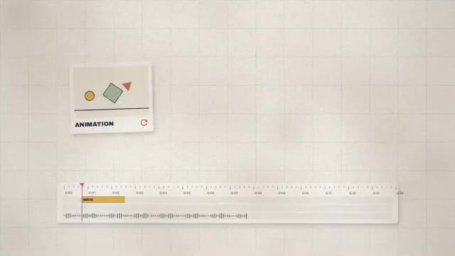  
  *⏱️ 00:00:01 — Une animation de style papier découpé avec une timeline de montage en bas et le mot "ANIMATION".*
- 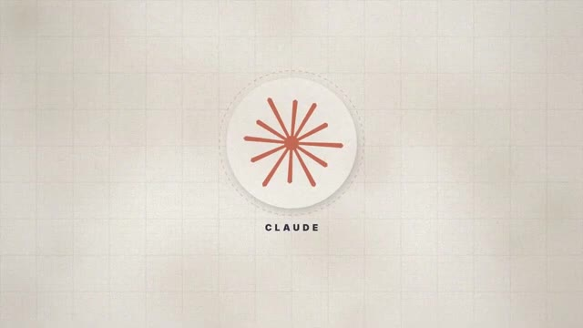  
  *⏱️ 00:00:11 — Le logo de l'assistant IA Claude représenté sous forme de rayons stylisés avec le texte "CLAUDE".*
- 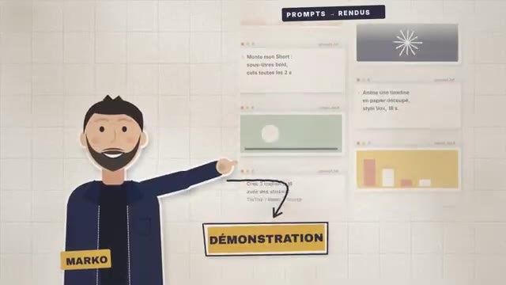  
  *⏱️ 00:00:20 — Le personnage animé Marko présentant des exemples de prompts et de rendus visuels sous l'étiquette "DÉMONSTRATION".*

---

### ⏱️ `[00:00:22 - 00:00:42]` | Segment #02

**🔊 Audio (Transcription Intégrale Mot pour Mot en Français) :**
> Car oui, cette introduction a été réalisée par Claude Opus 5.5 juste à partir d'un prompt. Le nouveau modèle d'Anthropic impressionne. Et dans cette vidéo, on va s'intéresser à ses capacités de motion design. On verra donc comment j'ai réalisé cette introduction de vidéo, mais aussi comment créer un projet dans le style animation pour les réseaux.

**👁️ Analyse Visuelle d'Écran (gemini-3.5-flash-lite) :**
**Interface & Outils** : Style graphique d'animation 2D (motion design) avec maquettes de lecteurs vidéo et de smartphones.
**Contenu textuel & Code** : Textes explicatifs : 'dans cette vidéo...', 'PARTIE 02', 'CRÉER UN PROJET STYLE ANIMATION', formes géométriques animées (cercle rouge, carré bleu).
**Action / Démonstration** : Présentation du plan de la vidéo et introduction aux concepts de motion design pour les réseaux sociaux.

---

### ⏱️ `[00:00:42 - 00:01:05]` | Segment #03

**🔊 Audio (Transcription Intégrale Mot pour Mot en Français) :**
> Et dans une dernière partie, on verra si Opus 5.5 peut nous monter un Reels, un Short, un TikTok pour nos réseaux, en mélangeant face cam et motion design. Pour rappel, pour utiliser le nouveau modèle Opus 5.5, il nous faudra à minimum un abonnement Cloud Pro. Ainsi, on pourra le charger dans notre chat ou dans l'espace Coworks, ainsi si on veut le sélectionner sur Cloud Code.

**👁️ Analyse Visuelle d'Écran (gemini-3.5-flash-lite) :**
**Interface & Outils** : Site web de Claude (Anthropic).
**Contenu textuel & Code** : Offres d'abonnement Free (0 €), Pro (15 €) et Max (à partir de 90 €) ; interface de chat avec le message d'accueil et le choix de modèle Opus 5.5.
**Action / Démonstration** : Le créateur présente les prérequis d'abonnement puis montre l'interface de chat de Claude avec le modèle Opus 5.5.

**Captures d'écran :**
- 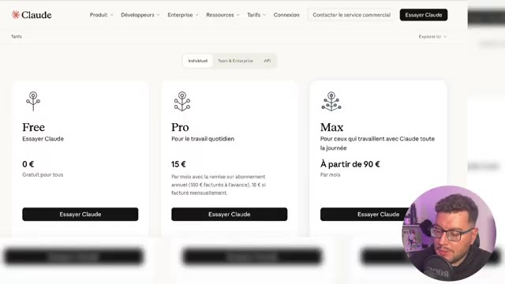  
  *⏱️ 00:00:54 — Page des tarifs de l'assistant Claude présentant les formules Free, Pro et Max.*
- 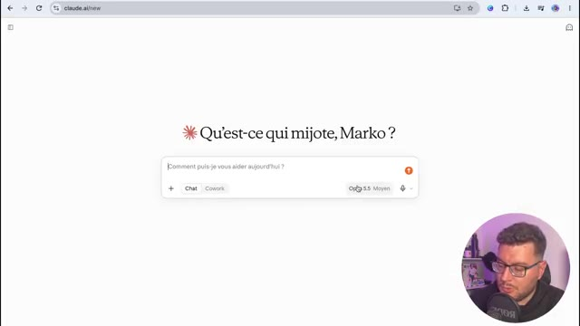  
  *⏱️ 00:01:04 — Interface de chat Claude (claude.ai/new) avec le sélecteur de modèle Opus 5.5 et l'option Cowork.*

---

### ⏱️ `[00:01:05 - 00:01:24]` | Segment #04

**🔊 Audio (Transcription Intégrale Mot pour Mot en Français) :**
> Les exemples que je vais présenter ici se font via l'abonnement Pro, mais bien sûr, si tu as besoin de plus de crédit, Opus 5.5 est aussi disponible en API, on en reparle en fin de vidéo. Donc déjà, à froid, j'ai voulu lui demander tout simplement, créez-moi une introduction de vidéo en motion design, reprenant le texte suivant. C'est tout.

**👁️ Analyse Visuelle d'Écran (gemini-3.5-flash-lite) :**
**Interface & Outils** : Présentation orale ou séquence sans interface partagée.
**Contenu textuel & Code** : Explications et conseils de création de contenu / IA.
**Action / Démonstration** : Démonstration et mise en contexte pratique.

---

### ⏱️ `[00:01:24 - 00:01:42]` | Segment #05

**🔊 Audio (Transcription Intégrale Mot pour Mot en Français) :**
> Et là, Opus 5 s'est mis en route et il a commencé à me coder la vidéo. Alors quand je dis coder la vidéo, qu'est-ce qui se passe en fait ? Il va coder les images, puis les animer frame par frame pour les transformer en rendu animation web qu'il va par la suite transformer en MP4 et nous proposer de le télécharger.

**👁️ Analyse Visuelle d'Écran (gemini-3.5-flash-lite) :**
**Interface & Outils** : Présentation orale ou séquence sans interface partagée.
**Contenu textuel & Code** : Explications et conseils de création de contenu / IA.
**Action / Démonstration** : Démonstration et mise en contexte pratique.

---

### ⏱️ `[00:01:42 - 00:02:02]` | Segment #06

**🔊 Audio (Transcription Intégrale Mot pour Mot en Français) :**
> Donc je résume simplement. Bien sûr, il y a beaucoup plus de procédés que ça. Mais ce qu'il faut savoir, c'est que toi, en tant qu'utilisateur, tu as juste à attendre pour avoir ton animation motion design créée ici au bout de 8 minutes et téléchargeable. Donc là avec vraiment très très peu d'informations, j'ai déjà une intro complète.

**👁️ Analyse Visuelle d'Écran (gemini-3.5-flash-lite) :**
**Interface & Outils** : Interface web de Claude AI / Navigateur web
**Contenu textuel & Code** : Fichiers générés ("Intro claude opus55 16x9.mp4", "Intro claude opus55 source.html"), texte "Créer sa petite animation"
**Action / Démonstration** : Le créateur montre l'interface de génération terminée après le temps d'attente et présente le résultat final en action.

**Captures d'écran :**
- 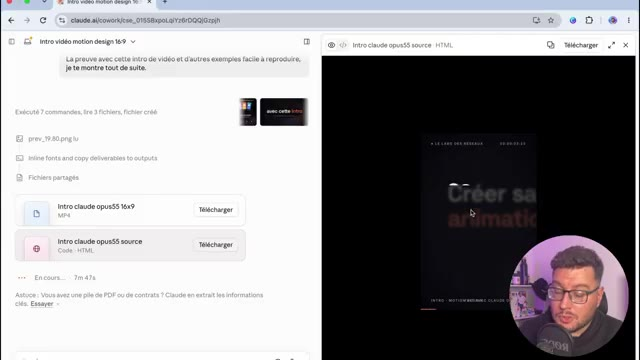  
  *⏱️ 00:01:52 — Interface de l'outil Claude affichant le résultat de la génération de l'animation motion design avec les boutons de téléchargement du fichier MP4 et du code HTML.*
- 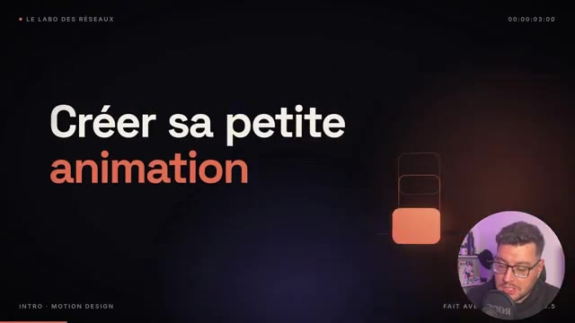  
  *⏱️ 00:02:00 — Aperçu en plein écran de l'animation motion design finale générée, avec le texte "Créer sa petite animation" affiché clairement.*

---

### ⏱️ `[00:02:02 - 00:02:30]` | Segment #07

**🔊 Audio (Transcription Intégrale Mot pour Mot en Français) :**
> Alors je n'ai pas de voix off sur cette intro, donc je vais continuer la conversation et demander si Claude peut me rajouter une voix off. Et là incroyable, sans même que je branche en API un logiciel comme Eleven Labs, j'aurai ma vidéo disponible avec une voix off. Bien sûr, il n'y aura pas d'émotion et ça ne sera pas trop professionnel. Mais si on la lance, créer sa petite animation, sa séquence de motion design, pour illustrer sa vidéo, ou même confier le montage de son TikTok, réel ou short YouTube.

**👁️ Analyse Visuelle d'Écran (gemini-3.5-flash-lite) :**
**Interface & Outils** : Interface web de l'assistant IA Claude, éditeur vidéo, lecteur audio intégré.
**Contenu textuel & Code** : Texte explicatif en anglais/français généré par l'IA, options de fichiers 'Intro claude opus55 16x9 voixoff.mp4' et 'Voixoff intro seule.wav', lecteur audio en cours de lecture (0:10 / 0:25).
**Action / Démonstration** : Le créateur présente l'interface de l'IA Claude qui a généré la voix off et la vidéo de manière automatisée.

**Captures d'écran :**
- 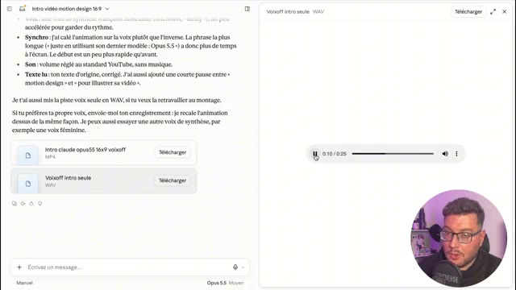  
  *⏱️ 00:02:16 — Interface de l'assistant IA Claude montrant un récapitulatif textuel avec options de téléchargement de fichiers audio et vidéo.*

---

### ⏱️ `[00:02:31 - 00:02:52]` | Segment #08

**🔊 Audio (Transcription Intégrale Mot pour Mot en Français) :**
> Le résultat est là. Alors, par contre, ce résultat, même s'il est sympathique, il est très générique. Et on risque fort de rencontrer le phénomène affiche chat GPT si on prend tous de manière simple pour avoir son motion design. C'est pour ça que dans un second temps, j'ai voulu recréer l'intro en lui donnant beaucoup plus de contexte.

**👁️ Analyse Visuelle d'Écran (gemini-3.5-flash-lite) :**
**Interface & Outils** : Navigateur web affichant l'interface de l'outil d'IA Claude et incrustation vidéo du créateur.
**Contenu textuel & Code** : Prompt textuel sur l'interface de Claude détaillant le style explicatif type Vox, la palette de couleurs, les éléments graphiques et la structure de la vidéo.
**Action / Démonstration** : Le créateur montre l'interface de l'outil d'intelligence artificielle Claude pour illustrer comment il a fourni du contexte et des consignes précises pour générer le motion design.

**Captures d'écran :**
- 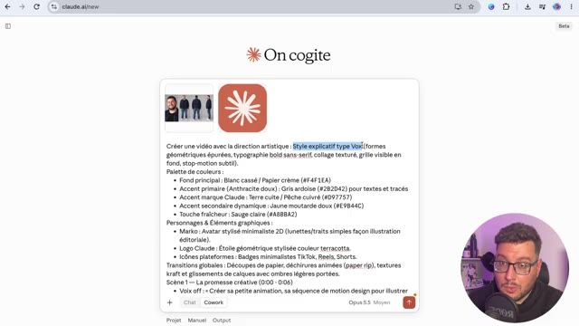  
  *⏱️ 00:02:50 — Interface de l'assistant IA Claude affichant un prompt détaillé pour la création de la direction artistique d'une vidéo motion design.*

---

### ⏱️ `[00:02:52 - 00:03:15]` | Segment #09

**🔊 Audio (Transcription Intégrale Mot pour Mot en Français) :**
> Et ici quand je parle de contexte, c'est surtout que je lui ai donné un style propre, ici le style Vox, avec des formes géométriques épurées, typographies, bol de sens et rive, et un collage texturé gris visible en fond, stop motion subtil, une palette de couleurs avec les codes couleurs pour l'accompagner, une indication sur les transitions globales, je lui ai donné aussi une indication de voix off, les effets sonores, et très important, je lui ai donné des références.

**👁️ Analyse Visuelle d'Écran (gemini-3.5-flash-lite) :**
**Interface & Outils** : Document textuel de planification / Interface de traitement de texte.
**Contenu textuel & Code** : Texte descriptif d'un projet vidéo abordant le style Vox, la palette de couleurs, les personnages et les transitions globales.
**Action / Démonstration** : Le créateur présente et lit les spécifications de direction artistique et de découpage de son projet vidéo.

**Captures d'écran :**
- 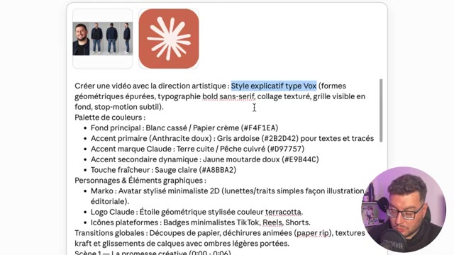  
  *⏱️ 00:02:53 — Capture d'écran montrant le document de conception détaillé avec le style explicatif type Vox et la palette de couleurs.*
- 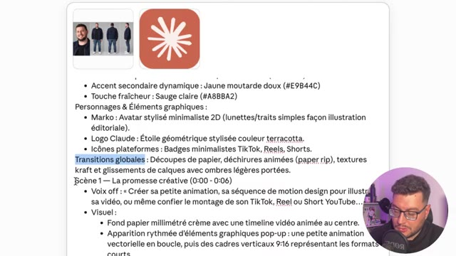  
  *⏱️ 00:03:03 — Capture d'écran du script vidéo détaillant la section des transitions globales et de la scène 1.*
- 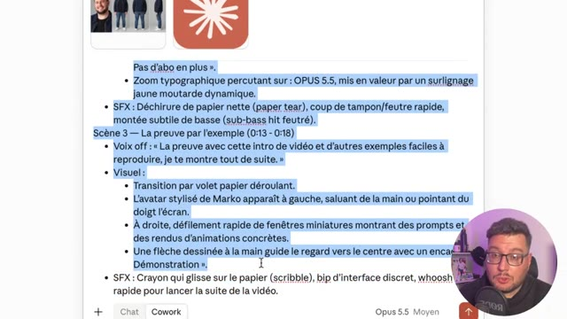  
  *⏱️ 00:03:14 — Capture d'écran du document textuel présentant les détails de la scène 3 et les éléments visuels associés.*

---

### ⏱️ `[00:03:15 - 00:03:36]` | Segment #10

**🔊 Audio (Transcription Intégrale Mot pour Mot en Français) :**
> Je vais donner une fiche caractère référence pour essayer de me créer un motion design. Et j'ai aussi donné le logo de Claude puisqu'il est mentionné dans la vidéo. Ensuite pour pouvoir maîtriser ce qui se passe à l'écran, j'ai refait scène par scène avec le redattage de celle-ci pour bien avoir ce qui s'affiche avec le texte qui est dit. Je génère. Ici j'en ai une pour une dizaine de minutes.

**👁️ Analyse Visuelle d'Écran (gemini-3.5-flash-lite) :**
**Interface & Outils** : Navigateur web, interface Claude / Cowork.
**Contenu textuel & Code** : Prompt de direction artistique (style Vox, formes géométriques, palette de couleurs) et volet de progression avec tâches (Construire l'animation, Générer les SFX, etc.).
**Action / Démonstration** : Le créateur montre l'utilisation de Claude pour configurer et suivre la génération de son motion design scène par scène.

**Captures d'écran :**
- 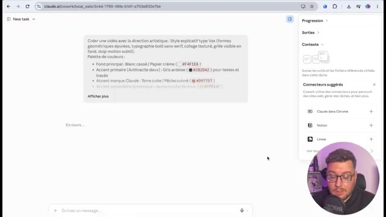  
  *⏱️ 00:03:25 — Interface de l'outil Claude montrant un prompt décrivant la direction artistique du motion design avec palette de couleurs et encart vidéo du créateur en bas à droite.*
- 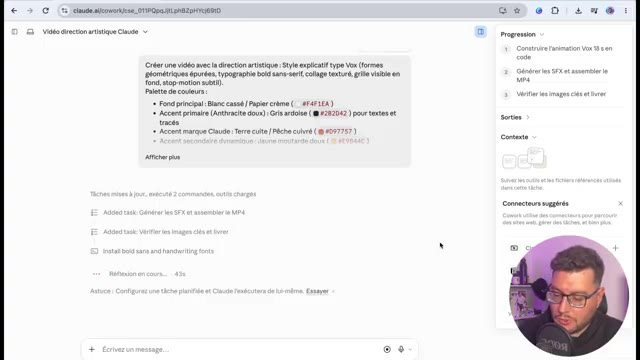  
  *⏱️ 00:03:34 — Progression de la tâche en cours sur Claude avec affichage des étapes d'exécution et mise à jour des tâches du projet vidéo.*

---

### ⏱️ `[00:03:36 - 00:04:01]` | Segment #11

**🔊 Audio (Transcription Intégrale Mot pour Mot en Français) :**
> Il a pris la décision de ne pas me mettre les lunettes parce que sur le point que j'avais fourni j'avais dit avec des lunettes mais la photo n'avait pas de lunettes. donc très très bien, et il a ajouté un petit texte supplémentaire, donc prise d'initiative de sa part, pourquoi pas, et en téléchargeant la vidéo et en la lançant, c'est celle que tu as vue en introduction de cette vidéo. On continue les tests avec cette fois-ci la volonté de créer un format récurrent sur TikTok 100% animé.

**👁️ Analyse Visuelle d'Écran (gemini-3.5-flash-lite) :**
**Interface & Outils** : Lecteur multimédia / Logiciel de lecture vidéo
**Contenu textuel & Code** : Fichier "intro_vox_claude.mp4", illustration avec des formes (cercle jaune, carré vert, triangle rouge), texte "ANIMATION", timeline avec curseur de lecture et forme d'onde audio.
**Action / Démonstration** : Le créateur visionne la vidéo générée pour en analyser le contenu et le rendu visuel.

**Captures d'écran :**
- 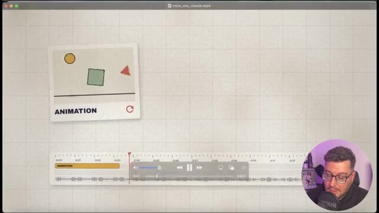  
  *⏱️ 00:03:49 — Capture d'écran montrant le lecteur vidéo en cours de lecture avec une animation de formes géométriques et une timeline audio en bas.*

---

### ⏱️ `[00:04:02 - 00:04:37]` | Segment #12

**🔊 Audio (Transcription Intégrale Mot pour Mot en Français) :**
> Dans un premier temps travail préparatoire, je vais demander de me trouver une histoire pour un dessin animé éducatif d'une minute au format TikTok, prendre une histoire connue avec un hook fort et une révélation à la fin. opus 5 réfléchit donc moi je les mets en moyen sachant qu'on peut le mettre aussi en élevé mais ça va user beaucoup plus de crédit néanmoins on n'a pas la même sensation qu'on a avec gpt6 astra et en termes de crédit on a le sentiment de pouvoir faire beaucoup plus de choses même si astra a sorti les modèles sol et luna récemment et il m'a sorti une histoire que je pourrais modifier je pourrais donner des références ici là je vais laisser travailler en paix pour

**👁️ Analyse Visuelle d'Écran (gemini-3.5-flash-lite) :**
**Interface & Outils** : On cogite, Cowork, Claude, Chrome
**Contenu textuel & Code** : "Peux-tu me trouver une histoire pour un petit dessin animé éducatif d'une minute, au format TikTok ? Prends une histoire connue avec un hook super fort et une révélation à la fin." ; "Voix off : « Alors le roi a eu une idée ! T’accord. Mais tu comptes chaque grain toi-même. Ce piège s’appelle la croissance exponentielle. C’est la même logique qu’un virus qui se propage... ou qu’une vidéo qui devient virale. »" ; "Pourquoi ça marche sur TikTok : Le hook pose une énigme (comment un grain peut ruiner un roi), l’escalade des chiffres retient l’attention jusqu’au bout et la dernière phrase relie l’histoire au quotidien, ce qui pousse à commenter." ; "Semmelweis : En 1847, un médecin a trouvé comment sauver des milliers de mères. On l’a pris pour un fou. « Révélation : Il demandait simplement aux médecins de se laver les mains. »" ; "Ératosthène : Il y a 2 200 ans, un homme a mesuré la Terre entière avec un bâton. « Révélation : Il s’est trompé de moins de 2 %, d’après les estimations les plus favorables. »" ; "Je peux peux-tu me découper l’histoire choisie en prompts SeedAnce plan par plan, sans musique de fond." ; "Non je veux que tu me créer la vidéo format TikTok avec voix off, mais tu vas devoir : choisir Une Direction artistique Style original/ bien dessiner les Personnages dans le meme style/ rendre chaque scène dynamique et intense dans les transition/ ajoute une Vox Off et des effets sonores" ; "Exécuté 3 commandes, outils chargés : 1 note"
**Action / Démonstration** : L'utilisateur pose une question à l'outil d'IA pour générer une histoire pour un dessin animé TikTok. L'IA propose plusieurs histoires avec leurs hooks et révélations. L'utilisateur affine ensuite sa demande pour la création vidéo.

**Captures d'écran :**
- 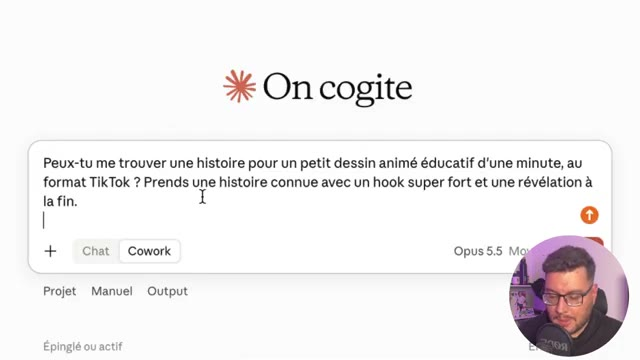  
  *⏱️ 00:04:03 — L'interface de l'outil "On cogite" affiche une requête en cours de saisie.*
- 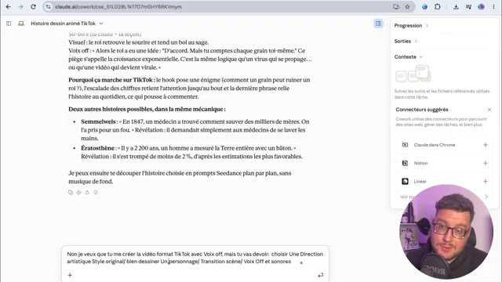  
  *⏱️ 00:04:20 — L'outil "On cogite" présente les suggestions d'histoires pour un dessin animé TikTok, avec des options pour les "Connexions" et "Contextes".*
- 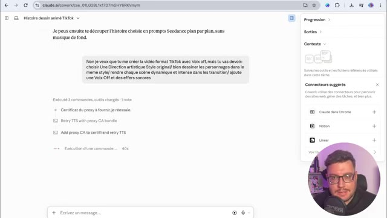  
  *⏱️ 00:04:36 — L'outil "On cogite" montre les commandes exécutées, les charges utiles et les notes, ainsi que la possibilité d'écrire un message.*

---

### ⏱️ `[00:04:38 - 00:05:11]` | Segment #13

**🔊 Audio (Transcription Intégrale Mot pour Mot en Français) :**
> avoir mon petit dessin animé en motion design d'une minute on est parti voix off essais sonores tout est en train de se créer on va accélérer la vidéo ici on en a eu pour 27 minutes de travail donc c'est quand même assez conséquent si on veut le mettre en place dans un workflow répété faudra plutôt se tourner vers une automatisation avec le code et l'api on va pouvoir télécharger et regarder le reste droit a failli perdre tout son royaume à cause d'un seul grain de riz il y a très longtemps en inde un vieux sage invente un jeu tout nouveau les échecs Magnifique. Demande-moi ce que tu veux.

**👁️ Analyse Visuelle d'Écran (gemini-3.5-flash-lite) :**
**Interface & Outils** : Lecteur vidéo ou aperçu de création en motion design.
**Contenu textuel & Code** : Texte affiché : « DEMANDE-MOI CE QUE », personnage souriant en costume orange avec un chapeau à plume, fond de rayons orange et effet vintage.
**Action / Démonstration** : Présentation du résultat final du dessin animé généré en motion design.

**Captures d'écran :**
- 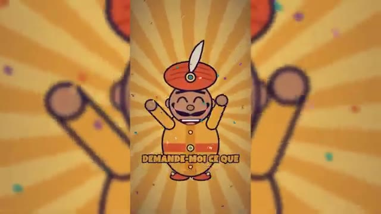  
  *⏱️ 00:05:09 — Animation au format vertical montrant un personnage de dessin animé style rétro avec des confettis en arrière-plan.*

---

### ⏱️ `[00:05:11 - 00:05:31]` | Segment #14

**🔊 Audio (Transcription Intégrale Mot pour Mot en Français) :**
> Un grain de riz sur la première case. Deux sur la deuxième. Quatre sur la troisième. Et tu doubles jusqu'à la dernière. Ah, c'est tout. Accord. Case 10, 512 grains. Une poignée. Case 21, plus d'un million de grains. Case 32, plus de 2 milliards.

**👁️ Analyse Visuelle d'Écran (gemini-3.5-flash-lite) :**
**Interface & Outils** : Animation vidéo éducative au format vertical
**Contenu textuel & Code** : Texte 'LA RÈGLE DU SAGE', échiquier vert et blanc, et graphismes illustrant le calcul exponentiel du riz
**Action / Démonstration** : Explication de la progression géométrique des grains de riz sur un échiquier à travers une animation visuelle

**Captures d'écran :**
- 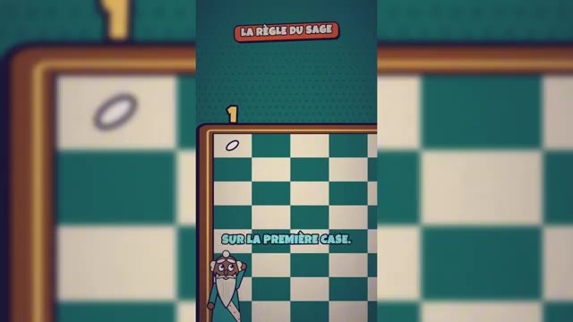  
  *⏱️ 00:05:12 — Illustration d'un échiquier avec une case mise en avant et le texte 'SUR LA PREMIÈRE CASE'*
- 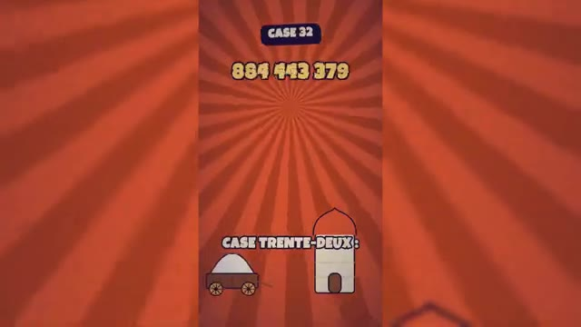  
  *⏱️ 00:05:30 — Affichage de la 'CASE 32' avec un grand nombre et une illustration de chariot rempli de grains*

---

### ⏱️ `[00:05:32 - 00:05:53]` | Segment #15

**🔊 Audio (Transcription Intégrale Mot pour Mot en Français) :**
> 50 tonnes. Et il reste encore 32 cases. Au total, 18 milliards de milliards de grains. des siècles de toute la récolte mondiale de riz. Aucun royaume au monde ne peut payer ça. Alors le roi a une idée. D'accord, mais tu les comptes toi-même, un par un. Ce piège a un nom, la croissance exponentielle.

**👁️ Analyse Visuelle d'Écran (gemini-3.5-flash-lite) :**
**Interface & Outils** : Graphismes animés verticaux de style vidéo explicative (Shorts/Reels).
**Contenu textuel & Code** : Textes illustrant le problème mathématique du riz et de l'échiquier (50 tonnes, trésor vide, aucun royaume, croissance exponentielle).
**Action / Démonstration** : Animation visuelle dynamique accompagnant la narration sur la croissance exponentielle.

---

### ⏱️ `[00:05:53 - 00:06:16]` | Segment #16

**🔊 Audio (Transcription Intégrale Mot pour Mot en Français) :**
> Et c'est exactement comme ça qu'une vidéo devient virale. Alors déjà en termes de rendu, on est sur des motion design proches du dessin animé. Donc ça c'est assez sympa, le hook est bien travaillé. L'histoire par contre je trouve elle est assez décousue, la voix off n'est pas trop adaptée. Et au final j'aurais peut-être dû relire certains passages parce que je pense qu'il manque des petits bouts pour pouvoir assembler le tableau.

**👁️ Analyse Visuelle d'Écran (gemini-3.5-flash-lite) :**
**Interface & Outils** : Vidéo au format Short / TikTok présentant un motion design narratif avec incrustation du créateur en bas à droite.
**Contenu textuel & Code** : Textes textuels incrustés et animations graphiques (organigramme, personnages de conte, plateau de jeu).
**Action / Démonstration** : Le créateur commente et analyse un exemple de vidéo virale basée sur une narration en motion design.

---

### ⏱️ `[00:06:16 - 00:06:35]` | Segment #17

**🔊 Audio (Transcription Intégrale Mot pour Mot en Français) :**
> Mais franchement sur un travail autonome d'une minute c'est assez surprenant. Surtout la façon d'animer les personnages au motion design que je trouve très rigolo. Donc le format court ça marche et imaginons maintenant on souhaite vraiment le travailler. Dans le cas présent j'ai tourné ma vidéo style vertical pour TikTok, Instagram et Youtube.

**👁️ Analyse Visuelle d'Écran (gemini-3.5-flash-lite) :**
**Interface & Outils** : Présentation orale ou séquence sans interface partagée.
**Contenu textuel & Code** : Explications et conseils de création de contenu / IA.
**Action / Démonstration** : Démonstration et mise en contexte pratique.

---

### ⏱️ `[00:06:35 - 00:06:54]` | Segment #18

**🔊 Audio (Transcription Intégrale Mot pour Mot en Français) :**
> Qui présente justement le motion design grâce à Opus 5.5. Et donc je vais donner cette vidéo où il n'y a aucun montage, aucune animation, aucune motion design. C'est seulement moi qui parle devant la caméra. Voici ma vidéo format 9-16ème qui présente les nouveautés de motion design d'Opus 5.5.

**👁️ Analyse Visuelle d'Écran (gemini-3.5-flash-lite) :**
**Interface & Outils** : Application web 'On cogite' avec interface de chat et import de fichier vidéo.
**Contenu textuel & Code** : Fichier vidéo 'Opus 55.mp4', prompt rédigé demandant l'ajout de motion design scène par scène.
**Action / Démonstration** : Le créateur tape un prompt détaillé dans l'interface de l'outil IA pour transformer sa vidéo face caméra.

**Captures d'écran :**
- 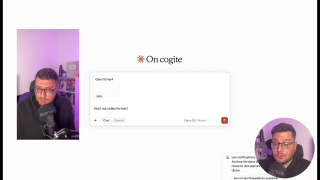  
  *⏱️ 00:06:36 — Interface de l'application 'On cogite' avec le fichier 'Opus 55.mp4' importé et un début de prompt saisi.*
- 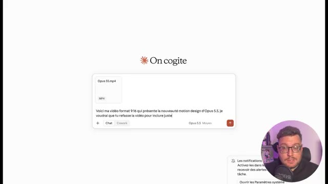  
  *⏱️ 00:06:45 — Poursuite de la saisie du prompt demandant d'inclure du motion design pour Opus 5.5.*
- 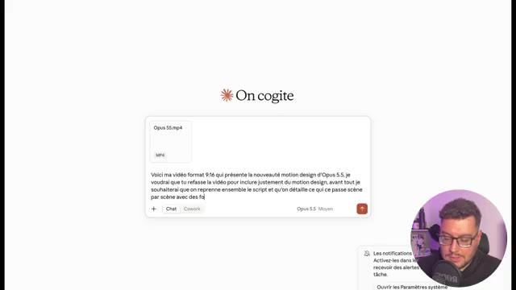  
  *⏱️ 00:06:53 — Fin de la saisie du prompt détaillant la reprise du script scène par scène.*

---

### ⏱️ `[00:06:55 - 00:07:14]` | Segment #19

**🔊 Audio (Transcription Intégrale Mot pour Mot en Français) :**
> Je voudrais que tu refasses la vidéo pour inclure justement du motion design. Avant tout je souhaite que tu reprends l'ensemble du script, que tu détailles ce qui se passe scène par scène. Comme ça on peut corriger ensemble. et je voudrais un style 3D motion design avec beaucoup de rythme et bien expliqué sur les parties techniques avec des schémas animés.

**👁️ Analyse Visuelle d'Écran (gemini-3.5-flash-lite) :**
**Interface & Outils** : Présentation orale ou séquence sans interface partagée.
**Contenu textuel & Code** : Explications et conseils de création de contenu / IA.
**Action / Démonstration** : Démonstration et mise en contexte pratique.

---

### ⏱️ `[00:07:14 - 00:07:33]` | Segment #20

**🔊 Audio (Transcription Intégrale Mot pour Mot en Français) :**
> Ma vidéo a été analysée, j'ai mon découpage qui a été fait, une direction artistique a été proposée et je suis d'accord même s'il me demande de changer le texte, je lui dis non non non, je ne veux pas du tout changer le texte et je veux que tu reprennes ma voix de narrateur. Je ne sais pas si c'est possible, on va voir tout de suite en le soumettant et là on laisse travailler l'IA.

**👁️ Analyse Visuelle d'Écran (gemini-3.5-flash-lite) :**
**Interface & Outils** : Présentation orale ou séquence sans interface partagée.
**Contenu textuel & Code** : Explications et conseils de création de contenu / IA.
**Action / Démonstration** : Démonstration et mise en contexte pratique.

---

### ⏱️ `[00:07:33 - 00:07:53]` | Segment #21

**🔊 Audio (Transcription Intégrale Mot pour Mot en Français) :**
> Alors ici, on a dû relancer Claude une deuxième fois parce que la limite d'action avait été atteinte pour la réponse. Donc, j'ai redemandé de continuer et la vidéo est prête. Alors là, le travail m'a pris un petit peu plus de 30 minutes. Donc, encore une fois, il faut avoir bien ça à l'esprit. La solution n'est pas magique. Elle demande du travail de contexte en amont.

**👁️ Analyse Visuelle d'Écran (gemini-3.5-flash-lite) :**
**Interface & Outils** : Présentation orale ou séquence sans interface partagée.
**Contenu textuel & Code** : Explications et conseils de création de contenu / IA.
**Action / Démonstration** : Démonstration et mise en contexte pratique.

---

### ⏱️ `[00:07:53 - 00:08:13]` | Segment #22

**🔊 Audio (Transcription Intégrale Mot pour Mot en Français) :**
> Elle demande du temps. Mais à la fin, on va voir le résultat en téléchargeant et en le lançant. Est-ce que ça ne vous a plus besoin de logiciel ou de compétences pour faire du motion design ? Une phrase avec Opus 5.5, Claude crée ta vidéo, ton animation. Et même pas besoin de skills de MCP ou d'abonnements supplémentaires. Non, non, en une seule phrase tu as ta vidéo, comme c'est intro en motion design.

**👁️ Analyse Visuelle d'Écran (gemini-3.5-flash-lite) :**
**Interface & Outils** : Vidéo au format Short/Reels avec éléments graphiques incrustés (interface de type application mobile ou overlay de montage).
[DESC_IMAGE_1_CONTENU] Texte 'OPUS 5.5', '1 phrase' et encadré de saisie 'Une intro 3D néon violet sur l...'.
[DESC_IMAGE_2_CONTENU] Texte '1 VIDÉO' et fenêtre de chargement/rendu 'rendu_motion.mp4 (image 213 / 450)' avec barre de progression.
**Contenu textuel & Code** : Explications et conseils de création de contenu / IA.
**Action / Démonstration** : Le présentateur explique et illustre visuellement le concept de génération vidéo par IA à partir d'une simple phrase.

---

### ⏱️ `[00:08:14 - 00:08:34]` | Segment #23

**🔊 Audio (Transcription Intégrale Mot pour Mot en Français) :**
> Dynamiser tes présentations, illustrer un passage de ta vidéo, créer du contenu viral pour tes réseaux. Les possibilités sont infinies, mais si un seul prompt te suffit, encore faut-il réussir à le structurer, pour ne pas avoir la même bouillie que tout le monde va générer. Alors tu vas devoir donner du contexte, des références et une direction artistique. Bref, être le plus précis possible.

**👁️ Analyse Visuelle d'Écran (gemini-3.5-flash-lite) :**
**Interface & Outils** : Non spécifié (visuel animé)
**Contenu textuel & Code** : "Tes présentations", "Ton prompt", "Un prompt structuré", "Direction artistique", "Références", "Contexte".
**Action / Démonstration** : Le créateur explique l'importance de structurer un prompt.

**Captures d'écran :**
- 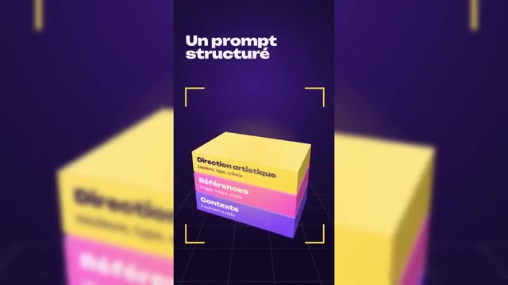  
  *⏱️ 00:08:32 — Visuel d'une pile de post-it avec les mentions "Direction artistique", "Références" et "Contexte".*

---

### ⏱️ `[00:08:34 - 00:08:52]` | Segment #24

**🔊 Audio (Transcription Intégrale Mot pour Mot en Français) :**
> Ensuite, Clodopus 5 écrit du code qui dessine et anime chaque image comme une page web animée et Clod te transforme le tout en fichier MP4 téléchargé. Assur, tu peux améliorer le workflow en ajoutant en API des voix off pro ou encore des images et vidéos IA générées par les meilleurs modèles du marché.

**👁️ Analyse Visuelle d'Écran (gemini-3.5-flash-lite) :**
**Interface & Outils** : Interface graphique animée en 3D sous forme de schémas conceptuels de workflow.
**Contenu textuel & Code** : Textes explicatifs : 'Claude Opus 5.5', 'Il écrit du code', 'Export en MP4', 'Améliorer le workflow', 'Voix off pro', 'Images et vidéos IA'.
**Action / Démonstration** : Explication visuelle étape par étape du fonctionnement de l'outil et de ses possibilités d'extension via API.

**Captures d'écran :**
- 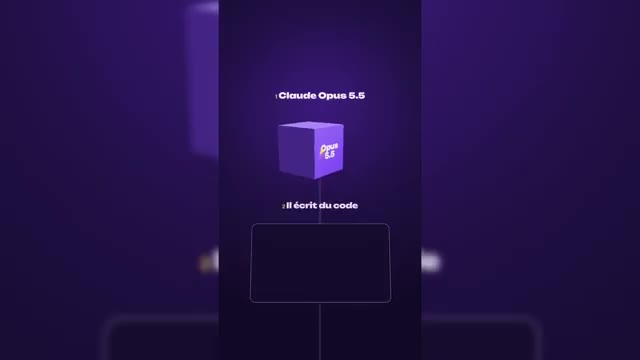  
  *⏱️ 00:08:35 — Illustration 3D présentant l'étape où Claude Opus 5.5 écrit du code pour l'animation.*
- 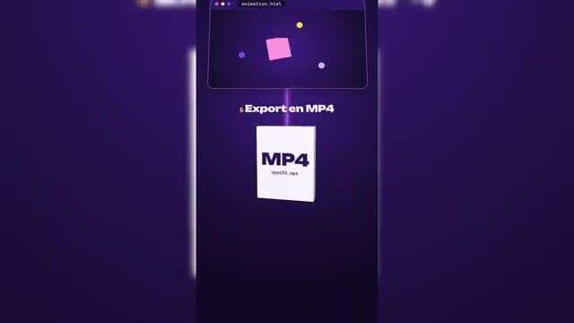  
  *⏱️ 00:08:43 — Illustration 3D montrant l'étape finale d'export au format fichier MP4.*
- 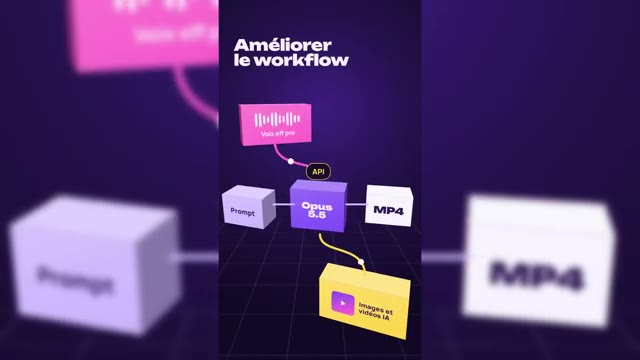  
  *⏱️ 00:08:50 — Schéma interactif 3D montrant l'amélioration du workflow via des API pour intégrer voix off pro, images et vidéos IA.*

---

### ⏱️ `[00:08:52 - 00:09:16]` | Segment #25

**🔊 Audio (Transcription Intégrale Mot pour Mot en Français) :**
> Bref, le résultat peut être très variable et c'est sûr qu'on va être un peu inondé sur les réseaux. Une bonne façon aussi de rappeler que le contenu pro animé par de vrais motion designers fera encore plus la différence. Alors je suis agréablement surpris. Il a gardé ma vidéo et mon audio original en incluant dedans le motion design et en mettant du rythme, en bien expliquant l'ensemble des schémas.

**👁️ Analyse Visuelle d'Écran (gemini-3.5-flash-lite) :**
**Interface & Outils** : Vidéo au format Short (YouTube Shorts / TikTok / Instagram Reels).
**Contenu textuel & Code** : Sous-titres dynamiques et animations graphiques (mention d'OPUS 5.5).
**Action / Démonstration** : Le créateur commente la qualité variable des contenus générés sur les réseaux sociaux.

---

### ⏱️ `[00:09:17 - 00:09:43]` | Segment #26

**🔊 Audio (Transcription Intégrale Mot pour Mot en Français) :**
> Franchement tout est clair. Il y a peut-être 2-3 défauts de transition et puis à la fin on voit aussi qu'il arrive du mal à illustrer cette toute dernière partie. mais franchement le livrable est là, je vais pouvoir le publier sur les réseaux sans aucun souci. C'est très impressionnant et j'en viens donc à cette conclusion que ça peut être un outil pour nous accompagner lors de présentations, lors de vidéos éducatives ou pour nous assister dans le montage pour expliquer des parties en motion design.

**👁️ Analyse Visuelle d'Écran (gemini-3.5-flash-lite) :**
**Interface & Outils** : Présentation orale ou séquence sans interface partagée.
**Contenu textuel & Code** : Explications et conseils de création de contenu / IA.
**Action / Démonstration** : Démonstration et mise en contexte pratique.

---

### ⏱️ `[00:09:43 - 00:10:02]` | Segment #27

**🔊 Audio (Transcription Intégrale Mot pour Mot en Français) :**
> Comme je le dis dans ce petit reel TikTok, est-ce qu'on ne va pas assister à une surproduction de ce type de vidéos et du coup, on va arriver à des résultats qui vont se ressembler tous avec des techniques de prompt qui vont être partagées et des styles qui vont se copier les uns les autres. Donc voilà, là c'est tout nouveau, c'est tout frais. On va en entendre parler sur les réseaux.

**👁️ Analyse Visuelle d'Écran (gemini-3.5-flash-lite) :**
**Interface & Outils** : AUCUNE
**Contenu textuel & Code** : AUCUN
**Action / Démonstration** : AUCUNE

---

### ⏱️ `[00:10:03 - 00:10:28]` | Segment #28

**🔊 Audio (Transcription Intégrale Mot pour Mot en Français) :**
> Est-ce qu'au final, ça ne va pas perdre de son charme et à force d'être utilisé, ça va être mis de côté par les viewers ? C'est quand même une super solution. Le prix en API, si on veut l'intégrer à un workflow cloud code dans une automatisation, sachant qu'en API, on peut brancher une voix off, par exemple, d'11Labs ou de fiches audio et pourquoi pas aussi l'API de XFIL pour pouvoir générer ces assets avec les meilleurs modèles du marché.

**👁️ Analyse Visuelle d'Écran (gemini-3.5-flash-lite) :**
**Interface & Outils** : Site web officiel d'Anthropic (Claude - Tarifs).
**Contenu textuel & Code** : Tableaux de prix des API pour Fable 5.1, Opus 5.5, Sonnet 5 et Haiku 4.5 (mise en cache des prompts, entrée, sortie).
**Action / Démonstration** : Le créateur présente et commente les tarifs des API des différents modèles Claude pour illustrer leur coût d'intégration dans un workflow d'automatisation.

**Captures d'écran :**
- 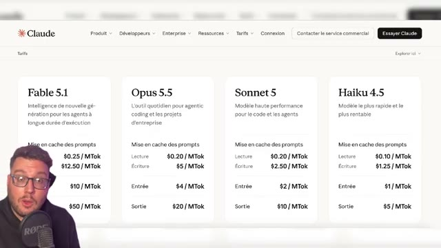  
  *⏱️ 00:10:16 — Affichage de la page de tarification des API de Claude montrant les différents modèles (Fable 5.1, Opus 5.5, Sonnet 5, Haiku 4.5) et leurs prix par million de tokens.*
- 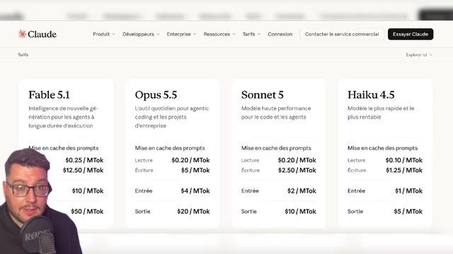  
  *⏱️ 00:10:27 — Vue similaire sur la grille tarifaire des API Claude d'Anthropic.*

---

### ⏱️ `[00:10:29 - 00:10:50]` | Segment #29

**🔊 Audio (Transcription Intégrale Mot pour Mot en Français) :**
> Ça, je pense, on en fera une vidéo dédiée. Et bien sûr, ce modèle Opus 5.5, il ne va pas que servir à faire du motion design. Il est très bon aussi dans tout ce qui va être création d'applications, création de sites internet, dans le code et dans les automatisations. Bref, à vous de le tester de votre côté. Merci d'avoir suivi ce tuto et je te dis à très bientôt sur le Labo des Réseaux pour de nouvelles vidéos.

**👁️ Analyse Visuelle d'Écran (gemini-3.5-flash-lite) :**
**Interface & Outils** : AUCUNE
**Contenu textuel & Code** : AUCUNE
**Action / Démonstration** : Le créateur conclut sa vidéo en s'adressant directement à son audience.

---
