# 🎬 Arrête de payer pour des Crédits IA que tu n’utilises pas : HIGGSFIELD API

> **Chaîne** : [Labo Des Réseaux](https://www.youtube.com/@labodesreseaux)  
> **Lien YouTube** : [https://www.youtube.com/watch?v=u66ICS8uDTE](https://www.youtube.com/watch?v=u66ICS8uDTE)  
> **Date de publication** : 20260930  
> **Durée** : 7:38  
> **Identifiant vidéo** : `u66ICS8uDTE`  
> **Modèles** : Audio: `whisper-v3-large-turbo` | Vision: `gemini-3.5-flash-lite`  

---

## 📌 Synthèse Exécutive & Outils

### 💡 Résumé
**La vidéo du « Labo Des Réseaux » met en lumière l'aberration financière des abonnements IA traditionnels dont les crédits non utilisés sont perdus chaque mois.** Le créateur présente l'API d'Higgsfield comme une alternative économique majeure, un agrégateur puissant où l'utilisateur ne paie que ce qu'il génère réellement, avec des tarifs ultra-compétitifs et des limites de générations simultanées modulables selon le solde du compte (débutant à 2 générations simultanées pour un crédit de 10 $).

**Pour surmonter l'ergonomie parfois perfectible de la plateforme native, le tutoriel démontre l'utilisation combinée de l'API et de l'assistant Claude (ou Claude Code).** En injectant le prompt de démarrage rapide fourni par Higgsfield dans l'IA, le créateur automatise la création d'une application locale sur son bureau qui centralise l'ensemble des modèles d'images et de vidéos disponibles, offrant ainsi une interface unifiée, connectée via une clé API sécurisée et facilement personnalisable en langage naturel.

**En conclusion, l'analyse stratégique nuancera l'abandon total des abonnements au profit du paiement à l'usage.** Si les abonnements gardent l'avantage pour une consommation lissée, illimitée ou pour des modèles spécifiques absents (comme ceux de Google et ChatGPT), le passage par l'API s'impose comme la solution idéale pour le travail par projets (pics de production suivis de pauses), le test comparatif de workflows, ou le prototypage rapide d'applications de génération dédiées à l'entrepreneuriat.

### 🛠️ Outils, Modèles & Logiciels Présentés
- **Plateforme API Higgsfield** (open.higgsfield.ai) : Agrégateur d'API de génération d'images et de vidéos à l'usage.**
- **Claude / Claude Code (Anthropic)** : Assistant conversationnel et outil de génération de code pour concevoir et modifier l'application locale.**
- **ChatGPT / Codex (OpenAI)** : Alternative mentionnée pour la gestion de code et d'assistants par agent.**
- **Modèles Vidéo** : Seedance 2.5, Seedance 2.0, Kling 3.0, Minimax H3, Wana 3.0 Prime, Genjutsu, Cinema Studio 4.0.**
- **Modèles Images** : Grok Imagine 2.0, Ideogram 4.0, Recraft 4.1, Flux 2, Soul 2, Marketing Studio Image.**

### 🔑 Points Clés & Enseignements Stratégiques
- Alternative aux abonnements** : Éviter la perte mensuelle des crédits non consommés en basculant sur un modèle de paiement à la génération (Pay-as-you-go).
- Gestion des limites de concurrence** : Le nombre de générations simultanées est indexé sur le solde de la balance (ex. : 2 générations max pour 10 $, jusqu'à 10 générations pour 25 $ ou plus).
- Centralisation via application locale** : Utilisation de Claude pour générer une application sur-mesure regroupant tous les modèles sur une seule interface depuis le bureau.
- Automatisation par Agent** : Récupération du prompt de démarrage rapide ("Copy Prompt Agent") dans l'onglet Quick Start de Higgsfield pour guider l'intelligence artificielle générative de code.
- Connexion sécurisée** : Génération d'une clé API dédiée depuis le dashboard Higgsfield (avec nom et date d'expiration optionnelle) pour relier l'application locale.
- Itération et personnalisation de l'UI** : Capacité de modifier l'interface en langage naturel via Claude (ex. : ajout d'un curseur latéral pour la barre de prompt).
- Référencement d'actifs** : Possibilité d'injecter directement des images de référence issues des assets générés dans les modèles vidéo (ex. : Seedance 2.5 Image-to-Video).
- Absences notables** : La plateforme ne propose pas encore les modèles de Google et ChatGPT, nécessitant de conserver des abonnements séparés selon les besoins.
- Cas d'usage optimal pour l'API** : Idéal pour les professionnels travaillant par projets (fortes charges de travail sporadiques suivies de périodes creuses sans facturation).
- Phase de test de workflows** : L'API sert de banc d'essai parfait pour auditer la qualité de différents modèles avant une intégration définitive dans un processus de production.
- Maintenance évolutive** : Nécessité de mettre à jour manuellement l'application locale pour intégrer les futurs modèles publiés par la plateforme.
- Scalabilité commerciale** : Possibilité d'exploiter les API individuelles de Higgsfield pour bâtir de véritables projets de business SaaS autour de la génération visuelle par IA.

---

## ⏱️ Chronologie & Transcription Complète Audio & Visuelle (Mot pour Mot)

### ⏱️ `[00:00:00 - 00:00:22]` | Segment #01

**🔊 Audio (Transcription Intégrale Mot pour Mot en Français) :**
> Chaque mois je perds des crédits parce que je ne les utilise pas avant la date de renouvellement de mon abonnement. C'est comme ça que fonctionnent la plupart des abonnements IA. Que ce soit les plateformes dédiées à un modèle ou les agrégateurs. Tu reçois des crédits pour le mois et ceux que tu n'utilises pas sont perdus. Aujourd'hui je te montre une autre façon de générer des images et des vidéos IA passées par l'API d'Exfit.

**👁️ Analyse Visuelle d'Écran (gemini-3.5-flash-lite) :**
**Interface & Outils** : Interface graphique personnalisée de présentation vidéo (motion design).
**Contenu textuel & Code** : Texte explicatif sur les abonnements IA, les crédits restants (940 sur 1000) et les différentes formules (19€, 39€, 79€/mois).
**Action / Démonstration** : Le présentateur introduit la problématique de la perte mensuelle de crédits sur les abonnements d'intelligence artificielle.

**Captures d'écran :**
- 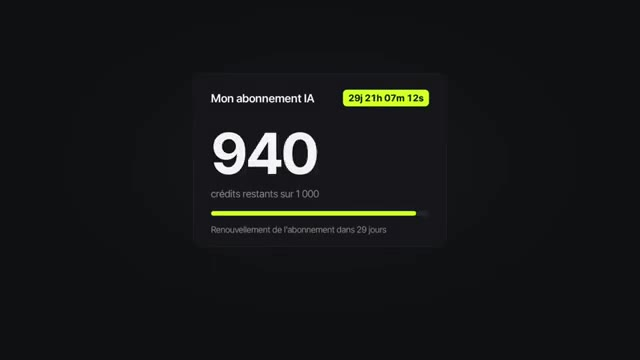  
  *⏱️ 00:00:01 — Aperçu du solde de crédits d'un abonnement IA et du temps restant avant renouvellement.*
- 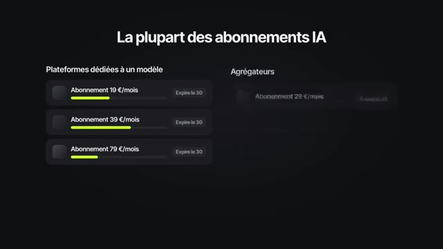  
  *⏱️ 00:00:11 — Comparatif visuel des différents abonnements IA, incluant les plateformes dédiées et les agrégateurs.*

---

### ⏱️ `[00:00:22 - 00:00:44]` | Segment #02

**🔊 Audio (Transcription Intégrale Mot pour Mot en Français) :**
> Cette API elle te donne accès à plusieurs modèles images et vidéos et tu payes seulement ce que tu génères. Niveau tarif c'est ultra compétitif. Si tu compares à ce qui se fait actuellement sur le marché. Et avec l'aide de Claude, on va construire une application locale installée sur ton ordinateur qui regroupe tous ces modèles au même endroit. Ça te permettra d'utiliser facilement tous les modèles IA compris dans la solution d'Xfield.

**👁️ Analyse Visuelle d'Écran (gemini-3.5-flash-lite) :**
**Interface & Outils** : Présentation orale ou séquence sans interface partagée.
**Contenu textuel & Code** : Explications et conseils de création de contenu / IA.
**Action / Démonstration** : Démonstration et mise en contexte pratique.

---

### ⏱️ `[00:00:44 - 00:01:04]` | Segment #03

**🔊 Audio (Transcription Intégrale Mot pour Mot en Français) :**
> De la création de la clé API jusqu'à la première génération, avec les étapes et les limites que j'ai rencontrées, je t'explique tout dans cette vidéo. Je suis sur le site spécial API d'Xfield. Pour y accéder, je te mets le lien en description et commentaire épinglé. J'ai créé un compte, je l'ai crédité de 10$. Un coup de feu rapide sur les prix des modèles.

**👁️ Analyse Visuelle d'Écran (gemini-3.5-flash-lite) :**
**Interface & Outils** : Interface web de Higgsfield API (Dashboard et page Pricing)
**Contenu textuel & Code** : Dashboard montrant le solde de l'organisation (9,94$), les dépenses du jour (0,06$) et le tableau comparatif des prix des modèles (Kling 3.0, Seedance, etc.)
**Action / Démonstration** : Navigation sur le tableau de bord et consultation de la grille tarifaire de la plateforme API.

**Captures d'écran :**
- 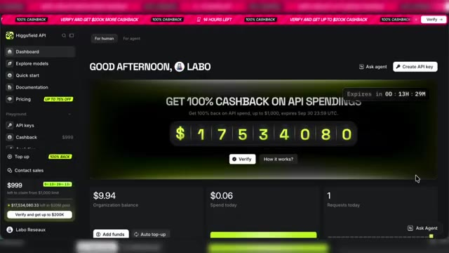  
  *⏱️ 00:00:54 — Le tableau de bord du compte utilisateur sur la plateforme Higgsfield API, montrant le solde de l'organisation et un compteur de cashback.*
- 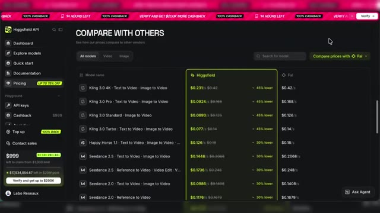  
  *⏱️ 00:01:03 — La page de tarification et de comparaison des prix des différents modèles d'IA sur la plateforme Higgsfield API.*

---

### ⏱️ `[00:01:04 - 00:01:22]` | Segment #04

**🔊 Audio (Transcription Intégrale Mot pour Mot en Français) :**
> On voit ici les tarifs par seconde selon le modèle. Et une comparaison avec un autre acteur du marché. Et du coup la compétitivité de cette plateforme API d'Xfield. Point important sur le nombre de générations simultanées. Nous ici avec seulement 10$ de balance, on sera limité à 2 générations simultanées.

**👁️ Analyse Visuelle d'Écran (gemini-3.5-flash-lite) :**
**Interface & Outils** : Présentation orale ou séquence sans interface partagée.
**Contenu textuel & Code** : Explications et conseils de création de contenu / IA.
**Action / Démonstration** : Démonstration et mise en contexte pratique.

---

### ⏱️ `[00:01:22 - 00:01:44]` | Segment #05

**🔊 Audio (Transcription Intégrale Mot pour Mot en Français) :**
> Mais plus tu as de crédit sur ton compte, plus ça augmente. Par exemple, des 25$ de balance, on monte jusqu'à 10 générations simultanées. Si je me rends dans Explore Models, je vais avoir tous les modèles disponibles en API. Pour la vidéo, on a Seed Dance 2.5, on aura aussi Seed Dance 2.0, Kling 3.0, Minimax H3 ou encore WANA 3.0 Prime.

**👁️ Analyse Visuelle d'Écran (gemini-3.5-flash-lite) :**
**Interface & Outils** : Dashboard web de Higgsfield API (open.higgsfield.ai)
**Contenu textuel & Code** : Menus Dashboard, Explore models, Quick start, Pricing, et cartes de présentation des IA vidéo (bytedance/Seeddance 2.5, higgsfield/Genjutsu, kling/Kling 3.0).
**Action / Démonstration** : Le créateur navigue dans l'onglet 'Explore models' pour présenter les différents modèles d'intelligence artificielle disponibles via l'API.

**Captures d'écran :**
-   
  *⏱️ 00:01:33 — Vue générale de l'interface Higgsfield API montrant les modèles vidéo disponibles comme Seeddance 2.5 et Kling 3.0.*
- 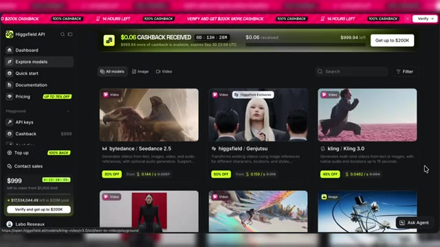  
  *⏱️ 00:01:43 — Navigation dans le catalogue des modèles d'intelligence artificielle avec les options de génération vidéo et les tarifs associés.*

---

### ⏱️ `[00:01:45 - 00:02:05]` | Segment #06

**🔊 Audio (Transcription Intégrale Mot pour Mot en Français) :**
> Et on a aussi les modèles Maison d'Xfield avec Genjutsu ou encore Cinema Studio 4.0. On aura aussi accès aux modèles images, et là il y aura du Grok Imagine 2.0, Ideogram 4.0, Recraft 4.1 et plein d'autres, avec aussi les modèles Maison d'Xfield, Soul 2 ou encore le Marketing Studio Image.

**👁️ Analyse Visuelle d'Écran (gemini-3.5-flash-lite) :**
**Interface & Outils** : Interface web de Higgsfield API (Explore models)
**Contenu textuel & Code** : Miniatures et descriptions de modèles d'IA : Minimax H3, Wan 3.0 Prime, Marketing Studio Image, Grok Imagine 2.0, Soul 2, Ideogram 4.0, Recraft 4.1, Soul Standard
**Action / Démonstration** : Le présentateur parcourt le catalogue des modèles d'IA d'image et de vidéo disponibles sur la plateforme Higgsfield API.

**Captures d'écran :**
- 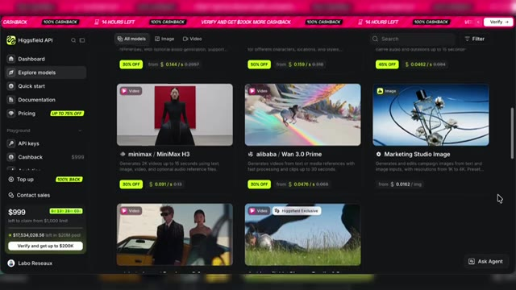  
  *⏱️ 00:01:46 — Interface de Higgsfield API montrant divers modèles vidéo et d'image disponibles sur la plateforme.*
- 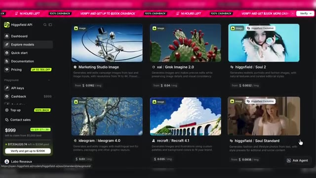  
  *⏱️ 00:01:55 — Vue détaillée de la galerie des modèles d'images incluant Marketing Studio Image, Grok Imagine 2.0, Soul 2, Ideogram 4.0 et Recraft 4.1.*
- 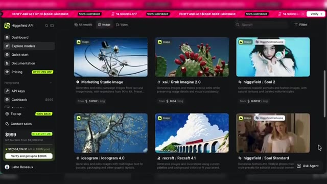  
  *⏱️ 00:02:03 — Affichage similaire de l'interface de Higgsfield API mettant en avant les modèles d'images récents.*

---

### ⏱️ `[00:02:05 - 00:02:24]` | Segment #07

**🔊 Audio (Transcription Intégrale Mot pour Mot en Français) :**
> La liste est plutôt complète, dommage, on n'a pas accès aux modèles de ChatGPT et Google pour l'instant. Je ne sais pas si ça changera, la plateforme est encore toute récente, espérons que la liste de modèles s'enrichisse très vite. Et tous ces modèles, on peut les utiliser directement depuis le site. Par exemple, pour créer une image, je vais tester Grok Imagine 2.0.

**👁️ Analyse Visuelle d'Écran (gemini-3.5-flash-lite) :**
**Interface & Outils** : Site web de Higgsfield API, interface de test (Playground) et documentation de modèles d'IA.
**Contenu textuel & Code** : Menus de navigation (Dashboard, Explore models, Quick start, Pricing, API keys), vignettes de modèles (Marketing Studio Image, Grok Imagine 2.0, Soul 2), extraits de code TypeScript et champ de prompt d'entrée.
**Action / Démonstration** : Le créateur navigue dans le catalogue des modèles d'IA, sélectionne Grok Imagine 2.0 et présente l'interface du playground pour tester la génération d'images.

**Captures d'écran :**
-   
  *⏱️ 00:02:06 — Vue d'ensemble de la plateforme Higgsfield API montrant la liste des modèles d'IA disponibles pour les images et vidéos.*
- 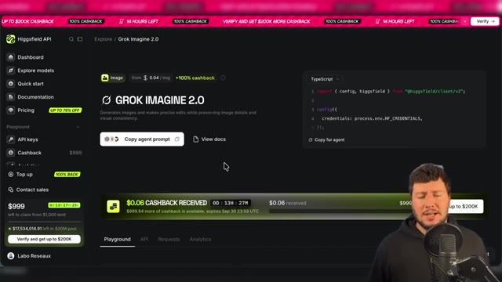  
  *⏱️ 00:02:15 — Page de détails du modèle 'Grok Imagine 2.0' sur Higgsfield API avec des exemples de code TypeScript et des options d'intégration.*
- 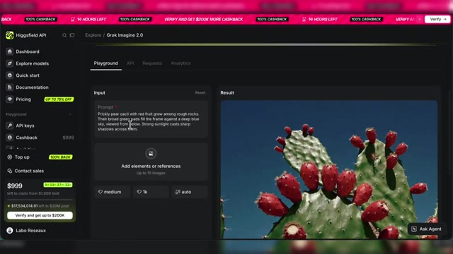  
  *⏱️ 00:02:23 — Interface du playground de Higgsfield API pour le modèle Grok Imagine 2.0 affichant le champ de prompt textuel et le résultat généré.*

---

### ⏱️ `[00:02:24 - 00:02:50]` | Segment #08

**🔊 Audio (Transcription Intégrale Mot pour Mot en Français) :**
> Je le sélectionne et là dans la partie Playground, je vais avoir une barre de prompt. Je vais pouvoir indiquer mon prompt et faire mes réglages, puis générer. J'ai d'ailleurs le prix qui s'affiche sur le bouton de génération. Voilà mon résultat. A noter, tu retrouveras toutes les générations sur l'onglet Request du modèle. Toujours dans les onglets, tu as aussi un onglet API qui te donne accès à la doc API du modèle et aussi une commande spécifique Copy Agent Prompt.

**👁️ Analyse Visuelle d'Écran (gemini-3.5-flash-lite) :**
**Interface & Outils** : Interface web de Higgsfield API / Grok Imagine 2.0 Playground.
**Contenu textuel & Code** : Champs de saisie de prompt, boutons de réglage (medium, 1k, auto), bouton de génération avec prix ($0.06), onglets Playground, API, Requests, Analytics.
[DESC_IMAGE_3] Saisie d'un prompt textuel, réglage des paramètres et explication du fonctionnement de la génération et du suivi dans l'onglet Requests.
**Action / Démonstration** : Démonstration et mise en contexte pratique.

**Captures d'écran :**
- 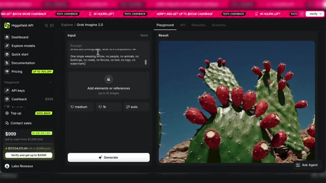  
  *⏱️ 00:02:26 — Interface de l'API Higgsfield avec le modèle Grok Imagine 2.0 affichant un prompt textuel et une image générée de cactus.*
- 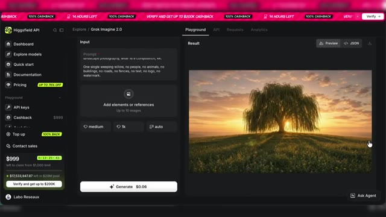  
  *⏱️ 00:02:37 — Interface Playground montrant la barre de prompt, les réglages et le bouton de génération affichant le coût de 0,06 $ avec une image de paysage arboré.*
- 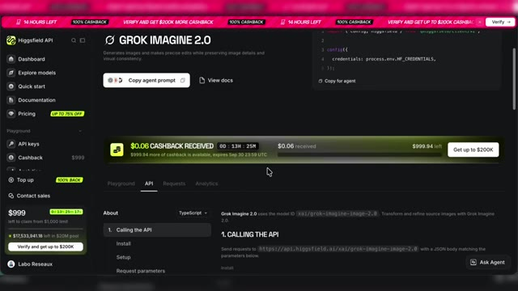  
  *⏱️ 00:02:48 — Vue de l'API Grok Imagine 2.0 sur la plateforme Higgsfield montrant la documentation, les onglets API, Requests et Analytics, ainsi qu'une notification de cashback.*

---

### ⏱️ `[00:02:50 - 00:03:10]` | Segment #09

**🔊 Audio (Transcription Intégrale Mot pour Mot en Français) :**
> qui te permet de copier-coller le prompt pour paramétrer l'API du modèle via un agent. Nous, on ne va pas le faire. On utilisera plutôt une autre commande pour donner d'un seul coup tous les modèles à Cloud qui nous préparera une application. Avant ça, je te montre aussi un modèle vidéo depuis la plateforme. Donc je sélectionne dans ma liste de modèles disponibles Seedense 2.5.

**👁️ Analyse Visuelle d'Écran (gemini-3.5-flash-lite) :**
**Interface & Outils** : Interface web de Higgsfield API, navigateur web, fenêtres de code TypeScript.
**Contenu textuel & Code** : Menus de navigation (Dashboard, Explore models, Quick start, Documentation, Pricing, API keys), bannières promotionnelles 'GET 100% CASHBACK ON API SPENDINGS', sélecteurs de formats (Text to Video, Image to Video, Reference to Video, Video Edit, Video Extend) et code de configuration d'API.
**Action / Démonstration** : Le créateur navigue sur la plateforme Higgsfield API pour explorer les modèles vidéo disponibles et montrer les options de configuration et de code.

**Captures d'écran :**
- 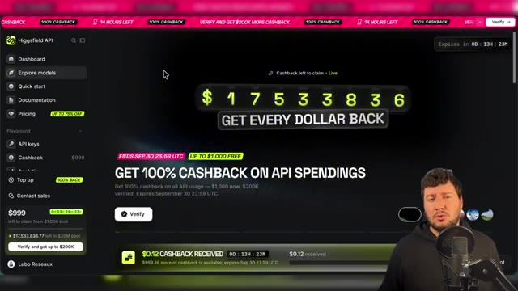  
  *⏱️ 00:03:00 — Vue générale du dashboard de la plateforme Higgsfield API avec des bannières promotionnelles de cashback.*
- 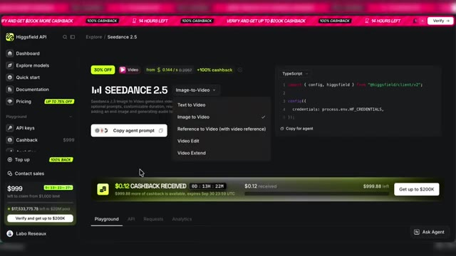  
  *⏱️ 00:03:09 — Affichage de la page de modèle 'SEEDANCE 2.5' sur l'API Higgsfield avec le menu déroulant des modes vidéo et un extrait de code TypeScript incluant le bouton 'Copy agent prompt'.*

---

### ⏱️ `[00:03:10 - 00:03:29]` | Segment #10

**🔊 Audio (Transcription Intégrale Mot pour Mot en Français) :**
> Tu vois, j'ai aussi la possibilité de choisir les déclinaisons du modèle selon l'usage. Là, je vais utiliser en image to video. Et pareil, je peux générer directement depuis le site ma vidéo en utilisant mes crédits API. Bon, même si l'utilisation des modèles depuis le site est possible, ce n'est pas forcément le plus agréable. Je te conseille de te rendre dans l'onglet Quick Start.

**👁️ Analyse Visuelle d'Écran (gemini-3.5-flash-lite) :**
**Interface & Outils** : Site web Higgsfield API (Playground Image-to-Video)
**Contenu textuel & Code** : Menu de gauche avec Dashboard, Explore models, Quick start, Documentation, Pricing ; au centre, les options Prompt, Start/End frames et Generate Audio ; à droite, le panneau de résultat vidéo.
**Action / Démonstration** : Le créateur montre l'interface de génération vidéo Image-to-Video sur la plateforme Higgsfield API.

**Captures d'écran :**
- 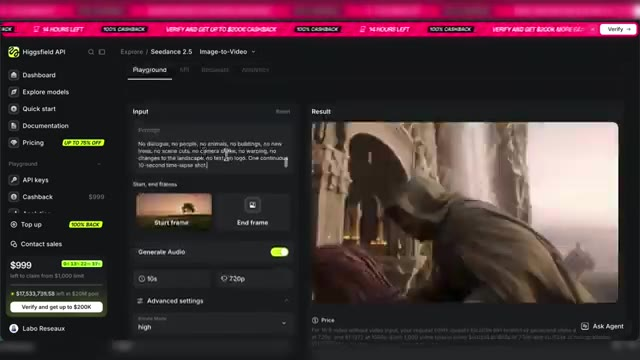  
  *⏱️ 00:03:20 — Interface du générateur vidéo en ligne Higgsfield API montrant les options Image-to-Video et le résultat en cours de lecture.*
- 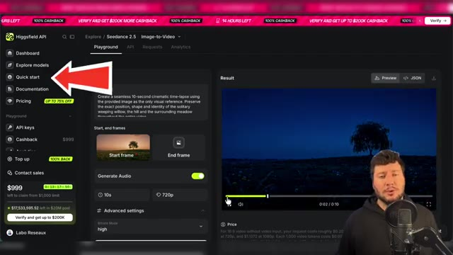  
  *⏱️ 00:03:28 — Interface de Higgsfield API avec une flèche rouge pointant vers le menu Quick Start, tandis que le créateur apparaît en incrustation.*

---

### ⏱️ `[00:03:29 - 00:03:48]` | Segment #11

**🔊 Audio (Transcription Intégrale Mot pour Mot en Français) :**
> Et tu vas copier ce prompt avec le bouton Copy Prompt Agent. Je vais ensuite ouvrir Cloud Code via l'application. Alors moi ici, j'utilise l'application Cloud Code, mais si tu es un utilisateur de chat GPT, tu peux utiliser Codex. Claude va me poser quelques questions supplémentaires. Je vais l'orienter en lui demandant d'installer l'application en local.

**👁️ Analyse Visuelle d'Écran (gemini-3.5-flash-lite) :**
**Interface & Outils** : Higgsfield API, application Claude / Cloud Code.
**Contenu textuel & Code** : Bouton "Copy agent prompt", interface de discussion avec l'IA et options d'installation technique (Node.js, npm, pnpm).
**Action / Démonstration** : Le créateur montre comment copier un prompt depuis Higgsfield et l'utiliser dans Claude en interagissant avec l'application.

**Captures d'écran :**
- 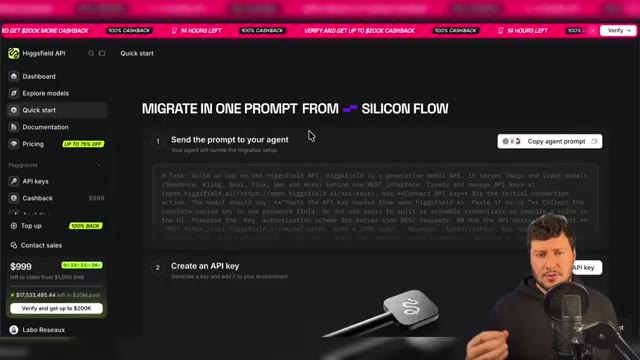  
  *⏱️ 00:03:30 — Interface de l'API Higgsfield montrant le bouton pour copier le prompt d'agent.*
- 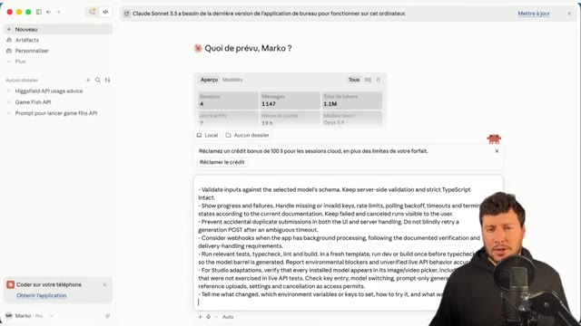  
  *⏱️ 00:03:39 — Interface de l'application Claude affichant le champ de saisie du prompt.*
- 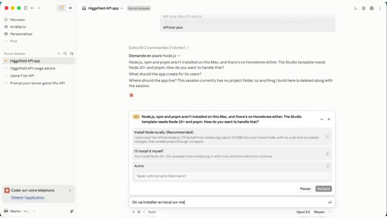  
  *⏱️ 00:03:46 — Interface de l'application Claude affichant une demande de configuration de Node.js et les options d'installation.*

---

### ⏱️ `[00:03:48 - 00:04:06]` | Segment #12

**🔊 Audio (Transcription Intégrale Mot pour Mot en Français) :**
> On va aussi lui demander de créer un nouveau dossier sur notre bureau pour accueillir l'application. Et je lui ai aussi précisé que je voulais tous les modèles de disponibles dans mon application. Donc tous les modèles vidéo et tous les modèles images disponibles via l'API d'Xfield. Et c'est parti, on va laisser Claude faire le boulot et on reviendra dans pas longtemps.

**👁️ Analyse Visuelle d'Écran (gemini-3.5-flash-lite) :**
**Interface & Outils** : Présentation orale ou séquence sans interface partagée.
**Contenu textuel & Code** : Explications et conseils de création de contenu / IA.
**Action / Démonstration** : Démonstration et mise en contexte pratique.

---

### ⏱️ `[00:04:06 - 00:04:25]` | Segment #13

**🔊 Audio (Transcription Intégrale Mot pour Mot en Français) :**
> Quelques instants plus tard, j'ai donc mon application de prête. Je vais la lancer. Elle est assez simple, mais on voit bien la liste complète des modèles vidéo et images. Bon, on pourrait sûrement mieux organiser ça. Et justement, ce qui est bien avec notre application, c'est qu'on va pouvoir demander à Claude de faire des ajustements et des modifications.

**👁️ Analyse Visuelle d'Écran (gemini-3.5-flash-lite) :**
**Interface & Outils** : Application web sur mesure de génération par IA ("Atelier")
**Contenu textuel & Code** : Menu déroulant des modèles (Seedance 2.0 Fast/Mini, Kling 3.0 Turbo/Standard/Pro/4K/Motion Control), champ de prompt "Describe the scene you imagine...", et bouton "GENERATE".
**Action / Démonstration** : Le créateur montre l'interface de l'application qu'il vient de lancer, explore la liste complète des modèles vidéo et image disponibles, et démontre les fonctionnalités de base.

**Captures d'écran :**
- 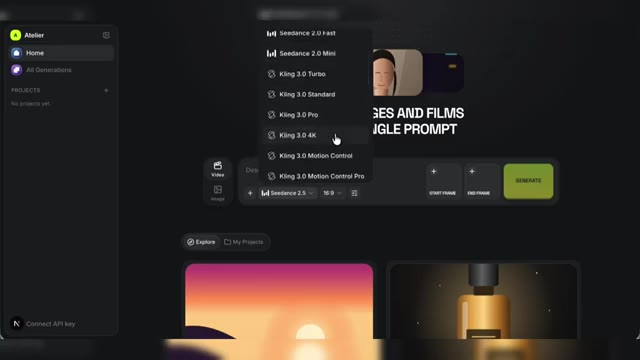  
  *⏱️ 00:04:16 — Interface de l'application avec le menu déroulant des modèles de génération vidéo ouvert, affichant Seedance, Kling 3.0, etc.*
- 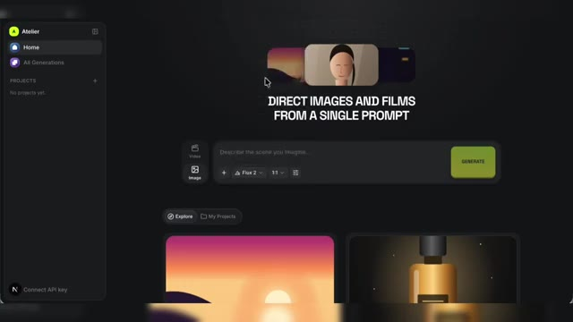  
  *⏱️ 00:04:24 — Interface principale de l'application de génération d'images et vidéos avec un champ de texte central et un bouton 'Generate'.*

---

### ⏱️ `[00:04:26 - 00:04:45]` | Segment #14

**🔊 Audio (Transcription Intégrale Mot pour Mot en Français) :**
> On va voir ça dans un petit moment, mais avant, mon application, elle n'est pas encore connectée à l'API d'Xfield. Donc là, je vais me rendre en bas à gauche. J'ai un bouton Connect API que Claude m'a inclus dans l'application. Je clique dessus, je suis redirigé vers la plateforme API d'XField. Cette fois je clique sur le bouton Create API Key.

**👁️ Analyse Visuelle d'Écran (gemini-3.5-flash-lite) :**
**Interface & Outils** : Navigateur web, plateforme API Higgsfield AI
**Contenu textuel & Code** : Menu latéral (Dashboard, Explore models, Quick start, Documentation, Pricing, API keys...), bloc de texte d'instructions pour l'API, illustration d'une clé physique et bouton "Create API key".
**Action / Démonstration** : Le créateur montre la plateforme API d'Higgsfield et s'apprête à cliquer sur le bouton "Create API key".

**Captures d'écran :**
- 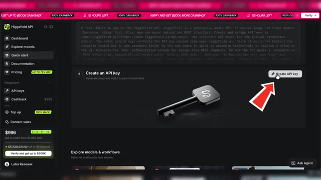  
  *⏱️ 00:04:44 — Page de documentation et de gestion des clés API sur la plateforme Higgsfield AI avec une flèche rouge pointant vers le bouton "Create API key".*

---

### ⏱️ `[00:04:45 - 00:05:05]` | Segment #15

**🔊 Audio (Transcription Intégrale Mot pour Mot en Français) :**
> Je donne un nom à mon API. On peut aussi mettre une date d'expiration. Et je n'ai plus qu'à copier et coller ma clé API dans mon application en local pour pouvoir utiliser tous les modèles IA. On va faire un test avec le modèle Flux 2. Et on a notre résultat, ça marche. On va tester maintenant un modèle IA vidéo. Alors là j'ai un truc qui me gêne dans la barre de prompt.

**👁️ Analyse Visuelle d'Écran (gemini-3.5-flash-lite) :**
**Interface & Outils** : Interface web de Higgsfield AI et dashboard de configuration de clés API.
**Contenu textuel & Code** : Formulaires de création d'API, champ de saisie de clé secrète, invite de prompt pour la génération avec Flux 2.
**Action / Démonstration** : Le créateur montre comment nommer une clé API, l'insérer dans l'application locale et tester la génération avec le modèle Flux 2.

**Captures d'écran :**
- 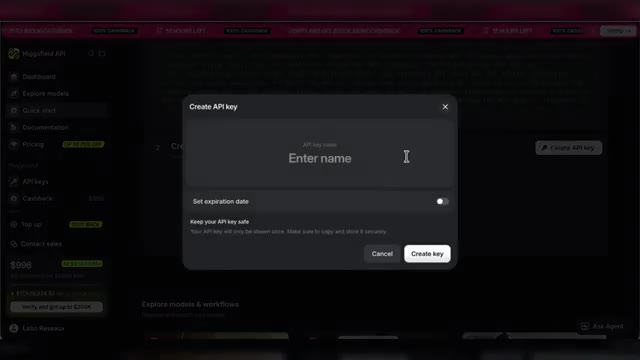  
  *⏱️ 00:04:46 — Interface de création d'une clé API avec champ de nom et option de date d'expiration.*
- 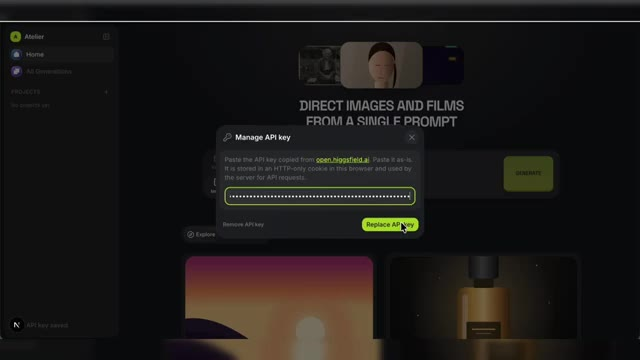  
  *⏱️ 00:04:55 — Fenêtre modale de gestion de la clé API pour coller le code d'accès de Higgsfield AI.*
- 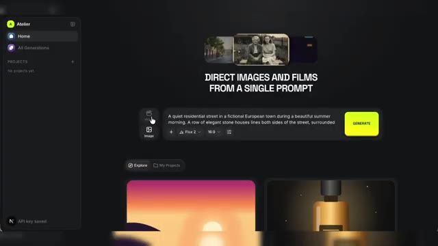  
  *⏱️ 00:05:04 — Interface principale d'un générateur d'images et de films par IA avec le modèle Flux 2 sélectionné.*

---

### ⏱️ `[00:05:05 - 00:05:25]` | Segment #16

**🔊 Audio (Transcription Intégrale Mot pour Mot en Français) :**
> Je ne peux pas scroller pour voir mon texte. Mais pas grave, comme je te l'ai dit, on va pouvoir personnaliser et améliorer notre application avec l'aide de Claude. Donc là, je vais simplement demander à Claude, peux-tu améliorer l'interface en ajoutant un curseur latéral, une barre latérale pour descendre dans la barre de prompt ? Bon, j'espère qu'il va comprendre ce que je lui ai demandé. Je relance l'application.

**👁️ Analyse Visuelle d'Écran (gemini-3.5-flash-lite) :**
**Interface & Outils** : Interface web de Claude (Anthropic)
**Contenu textuel & Code** : Texte de documentation technique et barre de prompt contenant la requête : "peux tu améliorer l'interface en ajoutant un curseur latéral pour descendre dans la barre de prompt"
**Action / Démonstration** : Le créateur tape un prompt dans l'interface de Claude pour demander une modification d'interface sur son application.

**Captures d'écran :**
- 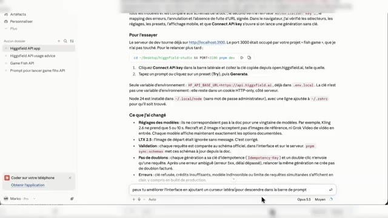  
  *⏱️ 00:05:15 — Interface de Claude affichant le prompt demandant d'ajouter un curseur latéral pour la barre de prompt.*
- 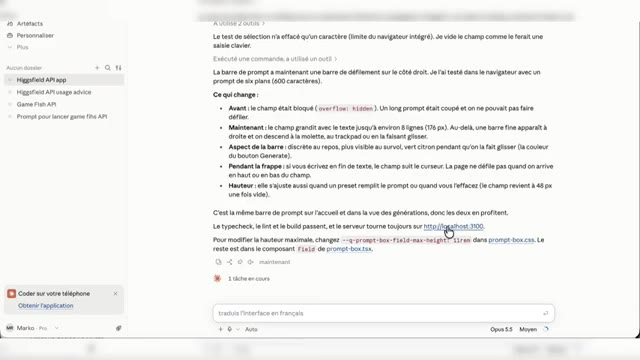  
  *⏱️ 00:05:23 — Réponse de Claude expliquant les modifications apportées à la barre de prompt avec le nouveau prompt de traduction.*

---

### ⏱️ `[00:05:26 - 00:05:51]` | Segment #17

**🔊 Audio (Transcription Intégrale Mot pour Mot en Français) :**
> Et super, il m'a fait les modifications demandées. C'est beaucoup mieux comme ça. Je vais pouvoir tester Seedense 2.5 avec une image en référence. En plus c'est cool, je peux aller directement chercher cette image de référence dans mes assets générés. C'est super, l'application fonctionne bien avec tous les modèles. C'est une version simplifiée, mais comme on l'a vu, il est tout à fait possible de la personnaliser à l'aide de Cloud pour avoir une application parfaitement adaptée à tes usages.

**👁️ Analyse Visuelle d'Écran (gemini-3.5-flash-lite) :**
**Interface & Outils** : Application web de génération IA (Seedance 2.5 / Atelier)
**Contenu textuel & Code** : Prompts textuels de génération vidéo, paramètres (Modèle Seedance 2.5, format 16:9), galerie d'assets et panneau de métadonnées.
**Action / Démonstration** : Test du modèle Seedance 2.5 avec une image de référence pour générer un timelapse saisonnier d'une rue.

**Captures d'écran :**
- 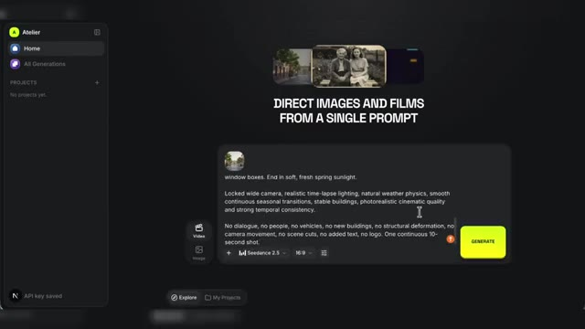  
  *⏱️ 00:05:27 — Interface de l'application de génération avec un champ de texte de prompt et le modèle Seedance 2.5 sélectionné.*
- 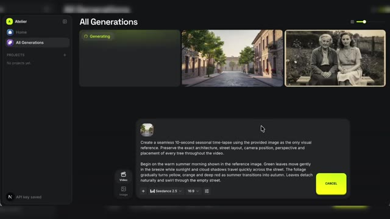  
  *⏱️ 00:05:39 — Vue sur la galerie de générations en cours montrant le lancement de la création vidéo avec le modèle Seedance 2.5.*
- 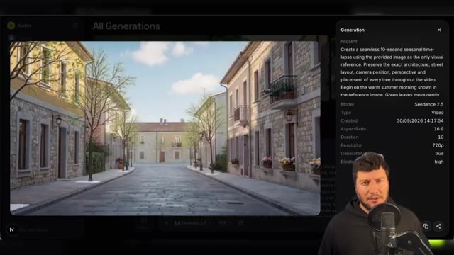  
  *⏱️ 00:05:50 — Aperçu de la vidéo générée dans l'application, avec le panneau latéral affichant les détails de génération Seedance 2.5 et le youtubeur en bas à droite.*

---

### ⏱️ `[00:05:51 - 00:06:14]` | Segment #18

**🔊 Audio (Transcription Intégrale Mot pour Mot en Français) :**
> Alors est-ce que l'utilisation d'Xfield en API rend forcément l'utilisation d'un abonnement inutile ? Pour moi, non. Déjà parce que comme on l'a vu, même si le service d'API d'Xfield est très complet, il moque encore pour l'instant l'accès à quelques modèles, notamment ceux de Google et ChatGPT. Mais aussi parce que selon tes besoins et la formule choisie, les abonnements peuvent rester une meilleure solution.

**👁️ Analyse Visuelle d'Écran (gemini-3.5-flash-lite) :**
**Interface & Outils** : Interface graphique animée de présentation vidéo sur fond sombre.
**Contenu textuel & Code** : Textes "L'API rend-elle l'abonnement inutile ?", noms de modèles d'IA (Seedance 2.5, Genjutsu, Kling 3.0, MiniMax H3, Wan 3.0 Prime) et schéma de balance avec "API" et "Abonnement".
**Action / Démonstration** : Le créateur illustre visuellement la question de l'utilité de l'API face à l'abonnement et présente les différents modèles pris en charge.

**Captures d'écran :**
- 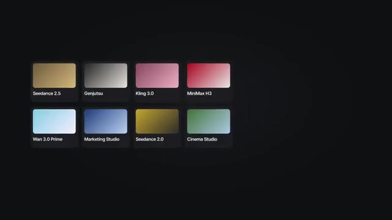  
  *⏱️ 00:06:02 — Grille de vignettes représentant différents modèles d'IA et studios disponibles (Seedance, Genjutsu, Kling, MiniMax, Wan, Marketing Studio, Cinema Studio).*
- 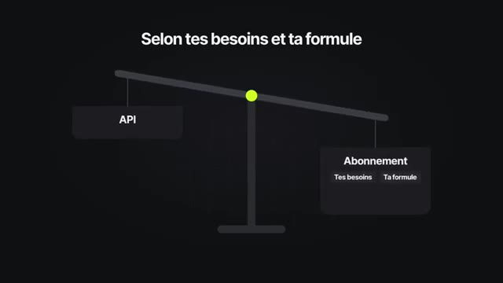  
  *⏱️ 00:06:12 — Représentation graphique sous forme de balance comparant l'API et l'Abonnement selon les besoins et la formule.*

---

### ⏱️ `[00:06:14 - 00:06:33]` | Segment #19

**🔊 Audio (Transcription Intégrale Mot pour Mot en Français) :**
> Par exemple, via certaines offres, tu as un accès illimité à certains modèles et avec un engagement longue durée, tu peux aussi avoir des tarifs intéressants sur tes générations. Si tu sais que tu vas consommer chaque mois tous tes crédits et que les modèles inclus correspondent à ton activité, un abonnement reste simple, prévisible et potentiellement rentable.

**👁️ Analyse Visuelle d'Écran (gemini-3.5-flash-lite) :**
**Interface & Outils** : Aucun (animation de texte)
**Contenu textuel & Code** : Texte affiché : "SIMPLE. PRÉVISIBLE."
**Action / Démonstration** : Illustration visuelle du propos audio par une phrase clé.

---

### ⏱️ `[00:06:33 - 00:06:53]` | Segment #20

**🔊 Audio (Transcription Intégrale Mot pour Mot en Français) :**
> Pour moi, le passage par API, c'est une solution plus intéressante à étudier si tu travailles par projet. Par exemple, si tu as besoin de produire énormément d'images et de vidéos pendant quelques jours, puis de ne rien générer pendant plusieurs semaines après. C'est aussi pratique pour tester différents modèles avant de choisir lequel tu intégreras définitivement à ton workflow.

**👁️ Analyse Visuelle d'Écran (gemini-3.5-flash-lite) :**
**Interface & Outils** : Interface de présentation de modèles d'IA.
**Contenu textuel & Code** : Texte principal : 'Tester plusieurs modèles avant de choisir'. Cartes des modèles : Seedance 2.5, Kling 3.0, MiniMax H3, Wan 3.0. Bouton : 'Intégré à ton workflow'.
**Action / Démonstration** : Le créateur présente l'interface illustrant la possibilité de tester différents modèles avant de faire un choix définitif.

**Captures d'écran :**
- 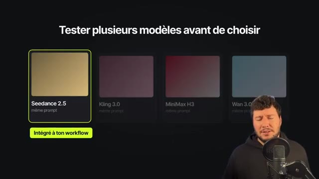  
  *⏱️ 00:06:51 — Présentation des différents modèles d'IA disponibles pour les tests, avec le modèle 'Seedance 2.5' sélectionné.*

---

### ⏱️ `[00:06:53 - 00:07:13]` | Segment #21

**🔊 Audio (Transcription Intégrale Mot pour Mot en Français) :**
> Attention sur ce dernier point si tu utilises une application en local, comme dans l'exemple de cette vidéo. ça veut dire qu'il faudra aussi la mettre à jour lorsqu'un nouveau modèle sera disponible. Point intéressant dans cette vidéo, on a utilisé l'API pour la génération de vidéos et d'images et on a utilisé une clé API générale XFile regroupant tous les modèles disponibles.

**👁️ Analyse Visuelle d'Écran (gemini-3.5-flash-lite) :**
**Interface & Outils** : Interface logicielle locale et schéma explicatif
**Contenu textuel & Code** : Textes : 'Attention', 'Une app locale se met à jour à la main', 'Mon studio IA', 'Nouveau modèle', 'Dans cette vidéo', 'Vidéos', 'Images', 'Clé API générale tous les modèles', et noms des modèles (Seedance 2.5, Genjutsu, Kling 3.0, MiniMax H3, Wan 3.0 Prime).
**Action / Démonstration** : Explication par le créateur de la nécessité de mettre à jour manuellement une application locale lors de la sortie d'un nouveau modèle, et présentation du fonctionnement d'une clé API générale pour différents modèles de génération.

**Captures d'écran :**
- 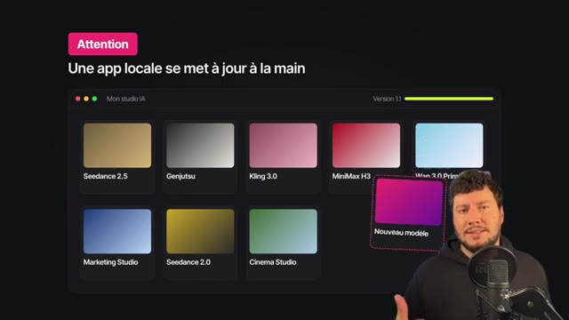  
  *⏱️ 00:07:03 — Interface d'une application locale 'Mon studio IA' montrant différents modèles de génération (Seedance 2.5, Genjutsu, Kling 3.0, MiniMax H3, etc.) et l'apparition d'un nouveau modèle.*
- 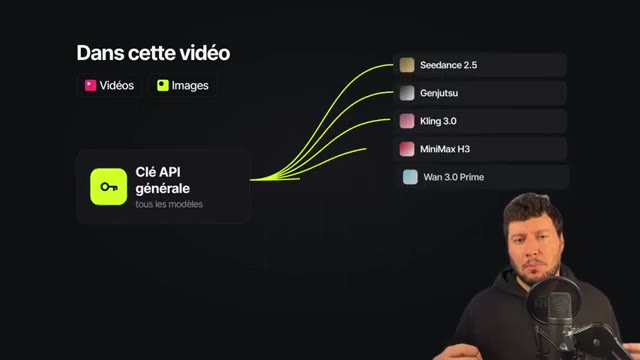  
  *⏱️ 00:07:12 — Schéma explicatif montrant l'utilisation d'une clé API générale connectée à plusieurs modèles (Seedance 2.5, Genjutsu, Kling 3.0, MiniMax H3, Wan 3.0 Prime) pour la génération de vidéos et d'images.*

---

### ⏱️ `[00:07:14 - 00:07:35]` | Segment #22

**🔊 Audio (Transcription Intégrale Mot pour Mot en Français) :**
> Mais on peut aller plus loin et aussi utiliser individuellement les API de modèles pour la création d'applications spécifiques. Si tu as une idée de business autour de la génération d'images ou de vidéos IA, L'utilisation des API avec les modèles présents sur la plateforme API Xfield, c'est une bonne solution. Pour tester le service API d'Xfield, le lien est en description et en commentaire épinglé.

**👁️ Analyse Visuelle d'Écran (gemini-3.5-flash-lite) :**
**Interface & Outils** : Interface web de la plateforme API Higgsfield (dashboard et catalogue de modèles).
**Contenu textuel & Code** : Catalogue de modèles d'IA (bytedance / Seedance 2.5, higgsfield / Genjutsu, kling / etc.), filtres par type (All models, Image, Video), onglets de navigation (Dashboard, Explore models, Quick start, Documentation, Pricing, API keys, Cashback) et bannières promotionnelles de cashback.
**Action / Démonstration** : Le présentateur introduit la plateforme API Higgsfield et présente les différents modèles de génération d'images et de vidéos disponibles pour la création d'applications.

**Captures d'écran :**
- 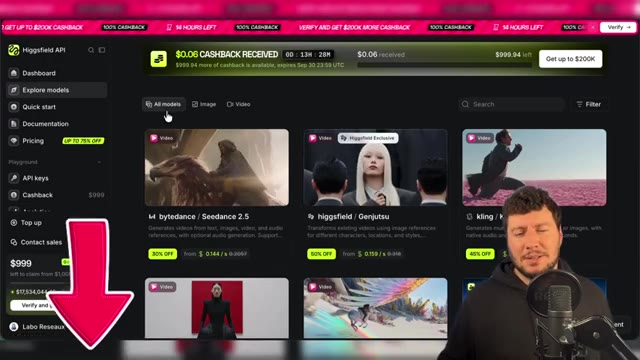  
  *⏱️ 00:07:34 — Interface de la plateforme API Higgsfield montrant les différents modèles disponibles pour la génération d'images et de vidéos, avec le présentateur en bas à droite.*

---

### ⏱️ `[00:07:36 - 00:07:38]` | Segment #23

**🔊 Audio (Transcription Intégrale Mot pour Mot en Français) :**
> Merci et à bientôt sur le Labo des Réseaux.

**👁️ Analyse Visuelle d'Écran (gemini-3.5-flash-lite) :**
**Interface & Outils** : Navigateur web, interface de la plateforme Higgsfield API, tableau de bord de modèles d'IA.
**Contenu textuel & Code** : Noms des modèles d'IA (bytedance / Seedance 2.5, higgsfield / Genjutsu, kling / Kling 3.0, minimax / MiniMax H3, alibaba / Wan 3.0 Prime), menus de navigation (Dashboard, Explore models, Quick start, Pricing, API keys), bannières promotionnelles de cashback.
**Action / Démonstration** : Le présentateur conclut la vidéo en présentant la plateforme d'API et en invitant les spectateurs à la découvrir.

**Captures d'écran :**
- 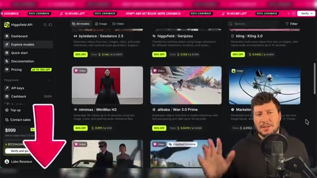  
  *⏱️ 00:07:37 — Le présentateur s'exprime devant une interface web de type marketplace de modèles d'IA (Higgsfield API) avec une flèche rose pointant vers le bas.*
-   
  *⏱️ 00:07:37 — Vue similaire montrant l'interface Higgsfield API avec les différents modèles vidéo et le présentateur en bas à droite.*
-   
  *⏱️ 00:07:37 — Vue identique de la plateforme Higgsfield API avec les sections de modèles et la flèche rose graphique d'appel à l'action.*

---
