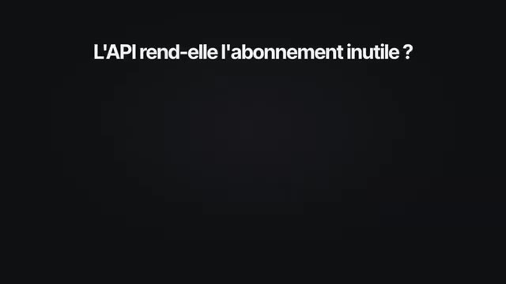

# 🎬 Arrête de payer pour des Crédits IA que tu n’utilises pas : HIGGSFIELD API

> **Chaîne** : [Labo Des Réseaux](https://www.youtube.com/@labodesreseaux)  
> **Lien YouTube** : [https://www.youtube.com/watch?v=u66ICS8uDTE](https://www.youtube.com/watch?v=u66ICS8uDTE)  
> **Date de publication** : 20260930  
> **Durée** : 7:38  
> **Identifiant vidéo** : `u66ICS8uDTE`  
> **Modèles** : Audio: `whisper-v3-large-turbo` | Vision: `gemini-3.5-flash-lite`  

---

## 📌 Synthèse Exécutive & Outils

### 💡 Résumé
**La vidéo explore une alternative économique aux abonnements d'intelligence artificielle traditionnels en proposant d'utiliser la plateforme API d'Higgsfield.** Contrairement aux formules mensuelles classiques où les crédits non utilisés sont perdus à la date de renouvellement, ce modèle de paiement à l'usage permet de ne payer que pour ce qui est réellement généré, offrant ainsi une flexibilité accrue pour les utilisateurs aux besoins intermittents ou irréguliers.

**Pour centraliser l'accès à l'ensemble des modèles d'images et de vidéos proposés par Higgsfield, le présentateur démontre comment concevoir une application locale personnalisée.** En combinant le prompt de démarrage rapide fourni par la plateforme avec l'assistant de code de Claude (ou des alternatives comme Codex), il devient possible de générer, d'itérer et d'ajuster une interface utilisateur sur mesure installée directement sur le bureau de l'ordinateur.

**En conclusion, si le passage par l'API s'avère particulièrement pertinent pour le travail par projet ou le test de multiples modèles, les abonnements conservent des avantages dans le cadre d'un usage intensif et régulier.** Le créateur souligne également le potentiel de cette infrastructure pour prototyper rapidement des applications métiers ou tester de nouveaux workflows avant un déploiement définitif.

### 🛠️ Outils, Modèles & Logiciels Présentés
- **Higgsfield (et son espace API / Dashboard)** : Plateforme principale d'agrégation de modèles avec tarification à l'usage.**
- **Claude (et Claude Code / Application)** : Assistant conversationnel et outil de génération de code pour créer et modifier l'application locale.**
- **Seedance (versions 2.0 et 2.5)** : Modèles de génération et de traitement de vidéos (notamment *image-to-video*).**
- **Kling 3.0** : Modèle de génération vidéo.**
- **Minimax H3** : Modèle vidéo proposé via l'API.**
- **WANA 3.0 Prime** : Modèle vidéo disponible sur la plateforme.**
- **Genjutsu & Cinema Studio 4.0** : Modèles vidéo propriétaires (maison) d'Higgsfield.**
- **Grok Imagine 2.0** : Modèle de génération d'images.**
- **Ideogram 4.0** : Modèle spécialisé dans la création d'images et de typographies.**
- **Recraft 4.1** : Modèle orienté vers le design et la génération d'images.**
- **Soul 2 & Marketing Studio Image** : Modèles d'images maison proposés par Higgsfield.**
- **Flux 2** : Modèle d'image testé lors de la configuration de l'application locale.**
- **Codex** : Alternative mentionnée pour les utilisateurs de ChatGPT souhaitant coder l'application.**

### 🔑 Points Clés & Enseignements Stratégiques
- Optimisation budgétaire** : Le paiement à l'acte évite le gaspillage des crédits mensuels perdus sur les abonnements traditionnels à renouvellement fixe.
- Gestion des générations simultanées** : Le nombre de requêtes simultanées augmente avec le solde du compte (limité à 2 pour 10$ de balance, jusqu'à 10 pour 25$ ou plus).
- Diversité des modèles** : Accès centralisé à une vaste gamme de moteurs de pointe pour la vidéo et l'image depuis une seule interface.
- Création d'une application sur mesure** : Utilisation du prompt "Copy Prompt Agent" depuis l'onglet *Quick Start* pour alimenter Claude et automatiser la création d'un outil local.
- Personnalisation itérative** : Capacité à demander à l'IA des modifications ergonomiques ciblées sur l'application locale (ex. : ajout d'un curseur latéral pour la barre de prompt).
- Intégration d'assets** : Possibilité de réutiliser directement les images générées en tant qu'assets de référence pour les modèles vidéo (*image-to-video*).
- Limites actuelles de l'offre** : Absence notable des modèles phares de Google et de ChatGPT sur la plateforme Higgsfield pour l'instant.
- Arbitrage abonnement vs API** : L'abonnement reste rentable en cas de consommation maximale et continue, ou pour bénéficier d'un accès illimité sur des volumes élevés.
- Cas d'usage idéal de l'API** : Parfait pour le travail par projet nécessitant des pics de production intenses suivis de longues périodes d'inactivité.
- Phase de test et R&D** : L'API sert de formidable bac à sable pour comparer l'efficacité de différents modèles avant d'en intégrer un définitivement dans son workflow.
- Évolution de la maintenance** : L'utilisation d'une application locale nécessite des mises à jour manuelles ou assistées pour intégrer l'arrivée de nouveaux modèles.
- Développement de business** : Possibilité d'exploiter les clés API individuelles des modèles pour concevoir et lancer de nouvelles applications ou solutions commerciales.

---

## ⏱️ Chronologie & Transcription Complète Audio & Visuelle (Mot pour Mot)

### ⏱️ `[00:00:00 - 00:00:22]` | Segment #01

**🔊 Audio (Transcription Intégrale Mot pour Mot en Français) :**
> Chaque mois je perds des crédits parce que je ne les utilise pas avant la date de renouvellement de mon abonnement. C'est comme ça que fonctionnent la plupart des abonnements IA. Que ce soit les plateformes dédiées à un modèle ou les agrégateurs. Tu reçois des crédits pour le mois et ceux que tu n'utilises pas sont perdus. Aujourd'hui je te montre une autre façon de générer des images et des vidéos IA passées par l'API d'Exfit.

**👁️ Analyse Visuelle d'Écran (gemini-3.5-flash-lite) :**
**Interface & Outils** : Interface graphique animée de présentation vidéo.
[DESC_IMAGE_3]
**Contenu textuel & Code** : Textes explicatifs sur les abonnements IA, les crédits, et les options de génération d'images et de vidéos.
**Action / Démonstration** : Introduction au problème de la perte des crédits d'abonnement IA non utilisés et présentation d'une alternative.

**Captures d'écran :**
-   
  *⏱️ 00:00:01 — Illustration graphique montrant un compteur de 940 crédits restants sur 1000 pour un abonnement IA.*
-   
  *⏱️ 00:00:11 — Schéma comparatif montrant les abonnements IA entre plateformes dédiées et agrégateurs avec des tarifs mensuels.*
-   
  *⏱️ 00:00:20 — Écran de transition affichant le texte 'Une autre façon de générer' avec les options Images et Vidéos.*

---

### ⏱️ `[00:00:22 - 00:00:44]` | Segment #02

**🔊 Audio (Transcription Intégrale Mot pour Mot en Français) :**
> Cette API elle te donne accès à plusieurs modèles images et vidéos et tu payes seulement ce que tu génères. Niveau tarif c'est ultra compétitif. Si tu compares à ce qui se fait actuellement sur le marché. Et avec l'aide de Claude, on va construire une application locale installée sur ton ordinateur qui regroupe tous ces modèles au même endroit. Ça te permettra d'utiliser facilement tous les modèles IA compris dans la solution d'Xfield.

**👁️ Analyse Visuelle d'Écran (gemini-3.5-flash-lite) :**
**Interface & Outils** : Présentation orale ou séquence sans interface partagée.
**Contenu textuel & Code** : Explications et conseils de création de contenu / IA.
**Action / Démonstration** : Démonstration et mise en contexte pratique.

---

### ⏱️ `[00:00:44 - 00:01:04]` | Segment #03

**🔊 Audio (Transcription Intégrale Mot pour Mot en Français) :**
> De la création de la clé API jusqu'à la première génération, avec les étapes et les limites que j'ai rencontrées, je t'explique tout dans cette vidéo. Je suis sur le site spécial API d'Xfield. Pour y accéder, je te mets le lien en description et commentaire épinglé. J'ai créé un compte, je l'ai crédité de 10$. Un coup de feu rapide sur les prix des modèles.

**👁️ Analyse Visuelle d'Écran (gemini-3.5-flash-lite) :**
**Interface & Outils** : Interface web de Higgsfield API (Dashboard et page Pricing)
**Contenu textuel & Code** : Menus Dashboard, Explore models, Quick start, Documentation, Pricing, API keys, Cashback, Top up, affichage du solde du compte (9.94$), des dépenses du jour et tableau comparatif des prix des différents modèles (Kling 3.0, Seedance, etc.).
**Action / Démonstration** : Le créateur présente le tableau de bord de son compte API, montre qu'il est crédité puis navigue vers la section des prix pour comparer les tarifs des différents modèles disponibles.

**Captures d'écran :**
-   
  *⏱️ 00:00:54 — Le tableau de bord du compte utilisateur sur la plateforme Higgsfield API, affichant le solde, le statut du cashback et les options de navigation.*
-   
  *⏱️ 00:01:03 — La page de tarification et de comparaison des modèles sur la plateforme Higgsfield API, montrant les coûts par génération de vidéo et d'image.*

---

### ⏱️ `[00:01:04 - 00:01:22]` | Segment #04

**🔊 Audio (Transcription Intégrale Mot pour Mot en Français) :**
> On voit ici les tarifs par seconde selon le modèle. Et une comparaison avec un autre acteur du marché. Et du coup la compétitivité de cette plateforme API d'Xfield. Point important sur le nombre de générations simultanées. Nous ici avec seulement 10$ de balance, on sera limité à 2 générations simultanées.

**👁️ Analyse Visuelle d'Écran (gemini-3.5-flash-lite) :**
**Interface & Outils** : Présentation orale ou séquence sans interface partagée.
**Contenu textuel & Code** : Explications et conseils de création de contenu / IA.
**Action / Démonstration** : Démonstration et mise en contexte pratique.

---

### ⏱️ `[00:01:22 - 00:01:44]` | Segment #05

**🔊 Audio (Transcription Intégrale Mot pour Mot en Français) :**
> Mais plus tu as de crédit sur ton compte, plus ça augmente. Par exemple, des 25$ de balance, on monte jusqu'à 10 générations simultanées. Si je me rends dans Explore Models, je vais avoir tous les modèles disponibles en API. Pour la vidéo, on a Seed Dance 2.5, on aura aussi Seed Dance 2.0, Kling 3.0, Minimax H3 ou encore WANA 3.0 Prime.

**👁️ Analyse Visuelle d'Écran (gemini-3.5-flash-lite) :**
**Interface & Outils** : Higgsfield API (plateforme web en ligne)
**Contenu textuel & Code** : Menus Dashboard, Explore models, Quick start, Pricing, et miniatures des modèles vidéo (bytedance / Seeddance 2.5, higgsfield / Genjutsu, kling / Kling 3.0) avec tarifs et réductions.
**Action / Démonstration** : Navigation et présentation des différents modèles d'IA disponibles via l'API.

**Captures d'écran :**
-   
  *⏱️ 00:01:33 — Interface de la plateforme Higgsfield API montrant la liste des modèles disponibles, incluant Seeddance 2.5 et Kling 3.0.*
-   
  *⏱️ 00:01:43 — Vue de la même interface Higgsfield API avec les cartes de présentation des différents modèles d'intelligence artificielle vidéo et image.*

---

### ⏱️ `[00:01:45 - 00:02:05]` | Segment #06

**🔊 Audio (Transcription Intégrale Mot pour Mot en Français) :**
> Et on a aussi les modèles Maison d'Xfield avec Genjutsu ou encore Cinema Studio 4.0. On aura aussi accès aux modèles images, et là il y aura du Grok Imagine 2.0, Ideogram 4.0, Recraft 4.1 et plein d'autres, avec aussi les modèles Maison d'Xfield, Soul 2 ou encore le Marketing Studio Image.

**👁️ Analyse Visuelle d'Écran (gemini-3.5-flash-lite) :**
**Interface & Outils** : Interface web de Higgsfield API (Explore models).
**Contenu textuel & Code** : Listes de modèles d'IA (MiniMax H3, Wan 3.0 Prime, Marketing Studio Image, Grok Imagine 2.0, Soul 2, Ideogram 4.0, Recraft 4.1, Soul Standard) avec indicateurs de prix et options de filtrage.
**Action / Démonstration** : Présentation et navigation à travers les différents modèles vidéo et image disponibles sur la plateforme Higgsfield API.

**Captures d'écran :**
-   
  *⏱️ 00:01:46 — Interface de Higgsfield API montrant divers modèles vidéo disponibles avec leurs tarifs.*
-   
  *⏱️ 00:01:55 — Navigation dans Higgsfield API avec les différents modèles d'images listés (Marketing Studio, Grok Imagine 2.0, Soul 2, Ideogram 4.0, Recraft 4.1).*
-   
  *⏱️ 00:02:03 — Vue similaire sur l'interface de Higgsfield API affichant la grille des modèles d'images disponibles.*

---

### ⏱️ `[00:02:05 - 00:02:24]` | Segment #07

**🔊 Audio (Transcription Intégrale Mot pour Mot en Français) :**
> La liste est plutôt complète, dommage, on n'a pas accès aux modèles de ChatGPT et Google pour l'instant. Je ne sais pas si ça changera, la plateforme est encore toute récente, espérons que la liste de modèles s'enrichisse très vite. Et tous ces modèles, on peut les utiliser directement depuis le site. Par exemple, pour créer une image, je vais tester Grok Imagine 2.0.

**👁️ Analyse Visuelle d'Écran (gemini-3.5-flash-lite) :**
**Interface & Outils** : Higgsfield API (site web / plateforme d'IA)
**Contenu textuel & Code** : Menus de navigation (Dashboard, Explore models, Quick start, API keys), vignettes de modèles (Marketing Studio Image, Grok Imagine 2.0), code TypeScript, et zone de saisie de prompt 'Input' avec le résultat visuel.
**Action / Démonstration** : Navigation dans la liste des modèles, sélection du modèle Grok Imagine 2.0 et consultation de son interface de test (playground).

**Captures d'écran :**
-   
  *⏱️ 00:02:06 — Vue d'ensemble de la plateforme Higgsfield API montrant la liste des modèles disponibles avec leurs tarifs.*
-   
  *⏱️ 00:02:15 — Page de détails du modèle 'Grok Imagine 2.0' sur Higgsfield API avec des options de code et de test.*
-   
  *⏱️ 00:02:23 — Interface du Playground du modèle Grok Imagine 2.0 affichant le champ de saisie du prompt et le résultat généré.*

---

### ⏱️ `[00:02:24 - 00:02:50]` | Segment #08

**🔊 Audio (Transcription Intégrale Mot pour Mot en Français) :**
> Je le sélectionne et là dans la partie Playground, je vais avoir une barre de prompt. Je vais pouvoir indiquer mon prompt et faire mes réglages, puis générer. J'ai d'ailleurs le prix qui s'affiche sur le bouton de génération. Voilà mon résultat. A noter, tu retrouveras toutes les générations sur l'onglet Request du modèle. Toujours dans les onglets, tu as aussi un onglet API qui te donne accès à la doc API du modèle et aussi une commande spécifique Copy Agent Prompt.

**👁️ Analyse Visuelle d'Écran (gemini-3.5-flash-lite) :**
**Interface & Outils** : Interface web de Higgsfield API (Playground et onglet API).
**Contenu textuel & Code** : Barres de prompt, boutons de réglages, affichage du prix de génération ($0.06), et onglets Playground, API, Requests, Analytics.
**Action / Démonstration** : Le créateur montre comment saisir un prompt, configurer les réglages de génération et consulter les détails du modèle et de l'API.

**Captures d'écran :**
-   
  *⏱️ 00:02:26 — Interface du playground Higgsfield API montrant un prompt et une image générée de cactus.*
-   
  *⏱️ 00:02:37 — Interface du playground Higgsfield API avec la saisie d'un prompt textuel et l'affichage du prix sur le bouton de génération.*
-   
  *⏱️ 00:02:48 — Onglet API du modèle Grok Imagine 2.0 sur la plateforme Higgsfield API avec notification de cashback.*

---

### ⏱️ `[00:02:50 - 00:03:10]` | Segment #09

**🔊 Audio (Transcription Intégrale Mot pour Mot en Français) :**
> qui te permet de copier-coller le prompt pour paramétrer l'API du modèle via un agent. Nous, on ne va pas le faire. On utilisera plutôt une autre commande pour donner d'un seul coup tous les modèles à Cloud qui nous préparera une application. Avant ça, je te montre aussi un modèle vidéo depuis la plateforme. Donc je sélectionne dans ma liste de modèles disponibles Seedense 2.5.

**👁️ Analyse Visuelle d'Écran (gemini-3.5-flash-lite) :**
**Interface & Outils** : Dashboard de Higgsfield API, navigateur web.
**Contenu textuel & Code** : Textes promotionnels 'Get 100% Cashback on API Spendings', menu de sélection des modèles de génération (Text to Video, Image to Video), et code d'intégration TypeScript avec le bouton 'Copy agent prompt'.
**Action / Démonstration** : Le créateur navigue sur la plateforme Higgsfield API et explore le modèle Seedance 2.5 pour montrer les options de génération et le code d'intégration.

**Captures d'écran :**
-   
  *⏱️ 00:03:00 — Interface principale de Higgsfield API montrant le tableau de bord avec une offre promotionnelle de cashback sur les dépenses d'API.*
-   
  *⏱️ 00:03:09 — Page d'exploration du modèle 'SEEDANCE 2.5' sur Higgsfield API avec un menu déroulant affichant les modes de génération et un bloc de code TypeScript.*

---

### ⏱️ `[00:03:10 - 00:03:29]` | Segment #10

**🔊 Audio (Transcription Intégrale Mot pour Mot en Français) :**
> Tu vois, j'ai aussi la possibilité de choisir les déclinaisons du modèle selon l'usage. Là, je vais utiliser en image to video. Et pareil, je peux générer directement depuis le site ma vidéo en utilisant mes crédits API. Bon, même si l'utilisation des modèles depuis le site est possible, ce n'est pas forcément le plus agréable. Je te conseille de te rendre dans l'onglet Quick Start.

**👁️ Analyse Visuelle d'Écran (gemini-3.5-flash-lite) :**
**Interface & Outils** : Site web Higgsfield API (Seedance 2.5)
**Contenu textuel & Code** : Menu Playground, options Input avec champ de texte, Start/End frame, Generate Audio, durée (10s), résolution (720p), et affichage du résultat vidéo.
**Action / Démonstration** : Le créateur montre l'utilisation du mode Image-to-Video sur la plateforme et commente l'interface.

**Captures d'écran :**
-   
  *⏱️ 00:03:20 — Interface du générateur vidéo Higgsfield API affichant le mode Image-to-Video et les options de réglage avec le résultat en cours de génération.*
-   
  *⏱️ 00:03:28 — Interface de Higgsfield API avec une flèche rouge pointant vers le menu Quick start, et apparition du créateur en incrustation à droite.*

---

### ⏱️ `[00:03:29 - 00:03:48]` | Segment #11

**🔊 Audio (Transcription Intégrale Mot pour Mot en Français) :**
> Et tu vas copier ce prompt avec le bouton Copy Prompt Agent. Je vais ensuite ouvrir Cloud Code via l'application. Alors moi ici, j'utilise l'application Cloud Code, mais si tu es un utilisateur de chat GPT, tu peux utiliser Codex. Claude va me poser quelques questions supplémentaires. Je vais l'orienter en lui demandant d'installer l'application en local.

**👁️ Analyse Visuelle d'Écran (gemini-3.5-flash-lite) :**
**Interface & Outils** : Navigateur web (site Higgsfield API) et application de bureau Claude Code.
**Contenu textuel & Code** : Documentation technique, instructions de migration d'API, prompts textuels complexes et questions interactives de l'agent IA concernant les dépendances (Node.js, npm, pnpm).
**Action / Démonstration** : Le créateur montre la copie d'un prompt d'agent depuis une API, puis bascule sur l'application Claude Code pour configurer et installer l'environnement de développement nécessaire.

**Captures d'écran :**
-   
  *⏱️ 00:03:30 — Interface du site web Higgsfield API montrant les instructions pour migrer en un prompt et le bouton pour copier le prompt de l'agent.*
-   
  *⏱️ 00:03:39 — Interface de l'application Claude Code affichant un prompt textuel détaillé et des statistiques d'utilisation du modèle.*
-   
  *⏱️ 00:03:46 — Interface de Claude Code posant une question interactive sur l'installation de Node.js et pnpm avec des options de réponse.*

---

### ⏱️ `[00:03:48 - 00:04:06]` | Segment #12

**🔊 Audio (Transcription Intégrale Mot pour Mot en Français) :**
> On va aussi lui demander de créer un nouveau dossier sur notre bureau pour accueillir l'application. Et je lui ai aussi précisé que je voulais tous les modèles de disponibles dans mon application. Donc tous les modèles vidéo et tous les modèles images disponibles via l'API d'Xfield. Et c'est parti, on va laisser Claude faire le boulot et on reviendra dans pas longtemps.

**👁️ Analyse Visuelle d'Écran (gemini-3.5-flash-lite) :**
**Interface & Outils** : Présentation orale ou séquence sans interface partagée.
**Contenu textuel & Code** : Explications et conseils de création de contenu / IA.
**Action / Démonstration** : Démonstration et mise en contexte pratique.

---

### ⏱️ `[00:04:06 - 00:04:25]` | Segment #13

**🔊 Audio (Transcription Intégrale Mot pour Mot en Français) :**
> Quelques instants plus tard, j'ai donc mon application de prête. Je vais la lancer. Elle est assez simple, mais on voit bien la liste complète des modèles vidéo et images. Bon, on pourrait sûrement mieux organiser ça. Et justement, ce qui est bien avec notre application, c'est qu'on va pouvoir demander à Claude de faire des ajustements et des modifications.

**👁️ Analyse Visuelle d'Écran (gemini-3.5-flash-lite) :**
**Interface & Outils** : Application web "Atelier" (interface de génération d'images et vidéos par IA).
**Contenu textuel & Code** : Menus de sélection de modèles (Seedance 2.0 Fast, Kling 3.0 Turbo, Kling 3.0 4K, etc.), champ de texte "Describe the scene you imagine...", bouton "GENERATE".
**Action / Démonstration** : Le créateur navigue dans l'interface de son application et explore la liste déroulante des différents modèles vidéo et image disponibles.

**Captures d'écran :**
-   
  *⏱️ 00:04:16 — Interface sombre d'une application web avec un menu déroulant affichant différents modèles vidéo et image (Seedance, Kling 3.0).*
-   
  *⏱️ 00:04:24 — Interface principale de l'application web avec un champ de saisie de prompt et un bouton vert de génération.*

---

### ⏱️ `[00:04:26 - 00:04:45]` | Segment #14

**🔊 Audio (Transcription Intégrale Mot pour Mot en Français) :**
> On va voir ça dans un petit moment, mais avant, mon application, elle n'est pas encore connectée à l'API d'Xfield. Donc là, je vais me rendre en bas à gauche. J'ai un bouton Connect API que Claude m'a inclus dans l'application. Je clique dessus, je suis redirigé vers la plateforme API d'XField. Cette fois je clique sur le bouton Create API Key.

**👁️ Analyse Visuelle d'Écran (gemini-3.5-flash-lite) :**
**Interface & Outils** : Interface web de la plateforme Higgsfield API (mode sombre).
**Contenu textuel & Code** : Menu latéral (Dashboard, Explore models, Quick start, Documentation, Pricing, API keys...), un encadré explicatif avec du code/texte de tâche, et une section "2. Create an API key" avec une illustration de clé et un bouton "Create API key" pointé par une flèche rouge.
**Action / Démonstration** : Le créateur montre la page de création de clé API sur la plateforme Higgsfield pour connecter son application.

**Captures d'écran :**
-   
  *⏱️ 00:04:44 — Capture d'écran de la plateforme API d'Higgsfield montrant la section pour créer une clé API.*

---

### ⏱️ `[00:04:45 - 00:05:05]` | Segment #15

**🔊 Audio (Transcription Intégrale Mot pour Mot en Français) :**
> Je donne un nom à mon API. On peut aussi mettre une date d'expiration. Et je n'ai plus qu'à copier et coller ma clé API dans mon application en local pour pouvoir utiliser tous les modèles IA. On va faire un test avec le modèle Flux 2. Et on a notre résultat, ça marche. On va tester maintenant un modèle IA vidéo. Alors là j'ai un truc qui me gêne dans la barre de prompt.

**👁️ Analyse Visuelle d'Écran (gemini-3.5-flash-lite) :**
**Interface & Outils** : Dashboard de gestion API et interface web de génération d'IA (Atelier / Higgsfield).
**Contenu textuel & Code** : Menus "Create API key", "Enter name", champ de saisie de clé API masquée, prompt textuel et options de sélection du modèle Flux 2.
**Action / Démonstration** : Le créateur crée une clé API, l'insère dans l'application locale et configure un test de génération avec le modèle Flux 2.

**Captures d'écran :**
-   
  *⏱️ 00:04:46 — Interface de création d'une clé API avec champ de nom et date d'expiration.*
-   
  *⏱️ 00:04:55 — Fenêtre de gestion de l'API montrant l'insertion et l'enregistrement de la clé secrète.*
-   
  *⏱️ 00:05:04 — Interface de génération d'images et vidéos par IA avec le modèle Flux 2 sélectionné.*

---

### ⏱️ `[00:05:05 - 00:05:25]` | Segment #16

**🔊 Audio (Transcription Intégrale Mot pour Mot en Français) :**
> Je ne peux pas scroller pour voir mon texte. Mais pas grave, comme je te l'ai dit, on va pouvoir personnaliser et améliorer notre application avec l'aide de Claude. Donc là, je vais simplement demander à Claude, peux-tu améliorer l'interface en ajoutant un curseur latéral, une barre latérale pour descendre dans la barre de prompt ? Bon, j'espère qu'il va comprendre ce que je lui ai demandé. Je relance l'application.

**👁️ Analyse Visuelle d'Écran (gemini-3.5-flash-lite) :**
**Interface & Outils** : Interface de Claude (assistant IA conversationnel)
**Contenu textuel & Code** : Texte du prompt saisi : 'peux tu améliorer l'interface en ajoutant un curseur latéral pour descendre dans la barre de prompt' et explications textuelles de l'assistant.
**Action / Démonstration** : Le créateur demande à l'assistant Claude d'apporter une modification à l'interface de l'application.

**Captures d'écran :**
-   
  *⏱️ 00:05:15 — Interface de l'outil Claude affichant le prompt demandant d'ajouter un curseur latéral.*
-   
  *⏱️ 00:05:23 — Interface de Claude affichant la réponse détaillée de l'IA sur la modification apportée à la barre de prompt.*

---

### ⏱️ `[00:05:26 - 00:05:51]` | Segment #17

**🔊 Audio (Transcription Intégrale Mot pour Mot en Français) :**
> Et super, il m'a fait les modifications demandées. C'est beaucoup mieux comme ça. Je vais pouvoir tester Seedense 2.5 avec une image en référence. En plus c'est cool, je peux aller directement chercher cette image de référence dans mes assets générés. C'est super, l'application fonctionne bien avec tous les modèles. C'est une version simplifiée, mais comme on l'a vu, il est tout à fait possible de la personnaliser à l'aide de Cloud pour avoir une application parfaitement adaptée à tes usages.

**👁️ Analyse Visuelle d'Écran (gemini-3.5-flash-lite) :**
**Interface & Outils** : Application web de génération vidéo IA (Seedance 2.5) avec panneau latéral et zone de prompt.
**Contenu textuel & Code** : Prompt en anglais pour créer un time-lapse saisonnier, sélection du modèle Seedance 2.5, format 16:9, et détails de génération.
**Action / Démonstration** : Le créateur lance une génération vidéo avec image de référence et examine le résultat final.

**Captures d'écran :**
-   
  *⏱️ 00:05:27 — Interface de l'application de génération avec un prompt textuel et le modèle Seedance 2.5 sélectionné.*
-   
  *⏱️ 00:05:39 — Vue sur la génération en cours et les assets récents avec le bouton 'Cancel'.*
-   
  *⏱️ 00:05:50 — Affichage du résultat généré avec un panneau de détails et le créateur visible en bas à droite.*

---

### ⏱️ `[00:05:51 - 00:06:14]` | Segment #18

**🔊 Audio (Transcription Intégrale Mot pour Mot en Français) :**
> Alors est-ce que l'utilisation d'Xfield en API rend forcément l'utilisation d'un abonnement inutile ? Pour moi, non. Déjà parce que comme on l'a vu, même si le service d'API d'Xfield est très complet, il moque encore pour l'instant l'accès à quelques modèles, notamment ceux de Google et ChatGPT. Mais aussi parce que selon tes besoins et la formule choisie, les abonnements peuvent rester une meilleure solution.

**👁️ Analyse Visuelle d'Écran (gemini-3.5-flash-lite) :**
**Interface & Outils** : Interface vidéo de la chaîne YouTube 'Labo Des Réseaux' avec des infographies animées.
**Contenu textuel & Code** : Textes : 'L'API rend-elle l'abonnement inutile ?', noms de modèles IA (Seedance 2.5, Genjutsu, Kling 3.0, MiniMax H3, Wan 3.0 Prime, Marketing Studio, Seedance 2.0, Cinema Studio), et balance comparative 'API' vs 'Abonnement'.
**Action / Démonstration** : Le créateur illustre par des graphiques animés la comparaison entre l'utilisation d'une API et un abonnement classique.

**Captures d'écran :**
-   
  *⏱️ 00:05:52 — Écran titre posant la question de l'utilité d'un abonnement face à l'utilisation d'une API.*
-   
  *⏱️ 00:06:02 — Grille de sélection affichant différents modèles et outils d'intelligence artificielle disponibles.*
-   
  *⏱️ 00:06:12 — Représentation graphique d'une balance comparant l'utilisation d'une API et d'un abonnement en fonction des besoins et de la formule.*

---

### ⏱️ `[00:06:14 - 00:06:33]` | Segment #19

**🔊 Audio (Transcription Intégrale Mot pour Mot en Français) :**
> Par exemple, via certaines offres, tu as un accès illimité à certains modèles et avec un engagement longue durée, tu peux aussi avoir des tarifs intéressants sur tes générations. Si tu sais que tu vas consommer chaque mois tous tes crédits et que les modèles inclus correspondent à ton activité, un abonnement reste simple, prévisible et potentiellement rentable.

**👁️ Analyse Visuelle d'Écran (gemini-3.5-flash-lite) :**
**Interface & Outils** : Écran de montage vidéo ou infographie textuelle.
**Contenu textuel & Code** : Texte affiché : "SIMPLE. PRÉVISIBLE."
**Action / Démonstration** : Le créateur illustre visuellement les arguments clés abordés dans sa voix off concernant la simplicité et la prévisibilité des abonnements.

---

### ⏱️ `[00:06:33 - 00:06:53]` | Segment #20

**🔊 Audio (Transcription Intégrale Mot pour Mot en Français) :**
> Pour moi, le passage par API, c'est une solution plus intéressante à étudier si tu travailles par projet. Par exemple, si tu as besoin de produire énormément d'images et de vidéos pendant quelques jours, puis de ne rien générer pendant plusieurs semaines après. C'est aussi pratique pour tester différents modèles avant de choisir lequel tu intégreras définitivement à ton workflow.

**👁️ Analyse Visuelle d'Écran (gemini-3.5-flash-lite) :**
**Interface & Outils** : Interface de présentation de modèles d'IA avec superposition vidéo du présentateur.
**Contenu textuel & Code** : Titre : "Tester plusieurs modèles avant de choisir". Cartes de modèles : Seedance 2.5 (sélectionné, "Intégré à ton workflow"), Kling 3.0, MiniMax H3, Wan 3.0 (mention "même prompt").
**Action / Démonstration** : Le présentateur explique comment il est possible de tester divers modèles d'IA avant d'intégrer le choix définitif dans son workflow.

**Captures d'écran :**
-   
  *⏱️ 00:06:51 — Présentation des différents modèles d'IA disponibles pour les tests avec surbrillance sur Seedance 2.5.*

---

### ⏱️ `[00:06:53 - 00:07:13]` | Segment #21

**🔊 Audio (Transcription Intégrale Mot pour Mot en Français) :**
> Attention sur ce dernier point si tu utilises une application en local, comme dans l'exemple de cette vidéo. ça veut dire qu'il faudra aussi la mettre à jour lorsqu'un nouveau modèle sera disponible. Point intéressant dans cette vidéo, on a utilisé l'API pour la génération de vidéos et d'images et on a utilisé une clé API générale XFile regroupant tous les modèles disponibles.

**👁️ Analyse Visuelle d'Écran (gemini-3.5-flash-lite) :**
**Interface & Outils** : Application locale "Mon studio IA", interface de gestion de modèles et schéma conceptuel d'API.
**Contenu textuel & Code** : Texte "Une app locale se met à jour à la main", vignettes de modèles (Seedance 2.5, Genjutsu, Kling 3.0, MiniMax H3, Wan 3.0 Prime, Marketing Studio, Cinema Studio, Nouveau modèle), schéma "Clé API générale" (tous les modèles) connectée aux différents services.
**Action / Démonstration** : Explication par le créateur de la mise à jour manuelle des applications locales et de l'utilisation d'une clé API générale pour l'accès aux modèles de génération vidéo et image.

**Captures d'écran :**
-   
  *⏱️ 00:07:03 — Interface de démonstration montrant une application locale avec différents modèles d'IA et l'ajout d'un nouveau modèle.*
-   
  *⏱️ 00:07:12 — Schéma explicatif montrant l'utilisation d'une clé API générale reliée à différents modèles pour la génération de vidéos et d'images.*

---

### ⏱️ `[00:07:14 - 00:07:35]` | Segment #22

**🔊 Audio (Transcription Intégrale Mot pour Mot en Français) :**
> Mais on peut aller plus loin et aussi utiliser individuellement les API de modèles pour la création d'applications spécifiques. Si tu as une idée de business autour de la génération d'images ou de vidéos IA, L'utilisation des API avec les modèles présents sur la plateforme API Xfield, c'est une bonne solution. Pour tester le service API d'Xfield, le lien est en description et en commentaire épinglé.

**👁️ Analyse Visuelle d'Écran (gemini-3.5-flash-lite) :**
**Interface & Outils** : Dashboard de la plateforme API Higgsfield.
**Contenu textuel & Code** : Menus de navigation (Dashboard, Explore models, Quick start, Documentation, Pricing, API keys), bannières promotionnelles de cashback, cartes de modèles de génération vidéo (Bytedance Seedance 2.5, Higgsfield Genjutsu, Kling) et le présentateur en bas à droite.
**Action / Démonstration** : Le présentateur présente la plateforme API Higgsfield pour la création d'applications spécifiques basées sur l'IA.

**Captures d'écran :**
-   
  *⏱️ 00:07:34 — Capture d'écran du tableau de bord de la plateforme API Higgsfield présentant différents modèles d'IA pour la génération de vidéos et d'images.*

---

### ⏱️ `[00:07:36 - 00:07:38]` | Segment #23

**🔊 Audio (Transcription Intégrale Mot pour Mot en Français) :**
> Merci et à bientôt sur le Labo des Réseaux.

**👁️ Analyse Visuelle d'Écran (gemini-3.5-flash-lite) :**
**Interface & Outils** : Navigateur web affichant la plateforme Higgsfield API.
**Contenu textuel & Code** : Catalogue de modèles d'IA (bytedance / Seedance 2.5, higgsfield / Genjutsu, kling / Kling 3.0, minimax / MiniMax H3, alibaba / Wan 3.0 Prime), menu latéral avec Dashboard, Explore models, Quick start, Documentation, Pricing, API keys, Cashback, Top up, Contact sales. Présence d'une flèche rose pointant vers le bas.
**Action / Démonstration** : Le présentateur conclut la vidéo en s'adressant aux spectateurs face caméra.

**Captures d'écran :**
-   
  *⏱️ 00:07:37 — Capture d'écran montrant l'interface de Higgsfield API avec le présentateur à l'écran.*
-   
  *⏱️ 00:07:37 — Capture d'écran montrant l'interface de Higgsfield API avec le présentateur à l'écran.*
-   
  *⏱️ 00:07:37 — Capture d'écran montrant l'interface de Higgsfield API avec le présentateur à l'écran.*

---
