# 🎬 Claude OPUS 5.5 a créé MA SÉRIE de 8 épisodes (MCP Higgsfield)

> **Chaîne** : [Labo Des Réseaux](https://www.youtube.com/@labodesreseaux)  
> **Lien YouTube** : [https://www.youtube.com/watch?v=fUokaQ-NnZE](https://www.youtube.com/watch?v=fUokaQ-NnZE)  
> **Date de publication** : 20261003  
> **Durée** : 13:04  
> **Identifiant vidéo** : `fUokaQ-NnZE`  
> **Modèles** : Audio: `whisper-v3-large-turbo` | Vision: `gemini-3.5-flash-lite`  

---

## 📌 Synthèse Exécutive & Outils

### 💡 Résumé
**Cette vidéo de la chaîne « Labo Des Réseaux » explore l'automatisation totale de la création de contenu vidéo grâce à l'association de Claude.ai et de la plateforme Xfield via un connecteur MCP.** Le créateur démontre comment un modèle de pointe tel qu'**Opus 5.5** peut gérer l'intégralité d'un projet de fiction, de l'idéation initiale jusqu'à la production autonome d'une mini-série de 8 épisodes au format vertical pour les réseaux sociaux. L'objectif est de s'affranchir des équipes de tournage et des compétences techniques lourdes pour concevoir des séries de fictions, des publicités ou du contenu marketing en déléguant le travail de coordination à une intelligence artificielle.

**Le tutoriel détaille pas à pas la configuration technique nécessaire, débutant par l'association d'un compte Claude Pro et d'un abonnement Xfield à l'aide des connecteurs MCP.** Une fois la liaison établie, le système permet de piloter la génération d'assets graphiques, de fiches personnages et de séquences vidéos directement depuis l'interface de conversation de l'assistant. Le créateur montre l'utilisation de modèles spécifiques comme **GPT 2.5** pour la cohérence visuelle des personnages et **WAN 3.0** pour l'optimisation de la génération vidéo, tout en mesurant précisément l'impact financier de l'opération en crédits consommés.

**En conclusion, l'expérience prouve qu'il est désormais possible de produire une série complète en moins de deux heures avec un minimum d'intervention humaine, se limitant à quelques ajustements de montage et à une validation du scénario.** Si le créateur note des limites inhérentes à la spontanéité narrative de l'IA nécessitant un travail d'écriture plus poussé, il souligne le formidable potentiel de productivité de cette méthode. Cette synergie technologique ouvre la voie à de nouveaux cas d'usage allant de l'animation de concepts marketing à la création d'applications, de jeux ou d'influenceurs virtuels.

---

### 🛠️ Outils, Modèles & Logiciels Présentés
- **Claude.ai (Modèle Opus 5.5)** : Assistant conversationnel et modèle de réflexion avancé utilisé pour manager le projet, rédiger les scripts et orchestrer les générations.**
- **Xfield (higgsfield.ai)** : Agrégateur et plateforme cloud de génération d'images et de vidéos par IA.**
- **Connecteur MCP (Model Context Protocol)** : Protocole de liaison permettant de connecter Claude.ai aux outils d'Xfield.**
- **GPT 2.5** : Modèle d'intelligence artificielle utilisé pour la génération et la constance des fiches personnages.**
- **WAN 3.0** : Modèle de génération vidéo performant et optimisé en termes de coût en crédits.**
- **Supercomputer d'Xfield** : Outil intégré permettant d'utiliser des modèles de réflexion directement au sein de la plateforme Xfield sans abonnement Claude.**
- **API d'Xfield** : Alternative de paiement à l'utilisation (pay-as-you-go) sans abonnement mensuel.**
- **GPT Astra** : Outil alternatif mentionné pour des flux de travail similaires connectés à Xfield.**
- ****

### 🔑 Points Clés & Enseignements Stratégiques
- Délégation complète du workflow** : Claude Opus 5.5 gère l'organisation du projet, structure le synopsis, rédige les règles de l'univers et enchaîne la création des épisodes de manière autonome.
- Connexion par MCP** : L'association fluide entre Claude et Xfield s'effectue simplement en activant le connecteur dédié dans les options de personnalisation de l'assistant.
- Gestion de la récurrence des personnages** : L'utilisation de fiches personnages détaillées (plans de face, profil et dos) garantit la consistance visuelle des protagonistes à travers les différents épisodes.
- Optimisation des coûts et des ressources** : Il est recommandé de consulter les tarifs et la consommation en crédits des différents modèles sur Xfield (comme WAN 3.0) avant de lancer des générations massives de vidéos.
- Autonomie de production** : Le processus de génération d'un épisode prend en moyenne entre 11 et 12 minutes, permettant de lancer les tâches en arrière-plan et de récupérer une série complète après environ 1h30.
- Flexibilité des modifications** : En cas d'insatisfaction sur une séquence précise, il n'est pas nécessaire de régénérer l'épisode en entier ; il suffit de cibler le plan défectueux en s'appuyant sur les assets déjà enregistrés.
- Nécessité d'un suivi narratif** : Le créateur souligne qu'un travail d'écriture et de réflexion en amont plus poussé avec l'IA permet d'éviter les facilités scénaristiques et d'améliorer la qualité globale de la série.
- Diversification des cas d'usage** : La connexion entre Claude et Xfield ne se limite pas aux séries vidéo ; elle s'applique également au marketing, à la création de publicités, de sites web, de jeux vidéo ou d'applications.
- Alternative sans abonnement Claude** : Le "Supercomputer" d'Xfield permet d'accéder à des modèles de réflexion directement depuis la plateforme, imputant uniquement les crédits d'utilisation.
- Modèle économique flexible** : L'utilisation de l'API Xfield offre la possibilité de payer strictement à la consommation (pay-as-you-go) sans s'engager sur un abonnement mensuel fixe.

---

## ⏱️ Chronologie & Transcription Complète Audio & Visuelle (Mot pour Mot)

### ⏱️ `[00:00:00 - 00:00:23]` | Segment #01

**🔊 Audio (Transcription Intégrale Mot pour Mot en Français) :**
> Et si on y était ? Le moment où n'importe qui peut réaliser une série sans équipe de tournage, sans acteur, sans scénariste, bref, juste via une conversation avec Lya, en l'occurrence ici sur Claude et son dernier modèle, Opus 5.5. C'est ce qu'on va voir donc dans cette vidéo en produisant une série de 8 épisodes de 30 secondes, format vertical, TikTok short reels.

**👁️ Analyse Visuelle d'Écran (gemini-3.5-flash-lite) :**
**Interface & Outils** : Interface graphique d'assistant conversationnel IA et interface de présentation vidéo.
[DESC_IMAGE_1] Le présentateur s'exprime face caméra dans son studio avec un éclairage violet.
[DESC_IMAGE_2] Une interface d'assistant IA simulant une conversation textuelle pour créer une série.
[DESC_IMAGE_3] Une vue d'ensemble montrant la production d'une série de 8 épisodes verticaux de 30 secondes.
**Contenu textuel & Code** : Texte à l'écran illustrant la conversation avec l'IA (« Crée-moi une série de 8 épisodes de 30 secondes ») et les vignettes des 8 épisodes (EP 01 à EP 08).
**Action / Démonstration** : Le créateur introduit le sujet de la vidéo en montrant comment interagir avec un assistant IA pour générer le concept d'une mini-série.

**Captures d'écran :**
-   
  *⏱️ 00:00:12 — Une interface d'assistant IA simulant une conversation textuelle pour créer une série.*
- 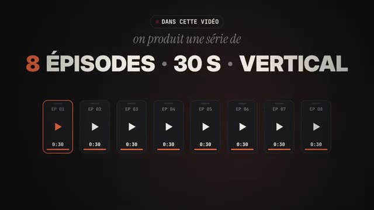  
  *⏱️ 00:00:22 — Une vue d'ensemble montrant la production d'une série de 8 épisodes verticaux de 30 secondes.*

---

### ⏱️ `[00:00:24 - 00:00:54]` | Segment #02

**🔊 Audio (Transcription Intégrale Mot pour Mot en Français) :**
> Oui, c'est vrai, on aurait pu directement s'attaquer au format 20 minutes, mais ça aurait coûté un petit peu cher en token. Là ce que je te propose c'est vraiment de te montrer tout le processus et le coût final pour pouvoir ainsi le dupliquer et voir que ça n'a jamais été aussi facile juste à partir de Claude de chercher une idée, la développer, créer ses personnages et les mettre en scène à travers une série d'épisodes qui se suivent pour ensuite la propulser sur les réseaux.

**👁️ Analyse Visuelle d'Écran (gemini-3.5-flash-lite) :**
**Interface & Outils** : Interface web de Claude (LLM) et lecteur vidéo intégré.
**Contenu textuel & Code** : Texte listant des "Défauts à corriger au montage" et une vidéo montrant un acteur tenant un téléphone.
**Action / Démonstration** : Le créateur montre l'utilisation de Claude pour analyser et corriger les détails d'un projet vidéo.

**Captures d'écran :**
- 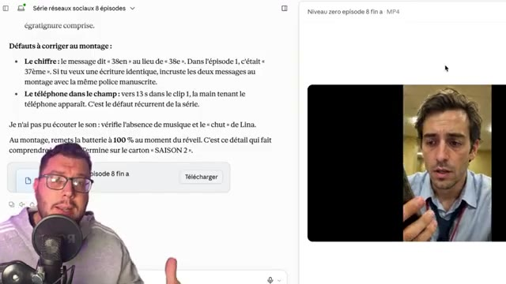  
  *⏱️ 00:00:52 — Capture d'écran montrant l'interface de Claude avec du texte à gauche et une vidéo de démonstration à droite.*

---

### ⏱️ `[00:00:54 - 00:01:19]` | Segment #03

**🔊 Audio (Transcription Intégrale Mot pour Mot en Français) :**
> Alors avant toute chose, ce qu'il va nous falloir dans un premier temps, c'est au moins un compte CloudPro, puisqu'ici nous allons utiliser le dernier modèle de réflexion Opus 5.5. Ici Opus 5.5 va nous permettre d'organiser toutes nos idées et de manager toute l'organisation de projet pour ainsi nous produire les épisodes les uns les autres à la suite montés de A à Z.

**👁️ Analyse Visuelle d'Écran (gemini-3.5-flash-lite) :**
**Interface & Outils** : Site web de Claude (Anthropic) - Page de tarification (Tarifs).
**Contenu textuel & Code** : Offres d'abonnement : Free (0 €), Pro (15 €/mois), Max (à partir de 90 €/mois) avec listes de fonctionnalités détaillées.
**Action / Démonstration** : Le créateur présente les différents abonnements disponibles pour utiliser l'intelligence artificielle Claude.

**Captures d'écran :**
- 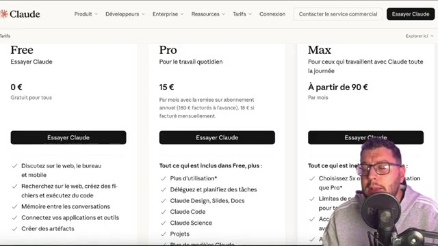  
  *⏱️ 00:01:06 — Affichage de la page de tarification du site Claude montrant les offres Free, Pro et Max.*
- 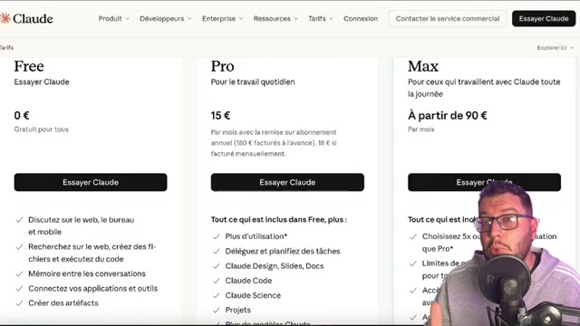  
  *⏱️ 00:01:17 — Vue similaire sur la page de tarification de Claude pendant l'explication des offres d'abonnement.*

---

### ⏱️ `[00:01:19 - 00:01:38]` | Segment #04

**🔊 Audio (Transcription Intégrale Mot pour Mot en Français) :**
> Mais il va nous falloir aussi un générateur d'images et de vidéos IA. Ici, on va passer par Xfield, un agrégateur qui va nous permettre de pouvoir sélectionner parmi plusieurs modèles ce qu'on juge nécessaire à la création de notre série. En description et en commentaire de vidéo, tu trouveras un lien qui te renvoie vers Xfield.

**👁️ Analyse Visuelle d'Écran (gemini-3.5-flash-lite) :**
**Interface & Outils** : Navigateur web, site de Higgsfield AI (higgsfield.ai)
**Contenu textuel & Code** : "Welcome to Higgsfield Apps", catégories professionnelles (Virality Predictor, Expand image, Angles 2.0, Shots), grille de tarifs (Plus à $35/mois, Ultra à $70/mois)
**Action / Démonstration** : Présentation de la plateforme agrégateur d'IA Higgsfield et de ses différentes fonctionnalités de génération d'images et de vidéos.

**Captures d'écran :**
- 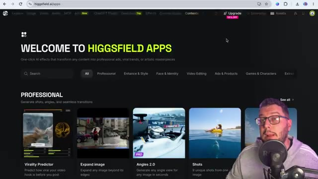  
  *⏱️ 00:01:28 — Page d'accueil de la plateforme Higgsfield AI montrant les différents outils et applications de génération vidéo.*
- 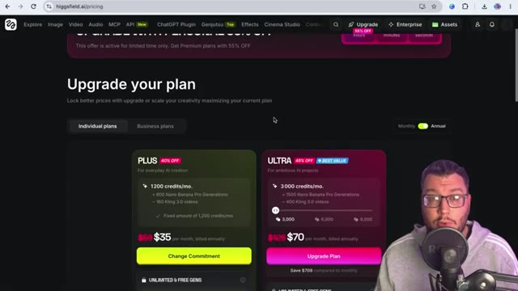  
  *⏱️ 00:01:37 — Page de tarification (Pricing) de Higgsfield AI avec les abonnements Plus et Ultra.*

---

### ⏱️ `[00:01:38 - 00:01:59]` | Segment #05

**🔊 Audio (Transcription Intégrale Mot pour Mot en Français) :**
> Tu pourras ainsi consulter les différents types d'abonnements et sélectionner celui qui te convient le mieux. Une fois donc que ton compte Cloud et Xfield sont opérationnels, on va les connecter ensemble via le MCP. Pour pouvoir le faire, c'est très simple. Tu te rends sur Cloud dans personnaliser, tu vas aller chercher connecteur et dans la barre de recherche, tu vas taper Xfield.

**👁️ Analyse Visuelle d'Écran (gemini-3.5-flash-lite) :**
**Interface & Outils** : Navigateur web affichant Higgsfield.ai et Claude.ai
[DESC_IMAGE_2] Gros plan du présentateur de la chaîne YouTube face caméra, sans élément d'interface visible.
[DESC_IMAGE_3] Page de personnalisation de l'interface Claude (claude.ai/customize/connectors) montrant l'onglet des connecteurs et diverses compétences.
**Contenu textuel & Code** : Tarifs d'abonnements, options de crédits, options de personnalisation, connecteurs et compétences de Claude AI
**Action / Démonstration** : Le créateur montre les abonnements disponibles puis se rend sur Claude pour expliquer comment connecter les comptes via le MCP dans l'onglet connecteurs.

**Captures d'écran :**
- 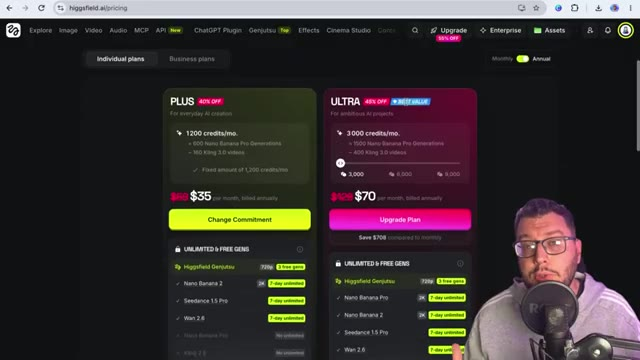  
  *⏱️ 00:01:39 — Page de tarification d'une plateforme d'IA (Higgsfield) montrant différents abonnements (Plus, Ultra) et crédits.*
- 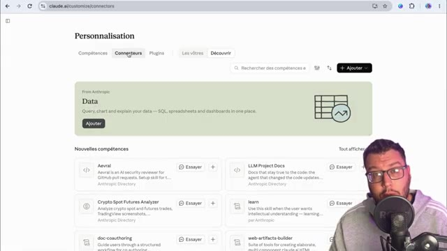  
  *⏱️ 00:01:57 — Page de personnalisation de l'interface Claude (claude.ai/customize/connectors) montrant l'onglet des connecteurs et diverses compétences.*

---

### ⏱️ `[00:01:59 - 00:02:22]` | Segment #06

**🔊 Audio (Transcription Intégrale Mot pour Mot en Français) :**
> Tu n'auras ainsi qu'à connecter Xfield à Cloud pour que tu puisses maintenant générer tes images et vidéos à partir de Cloud, sachant que ceux-ci seront aussi disponibles dans les assets générés d'Xfield. Tu vas voir c'est très simple, dans un premier temps on va se rendre dans notre conversation Cowork. Et ici on vérifie bien dans l'outil plus en allant dans Connecteur que notre connecteur Xfield est bien activé.

**👁️ Analyse Visuelle d'Écran (gemini-3.5-flash-lite) :**
**Interface & Outils** : Présentation orale ou séquence sans interface partagée.
**Contenu textuel & Code** : Explications et conseils de création de contenu / IA.
**Action / Démonstration** : Démonstration et mise en contexte pratique.

---

### ⏱️ `[00:02:22 - 00:02:43]` | Segment #07

**🔊 Audio (Transcription Intégrale Mot pour Mot en Français) :**
> Maintenant dans un premier temps on va essayer de trouver un concept de série sans réalisation pour le moment. Ainsi je vais lui indiquer, sans aucune réalisation je souhaiterais créer une série pour les réseaux sociaux, 8 épisodes de moins de 30 secondes, format vertical. Je n'ai pas encore d'idée sur les personnages, l'ambiance, le style, mais pourquoi pas quelque chose en lien avec les backrooms.

**👁️ Analyse Visuelle d'Écran (gemini-3.5-flash-lite) :**
**Interface & Outils** : Présentation orale ou séquence sans interface partagée.
**Contenu textuel & Code** : Explications et conseils de création de contenu / IA.
**Action / Démonstration** : Démonstration et mise en contexte pratique.

---

### ⏱️ `[00:02:43 - 00:03:09]` | Segment #08

**🔊 Audio (Transcription Intégrale Mot pour Mot en Français) :**
> Un personnage donc qui chercherait à s'enfuir, il faudrait une introduction, que ça nous donne envie de regarder la série, et un cliffhanger à la fin pour pouvoir peut-être annoncer une saison 2. Ok, on lance le prompt, et là, Opus 5.5 va nous proposer le synopsis des 8 épisodes. Il nous donne aussi les règles de l'univers, et nous propose, avant de commencer à réaliser les épisodes, de pourquoi pas nous générer les fiches personnages.

**👁️ Analyse Visuelle d'Écran (gemini-3.5-flash-lite) :**
**Interface & Outils** : Présentation orale ou séquence sans interface partagée.
**Contenu textuel & Code** : Explications et conseils de création de contenu / IA.
**Action / Démonstration** : Démonstration et mise en contexte pratique.

---

### ⏱️ `[00:03:09 - 00:03:36]` | Segment #09

**🔊 Audio (Transcription Intégrale Mot pour Mot en Français) :**
> C'est exactement ça qu'on va faire dans un premier temps. On va demander la fiche personnage de notre héros pour savoir si celui-ci, il colle bien à l'ambiance. Donc en lui demandant de réaliser la fiche personnage de Théo, c'est ici que le MCP d'XField va intervenir. Et en fait, Claude va nous demander l'autorisation pour pouvoir faire en sorte d'envoyer le prompt qu'il a réalisé pour créer cette fiche personnage à XField et ainsi nous crée une image.

**👁️ Analyse Visuelle d'Écran (gemini-3.5-flash-lite) :**
**Interface & Outils** : Interface de l'assistant IA Claude
**Contenu textuel & Code** : Prompt utilisateur « réalise moi la fiche personnage de Théo », indications « Outils chargés », « Mémoire lue », mention « a utilisé l'intégration Higgsfield » et « Ad Multiplier and Creative Workflows » en cours.
**Action / Démonstration** : Le créateur montre la soumission du prompt pour générer la fiche personnage via l'intégration MCP.

**Captures d'écran :**
- 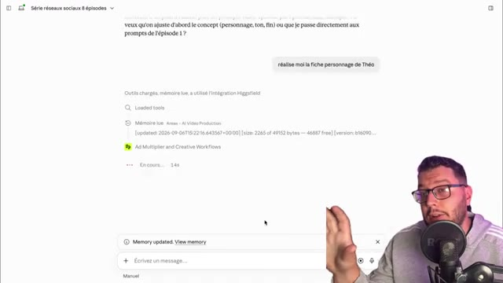  
  *⏱️ 00:03:23 — Interface de Claude montrant la requête pour créer la fiche personnage de Théo avec le chargement des outils et l'intégration Higgsfield.*

---

### ⏱️ `[00:03:36 - 00:03:57]` | Segment #10

**🔊 Audio (Transcription Intégrale Mot pour Mot en Français) :**
> Et ici on voit qu'il a utilisé en modèle d'image GPT 2.5, donc sûrement le modèle le plus réaliste en ce moment du marché. Notre fiche personnage est parfaite, c'est-à-dire que nous avons un plan de face, un plan entier de profil et de dos. Ça va nous permettre d'avoir de la récurrence à travers les 8 épisodes pour que le personnage principal garde de la consistance.

**👁️ Analyse Visuelle d'Écran (gemini-3.5-flash-lite) :**
**Interface & Outils** : Interface de chat web / générateur d'images IA avec incrustation vidéo du créateur en bas à droite.
**Contenu textuel & Code** : Génération d'une fiche personnage avec des vues multiples (face, profil, dos), boutons d'action (Animate, Edit, Download), et options d'intégration Higgsfield.
**Action / Démonstration** : Le créateur commente la fiche personnage générée et explique son utilité pour assurer la récurrence du personnage sur plusieurs épisodes.

**Captures d'écran :**
- 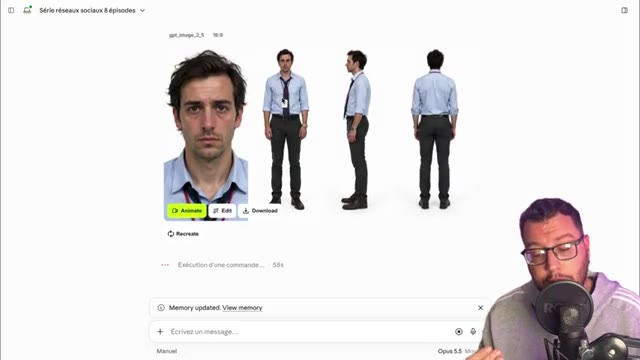  
  *⏱️ 00:03:47 — Affichage de la fiche personnage générée par IA montrant un portrait de face et un plan complet sous différents angles.*
- 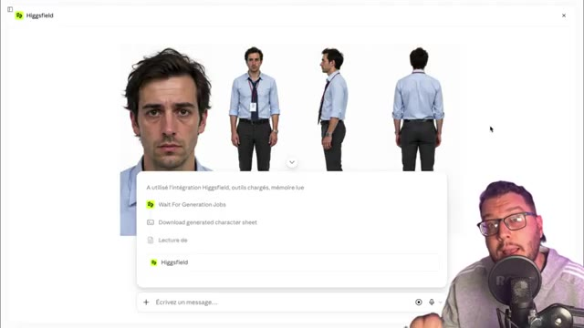  
  *⏱️ 00:03:56 — Affichage de l'interface montrant les détails d'intégration et les options d'outils liés à Higgsfield et la génération.*

---

### ⏱️ `[00:03:57 - 00:04:17]` | Segment #11

**🔊 Audio (Transcription Intégrale Mot pour Mot en Français) :**
> Et si on retourne dans Xfield et qu'on va dans les assets, on voit bien que la génération a été faite et on retrouvera notre fiche personnage juste ici. Donc je me suis aussi noté les crédits que j'avais en début de session. J'étais à 4350, on va voir combien on va en dépenser pour justement réaliser ce drama, cette série IA.

**👁️ Analyse Visuelle d'Écran (gemini-3.5-flash-lite) :**
**Interface & Outils** : Higgsfield Apps, interface web d'IA générative et interface de chat/automatisation.
**Contenu textuel & Code** : Interface d'accueil Higgsfield, fiches personnages avec multiples angles de vue, détails de génération (modèle GPT image 2.5) et fenêtre de code JSON.
**Action / Démonstration** : Le créateur navigue sur la plateforme Higgsfield, consulte la fiche personnage générée et examine les permissions de l'application.

**Captures d'écran :**
- 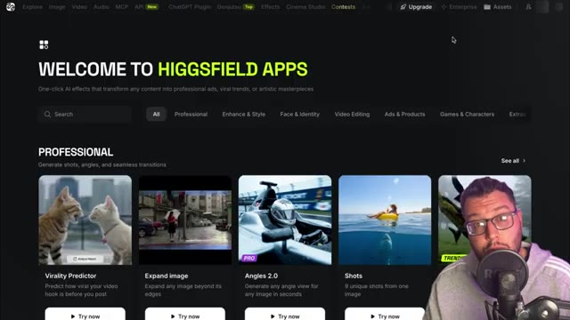  
  *⏱️ 00:03:58 — Page d'accueil de la plateforme Higgsfield Apps avec des exemples d'effets IA et le créateur visible en bas à droite.*
- 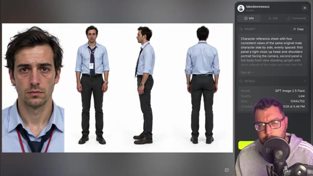  
  *⏱️ 00:04:07 — Affichage d'une fiche personnage générée comportant plusieurs vues d'un même homme en costume, avec les détails du prompt sur le panneau latéral.*
- 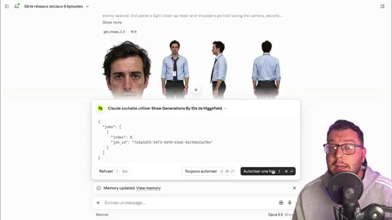  
  *⏱️ 00:04:15 — Fenêtre contextuelle d'autorisation affichant du code JSON (job_id) pour l'utilisation d'une application ou d'une intégration.*

---

### ⏱️ `[00:04:17 - 00:04:37]` | Segment #12

**🔊 Audio (Transcription Intégrale Mot pour Mot en Français) :**
> Retour sur Claude qui me demande si la fiche personnage me correspond. Là ça me va, c'est parfait. Et avant de continuer, on va lui demander de générer les autres fiches personnages qui vont intervenir au cours des 8 épisodes. Je vais avoir ainsi Lina qui est mon personnage féminin de la série. On ne sait pas pourquoi elle, elle est prisonnière des backrooms.

**👁️ Analyse Visuelle d'Écran (gemini-3.5-flash-lite) :**
**Interface & Outils** : Interface de l'outil d'IA et de génération (Higgsfield via Claude).
**Contenu textuel & Code** : Vues multiples du personnage féminin (Lina), fichiers de téléchargement (lina.png, employe.png) et boîte de dialogue de l'assistant.
**Action / Démonstration** : Le créateur montre la génération de la fiche personnage de Lina, le personnage féminin principal de la série.

**Captures d'écran :**
- 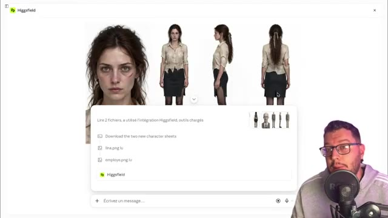  
  *⏱️ 00:04:35 — Affichage de la fiche personnage générée pour Lina avec des vues sous différents angles (face, profil, dos).*

---

### ⏱️ `[00:04:37 - 00:04:59]` | Segment #13

**🔊 Audio (Transcription Intégrale Mot pour Mot en Français) :**
> Et on a le mystérieux employé, personnage typique, horrifique, qui colle parfaitement à cet univers. Maintenant qu'on a ces personnages, Claude nous propose de générer quelques décors qui vont accompagner les 8 épisodes pour nous mettre dans l'ambiance des backrooms. Et ici j'ai la réalisation suivante avec les images clés qui devraient être utilisées à travers les différents épisodes.

**👁️ Analyse Visuelle d'Écran (gemini-3.5-flash-lite) :**
**Interface & Outils** : Interface web de Claude / Higgsfield avec affichage du chat et des visuels générés.
**Contenu textuel & Code** : Textes de prompts pour les épisodes et visualisations de personnages et décors (backrooms).
**Action / Démonstration** : Le créateur montre la transition entre la génération des personnages et la création des décors avec l'IA.

**Captures d'écran :**
- 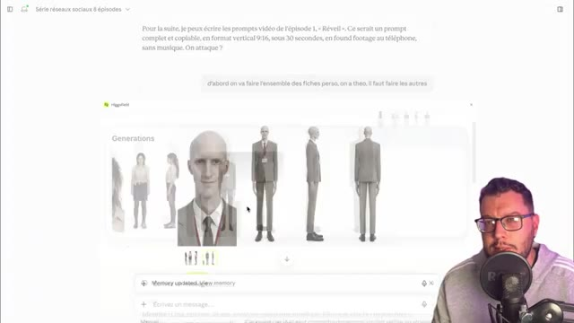  
  *⏱️ 00:04:38 — Interface montrant des générations de personnages pour la série, notamment l'employé mystérieux avec des vues de face et de profil.*
- 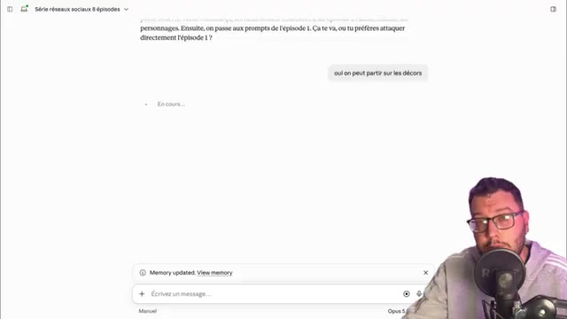  
  *⏱️ 00:04:48 — Interface de discussion textuelle en cours de chargement ('En cours...') pour la création des décors de la série.*
- 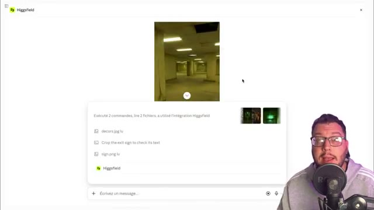  
  *⏱️ 00:04:57 — Interface montrant la génération d'un décor inspiré des backrooms avec des néons et des couloirs labyrinthiques via l'intégration de Higgsfield.*

---

### ⏱️ `[00:04:59 - 00:05:18]` | Segment #14

**🔊 Audio (Transcription Intégrale Mot pour Mot en Français) :**
> Et donc maintenant il me propose d'attaquer les promptes pour l'épisode 1. Ok je vais valider et on va pouvoir voir ce que ça donne. Le prompt est prêt et dans sa logique il va me réaliser deux clics qu'il va combiner pour pouvoir créer ce premier épisode. C'est très détaillé, c'est horodaté. Donc on sait ce qui va se passer de telle seconde à telle seconde.

**👁️ Analyse Visuelle d'Écran (gemini-3.5-flash-lite) :**
**Interface & Outils** : Interface web de type assistant conversationnel / LLM (style Claude)
**Contenu textuel & Code** : Scripts de prompts structurés au format JSON avec des horodatages ("time", "shot", "camera", "look", "audio", "constraints")
**Action / Démonstration** : Le créateur présente l'utilisation des prompts détaillés et horodatés générés par l'IA pour structurer les scènes de l'épisode.

**Captures d'écran :**
- 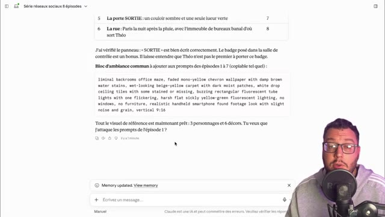  
  *⏱️ 00:05:00 — Affichage du panneau de discussion avec une interface de type assistant textuel, montrant un prompt structuré pour une série vidéo.*
- 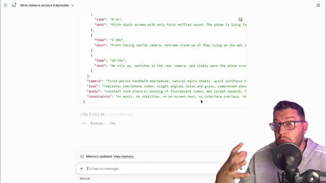  
  *⏱️ 00:05:08 — Affichage du générateur de code avec un prompt JSON détaillé et horodaté pour le clip 2 de l'épisode.*
- 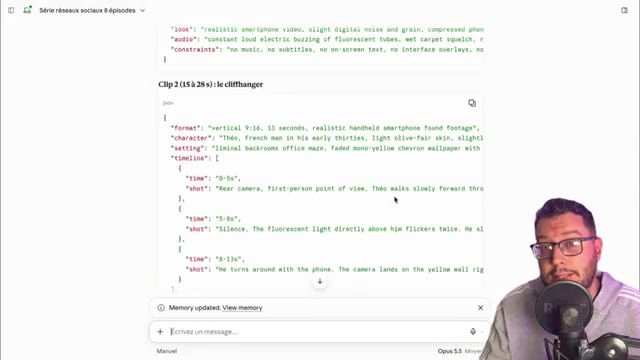  
  *⏱️ 00:05:16 — Vue détaillée de la structure JSON avec l'horodatage précis décrivant les actions planifiées pour le cliffhanger.*

---

### ⏱️ `[00:05:18 - 00:05:38]` | Segment #15

**🔊 Audio (Transcription Intégrale Mot pour Mot en Français) :**
> Et il me donne aussi des indications de montage si je veux rajouter des petits détails de mon côté. Moi ça me paraît correct, je vais donc demander de générer ce premier épisode. Je vais juste lui préciser le modèle que je souhaite utiliser. Ici, je veux qu'il utilise WAN 3.0 puisque c'est un modèle très performant et qui ne sera pas trop gourmand en crédit.

**👁️ Analyse Visuelle d'Écran (gemini-3.5-flash-lite) :**
**Interface & Outils** : Présentation orale ou séquence sans interface partagée.
**Contenu textuel & Code** : Explications et conseils de création de contenu / IA.
**Action / Démonstration** : Démonstration et mise en contexte pratique.

---

### ⏱️ `[00:05:38 - 00:06:07]` | Segment #16

**🔊 Audio (Transcription Intégrale Mot pour Mot en Français) :**
> C'est aussi important de l'avoir en tête. Avant de valider quoi que ce soit comme action sur X-File, surtout sur de la génération vidéo, ne pas hésiter à aller faire un tour sur la plateforme et voir quel modèle prendre et combien ça coûtera en tel format pour tant de secondes. Ici donc, il est parti pour me réaliser l'épisode 1. et ça a duré 11 minutes 17 pour me générer ce premier épisode, donc deux séquences séparées qu'il a assemblées ensemble au montage, et qu'il me propose directement de visionner juste ici, et de télécharger.

**👁️ Analyse Visuelle d'Écran (gemini-3.5-flash-lite) :**
**Interface & Outils** : Interface web de type assistant IA / LLM (avec panneau de chat et lecteur vidéo intégré)
**Contenu textuel & Code** : Texte de description d'un épisode de série ("Série réseaux sociaux 8 épisodes", "Le décor", "Le cliffhanger", "Un défaut à surveiller") et un lecteur affichant "Niveau zero episode 1 . MP4".
**Action / Démonstration** : Le créateur montre le résultat généré et le compte-rendu textuel de la génération vidéo.

**Captures d'écran :**
- 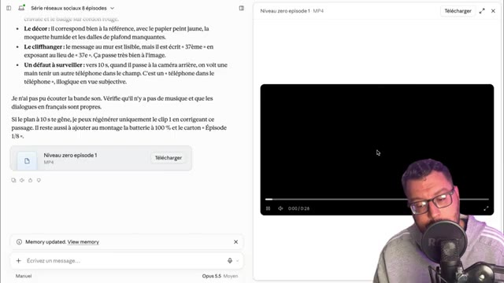  
  *⏱️ 00:06:05 — Interface de discussion textuelle à gauche affichant un récapitulatif avec un lecteur vidéo à droite et le créateur en bas à droite.*

---

### ⏱️ `[00:06:07 - 00:06:27]` | Segment #17

**🔊 Audio (Transcription Intégrale Mot pour Mot en Français) :**
> Ainsi je vais pouvoir faire la même chose au fil de la conversation pour les 8 épisodes, et à la fin donc avoir ma série complète, on va avancer dans le temps et voir si le tout est cohérent. Alors ça y est, j'ai ma série complète, mes 8 épisodes qui ont été générés, en moyenne pour chaque épisode il a mis entre 11 et 12 minutes, des épisodes qui varient entre 20 et 30 secondes.

**👁️ Analyse Visuelle d'Écran (gemini-3.5-flash-lite) :**
**Interface & Outils** : Présentation orale ou séquence sans interface partagée.
**Contenu textuel & Code** : Explications et conseils de création de contenu / IA.
**Action / Démonstration** : Démonstration et mise en contexte pratique.

---

### ⏱️ `[00:06:27 - 00:06:51]` | Segment #18

**🔊 Audio (Transcription Intégrale Mot pour Mot en Français) :**
> Si je vais dans mes assets, je vois l'ensemble des séquences qui ont été réalisées. Et en crédit, je vois que maintenant je suis à 3564. Donc en moyenne, j'en ai eu pour 100 crédits par épisode. Donc voilà ce que ça m'a coûté de mon côté. Toi, le coût, il variera selon le niveau d'abonnement que tu as. Et puis les modèles que tu vas utiliser pour créer ta série et le nombre de secondes que tu vas mettre par épisode.

**👁️ Analyse Visuelle d'Écran (gemini-3.5-flash-lite) :**
**Interface & Outils** : Interface web de Higgsfield Apps.
**Contenu textuel & Code** : Texte "WELCOME TO HIGGSFIELD APPS", menus de navigation (Explore, Image, Video, Audio, MCP, API, etc.), et différentes fonctionnalités présentées sous forme de cartes (Virality Predictor, Expand image, Angles 2.0, Shots).
**Action / Démonstration** : Le créateur montre comment accéder à la section "Assets" de l'application pour consulter les séquences générées.

**Captures d'écran :**
- 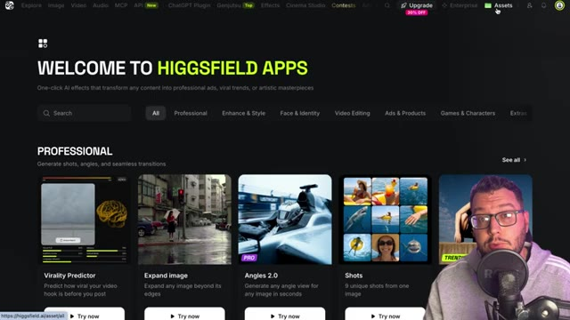  
  *⏱️ 00:06:28 — Page d'accueil de la plateforme Higgsfield Apps avec le curseur pointant sur l'onglet "Assets".*

---

### ⏱️ `[00:06:51 - 00:07:15]` | Segment #19

**🔊 Audio (Transcription Intégrale Mot pour Mot en Français) :**
> En tout cas, moi ici, je suis très content du résultat. Alors j'ai juste fait une modification, c'est que j'ai régénéré une autre idée pour l'épisode 8 puisque la fin ne me plaisait pas. Mais le reste c'est quasi parfait, il y a des petites incohérences, rien de trop compliqué. Avec 5 minutes de montage, j'ai coupé des séquences à droite à gauche. Et vraiment si j'avais eu des problèmes sur un épisode, j'aurais pu régénérer une séquence sans régénérer l'épisode en entier.

**👁️ Analyse Visuelle d'Écran (gemini-3.5-flash-lite) :**
**Interface & Outils** : Interface web de Claude.ai et lecteur vidéo intégré.
**Contenu textuel & Code** : Texte de retour de projet "Série réseaux sociaux 8 épisodes" avec des listes à puces sur les modifications, les défauts à corriger et un fichier MP4 "Niveau zero episode 8".
**Action / Démonstration** : Le créateur montre son écran de travail sur Claude.ai pour illustrer ses modifications d'écriture et les retours sur sa série.

**Captures d'écran :**
- 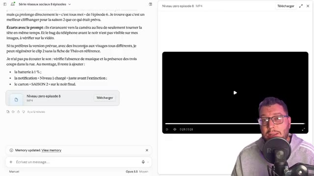  
  *⏱️ 00:06:52 — Capture d'écran montrant l'interface de Claude avec le texte de révision de l'épisode 8 et un lecteur vidéo à droite.*
- 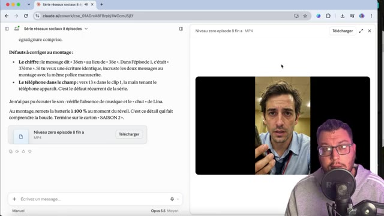  
  *⏱️ 00:07:03 — Capture d'écran montrant l'interface de Claude avec les défauts à corriger au montage et un extrait vidéo de l'acteur au téléphone.*
- 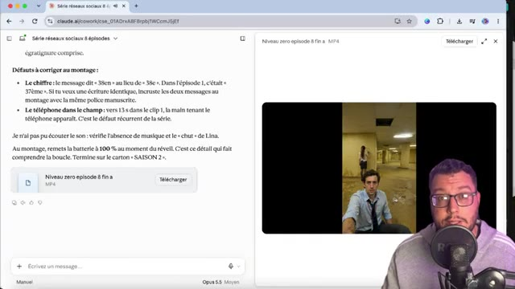  
  *⏱️ 00:07:13 — Capture d'écran montrant l'interface de Claude avec les retours de montage et un extrait vidéo d'une scène avec un personnage de dos et un acteur au premier plan.*

---

### ⏱️ `[00:07:15 - 00:07:36]` | Segment #20

**🔊 Audio (Transcription Intégrale Mot pour Mot en Français) :**
> En sélectionnant justement le nombre de secondes qu'il me faut et réutiliser ma conversation de Claude où j'ai déjà tous mes assets qui sont uploadés. donc mes caractères références et les décors principaux. On va voir tout de suite ce que la série donne. Donc il y a 8 épisodes de moins de 30 secondes. Il y en a pour à peu près 3 minutes de visionnage. Je te laisse regarder et on fait le débrief après.

**👁️ Analyse Visuelle d'Écran (gemini-3.5-flash-lite) :**
**Interface & Outils** : Présentation orale ou séquence sans interface partagée.
**Contenu textuel & Code** : Explications et conseils de création de contenu / IA.
**Action / Démonstration** : Démonstration et mise en contexte pratique.

---

### ⏱️ `[00:07:41 - 00:08:05]` | Segment #21

**🔊 Audio (Transcription Intégrale Mot pour Mot en Français) :**
> Si quelqu'un voit cette vidéo, je m'appelle Théo. Je ne sais pas où je suis. Il y a quelqu'un ? 37 fois.

**👁️ Analyse Visuelle d'Écran (gemini-3.5-flash-lite) :**
**Interface & Outils** : Vidéo narrative / fiction inspirée des creepypastas (Backrooms)
**Contenu textuel & Code** : Inscription murale "THÉO, C'EST TA 37ÈME FOIS"
**Action / Démonstration** : Le créateur met en scène une situation narrative et immersive de type "Backrooms".

**Captures d'écran :**
- 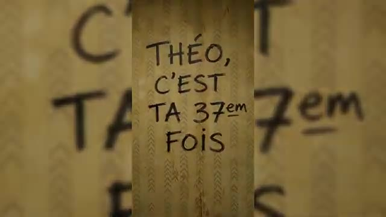  
  *⏱️ 00:08:04 — Gros plan sur un mur avec l'inscription manuscrite "THÉO, C'EST TA 37ÈME FOIS".*

---

### ⏱️ `[00:08:06 - 00:08:32]` | Segment #22

**🔊 Audio (Transcription Intégrale Mot pour Mot en Français) :**
> Je ne me souviens de rien. C'est là que je me suis réveillé. Il n'y a personne.

**👁️ Analyse Visuelle d'Écran (gemini-3.5-flash-lite) :**
**Interface & Outils** : Aucun logiciel ou interface technique visible (vidéo narrative type fiction).
**Contenu textuel & Code** : Ambiance de type Backrooms, couloirs infinis, murs jaunis, éclairage néon, silhouette au sol, mention 'Ep3'.
[DESC_IMAGE_3] Séquence narrative de fiction où un personnage se réveille seul dans un environnement mystérieux.
**Action / Démonstration** : Démonstration et mise en contexte pratique.

---

### ⏱️ `[00:08:33 - 00:08:58]` | Segment #23

**🔊 Audio (Transcription Intégrale Mot pour Mot en Français) :**
> J'ai rêvé. Maman ?

**👁️ Analyse Visuelle d'Écran (gemini-3.5-flash-lite) :**
**Interface & Outils** : Scène narrative fictive / Vidéo générée par IA
**Contenu textuel & Code** : Personnage inquiet et étrange couloir monochrome aux murs jaunâtres
**Action / Démonstration** : Illustration d'une séquence narrative dramatique et mystérieuse

---

### ⏱️ `[00:08:58 - 00:09:23]` | Segment #24

**🔊 Audio (Transcription Intégrale Mot pour Mot en Français) :**
> Je ne fais confiance à personne. ne fait confiance à personne. Ils entendent tout.

**👁️ Analyse Visuelle d'Écran (gemini-3.5-flash-lite) :**
**Interface & Outils** : AUCUNE
**Contenu textuel & Code** : AUCUNE
**Action / Démonstration** : AUCUNE

---

### ⏱️ `[00:09:23 - 00:09:46]` | Segment #25

**🔊 Audio (Transcription Intégrale Mot pour Mot en Français) :**
> T'es là depuis quand ? Depuis hier. Il y a une sortie. La lumière verde. Je sais où elle est. Alors on y va ? Tu... Tu travailles pour eux ? Mais c'est qui eux ?

**👁️ Analyse Visuelle d'Écran (gemini-3.5-flash-lite) :**
**Interface & Outils** : Aucun logiciel ou interface technique visible.
**Contenu textuel & Code** : Fiction narrative interactive ou mini-série au format vertical sur le thème des 'Backrooms'.
**Action / Démonstration** : Scène jouée par des acteurs dans un décor généré ou recréé.

---

### ⏱️ `[00:09:46 - 00:10:39]` | Segment #26

**🔊 Audio (Transcription Intégrale Mot pour Mot en Français) :**
> C'est moi. Tous moi. Si quelqu'un voit cette vidéo,

**👁️ Analyse Visuelle d'Écran (gemini-3.5-flash-lite) :**
**Interface & Outils** : Vidéo narrative / fiction (aucune interface logicielle ou outil technique affiché).
**Contenu textuel & Code** : Séquence narrative montrant un personnage face à ses doubles ou dans un environnement oppressant.
[DESC_IMAGE_1] Récit d'une histoire fictionnelle ou mise en scène visuelle par le créateur.
**Action / Démonstration** : Démonstration et mise en contexte pratique.

---

### ⏱️ `[00:10:39 - 00:11:02]` | Segment #27

**🔊 Audio (Transcription Intégrale Mot pour Mot en Français) :**
> je m'appelle Théo. Je sais pas où je suis. Donc voilà, si je devrais être un petit peu critique, c'est que je trouve que ça manque peut-être d'écriture. Il y a des facilités de scénario. Mais c'est vrai que de mon côté, je n'ai pas vraiment trop travaillé avec Claude.

**👁️ Analyse Visuelle d'Écran (gemini-3.5-flash-lite) :**
**Interface & Outils** : Navigateur web affichant l'interface de l'assistant IA Claude.
**Contenu textuel & Code** : Texte listant les défauts à corriger au montage (chiffre, téléphone dans le champ, son) et lecteur vidéo avec un fichier MP4 intitulé 'Niveau zero episode 8 fin a'.
**Action / Démonstration** : Le créateur présente l'interface de Claude et commente les retours textuels et vidéo générés par l'IA.

**Captures d'écran :**
-   
  *⏱️ 00:10:50 — Interface de Claude affichant une conversation avec du texte de critique de scénario et une vidéo intégrée, aux côtés du présentateur.*
- 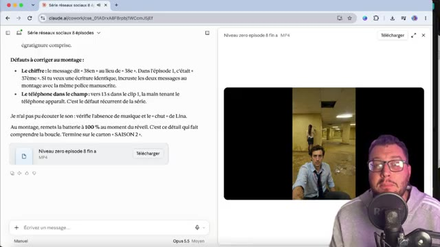  
  *⏱️ 00:11:00 — Vue similaire sur l'interface de Claude avec les retours sur le montage vidéo.*

---

### ⏱️ `[00:11:02 - 00:11:24]` | Segment #28

**🔊 Audio (Transcription Intégrale Mot pour Mot en Français) :**
> J'aurais donc peut-être dû passer plus de temps en réflexion et en écriture de scénario. C'était aussi le but de l'exercice. Avec un minimum, ce que Claude et Xfield peuvent me faire, le résultat est plutôt pas mal. Et surtout, il a été réalisé de façon autonome. C'est-à-dire que j'ai juste eu à vérifier peut-être l'épisode 1, mais après j'ai laissé Claude tourner avec les autorisations.

**👁️ Analyse Visuelle d'Écran (gemini-3.5-flash-lite) :**
**Interface & Outils** : Présentation orale ou séquence sans interface partagée.
**Contenu textuel & Code** : Explications et conseils de création de contenu / IA.
**Action / Démonstration** : Démonstration et mise en contexte pratique.

---

### ⏱️ `[00:11:24 - 00:11:42]` | Segment #29

**🔊 Audio (Transcription Intégrale Mot pour Mot en Français) :**
> à condition aussi qu'il faut penser d'avoir assez de crédits sur Xfield et anticiper le nombre de crédits que ça va nous coûter. Mais ensuite, je fais autre chose et je reviens 1h30 après, j'ai ma série complète qui est quasi prête à être diffusée. Ici, j'ai juste fait 2-3 ajustements, mais je peux inonder mes réseaux avec ce nouveau drama.

**👁️ Analyse Visuelle d'Écran (gemini-3.5-flash-lite) :**
**Interface & Outils** : Présentation orale ou séquence sans interface partagée.
**Contenu textuel & Code** : Explications et conseils de création de contenu / IA.
**Action / Démonstration** : Démonstration et mise en contexte pratique.

---

### ⏱️ `[00:11:42 - 00:12:00]` | Segment #30

**🔊 Audio (Transcription Intégrale Mot pour Mot en Français) :**
> Et ce principe, si je l'ai utilisé sur une série, je pourrais aussi imaginer l'utiliser en marketing dans la création de publicité ou pourquoi pas réfléchir influenceurs IA et créer du contenu autour de celui-ci dans différentes vidéos, dans différents trends. Cette connexion Cloud Xfield, elle peut aussi permettre de faire d'autres choses.

**👁️ Analyse Visuelle d'Écran (gemini-3.5-flash-lite) :**
**Interface & Outils** : Claude.ai (navigateur web)
**Contenu textuel & Code** : "J'aurais besoin d'une pub insta de...", "Pub choco cookie wom MP4", texte de description du résultat publicitaire généré.
**Action / Démonstration** : Le créateur montre la génération d'une publicité vidéo à partir d'un prompt et d'une image de cookie sur Claude AI.

**Captures d'écran :**
- 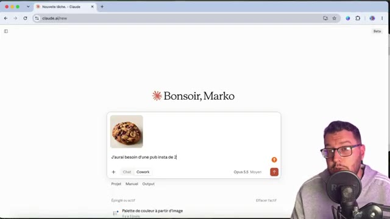  
  *⏱️ 00:11:43 — Interface de Claude AI montrant la saisie d'un prompt pour créer une publicité Instagram avec l'image d'un cookie.*
- 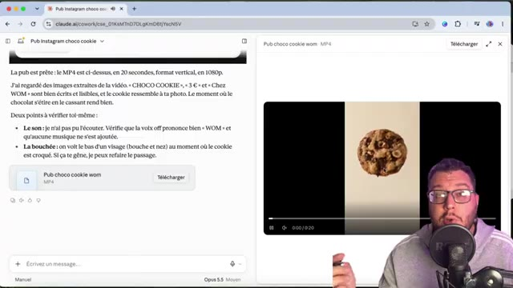  
  *⏱️ 00:11:51 — Interface de Claude AI affichant le résultat de la génération d'une vidéo publicitaire au format vertical MP4 (Pub choco cookie wom).*
- 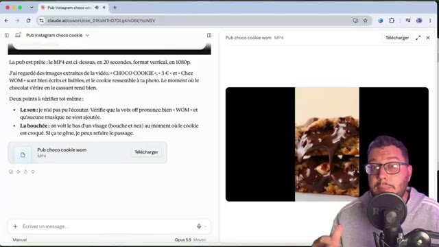  
  *⏱️ 00:11:59 — Gros plan sur le lecteur vidéo intégré à l'interface de Claude AI montrant le contenu de la publicité générée avec du chocolat fondant.*

---

### ⏱️ `[00:12:00 - 00:12:23]` | Segment #31

**🔊 Audio (Transcription Intégrale Mot pour Mot en Français) :**
> Bâtir des sites internet avec des images et des vidéos IA. Bâtir aussi ses propres applications ou jeux avec les assets graphiques créés grâce à Cloud et Xfield. Et d'ailleurs, si tu n'as pas Cloud, tu peux aussi passer par le supercomputer sur Xfield. Il se trouve sur le menu en allant dans Supercomputer. Et en fait ici, tu vas sélectionner le modèle de réflexion que tu veux utiliser.

**👁️ Analyse Visuelle d'Écran (gemini-3.5-flash-lite) :**
**Interface & Outils** : After Effects et Supercomputer (interface web d'IA).
**Contenu textuel & Code** : Menus de sélection de modèles IA (Auto, GPT 6 Astra, Claude Opus 5.5, Claude Fable 5.1), interface de chat, code, étapes de développement du jeu ('Sakura Catch').
**Action / Démonstration** : Le créateur montre comment passer par le supercomputer pour sélectionner un modèle d'IA et bâtir des applications ou jeux à l'aide d'assets graphiques.

**Captures d'écran :**
- 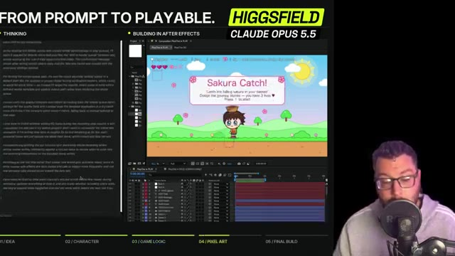  
  *⏱️ 00:12:12 — Interface détaillée montrant le processus de création d'un jeu vidéo, divisé en étapes (Idea, Character, Game Logic, Pixel Art, Final Build) avec le logiciel After Effects et du code en cours d'exécution.*
- 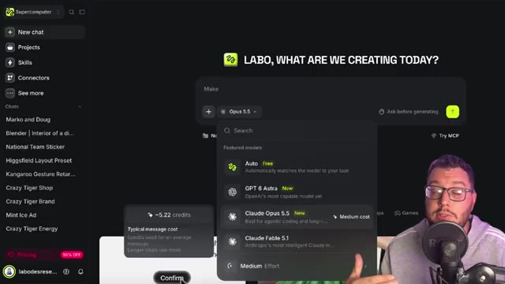  
  *⏱️ 00:12:21 — Interface de l'outil 'Supercomputer' avec un menu déroulant permettant de sélectionner le modèle d'intelligence artificielle 'Claude Opus 5.5' pour la création.*

---

### ⏱️ `[00:12:23 - 00:12:41]` | Segment #32

**🔊 Audio (Transcription Intégrale Mot pour Mot en Français) :**
> Donc ça va te prendre des crédits Xfield quand même, puisqu'ici tu ne payes pas l'abonnement Cloud, mais tu vas payer son utilisation sur Xfield. Et tu peux lancer ta conversation pour créer tes vidéos, tes applications ou encore tes jeux vidéo. Sachant que cet exercice, je l'ai fait aussi à travers différents exemples via GPT Astra et la connexion Xfield.

**👁️ Analyse Visuelle d'Écran (gemini-3.5-flash-lite) :**
**Interface & Outils** : Interface web de la plateforme Xfield (ou outil de création similaire basé sur le cloud).
**Contenu textuel & Code** : Vignettes de projets créatifs, icônes d'applications, compteurs de vues et de crédits, noms de projets (CharacterSheet, Thumbnail Maker, MicroDrama Studio, Director's Cut).
**Action / Démonstration** : Le créateur montre les différentes applications et créations possibles que l'on peut lancer sur la plateforme en utilisant des crédits.

**Captures d'écran :**
- 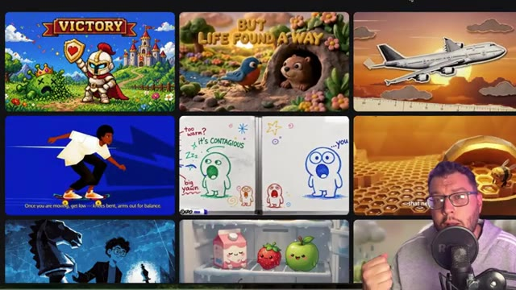  
  *⏱️ 00:12:32 — Grille de vignettes colorées et variées illustrant différents types de créations graphiques, de jeux vidéo ou de scènes animées, avec le visage du présentateur en bas à droite.*
- 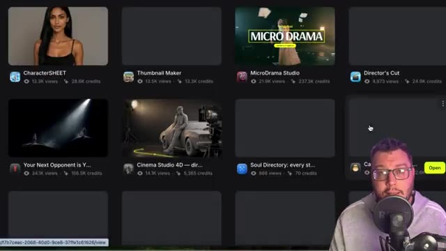  
  *⏱️ 00:12:40 — Interface de la plateforme avec une grille de projets et d'applications (CharacterSheet, Thumbnail Maker, MicroDrama Studio, etc.) affichant des statistiques de vues et de crédits, le présentateur apparaissant en bas à droite.*

---

### ⏱️ `[00:12:42 - 00:13:03]` | Segment #33

**🔊 Audio (Transcription Intégrale Mot pour Mot en Français) :**
> Et ici, on est passé sur un abonnement. Mais si tu veux vraiment payer que ce que tu dépenses sur Xfield sans système d'abonnement, tu peux aussi passer par une nouveauté, c'est l'API d'Xfield. On a fait une vidéo sur le sujet, elle s'affiche juste ici. Merci d'avoir suivi cette vidéo, je te mets tous les liens en description. Et je te dis à très bientôt pour une nouvelle vidéo, pour un nouveau tuto.

**👁️ Analyse Visuelle d'Écran (gemini-3.5-flash-lite) :**
**Interface & Outils** : Navigateur web, plateforme Xfield.
**Contenu textuel & Code** : Miniatures de projets vidéo et d'outils IA (CharacterSHEET, Thumbnail Maker, MicroDrama Studio, Director's Cut, Soul Directory, AI Drone Director, etc.), compteurs de vues et de crédits.
**Action / Démonstration** : Le présentateur conclut la vidéo tout en naviguant visuellement dans le catalogue des fonctionnalités et des créations de la plateforme Xfield.

**Captures d'écran :**
- 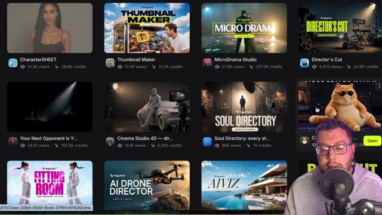  
  *⏱️ 00:12:43 — Interface d'Xfield affichant une grille de projets et de miniatures de créations vidéo.*
- 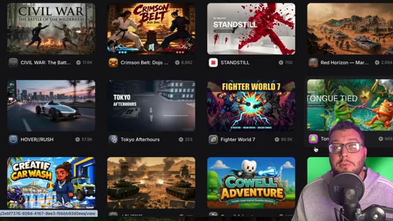  
  *⏱️ 00:13:02 — Navigation dans la bibliothèque de projets et de modèles de génération sur Xfield.*

---
