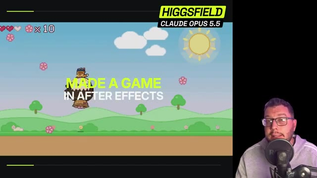

# 🎬 Claude OPUS 5.5 a créé MA SÉRIE de 8 épisodes (MCP Higgsfield)

> **Chaîne** : [Labo Des Réseaux](https://www.youtube.com/@labodesreseaux)  
> **Lien YouTube** : [https://www.youtube.com/watch?v=fUokaQ-NnZE](https://www.youtube.com/watch?v=fUokaQ-NnZE)  
> **Date de publication** : 20261003  
> **Durée** : 13:04  
> **Identifiant vidéo** : `fUokaQ-NnZE`  
> **Modèles** : Audio: `whisper-v3-large-turbo` | Vision: `gemini-3.5-flash-lite`  

---

## 📌 Synthèse Exécutive & Outils

### 💡 Résumé
**Cette vidéo de la chaîne « Labo Des Réseaux » explore la création automatisée et de bout en bout d'une série de fictionnelle de huit épisodes verticaux (formats courts type TikTok, Shorts ou Reels) sans équipe de tournage, acteur ni scénariste. Le créateur démontre comment combiner un LLM de pointe avec une plateforme d'agrégation d'IA pour concevoir, structurer, scénariser, prototyper et générer une mini-série horrifique centrée sur l'univers des « backrooms » en un temps record.**

**Le tutoriel détaille le processus technique complet, reposant sur l'association de Claude et de la plateforme Xfield via le Model Context Protocol (MCP). En configurant les connecteurs et en déléguant l'exécution au modèle de réflexion de Claude, l'intelligence artificielle pilote de manière autonome la production des fiches personnages, des décors clés, puis l'enchaînement des séquences vidéo à l'aide de modèles spécialisés comme GPT 2.5 et WAN 3.0.**

**À l'issue de l'exercice, le créateur dresse un bilan critique et pragmatique sur le coût (environ 100 crédits par épisode), le temps de rendu (11 à 12 minutes par épisode) et la qualité narrative obtenue. Il conclut en soulignant que cette méthode de travail autonome ouvre des perspectives massives bien au-delà de la fiction, s'étendant au marketing, à la création publicitaire, au développement d'applications, de sites web ou encore de jeux vidéo.**

### 🛠️ Outils, Modèles & Logiciels Présentés
- **Claude / Claude.ai / Claude Pro** (Assistant conversationnel et modèle de réflexion Opus 5.5)**
- **Xfield / higgsfield.ai** (Agrégateur de modèles d'IA, plateforme de génération d'images/vidéos, Supercomputer et API)**
- **Modèles d'IA et de génération** : GPT 2.5 (génération d'images réalistes) et WAN 3.0 (génération de vidéos)**
- **MCP (Model Context Protocol)** (Protocole de connexion entre Claude et Xfield)**
- **Formats de diffusion ciblés** : TikTok, Shorts, Reels (Formats verticaux courts)**
- **Logiciels de montage** (Mentionnés pour les ajustements finaux post-génération)**

### 🔑 Points Clés & Enseignements Stratégiques
- Délégation totale de la production** : Le système permet à une IA de manager l'ensemble d'un projet créatif, de l'idée initiale jusqu'à la génération des scènes finales de façon autonome.
- Connexion par MCP** : Lier Claude à Xfield via le Model Context Protocol permet à l'assistant d'exécuter directement des requêtes de génération visuelle sans intervention manuelle constante.
- Maintien de la consistance visuelle** : L'utilisation de fiches personnages détaillées (plans de face, de profil et de dos) garantit la récurrence et la cohérence esthétique d'un épisode à l'autre.
- Optimisation des coûts en crédits** : Il est recommandé de surveiller sa consommation de crédits (environ 100 crédits par épisode dans le test) et d'adapter le choix des modèles (ex. WAN 3.0) en fonction du budget.
- Maîtrise du temps de production** : Chaque épisode de 20 à 30 secondes requiert un temps de rendu d'environ 11 à 12 minutes, permettant d'obtenir une mini-série complète en moins d'une heure et demie d'exécution automatisée.
- Flexibilité des modifications** : En cas d'insatisfaction sur une séquence précise, il n'est pas nécessaire de régénérer l'épisode entier ; il suffit de cibler le nombre de secondes à corriger en s'appuyant sur les *assets* déjà uploadés.
- Importance de l'écriture préalable** : Le créateur souligne qu'un meilleur travail en amont sur le scénario et les prompts avec Claude permet d'éviter certaines facilités narratives inhérentes à une génération trop rapide.
- Diversification des cas d'usage** : Cette architecture de connexion peut s'appliquer à d'autres secteurs comme le marketing, la publicité, la création d'influenceurs virtuels, le développement web ou la conception de jeux vidéo.
- Alternatives d'utilisation de l'IA** : Pour les utilisateurs ne disposant pas d'un abonnement Claude Pro, il est possible d'utiliser le « Supercomputer » directement intégré dans l'interface de Xfield pour mener des conversations similaires.
- Modèle économique flexible** : Xfield propose différents types d'abonnements, une utilisation basée sur le calcul intégré, ainsi qu'une option d'API pour payer strictement au volume de consommation réel.

---

## ⏱️ Chronologie & Transcription Complète Audio & Visuelle (Mot pour Mot)

### ⏱️ `[00:00:00 - 00:00:23]` | Segment #01

**🔊 Audio (Transcription Intégrale Mot pour Mot en Français) :**
> Et si on y était ? Le moment où n'importe qui peut réaliser une série sans équipe de tournage, sans acteur, sans scénariste, bref, juste via une conversation avec Lya, en l'occurrence ici sur Claude et son dernier modèle, Opus 5.5. C'est ce qu'on va voir donc dans cette vidéo en produisant une série de 8 épisodes de 30 secondes, format vertical, TikTok short reels.

**👁️ Analyse Visuelle d'Écran (gemini-3.5-flash-lite) :**
**Interface & Outils** : Interface de chat Assistant IA.
**Contenu textuel & Code** : Texte « Crée-moi une série de 8 épisodes de 30 secondes » et aperçu des 8 épisodes verticaux (EP 01 à EP 08).
**Action / Démonstration** : Illustration de la création de la série par une conversation avec l'IA.

**Captures d'écran :**
-   
  *⏱️ 00:00:12 — Interface de chat montrant une conversation avec un assistant IA.*
-   
  *⏱️ 00:00:22 — Présentation graphique des 8 épisodes de 30 secondes au format vertical.*

---

### ⏱️ `[00:00:24 - 00:00:54]` | Segment #02

**🔊 Audio (Transcription Intégrale Mot pour Mot en Français) :**
> Oui, c'est vrai, on aurait pu directement s'attaquer au format 20 minutes, mais ça aurait coûté un petit peu cher en token. Là ce que je te propose c'est vraiment de te montrer tout le processus et le coût final pour pouvoir ainsi le dupliquer et voir que ça n'a jamais été aussi facile juste à partir de Claude de chercher une idée, la développer, créer ses personnages et les mettre en scène à travers une série d'épisodes qui se suivent pour ensuite la propulser sur les réseaux.

**👁️ Analyse Visuelle d'Écran (gemini-3.5-flash-lite) :**
**Interface & Outils** : Interface web de l'assistant IA Claude et lecteur vidéo intégré.
**Contenu textuel & Code** : Texte listant des "Défauts à corriger au montage" concernant un épisode de série (chiffre, téléphone dans le champ, son) et prévisualisation vidéo.
**Action / Démonstration** : Le créateur présente l'interface de travail et le processus de révision d'un projet généré par IA.

**Captures d'écran :**
-   
  *⏱️ 00:00:52 — Capture d'écran montrant une interface textuelle (Claude) à gauche avec des retours et corrections de montage, et une vidéo en cours de lecture à droite.*

---

### ⏱️ `[00:00:54 - 00:01:19]` | Segment #03

**🔊 Audio (Transcription Intégrale Mot pour Mot en Français) :**
> Alors avant toute chose, ce qu'il va nous falloir dans un premier temps, c'est au moins un compte CloudPro, puisqu'ici nous allons utiliser le dernier modèle de réflexion Opus 5.5. Ici Opus 5.5 va nous permettre d'organiser toutes nos idées et de manager toute l'organisation de projet pour ainsi nous produire les épisodes les uns les autres à la suite montés de A à Z.

**👁️ Analyse Visuelle d'Écran (gemini-3.5-flash-lite) :**
**Interface & Outils** : Site web officiel de Claude (Anthropic) - Page des abonnements et tarifs.
**Contenu textuel & Code** : Tarifs affichés : Free (0 €), Pro (15 €/mois), Max (à partir de 90 €/mois), avec les fonctionnalités détaillées pour chaque formule.
**Action / Démonstration** : Le créateur présente les différentes offres d'abonnement nécessaires pour utiliser l'outil de réflexion IA.

**Captures d'écran :**
-   
  *⏱️ 00:01:06 — Capture d'écran de la page de tarification du site officiel de Claude montrant les offres Free, Pro et Max.*
-   
  *⏱️ 00:01:17 — Même vue de la page des tarifs de Claude, avec le présentateur visible en incrustation dans le coin inférieur droit.*

---

### ⏱️ `[00:01:19 - 00:01:38]` | Segment #04

**🔊 Audio (Transcription Intégrale Mot pour Mot en Français) :**
> Mais il va nous falloir aussi un générateur d'images et de vidéos IA. Ici, on va passer par Xfield, un agrégateur qui va nous permettre de pouvoir sélectionner parmi plusieurs modèles ce qu'on juge nécessaire à la création de notre série. En description et en commentaire de vidéo, tu trouveras un lien qui te renvoie vers Xfield.

**👁️ Analyse Visuelle d'Écran (gemini-3.5-flash-lite) :**
**Interface & Outils** : Navigateur web affichant la plateforme Higgsfield AI (higgsfield.ai).
**Contenu textuel & Code** : Menus de navigation (Explore, Image, Video, Audio, MCP, API, Genjutsu, Effects, Cinema Studio), bannières de bienvenue, et grilles de modèles d'IA (Virality Predictor, Expand image, Angles 2.0, Shots).
**Action / Démonstration** : Le créateur présente l'interface de l'agrégateur d'IA Higgsfield et navigue sur son site web.

**Captures d'écran :**
-   
  *⏱️ 00:01:28 — Interface principale du site Higgsfield Apps présentant divers outils et effets vidéo par intelligence artificielle.*
-   
  *⏱️ 00:01:37 — Page de tarification (pricing) du site Higgsfield montrant les différentes formules d'abonnement (Plus et Ultra).*

---

### ⏱️ `[00:01:38 - 00:01:59]` | Segment #05

**🔊 Audio (Transcription Intégrale Mot pour Mot en Français) :**
> Tu pourras ainsi consulter les différents types d'abonnements et sélectionner celui qui te convient le mieux. Une fois donc que ton compte Cloud et Xfield sont opérationnels, on va les connecter ensemble via le MCP. Pour pouvoir le faire, c'est très simple. Tu te rends sur Cloud dans personnaliser, tu vas aller chercher connecteur et dans la barre de recherche, tu vas taper Xfield.

**👁️ Analyse Visuelle d'Écran (gemini-3.5-flash-lite) :**
**Interface & Outils** : Navigateur web affichant la page de tarification et l'interface de l'assistant Claude.
**Contenu textuel & Code** : Options d'abonnement (Plus/Ultra), crédits mensuels, et menus de personnalisation "Connecteurs".
**Action / Démonstration** : Le créateur montre les abonnements disponibles puis bascule sur l'interface de configuration des connecteurs.

**Captures d'écran :**
-   
  *⏱️ 00:01:39 — Page de tarification d'un outil IA montrant les différents abonnements (Plus et Ultra).*
-   
  *⏱️ 00:01:57 — Interface de personnalisation de l'assistant Claude avec l'onglet Connecteurs affiché à l'écran.*

---

### ⏱️ `[00:01:59 - 00:02:22]` | Segment #06

**🔊 Audio (Transcription Intégrale Mot pour Mot en Français) :**
> Tu n'auras ainsi qu'à connecter Xfield à Cloud pour que tu puisses maintenant générer tes images et vidéos à partir de Cloud, sachant que ceux-ci seront aussi disponibles dans les assets générés d'Xfield. Tu vas voir c'est très simple, dans un premier temps on va se rendre dans notre conversation Cowork. Et ici on vérifie bien dans l'outil plus en allant dans Connecteur que notre connecteur Xfield est bien activé.

**👁️ Analyse Visuelle d'Écran (gemini-3.5-flash-lite) :**
**Interface & Outils** : Présentation orale ou séquence sans interface partagée.
**Contenu textuel & Code** : Explications et conseils de création de contenu / IA.
**Action / Démonstration** : Démonstration et mise en contexte pratique.

---

### ⏱️ `[00:02:22 - 00:02:43]` | Segment #07

**🔊 Audio (Transcription Intégrale Mot pour Mot en Français) :**
> Maintenant dans un premier temps on va essayer de trouver un concept de série sans réalisation pour le moment. Ainsi je vais lui indiquer, sans aucune réalisation je souhaiterais créer une série pour les réseaux sociaux, 8 épisodes de moins de 30 secondes, format vertical. Je n'ai pas encore d'idée sur les personnages, l'ambiance, le style, mais pourquoi pas quelque chose en lien avec les backrooms.

**👁️ Analyse Visuelle d'Écran (gemini-3.5-flash-lite) :**
**Interface & Outils** : Présentation orale ou séquence sans interface partagée.
**Contenu textuel & Code** : Explications et conseils de création de contenu / IA.
**Action / Démonstration** : Démonstration et mise en contexte pratique.

---

### ⏱️ `[00:02:43 - 00:03:09]` | Segment #08

**🔊 Audio (Transcription Intégrale Mot pour Mot en Français) :**
> Un personnage donc qui chercherait à s'enfuir, il faudrait une introduction, que ça nous donne envie de regarder la série, et un cliffhanger à la fin pour pouvoir peut-être annoncer une saison 2. Ok, on lance le prompt, et là, Opus 5.5 va nous proposer le synopsis des 8 épisodes. Il nous donne aussi les règles de l'univers, et nous propose, avant de commencer à réaliser les épisodes, de pourquoi pas nous générer les fiches personnages.

**👁️ Analyse Visuelle d'Écran (gemini-3.5-flash-lite) :**
**Interface & Outils** : Présentation orale ou séquence sans interface partagée.
**Contenu textuel & Code** : Explications et conseils de création de contenu / IA.
**Action / Démonstration** : Démonstration et mise en contexte pratique.

---

### ⏱️ `[00:03:09 - 00:03:36]` | Segment #09

**🔊 Audio (Transcription Intégrale Mot pour Mot en Français) :**
> C'est exactement ça qu'on va faire dans un premier temps. On va demander la fiche personnage de notre héros pour savoir si celui-ci, il colle bien à l'ambiance. Donc en lui demandant de réaliser la fiche personnage de Théo, c'est ici que le MCP d'XField va intervenir. Et en fait, Claude va nous demander l'autorisation pour pouvoir faire en sorte d'envoyer le prompt qu'il a réalisé pour créer cette fiche personnage à XField et ainsi nous crée une image.

**👁️ Analyse Visuelle d'Écran (gemini-3.5-flash-lite) :**
**Interface & Outils** : Interface web de Claude AI avec incrustation vidéo du présentateur en bas à droite.
**Contenu textuel & Code** : Texte de l'utilisateur demandant de réaliser la fiche personnage de Théo, mentions d'outils chargés, mémoire lue (Higgsfield) et indicateur de chargement en cours.
**Action / Démonstration** : Le créateur montre l'interface de l'assistant IA en train de traiter la demande de création de la fiche personnage via une intégration spécifique.

**Captures d'écran :**
-   
  *⏱️ 00:03:23 — Interface de Claude montrant la demande de la fiche personnage pour Théo et le chargement des outils et de la mémoire.*

---

### ⏱️ `[00:03:36 - 00:03:57]` | Segment #10

**🔊 Audio (Transcription Intégrale Mot pour Mot en Français) :**
> Et ici on voit qu'il a utilisé en modèle d'image GPT 2.5, donc sûrement le modèle le plus réaliste en ce moment du marché. Notre fiche personnage est parfaite, c'est-à-dire que nous avons un plan de face, un plan entier de profil et de dos. Ça va nous permettre d'avoir de la récurrence à travers les 8 épisodes pour que le personnage principal garde de la consistance.

**👁️ Analyse Visuelle d'Écran (gemini-3.5-flash-lite) :**
**Interface & Outils** : Interface web d'un outil de génération d'images et de modèles d'IA (style ChatGPT/interface de chat avec boutons Animate, Edit, Download).
**Contenu textuel & Code** : Fiche personnage multi-angles (portrait, face, profil, dos), boutons d'action (Animate, Edit, Download), champ de texte de prompt "Écrivez un message...", mention de l'intégration Higgsfield.
**Action / Démonstration** : Le créateur présente une fiche personnage cohérente multi-angles générée par IA pour assurer la récurrence d'un personnage sur 8 épisodes.

**Captures d'écran :**
-   
  *⏱️ 00:03:47 — Interface d'un générateur d'images affichant la fiche personnage complète d'un homme (vue de face, profil et dos) générée via le modèle GPT 2.5.*
-   
  *⏱️ 00:03:56 — Interface montrant l'utilisation de l'intégration Higgsfield et les options de génération de la fiche personnage.*

---

### ⏱️ `[00:03:57 - 00:04:17]` | Segment #11

**🔊 Audio (Transcription Intégrale Mot pour Mot en Français) :**
> Et si on retourne dans Xfield et qu'on va dans les assets, on voit bien que la génération a été faite et on retrouvera notre fiche personnage juste ici. Donc je me suis aussi noté les crédits que j'avais en début de session. J'étais à 4350, on va voir combien on va en dépenser pour justement réaliser ce drama, cette série IA.

**👁️ Analyse Visuelle d'Écran (gemini-3.5-flash-lite) :**
**Interface & Outils** : Higgsfield Apps, interface web d'IA et assistant conversationnel (style Claude).
**Contenu textuel & Code** : Interface utilisateur de Higgsfield, fiches personnages, prompts descriptifs, détails techniques et blocs de code JSON d'autorisation.
**Action / Démonstration** : Le créateur navigue sur la plateforme Higgsfield, consulte les assets générés (la fiche personnage) et gère les autorisations de l'application.

**Captures d'écran :**
-   
  *⏱️ 00:03:58 — Page d'accueil de la plateforme Higgsfield Apps montrant différentes options de génération vidéo par IA.*
-   
  *⏱️ 00:04:07 — Affichage d'une fiche personnage générée par IA montrant plusieurs angles de vue d'un même homme avec le prompt et les détails associés dans le panneau latéral.*
-   
  *⏱️ 00:04:15 — Fenêtre de dialogue d'une application ou d'une extension demandant l'autorisation d'exécuter un script JSON avec un identifiant de tâche (job_id).*

---

### ⏱️ `[00:04:17 - 00:04:37]` | Segment #12

**🔊 Audio (Transcription Intégrale Mot pour Mot en Français) :**
> Retour sur Claude qui me demande si la fiche personnage me correspond. Là ça me va, c'est parfait. Et avant de continuer, on va lui demander de générer les autres fiches personnages qui vont intervenir au cours des 8 épisodes. Je vais avoir ainsi Lina qui est mon personnage féminin de la série. On ne sait pas pourquoi elle, elle est prisonnière des backrooms.

**👁️ Analyse Visuelle d'Écran (gemini-3.5-flash-lite) :**
**Interface & Outils** : Interface de l'outil de génération avec intégration de Higgsfield (type interface de chat ou d'assistant IA).
**Contenu textuel & Code** : Visuel d'un personnage féminin (Lina) sous plusieurs angles, options de téléchargement des fichiers « lina.png.lu » et « employe.png.lu ».
**Action / Démonstration** : Le créateur présente la fiche personnage générée pour Lina, le personnage féminin principal de la série.

**Captures d'écran :**
-   
  *⏱️ 00:04:35 — Affichage de la fiche personnage générée pour Lina avec des vues sous différents angles (face, profil, dos).*

---

### ⏱️ `[00:04:37 - 00:04:59]` | Segment #13

**🔊 Audio (Transcription Intégrale Mot pour Mot en Français) :**
> Et on a le mystérieux employé, personnage typique, horrifique, qui colle parfaitement à cet univers. Maintenant qu'on a ces personnages, Claude nous propose de générer quelques décors qui vont accompagner les 8 épisodes pour nous mettre dans l'ambiance des backrooms. Et ici j'ai la réalisation suivante avec les images clés qui devraient être utilisées à travers les différents épisodes.

**👁️ Analyse Visuelle d'Écran (gemini-3.5-flash-lite) :**
**Interface & Outils** : Interface web de Claude et Higgsfield AI.
**Contenu textuel & Code** : Prompts textuels pour les épisodes, générations de personnages et de décors Backrooms.
**Action / Démonstration** : Le créateur montre la génération des personnages puis demande à l'IA de créer les décors de la série.

**Captures d'écran :**
-   
  *⏱️ 00:04:38 — Affichage de l'interface montrant les générations de personnages pour la série.*
-   
  *⏱️ 00:04:48 — Interface de discussion textuelle en cours de génération de contenu avec Claude.*
-   
  *⏱️ 00:04:57 — Visualisation des décors de type Backrooms générés par l'IA sur l'interface.*

---

### ⏱️ `[00:04:59 - 00:05:18]` | Segment #14

**🔊 Audio (Transcription Intégrale Mot pour Mot en Français) :**
> Et donc maintenant il me propose d'attaquer les promptes pour l'épisode 1. Ok je vais valider et on va pouvoir voir ce que ça donne. Le prompt est prêt et dans sa logique il va me réaliser deux clics qu'il va combiner pour pouvoir créer ce premier épisode. C'est très détaillé, c'est horodaté. Donc on sait ce qui va se passer de telle seconde à telle seconde.

**👁️ Analyse Visuelle d'Écran (gemini-3.5-flash-lite) :**
**Interface & Outils** : Interface web de l'assistant IA Claude.
**Contenu textuel & Code** : Scripts, blocs d'ambiance, prompts horodatés au format JSON pour la création d'une série d'épisodes vidéo.
**Action / Démonstration** : Le créateur examine et valide les prompts générés par l'IA pour l'épisode 1 de sa série.

**Captures d'écran :**
-   
  *⏱️ 00:05:00 — Interface de l'assistant IA affichant les détails sur les décors et personnages et proposant de passer aux prompts de l'épisode 1.*
-   
  *⏱️ 00:05:08 — Affichage d'un prompt structuré et horodaté pour la génération de clips vidéo avec des instructions de caméra et d'ambiance.*
-   
  *⏱️ 00:05:16 — Visualisation détaillée du code JSON ou du prompt pour le 'Clip 2' incluant la timeline et les actions seconde par seconde.*

---

### ⏱️ `[00:05:18 - 00:05:38]` | Segment #15

**🔊 Audio (Transcription Intégrale Mot pour Mot en Français) :**
> Et il me donne aussi des indications de montage si je veux rajouter des petits détails de mon côté. Moi ça me paraît correct, je vais donc demander de générer ce premier épisode. Je vais juste lui préciser le modèle que je souhaite utiliser. Ici, je veux qu'il utilise WAN 3.0 puisque c'est un modèle très performant et qui ne sera pas trop gourmand en crédit.

**👁️ Analyse Visuelle d'Écran (gemini-3.5-flash-lite) :**
**Interface & Outils** : Présentation orale ou séquence sans interface partagée.
**Contenu textuel & Code** : Explications et conseils de création de contenu / IA.
**Action / Démonstration** : Démonstration et mise en contexte pratique.

---

### ⏱️ `[00:05:38 - 00:06:07]` | Segment #16

**🔊 Audio (Transcription Intégrale Mot pour Mot en Français) :**
> C'est aussi important de l'avoir en tête. Avant de valider quoi que ce soit comme action sur X-File, surtout sur de la génération vidéo, ne pas hésiter à aller faire un tour sur la plateforme et voir quel modèle prendre et combien ça coûtera en tel format pour tant de secondes. Ici donc, il est parti pour me réaliser l'épisode 1. et ça a duré 11 minutes 17 pour me générer ce premier épisode, donc deux séquences séparées qu'il a assemblées ensemble au montage, et qu'il me propose directement de visionner juste ici, et de télécharger.

**👁️ Analyse Visuelle d'Écran (gemini-3.5-flash-lite) :**
**Interface & Outils** : Interface web de type LLM / assistant avec panneau de lecture vidéo à droite.
**Contenu textuel & Code** : Texte de description et de correction de l'épisode, lecteur vidéo "Niveau zero episode 1 .MP4", et zone de saisie de message.
**Action / Démonstration** : Le créateur présente le résultat généré pour l'épisode 1 de la série de réseaux sociaux.

**Captures d'écran :**
-   
  *⏱️ 00:06:05 — Capture d'écran montrant l'interface d'un assistant textuel avec le résultat de la génération vidéo de l'épisode 1.*

---

### ⏱️ `[00:06:07 - 00:06:27]` | Segment #17

**🔊 Audio (Transcription Intégrale Mot pour Mot en Français) :**
> Ainsi je vais pouvoir faire la même chose au fil de la conversation pour les 8 épisodes, et à la fin donc avoir ma série complète, on va avancer dans le temps et voir si le tout est cohérent. Alors ça y est, j'ai ma série complète, mes 8 épisodes qui ont été générés, en moyenne pour chaque épisode il a mis entre 11 et 12 minutes, des épisodes qui varient entre 20 et 30 secondes.

**👁️ Analyse Visuelle d'Écran (gemini-3.5-flash-lite) :**
**Interface & Outils** : Présentation orale ou séquence sans interface partagée.
**Contenu textuel & Code** : Explications et conseils de création de contenu / IA.
**Action / Démonstration** : Démonstration et mise en contexte pratique.

---

### ⏱️ `[00:06:27 - 00:06:51]` | Segment #18

**🔊 Audio (Transcription Intégrale Mot pour Mot en Français) :**
> Si je vais dans mes assets, je vois l'ensemble des séquences qui ont été réalisées. Et en crédit, je vois que maintenant je suis à 3564. Donc en moyenne, j'en ai eu pour 100 crédits par épisode. Donc voilà ce que ça m'a coûté de mon côté. Toi, le coût, il variera selon le niveau d'abonnement que tu as. Et puis les modèles que tu vas utiliser pour créer ta série et le nombre de secondes que tu vas mettre par épisode.

**👁️ Analyse Visuelle d'Écran (gemini-3.5-flash-lite) :**
**Interface & Outils** : Interface web de Higgsfield Apps (générateur de vidéo/image par IA).
**Contenu textuel & Code** : Menu supérieur (Explore, Image, Video, Audio, MCP, API, etc.), message de bienvenue "WELCOME TO HIGGSFIELD APPS", barre de recherche, sections thématiques (Professional, Enhance & Style, Face & Identity, Video Editing, Ads & Products) et aperçus de fonctionnalités (Virality Predictor, Expand image, Angles 2.0, Shots).
**Action / Démonstration** : Le créateur navigue sur le site web et s'apprête à cliquer sur la rubrique 'Assets' pour consulter l'historique des séquences réalisées et le solde des crédits consommés.

**Captures d'écran :**
-   
  *⏱️ 00:06:28 — Page d'accueil de la plateforme Higgsfield Apps montrant le tableau de bord avec les différents outils et le curseur de la souris pointant vers l'onglet 'Assets'.*

---

### ⏱️ `[00:06:51 - 00:07:15]` | Segment #19

**🔊 Audio (Transcription Intégrale Mot pour Mot en Français) :**
> En tout cas, moi ici, je suis très content du résultat. Alors j'ai juste fait une modification, c'est que j'ai régénéré une autre idée pour l'épisode 8 puisque la fin ne me plaisait pas. Mais le reste c'est quasi parfait, il y a des petites incohérences, rien de trop compliqué. Avec 5 minutes de montage, j'ai coupé des séquences à droite à gauche. Et vraiment si j'avais eu des problèmes sur un épisode, j'aurais pu régénérer une séquence sans régénérer l'épisode en entier.

**👁️ Analyse Visuelle d'Écran (gemini-3.5-flash-lite) :**
**Interface & Outils** : Interface web de Claude AI (claude.ai) combinée à un lecteur vidéo intégré et incrustation vidéo du créateur en bas à droite.
**Contenu textuel & Code** : Texte de prompt et de révision intitulé 'Série réseaux sociaux 8 épisodes', listant des points de correction comme 'Le chiffre', 'Le téléphone dans le champ', et un fichier vidéo 'Niveau zéro episode 8 fin a.MP4'.
**Action / Démonstration** : Le créateur présente son processus de relecture textuelle et vidéo des épisodes générés par IA avant le montage final.

**Captures d'écran :**
-   
  *⏱️ 00:06:52 — Capture d'écran montrant l'interface de Claude avec le texte de révision de l'épisode 8 et un lecteur vidéo à droite affichant une prévisualisation noire.*
-   
  *⏱️ 00:07:03 — Vue de l'interface de Claude avec les notes de montage sur la gauche et un lecteur vidéo à droite montrant un plan rapproché d'un personnage tenant un téléphone.*
-   
  *⏱️ 00:07:13 — Vue de l'interface de Claude avec les défauts à corriger au montage et un lecteur vidéo montrant une scène avec le personnage principal au premier plan et un autre personnage de dos écrivant sur un mur en arrière-plan.*

---

### ⏱️ `[00:07:15 - 00:07:36]` | Segment #20

**🔊 Audio (Transcription Intégrale Mot pour Mot en Français) :**
> En sélectionnant justement le nombre de secondes qu'il me faut et réutiliser ma conversation de Claude où j'ai déjà tous mes assets qui sont uploadés. donc mes caractères références et les décors principaux. On va voir tout de suite ce que la série donne. Donc il y a 8 épisodes de moins de 30 secondes. Il y en a pour à peu près 3 minutes de visionnage. Je te laisse regarder et on fait le débrief après.

**👁️ Analyse Visuelle d'Écran (gemini-3.5-flash-lite) :**
**Interface & Outils** : Présentation orale ou séquence sans interface partagée.
**Contenu textuel & Code** : Explications et conseils de création de contenu / IA.
**Action / Démonstration** : Démonstration et mise en contexte pratique.

---

### ⏱️ `[00:07:41 - 00:08:05]` | Segment #21

**🔊 Audio (Transcription Intégrale Mot pour Mot en Français) :**
> Si quelqu'un voit cette vidéo, je m'appelle Théo. Je ne sais pas où je suis. Il y a quelqu'un ? 37 fois.

**👁️ Analyse Visuelle d'Écran (gemini-3.5-flash-lite) :**
**Interface & Outils** : AUCUNE
**Contenu textuel & Code** : Inscription textuelle 'Théo, c'est ta 37ème fois' sur un mur.
**Action / Démonstration** : Mise en scène narrative de type fiction/horreur sur le thème des Backrooms.

---

### ⏱️ `[00:08:06 - 00:08:32]` | Segment #22

**🔊 Audio (Transcription Intégrale Mot pour Mot en Français) :**
> Je ne me souviens de rien. C'est là que je me suis réveillé. Il n'y a personne.

**👁️ Analyse Visuelle d'Écran (gemini-3.5-flash-lite) :**
**Interface & Outils** : Aucun élément d'interface ou de logiciel affiché.
**Contenu textuel & Code** : Récit visuel narratif et immersif de fiction, sans texte technique ni prompt.
[DESC_IMAGE_1] Un homme en chemise et cravate se réveille dans un décor labyrinthique aux murs jaunes inspiré des Backrooms.
[DESC_IMAGE_2] Vue en contre-plongée des couloirs vides des Backrooms avec une silhouette dessinée au sol.
[DESC_IMAGE_3] Gros plan sur le visage de l'homme surpris et désorienté dans l'univers des Backrooms, avec la mention 'Ep3'.
[INTERFACE] Aucun
**Action / Démonstration** : Aucun

---

### ⏱️ `[00:08:33 - 00:08:58]` | Segment #23

**🔊 Audio (Transcription Intégrale Mot pour Mot en Français) :**
> J'ai rêvé. Maman ?

**👁️ Analyse Visuelle d'Écran (gemini-3.5-flash-lite) :**
**Interface & Outils** : Aucun logiciel ou interface n'est affiché.
**Contenu textuel & Code** : Séquence vidéo narrative de fiction, sans éléments textuels ni interfaces techniques.
**Action / Démonstration** : Illustration visuelle d'une fiction ou d'un récit dans le cadre de la vidéo.

---

### ⏱️ `[00:08:58 - 00:09:23]` | Segment #24

**🔊 Audio (Transcription Intégrale Mot pour Mot en Français) :**
> Je ne fais confiance à personne. ne fait confiance à personne. Ils entendent tout.

**👁️ Analyse Visuelle d'Écran (gemini-3.5-flash-lite) :**
**Interface & Outils** : Scène narrative cinématique / Illustration vidéo.
**Contenu textuel & Code** : Fiction mettant en scène des personnages apeurés et un distributeur de smartphones.
**Action / Démonstration** : Illustration visuelle du propos sur la surveillance généralisée.

---

### ⏱️ `[00:09:23 - 00:09:46]` | Segment #25

**🔊 Audio (Transcription Intégrale Mot pour Mot en Français) :**
> T'es là depuis quand ? Depuis hier. Il y a une sortie. La lumière verde. Je sais où elle est. Alors on y va ? Tu... Tu travailles pour eux ? Mais c'est qui eux ?

**👁️ Analyse Visuelle d'Écran (gemini-3.5-flash-lite) :**
**Interface & Outils** : Aucun (vidéo narrative de fiction ou test généré par IA).
**Contenu textuel & Code** : Décoration de type Backrooms avec murs jaunes et moquette beige, personnage masculin avec un badge.
**Action / Démonstration** : Scène narrative mettant en scène des personnages explorant un environnement étrange et oppressant.

---

### ⏱️ `[00:09:46 - 00:10:39]` | Segment #26

**🔊 Audio (Transcription Intégrale Mot pour Mot en Français) :**
> C'est moi. Tous moi. Si quelqu'un voit cette vidéo,

**👁️ Analyse Visuelle d'Écran (gemini-3.5-flash-lite) :**
**Interface & Outils** : Vidéo narrative / fictionnelle (aucun logiciel ou interface technique affiché).
**Contenu textuel & Code** : Aucun texte, prompt ou menu visible à l'écran.
**Action / Démonstration** : Le créateur joue une scène narrative ou un sketch de type found-footage.

---

### ⏱️ `[00:10:39 - 00:11:02]` | Segment #27

**🔊 Audio (Transcription Intégrale Mot pour Mot en Français) :**
> je m'appelle Théo. Je sais pas où je suis. Donc voilà, si je devrais être un petit peu critique, c'est que je trouve que ça manque peut-être d'écriture. Il y a des facilités de scénario. Mais c'est vrai que de mon côté, je n'ai pas vraiment trop travaillé avec Claude.

**👁️ Analyse Visuelle d'Écran (gemini-3.5-flash-lite) :**
**Interface & Outils** : Aucun élément d'interface ou logiciel présenté.
**Contenu textuel & Code** : Vidéo face caméra (talking head) avec un effet de flou sur les côtés.
**Action / Démonstration** : Théo s'exprime face caméra pour donner son avis critique.

---

### ⏱️ `[00:11:02 - 00:11:24]` | Segment #28

**🔊 Audio (Transcription Intégrale Mot pour Mot en Français) :**
> J'aurais donc peut-être dû passer plus de temps en réflexion et en écriture de scénario. C'était aussi le but de l'exercice. Avec un minimum, ce que Claude et Xfield peuvent me faire, le résultat est plutôt pas mal. Et surtout, il a été réalisé de façon autonome. C'est-à-dire que j'ai juste eu à vérifier peut-être l'épisode 1, mais après j'ai laissé Claude tourner avec les autorisations.

**👁️ Analyse Visuelle d'Écran (gemini-3.5-flash-lite) :**
**Interface & Outils** : Présentation orale ou séquence sans interface partagée.
**Contenu textuel & Code** : Explications et conseils de création de contenu / IA.
**Action / Démonstration** : Démonstration et mise en contexte pratique.

---

### ⏱️ `[00:11:24 - 00:11:42]` | Segment #29

**🔊 Audio (Transcription Intégrale Mot pour Mot en Français) :**
> à condition aussi qu'il faut penser d'avoir assez de crédits sur Xfield et anticiper le nombre de crédits que ça va nous coûter. Mais ensuite, je fais autre chose et je reviens 1h30 après, j'ai ma série complète qui est quasi prête à être diffusée. Ici, j'ai juste fait 2-3 ajustements, mais je peux inonder mes réseaux avec ce nouveau drama.

**👁️ Analyse Visuelle d'Écran (gemini-3.5-flash-lite) :**
**Interface & Outils** : Présentation orale ou séquence sans interface partagée.
**Contenu textuel & Code** : Explications et conseils de création de contenu / IA.
**Action / Démonstration** : Démonstration et mise en contexte pratique.

---

### ⏱️ `[00:11:42 - 00:12:00]` | Segment #30

**🔊 Audio (Transcription Intégrale Mot pour Mot en Français) :**
> Et ce principe, si je l'ai utilisé sur une série, je pourrais aussi imaginer l'utiliser en marketing dans la création de publicité ou pourquoi pas réfléchir influenceurs IA et créer du contenu autour de celui-ci dans différentes vidéos, dans différents trends. Cette connexion Cloud Xfield, elle peut aussi permettre de faire d'autres choses.

**👁️ Analyse Visuelle d'Écran (gemini-3.5-flash-lite) :**
**Interface & Outils** : Claude.ai (navigateur web, interface de chat et génération de contenu)
**Contenu textuel & Code** : "J'aurais besoin d'une pub insta de 2...", "Pub choco cookie wom.MP4", texte explicatif sur la génération de la vidéo publicitaire et ses vérifications.
**Action / Démonstration** : Le créateur montre la création et le résultat d'une publicité vidéo générée par l'IA à partir d'une image de cookie.

**Captures d'écran :**
-   
  *⏱️ 00:11:43 — Interface de Claude AI avec un prompt pour créer une publicité Instagram intégrant l'image d'un cookie.*
-   
  *⏱️ 00:11:51 — Interface de Claude AI affichant le résultat de la génération d'une publicité vidéo au format MP4 pour un cookie.*
-   
  *⏱️ 00:11:59 — Visualisation détaillée d'une séquence de la vidéo générée montrant un cookie fondant avec du chocolat coulant.*

---

### ⏱️ `[00:12:00 - 00:12:23]` | Segment #31

**🔊 Audio (Transcription Intégrale Mot pour Mot en Français) :**
> Bâtir des sites internet avec des images et des vidéos IA. Bâtir aussi ses propres applications ou jeux avec les assets graphiques créés grâce à Cloud et Xfield. Et d'ailleurs, si tu n'as pas Cloud, tu peux aussi passer par le supercomputer sur Xfield. Il se trouve sur le menu en allant dans Supercomputer. Et en fait ici, tu vas sélectionner le modèle de réflexion que tu veux utiliser.

**👁️ Analyse Visuelle d'Écran (gemini-3.5-flash-lite) :**
**Interface & Outils** : Adobe After Effects, interface Web Supercomputer / Higgsfield
**Contenu textuel & Code** : Texte "MADE A GAME IN AFTER EFFECTS", panneaux de code, interface de sélection de modèle IA (Claude Opus 5.5, GPT 6 Astra)
**Action / Démonstration** : Le créateur montre la création d'un jeu vidéo interactif et explique l'utilisation des différents modèles sur la plateforme Supercomputer.

**Captures d'écran :**
-   
  *⏱️ 00:12:01 — Aperçu du jeu vidéo en pixel art créé à l'aide d'Adobe After Effects, Higgsfield et Claude Opus 5.5.*
-   
  *⏱️ 00:12:12 — Interface complète montrant le code de conception (Thinking) à gauche et l'éditeur Adobe After Effects avec le jeu en cours de création au centre.*
-   
  *⏱️ 00:12:21 — Interface de l'outil Supercomputer avec le menu déroulant permettant de sélectionner le modèle d'intelligence artificielle (Claude Opus 5.5).*

---

### ⏱️ `[00:12:23 - 00:12:41]` | Segment #32

**🔊 Audio (Transcription Intégrale Mot pour Mot en Français) :**
> Donc ça va te prendre des crédits Xfield quand même, puisqu'ici tu ne payes pas l'abonnement Cloud, mais tu vas payer son utilisation sur Xfield. Et tu peux lancer ta conversation pour créer tes vidéos, tes applications ou encore tes jeux vidéo. Sachant que cet exercice, je l'ai fait aussi à travers différents exemples via GPT Astra et la connexion Xfield.

**👁️ Analyse Visuelle d'Écran (gemini-3.5-flash-lite) :**
**Interface & Outils** : Interface web de la plateforme de création vidéo et d'applications Xfield.
**Contenu textuel & Code** : Vignettes de projets créatifs, miniatures de vidéos, compteurs de vues et de crédits, boutons d'action.
**Action / Démonstration** : Le présentateur montre différents exemples de projets et d'applications créés sur la plateforme.

**Captures d'écran :**
-   
  *⏱️ 00:12:32 — Grille de vignettes vidéo et d'illustrations générées par IA avec le présentateur incrusté en bas à droite.*
-   
  *⏱️ 00:12:40 — Interface de la plateforme avec différents projets et studios affichés en vignettes (CharacterSheet, MicroDrama Studio, etc.) et le présentateur en bas à droite.*

---

### ⏱️ `[00:12:42 - 00:13:03]` | Segment #33

**🔊 Audio (Transcription Intégrale Mot pour Mot en Français) :**
> Et ici, on est passé sur un abonnement. Mais si tu veux vraiment payer que ce que tu dépenses sur Xfield sans système d'abonnement, tu peux aussi passer par une nouveauté, c'est l'API d'Xfield. On a fait une vidéo sur le sujet, elle s'affiche juste ici. Merci d'avoir suivi cette vidéo, je te mets tous les liens en description. Et je te dis à très bientôt pour une nouvelle vidéo, pour un nouveau tuto.

**👁️ Analyse Visuelle d'Écran (gemini-3.5-flash-lite) :**
**Interface & Outils** : Navigateur web, plateforme Xfield
**Contenu textuel & Code** : Miniatures de projets, titres (CharacterSheet, Thumbnail Maker, MicroDrama Studio, Director's Cut, Soul Directory, Civil War, Crimson Belt, Standstill, Red Horizon, Hover//Rush, Tokyo Afterhours, Fighter World 7, Tongue Tied, Creatif Car Wash, Cowell Adventure), compteurs de vues et de crédits, le présentateur dans un encadré vidéo.
**Action / Démonstration** : Le créateur présente l'interface de la plateforme Xfield et commente les différentes fonctionnalités de génération disponibles.

**Captures d'écran :**
-   
  *⏱️ 00:12:43 — Interface d'Xfield présentant une grille de projets et de modèles de génération avec le créateur en bas à droite.*
-   
  *⏱️ 00:13:02 — Affichage de la bibliothèque complète de projets Xfield avec des miniatures détaillées de créations vidéo et IA.*

---
