# 🎬 Nano Banana 2.1 : LE TEST

> **Chaîne** : [Labo Des Réseaux](https://www.youtube.com/@labodesreseaux)  
> **Lien YouTube** : [https://www.youtube.com/watch?v=eA8CAWUZnso](https://www.youtube.com/watch?v=eA8CAWUZnso)  
> **Date de publication** : 20261007  
> **Durée** : 9:29  
> **Identifiant vidéo** : `eA8CAWUZnso`  
> **Modèles** : Audio: `whisper-v3-large-turbo` | Vision: `gemini-3.5-flash-lite`  

---

## 📌 Synthèse Exécutive & Outils

### 💡 Résumé
**Google déploie la mise à jour de son modèle de génération d'images, Nano Banana 2.1, qui vient remplacer la version précédente (Nano Banana 2) directement au sein de Gemini, via la plateforme Google Flow, ou par le biais de l'API de Gemini.** Cette nouvelle mouture promet des améliorations ciblées sur la qualité visuelle, le réalisme, la gestion du texte dans les infographies, ainsi qu'une capacité de fusion allant jusqu'à 14 images de référence (4 personnages et 10 objets). L'analyse comparative menée par Marco sur la chaîne *Labo Des Réseaux* montre qu'il s'agit d'une évolution itérative plutôt que d'une révolution, offrant néanmoins des progrès notables en matière de cohérence contextuelle et de mise en page.

**Au fil des tests pratiques confrontant Nano Banana 2.1 aux versions précédentes et aux alternatives concurrentes (notamment GPT Image 2.5 Sunburst), le créateur explore l'édition multi-tours au sein d'une même conversation, l'intégration de prompts textuels complexes et l'utilisation de visages de référence.** Si le modèle 2.1 montre parfois des limites sur le photoréalisme facial par rapport à certains concurrents, il se distingue par une nette amélioration dans la création d'infographies propres et lisibles, ainsi que dans le respect des consignes textuelles et structurelles. L'intégration progressive de ces technologies dans l'écosystème de Google, notamment avec l'outil « Demander à Studio » sur YouTube pour générer des miniatures automatiques, préfigure des gains de productivité significatifs pour les créateurs de contenu.

**En conclusion, Nano Banana 2.1 s'impose comme une mise à jour de transition solide et efficace en attendant les prochaines annonces majeures de Google, telles que Gemini 4 Argon.** Le créateur souligne que le modèle prend véritablement tout son sens dans des cas d'usage spécifiques comme la conception d'infographies structurées et l'assistance à la création de miniatures vidéo, tout en maintenant une ergonomie simplifiée pour les utilisateurs de Gemini et Google Flow. Cette vidéo offre ainsi une vision analytique et nuancée, indispensable pour évaluer le positionnement de ces outils d'IA générative dans un flux de travail professionnel.

### 🛠️ Outils, Modèles & Logiciels Présentés
- **Nano Banana 2.1** : Modèle de génération d'images mis à jour par Google (remplaçant Nano Banana 2).**
- **Nano Banana 2** : Version précédente du modèle d'image de Google utilisée pour les tests comparatifs.**
- **Google Gemini** : Interface principale de Google intégrant nativement le nouveau modèle d'image.**
- **Google Flow** : Plateforme de Google permettant l'expérimentation et l'édition séquentielle d'images.**
- **API de Gemini** : Interface de programmation permettant d'accéder aux modèles Google.**
- **Higgsfield.ai** : Plateforme tierce utilisée pour tester et comparer les modèles d'image et vidéo via API.**
- **GPT Image 2.5 Sunburst** : Modèle concurrent utilisé pour évaluer la qualité comparative des visages, des textes et des compositions.**
- **YouTube Studio / « Demander à Studio »** : Outil natif de YouTube intégrant l'analyse vidéo pour la génération automatisée de miniatures.**
- **Omni Flash 1.1** : Modèle vidéo mentionné pour illustrer la nature des récentes mises à jour de Google.**
- **Gemini 4 Argon** : Prochain modèle d'intelligence artificielle de Google annoncé à moyen terme.**

### 🔑 Points Clés & Enseignements Stratégiques
- Déploiement simplifié :** L'accès à Nano Banana 2.1 sur Google Gemini et Google Flow s'effectue de manière totalement transparente lors de la création d'une nouvelle image.
- Améliorations techniques annoncées :** Le modèle gère des résolutions allant de 1K à 4K, réduit les artefacts, améliore le rendu du texte et propose un niveau de réflexion configurable (minimum, médium, défaut).
- Fusion d'images de référence :** Capacité accrue à fusionner jusqu'à 14 images de référence simultanément, réparties en 4 personnages et 10 objets.
- Édition conversationnelle :** Maintien d'une forte cohérence visuelle et qualitative lors des modifications successives d'une image au sein d'une même conversation (ex: ajout d'éléments ou modification de décors).
- Gestion des visages :** Si Nano Banana 2.1 surpasse ses prédécesseurs en termes de composition naturelle, les modèles concurrents comme GPT Image 2.5 conservent parfois une meilleure fidélité sur les visages de référence.
- Rendu infographique supérieur :** Le véritable bond en avant du modèle 2.1 réside dans sa capacité à concevoir des infographies complexes sans mélanger les langues et avec une mise en page claire entièrement en français.
- Intégration écosystémique :** L'utilisation de l'outil « Demander à Studio » dans YouTube permet d'analyser automatiquement une vidéo longue pour proposer des miniatures cohérentes incluant le sujet et le créateur.
- Pertinence en AB Testing :** Les miniatures générées par IA offrent une base créative originale idéale pour être testées en conditions réelles (AB Testing) face à des créations manuelles.
- Évolution itérative :** La mise à jour s'apparente à un ajustement qualitatif de transition plutôt qu'à une révolution technologique majeure, dans la lignée d'Omni Flash 1.1.
- Anticipation stratégique :** Ces améliorations préfigurent l'arrivée prochaine d'innovations majeures dans l'écosystème Google, notamment avec l'attente du modèle Gemini 4 Argon.

---

## ⏱️ Chronologie & Transcription Complète Audio & Visuelle (Mot pour Mot)

### ⏱️ `[00:00:00 - 00:00:21]` | Segment #01

**🔊 Audio (Transcription Intégrale Mot pour Mot en Français) :**
> Google met à jour son modèle d'image, Nano Banana passe à la version 2.1. Une nouvelle version qui va remplacer Nano Banana 2 sur Gemini ou encore Google Flow et qui sera aussi disponible via l'API de Gemini. Donc pour y avoir accès via Google Gemini c'est très très simple, il suffira de créer une image, ça sera automatiquement ce nouveau modèle qui sera utilisé.

**👁️ Analyse Visuelle d'Écran (gemini-3.5-flash-lite) :**
**Interface & Outils** : Navigateur web, site de documentation Google DeepMind, interface de Google Gemini.
**Contenu textuel & Code** : Texte « Nano Banana 2.1 », liste des canaux de distribution (Application Gemini, Google AI Studio, API Gemini, Google Flow), champ de saisie de prompt Gemini avec un visuel de chalutier en mer.
**Action / Démonstration** : Le créateur présente l'annonce officielle du modèle, détaille ses canaux de diffusion sur la documentation DeepMind, puis montre l'interface de génération d'images dans Gemini.

**Captures d'écran :**
- 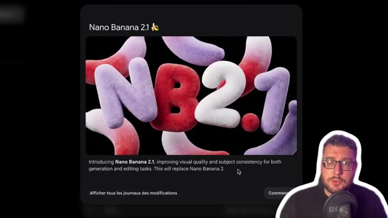  
  *⏱️ 00:00:01 — Présentation du modèle Nano Banana 2.1 avec une illustration textuelle 3D et sa description officielle.*
- 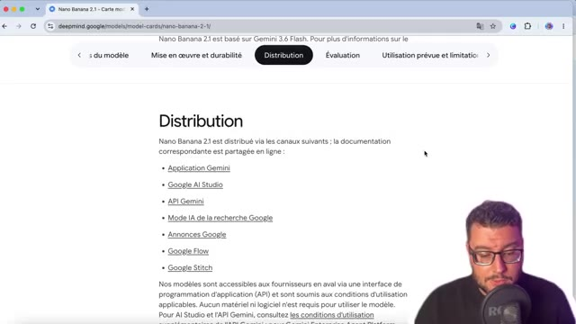  
  *⏱️ 00:00:10 — Documentation DeepMind sur la distribution de Nano Banana 2.1 listant les applications et plateformes compatibles.*
- 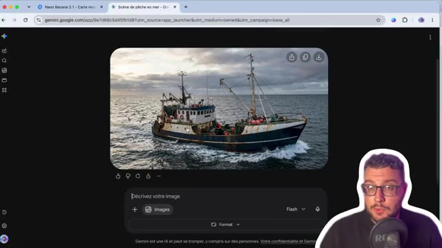  
  *⏱️ 00:00:19 — Interface de Google Gemini affichant une image générée d'un bateau de pêche en mer avec la barre de prompt.*

---

### ⏱️ `[00:00:21 - 00:00:43]` | Segment #02

**🔊 Audio (Transcription Intégrale Mot pour Mot en Français) :**
> La même chose en se rendant sur Google Flow. Alors, ce nouveau modèle, on nous annonce une légère évolution par rapport au précédent Google Nano Banana 2. Que ça soit dans le texte ou image, ou dans l'utilisation de référence, ou dans ses capacités d'édition, on voit à chaque fois sur les différentes catégories une légère amélioration, même si ce n'est pas un grand bond en avant.

**👁️ Analyse Visuelle d'Écran (gemini-3.5-flash-lite) :**
**Interface & Outils** : Google Flow, navigateur web affichant la documentation des modèles Google DeepMind.
**Contenu textuel & Code** : Menus de sélection de modèles (Nano Banana Pro, Lite, 2.1), tableaux comparatifs de performances text-to-image et d'édition.
**Action / Démonstration** : Le présentateur montre l'interface de sélection du modèle et parcourt la documentation officielle comparant les performances des versions de Google Nano Banana.

**Captures d'écran :**
- 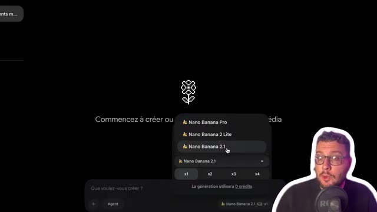  
  *⏱️ 00:00:22 — Interface de l'application de création avec un menu déroulant permettant de sélectionner différents modèles de génération comme Nano Banana 2.1.*
- 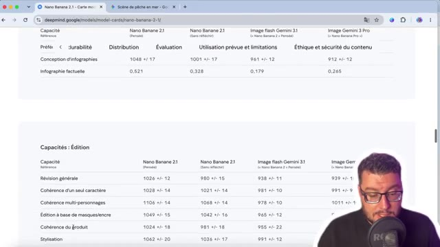  
  *⏱️ 00:00:32 — Page web de documentation Google DeepMind affichant un tableau comparatif détaillé des capacités d'édition des différents modèles.*
- 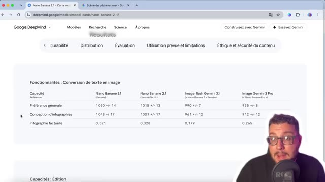  
  *⏱️ 00:00:41 — Page web de documentation Google DeepMind montrant les résultats d'évaluation pour la conversion de texte en image.*

---

### ⏱️ `[00:00:43 - 00:01:03]` | Segment #03

**🔊 Audio (Transcription Intégrale Mot pour Mot en Français) :**
> Du coup, j'ai voulu voir un petit peu ce qui changeait de mon côté. Une des premières bonnes nouvelles, c'est dans sa capacité d'édition à travers la même conversation. Par exemple, ici avec Google Flow, où on est passé d'une image, ici la voiture jaune dans un ciel bleu, avec la modification de la voiture en rouge, le changement du ciel pour que ça soit la nuit, l'ajout d'une caravane à la voiture.

**👁️ Analyse Visuelle d'Écran (gemini-3.5-flash-lite) :**
**Interface & Outils** : Navigateur web affichant l'interface de Google Flow (flow.google.com).
**Contenu textuel & Code** : Interface utilisateur avec aperçu d'image principale, panneau latéral d'historique de versions avec des vignettes textuelles ("une voiture jaune dans un ciel bleu", "ajoute une caravane à la voiture"), et barre de prompt "Que voulez-vous modifier ?".
**Action / Démonstration** : Le créateur montre et explique l'historique des modifications successives d'une image générée par IA au sein d'une même conversation.

**Captures d'écran :**
- 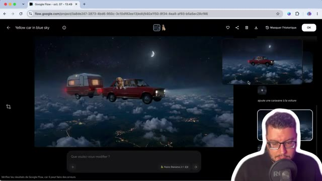  
  *⏱️ 00:00:44 — Interface de Google Flow montrant une version modifiée de l'image avec une voiture rouge, une caravane et un ciel nocturne étoilé.*
- 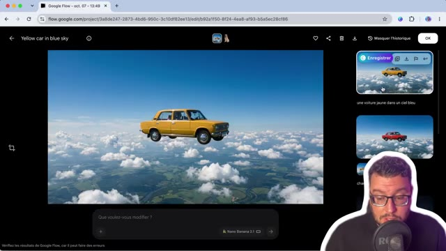  
  *⏱️ 00:00:53 — Interface de Google Flow montrant l'image initiale de la voiture jaune dans un ciel bleu au-dessus des nuages.*
- 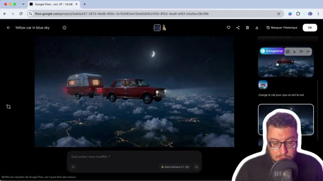  
  *⏱️ 00:01:01 — Interface de Google Flow affichant une étape intermédiaire de modification avec la voiture rouge et le ciel nocturne.*

---

### ⏱️ `[00:01:03 - 00:01:26]` | Segment #04

**🔊 Audio (Transcription Intégrale Mot pour Mot en Français) :**
> On voit qu'à chaque fois, on a la même cohérence et la qualité qui a été préservée à travers les différents designs. Ensuite, j'ai continué l'exercice en voulant ajouter ici une image référence extérieure, donc celle du chien, en indiquant que celui-ci sort la tête de la fenêtre. Là, par contre, le résultat est un petit peu moins bien, malgré le fait que le prompt a été compris perd tout de suite en réalisme.

**👁️ Analyse Visuelle d'Écran (gemini-3.5-flash-lite) :**
**Interface & Outils** : Google Chrome / Google Flow (interface web de génération d'images/vidéos).
**Contenu textuel & Code** : URL du projet Google Flow, visuel généré montrant une voiture rouge et une caravane volant dans un ciel nocturne étoilé avec un chien à la fenêtre, et incrustation vidéo du présentateur en bas à droite.
**Action / Démonstration** : Le créateur montre le résultat visuel obtenu après l'ajout d'une image de référence extérieure (le chien sortant la tête de la fenêtre).

**Captures d'écran :**
- 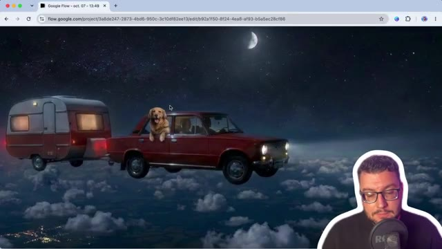  
  *⏱️ 00:01:24 — Interface du générateur Google Flow montrant une voiture volante tirant une caravane au-dessus des nuages avec un chien passant la tête par la fenêtre.*

---

### ⏱️ `[00:01:26 - 00:01:52]` | Segment #05

**🔊 Audio (Transcription Intégrale Mot pour Mot en Français) :**
> D'ailleurs si on va en détail dans la documentation les nouveautés qui sont mises en avant c'est une qualité visuelle et un réalisme amélioré pour les sorties que ce soit en 1K jusqu'à la 4K une correction des artefacts une amélioration du rang du texte surtout sur la mise en page d'infographie la fusion jusqu'à 14 images référence donc 4 personnages et 10 objets un ancrage à la recherche web et aux images de Google et un niveau de réflexion configurable donc minimum, médium et par défaut.

**👁️ Analyse Visuelle d'Écran (gemini-3.5-flash-lite) :**
**Interface & Outils** : Navigateur web affichant la documentation officielle de Google Gemini API (ai.google.dev).
**Contenu textuel & Code** : Texte descriptif listant les fonctionnalités : qualité visuelle 1K à 4K, correction des artefacts, amélioration du rendu du texte, fusion jusqu'à 14 images de référence.
**Action / Démonstration** : Le créateur présente et commente en direct la documentation officielle des nouveautés du modèle d'IA.

**Captures d'écran :**
- 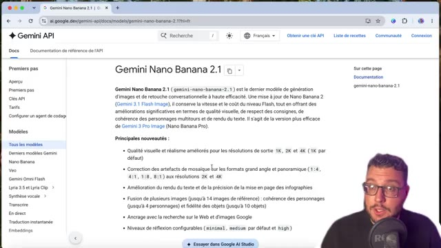  
  *⏱️ 00:01:27 — Page de documentation officielle de l'API Gemini présentant le modèle Gemini Nano Banana 2.1 et ses nouveautés.*
- 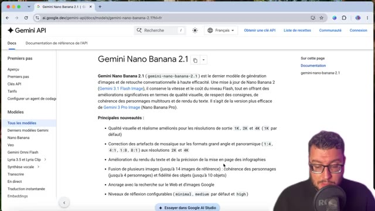  
  *⏱️ 00:01:39 — Vue rapprochée de la même page web de documentation technique de Gemini API avec le présentateur en médaillon.*
- 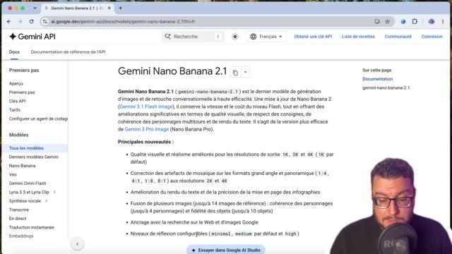  
  *⏱️ 00:01:50 — Vue complète de la page web montrant l'intégralité des points clés de mise à jour du modèle Gemini Nano Banana 2.1.*

---

### ⏱️ `[00:01:52 - 00:02:12]` | Segment #06

**🔊 Audio (Transcription Intégrale Mot pour Mot en Français) :**
> On va voir tout de suite maintenant avec des tests comparatifs. Et pour ça, je suis passé par la plateforme Xfield qui permet d'avoir les deux modèles en API. Donc tout d'abord, texte ou vidéo avec des prompts construits. Exemple ici avec un Jack Russell faisant du scooter. Ici donc, on est bien sur la version 2.1. Comparatif avec le même prompt sur la version 2.0.

**👁️ Analyse Visuelle d'Écran (gemini-3.5-flash-lite) :**
**Interface & Outils** : Navigateur web affichant la plateforme Higgsfield.ai, avec un panneau latéral d'informations et de prompt visible à droite.
**Contenu textuel & Code** : Vidéo générée montrant un chien Jack Russell en scooter, panneau avec le prompt textuel détaillé, et encadré jaune indiquant 'Banana 2.1' puis 'Banana 2'.
**Action / Démonstration** : Le créateur compare les résultats visuels obtenus par deux versions différentes du modèle d'IA via l'API de la plateforme Higgsfield.

**Captures d'écran :**
- 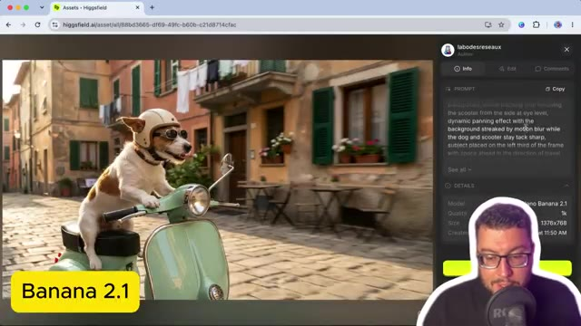  
  *⏱️ 00:02:02 — Interface de la plateforme Higgsfield montrant le résultat de génération vidéo avec le modèle 'Banana 2.1' pour un prompt de Jack Russell en scooter.*
- 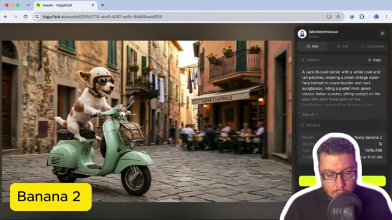  
  *⏱️ 00:02:11 — Interface de la plateforme Higgsfield montrant le comparatif de génération vidéo avec le modèle 'Nano Banana 2' pour le même prompt.*

---

### ⏱️ `[00:02:13 - 00:02:47]` | Segment #07

**🔊 Audio (Transcription Intégrale Mot pour Mot en Français) :**
> On voit qu'on a une qualité d'image similaire, mais peut-être une meilleure compréhension dans le sens où là on n'a pas le sentiment que le scooter est en mouvement malgré que l'arrière-plan est en flou et ici la scène donne plus de cohérence à noter aussi la lumière sur le poil du Jack Russell c'est un léger détail mais une image qui semble un tout petit peu supérieure j'ai voulu essayer aussi avec d'autres styles et surtout en ajoutant du texte puisque c'était une fonctionnalité qui était mise en avant donc ici on est sur 2.1 avec un étudiant qui doit copier au tableau je n'utiliserai pas l'IA dans un style animé

**👁️ Analyse Visuelle d'Écran (gemini-3.5-flash-lite) :**
**Interface & Outils** : Navigateur web affichant l'interface de Higgsfield AI (higgsfield.ai) et incrustation vidéo du créateur
**Contenu textuel & Code** : URL de Higgsfield, visuel d'un chien en scooter, étiquette 'Banana 2' (Image 1) ; visuel de style anime d'un élève écrivant 'Je n'utiliserai pas l'IA', panneau de prompt à droite, étiquette 'Banana 2.1' (Image 2)
**Action / Démonstration** : Le créateur présente et compare les résultats de différentes versions ou modèles de génération d'image/vidéo (Banana 2 vs Banana 2.1) en commentant les détails visuels.

**Captures d'écran :**
- 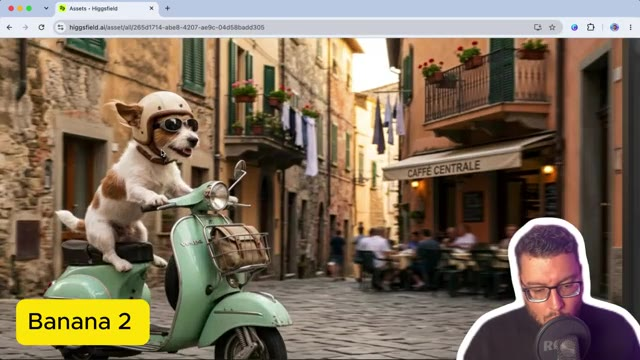  
  *⏱️ 00:02:14 — Interface du générateur montrant un Jack Russell en scooter avec l'encadré 'Banana 2'*
- 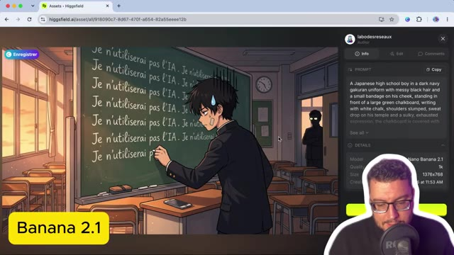  
  *⏱️ 00:02:46 — Interface du générateur montrant un élève écrivant au tableau avec l'encadré 'Banana 2.1' et le panneau de prompt visible à droite*

---

### ⏱️ `[00:02:47 - 00:03:20]` | Segment #08

**🔊 Audio (Transcription Intégrale Mot pour Mot en Français) :**
> la scène me convient sauf la place du tableau bien sûr puisqu'elle a été mis au milieu de la classe à noter qu'avec nano banana 2 on avait quelque chose qui était très bien aussi et peut-être même ici plus exploitable par rapport à vos 2.1 ici sur un style claymation en 2.1 avec un inspecteur qui interroge un serveur en fin de service là le détail qui me dérange un petit peu c'est l'inscription du café qui a été mal réalisé en arrière plan Par contre les détails de la scène derrière, on voit bien les tasses en fin de journée, le menu, la buée de fin de soirée avec l'éclairage, c'est pas trop mal.

**👁️ Analyse Visuelle d'Écran (gemini-3.5-flash-lite) :**
**Interface & Outils** : Navigateur web, interface de la plateforme Higgsfield (higgsfield.ai)
**Contenu textuel & Code** : Prompt textuel décrivant un inspecteur de police et un serveur en pâte à modeler, panneau des détails techniques indiquant le modèle "Nano Banana 2.1"
**Action / Démonstration** : Le créateur présente et analyse une image générée au style claymation en comparant les versions et les modèles d'IA.

**Captures d'écran :**
- 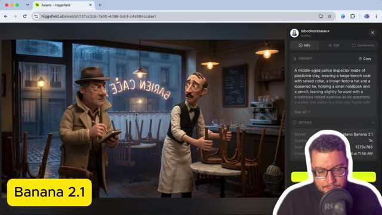  
  *⏱️ 00:03:04 — Affichage de l'interface de Higgsfield montrant une image au style claymation générée avec le modèle Nano Banana 2.1, illustrant un inspecteur interrogeant un serveur dans un café.*
- 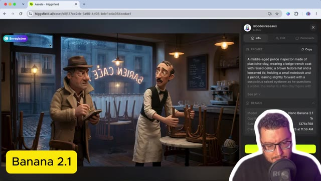  
  *⏱️ 00:03:19 — Vue similaire sur l'interface Higgsfield avec l'affichage du prompt complet détaillant la scène en pâte à modeler et les paramètres techniques du modèle Nano Banana 2.1.*

---

### ⏱️ `[00:03:21 - 00:03:46]` | Segment #09

**🔊 Audio (Transcription Intégrale Mot pour Mot en Français) :**
> Mais encore une fois ici sur du 2.0, on voit vraiment pas trop la différence. Et même ici il a bien réussi à mettre le café même si au dessus c'est illisible. Pareil en termes de détails d'arrière-plan, aucun souci, ça se vaut. Pour du photoréalisme, ici on est sur Nano Banana 2. et là je voulais que le personnage principal boit un matcha et qu'à côté il y ait un journal qui dit l'automne sera doux.

**👁️ Analyse Visuelle d'Écran (gemini-3.5-flash-lite) :**
**Interface & Outils** : Navigateur web, interface de la plateforme de génération d'images Higgsfield.ai, panneau latéral affichant les prompts et les détails des modèles (Nano Banana 2).
**Contenu textuel & Code** : Panneau latéral affichant le prompt descriptif ("A middle-aged police inspector...", "A young woman in her late twenties..."), dimensions (1376x768), modèle Nano Banana 2, et incrustation vidéo du créateur en bas à droite.
**Action / Démonstration** : Le créateur présente et commente les résultats visuels obtenus avec le modèle Nano Banana 2, en analysant la qualité des détails et le respect des prompts (café puis matcha).

**Captures d'écran :**
- 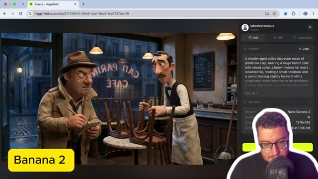  
  *⏱️ 00:03:22 — Interface du navigateur affichant le site Higgsfield avec l'image générée d'un inspecteur et d'un serveur dans un café, sous le modèle Nano Banana 2.*
- 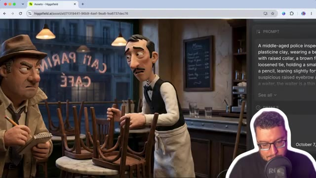  
  *⏱️ 00:03:33 — Vue rapprochée de la même scène générée, montrant les détails des personnages en pâte à modeler et le panneau du café en arrière-plan.*
- 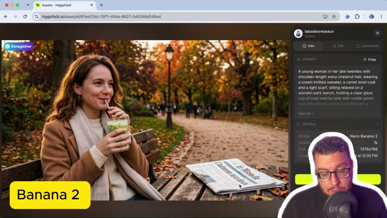  
  *⏱️ 00:03:44 — Interface de Higgsfield montrant une nouvelle image générée avec Nano Banana 2 représentant une femme buvant un matcha sur un banc de parc automnal.*

---

### ⏱️ `[00:03:46 - 00:04:08]` | Segment #10

**🔊 Audio (Transcription Intégrale Mot pour Mot en Français) :**
> Le problème c'est qu'ici on a un manque de cohérence puisque on ne sait pas où le banc commence et fini ou alors c'est une table, pas terrible. A noter qu'à chaque fois je fais seulement une seule génération et ça c'est sur Nano Banana 2.1 ou si le matcha latte est beaucoup plus respecté. Bon après sur la lumière c'est quasiment pareil par contre sur la mise en scène il a bien réussi à mettre le journal à côté.

**👁️ Analyse Visuelle d'Écran (gemini-3.5-flash-lite) :**
**Interface & Outils** : Navigateur web affichant l'interface de l'outil de génération d'IA (Higgsfield AI) et incrustation vidéo du créateur en bas à droite.
**Contenu textuel & Code** : Image générée d'une femme sur un banc avec un matcha latte, panneau latéral affichant le prompt descriptif complet et les détails du modèle (Nano Banana 2.1, résolution 1376x768).
**Action / Démonstration** : Le créateur présente et analyse le résultat visuel d'une génération d'image unique réalisée avec le modèle Nano Banana 2.1.

**Captures d'écran :**
-   
  *⏱️ 00:03:57 — Interface du générateur d'images affichant le résultat sur Nano Banana 2.1 avec le panneau latéral détaillant le prompt et le modèle utilisé.*
- 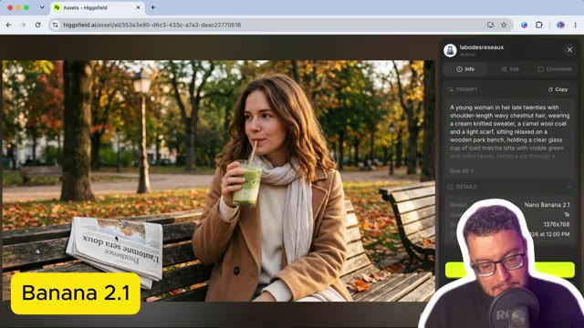  
  *⏱️ 00:04:07 — Vue similaire de l'interface du générateur d'images montrant le résultat de la génération avec le modèle Nano Banana 2.1.*

---

### ⏱️ `[00:04:08 - 00:04:31]` | Segment #11

**🔊 Audio (Transcription Intégrale Mot pour Mot en Français) :**
> Par contre, autant sur Nano Banana 2, j'avais le monde qui était indiqué. Ici, j'ai une marque de journal que je n'arrive pas à déchiffrer. Le titre est bien présent et c'est celui-ci qui était bien indiqué dans mon prompt. Donc texte ou image, on peut dire une très très légère évolution, pas une révolution. Par contre, il est annoncé que normalement, il est meilleur sur les images référence.

**👁️ Analyse Visuelle d'Écran (gemini-3.5-flash-lite) :**
**Interface & Outils** : Navigateur web avec l'interface de la plateforme Higgsfield (higgsfield.ai) et pastille vidéo du créateur.
**Contenu textuel & Code** : URL Higgsfield, panneau latéral avec les détails du prompt ("boit un café sur le vieux port à midi") et le modèle utilisé (Banana 2), badge "Banana 2".
**Action / Démonstration** : Analyse et comparaison par le créateur des résultats textuels et visuels générés par différents modèles d'IA sur Higgsfield.

**Captures d'écran :**
- 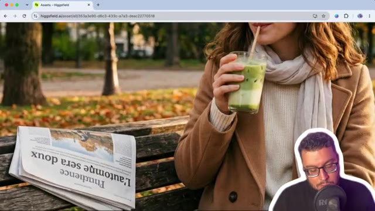  
  *⏱️ 00:04:09 — Image générée par IA montrant une femme buvant une boisson sur un banc avec un journal affichant le texte "L'automne sera doux".*
- 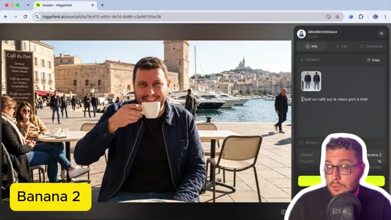  
  *⏱️ 00:04:29 — Interface de la plateforme Higgsfield montrant une image générée avec le modèle "Banana 2" où le créateur boit un café sur le vieux port.*

---

### ⏱️ `[00:04:31 - 00:04:52]` | Segment #12

**🔊 Audio (Transcription Intégrale Mot pour Mot en Français) :**
> On a tenté avec un prompt simple et une image référence d'une fiche personnage, donc la mienne, d'indiquer il boit un café sur le Vioport à midi. En termes de visage sur les modèles de Google, on a toujours un petit souci. On a toujours ces petits détails qui s'ajoutent. Donc là par exemple, si on zoom, terrasse synaptotique notre d'arbre, il s'est embrouillé à vouloir en faire trop.

**👁️ Analyse Visuelle d'Écran (gemini-3.5-flash-lite) :**
**Interface & Outils** : Navigateur web affichant l'outil Higgsfield AI.
**Contenu textuel & Code** : Fiche personnage multi-angles (portrait, face, dos, profil) du créateur, avec un panneau latéral affichant les détails du fichier (Source: Original Upload, Type: Image, Format: JPG) et l'incrustation vidéo du youtubeur en bas à droite.
**Action / Démonstration** : Le créateur présente une fiche personnage utilisée comme image de référence pour générer de nouvelles images par IA.

**Captures d'écran :**
- 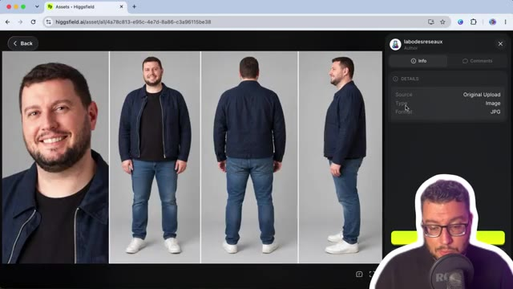  
  *⏱️ 00:04:32 — Capture d'écran de l'interface du générateur Higgsfield AI montrant une fiche personnage avec différentes vues (portrait, de face, de dos, de profil).*

---

### ⏱️ `[00:04:53 - 00:05:15]` | Segment #13

**🔊 Audio (Transcription Intégrale Mot pour Mot en Français) :**
> Le même prompt cette fois-ci avec 2.1. Et là j'ai été agréablement surpris. Même si encore on n'a pas un visage référence qui est à 100%, la composition est beaucoup plus agréable. avec une mise en scène et puis une lumière de midi qui fait beaucoup plus naturel. Donc ici, avantage à 2.1. Et je n'ai pas pu me retenir comme on est sur de l'image référence. De comparer aussi avec GPT 2.5, ici j'ai pris le modèle API Sunburst.

**👁️ Analyse Visuelle d'Écran (gemini-3.5-flash-lite) :**
**Interface & Outils** : Navigateur web affichant l'interface de la plateforme Higgsfield (higgsfield.ai) avec panneau latéral de détails et prompt.
**Contenu textuel & Code** : Prompt utilisateur 'il boit un café sur le vieux port à midi', avec les paramètres des modèles (Banana 2.1 et GPT 2.5 Sunburst) et le nom d'auteur 'labodesreseaux'.
**Action / Démonstration** : Le créateur présente et compare les résultats visuels obtenus entre différents modèles d'IA générative sur une même image de référence.

**Captures d'écran :**
- 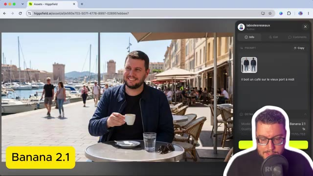  
  *⏱️ 00:04:54 — Interface du générateur Higgsfield affichant l'image générée avec le modèle Banana 2.1 et le prompt 'il boit un café sur le vieux port à midi'.*
- 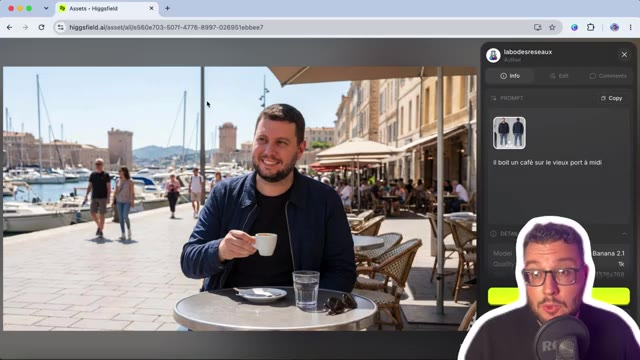  
  *⏱️ 00:05:04 — Vue continue de l'interface Higgsfield montrant le résultat du modèle Banana 2.1 avec l'encadré jaune de légende.*
- 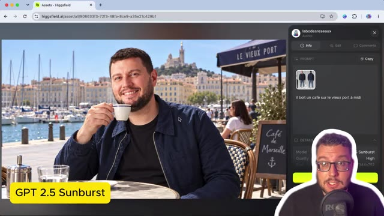  
  *⏱️ 00:05:14 — Interface Higgsfield affichant cette fois un résultat généré avec le modèle GPT 2.5 Sunburst sur le vieux port de Marseille.*

---

### ⏱️ `[00:05:16 - 00:05:38]` | Segment #14

**🔊 Audio (Transcription Intégrale Mot pour Mot en Français) :**
> Là, c'est vrai qu'en termes de référence visage, il est meilleur que les modèles Google. Et pareil en termes de texte, même si ici derrière, ça fait un petit peu IA, je n'ai pas de faute. Et donc pour de l'IA, j'ai un résultat quand même satisfaisant. Alors ensuite, on nous dit que le modèle est quand même plus intelligent et il arrive à comprendre mieux les consignes. Donc ici je l'ai testé dans une mise en situation, celle de la réalisation de la miniature de cette vidéo.

**👁️ Analyse Visuelle d'Écran (gemini-3.5-flash-lite) :**
**Interface & Outils** : Navigateur web, plateforme Higgsfield (higgsfield.ai).
**Contenu textuel & Code** : Image générée montrant le youtubeur tenant deux bananes avec le texte 'Nano Banana 2.1' en arrière-plan, et le panneau de prompt à droite détaillant les instructions de génération.
**Action / Démonstration** : Le créateur commente le résultat visuel généré par l'IA, notamment la gestion du texte et la fidélité des visages.

**Captures d'écran :**
- 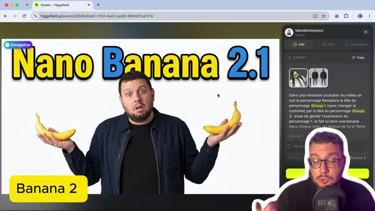  
  *⏱️ 00:05:36 — Interface du site Higgsfield affichant une image générée avec le texte 'Nano Banana 2.1' et le panneau de prompt latéral.*

---

### ⏱️ `[00:05:38 - 00:06:03]` | Segment #15

**🔊 Audio (Transcription Intégrale Mot pour Mot en Français) :**
> En commençant déjà par le modèle 2.0, donc le prompt dans une miniature YouTube, au milieu on voit le personnage, remplace la tête du personnage de l'image 1, pour la référence c'est David Goudeneuf, avec ma fiche caractère. Je ne veux pas qu'il change le costume, par contre il change la tête du personnage pour mettre celle du numéro 2, en essayant de garder l'expression du personnage 1, et en lui faisant tenir une banane dans chaque main avec le titre au-dessus, Nano Banana 2.1.

**👁️ Analyse Visuelle d'Écran (gemini-3.5-flash-lite) :**
**Interface & Outils** : Présentation orale ou séquence sans interface partagée.
**Contenu textuel & Code** : Explications et conseils de création de contenu / IA.
**Action / Démonstration** : Démonstration et mise en contexte pratique.

---

### ⏱️ `[00:06:04 - 00:06:23]` | Segment #16

**🔊 Audio (Transcription Intégrale Mot pour Mot en Français) :**
> On voit qu'avec Nano Banana 2, la consigne de garder le costume a pas été trop respectée. Pareil, les bananes pas trop sexy. La tête du personnage qui garde l'expression, ça va encore. Par contre, avec Nano Banana 2.1, on est un petit peu mieux, c'est-à-dire qu'on a bien le costume qui a été respecté et même en termes de composition, c'est beaucoup plus sympa.

**👁️ Analyse Visuelle d'Écran (gemini-3.5-flash-lite) :**
**Interface & Outils** : Navigateur web affichant l'interface de Higgsfield AI.
**Contenu textuel & Code** : Visuel généré avec le texte "NANO BANANA 2.1", un panneau latéral à droite affichant le prompt textuel et les images de référence utilisées ("@image 1", "@image 2").
**Action / Démonstration** : Le créateur présente le résultat visuel obtenu avec la version Nano Banana 2.1, mettant en avant le respect du costume et de la composition.

**Captures d'écran :**
- 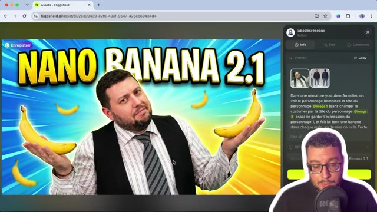  
  *⏱️ 00:06:21 — Capture d'écran montrant l'interface du générateur avec le résultat de Nano Banana 2.1 et le prompt utilisé.*

---

### ⏱️ `[00:06:23 - 00:06:49]` | Segment #17

**🔊 Audio (Transcription Intégrale Mot pour Mot en Français) :**
> Sur la tête, on a un peu un mix entre les deux têtes. et je refais le test avec GPT-image 2.5, Sunburst, et je trouve que c'est le résultat le plus original et la composition la plus réussie. D'ailleurs, je pense que je mettrai les deux miniatures en AB testing et je pense que c'est celle-ci qui va ressortir sur le long terme. Ce modèle 2.1, il va être intéressant dans l'utilisation des autres outils de Google comme YouTube, où on voit, on a une nouveauté maintenant, c'est demander à Studio ici.

**👁️ Analyse Visuelle d'Écran (gemini-3.5-flash-lite) :**
**Interface & Outils** : Navigateur web, Higgsfield, YouTube Studio
**Contenu textuel & Code** : Interface de génération d'image avec prompt textuel et aperçu de miniature YouTube ; tableau de bord YouTube Studio listant les vidéos de la chaîne.
**Action / Démonstration** : Le créateur montre le résultat de sa miniature générée et navigue sur YouTube Studio pour expliquer sa stratégie d'A/B testing.

**Captures d'écran :**
- 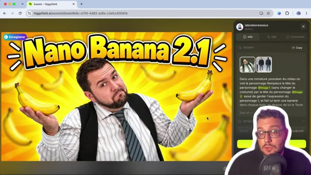  
  *⏱️ 00:06:36 — Aperçu d'une miniature YouTube générée par IA avec le titre "Nano Banana 2.1" et le panneau de prompt sur le côté.*
- 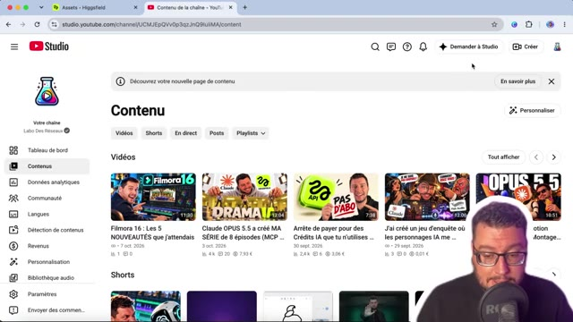  
  *⏱️ 00:06:48 — Capture du tableau de bord YouTube Studio montrant la gestion du contenu et des vidéos de la chaîne.*

---

### ⏱️ `[00:06:50 - 00:07:09]` | Segment #18

**🔊 Audio (Transcription Intégrale Mot pour Mot en Français) :**
> Et par exemple, on peut demander de créer notre miniature pour notre vidéo YouTube directement depuis la plateforme. Donc en utilisant Studio, tu demandes « Génère une miniature pour ma dernière vidéo longue ». Et ce que je trouve intéressant, c'est qu'on va avoir YouTube qui va analyser notre dernière vidéo et qui va directement nous proposer une miniature en tenant compte de la composition de la vidéo.

**👁️ Analyse Visuelle d'Écran (gemini-3.5-flash-lite) :**
**Interface & Outils** : YouTube Studio (Interface créateur, fonctionnalité 'Demander à Studio').
**Contenu textuel & Code** : Invite de commande : « Génère une miniature pour ma dernière vidéo longue », suivis des messages d'attente de l'IA.
**Action / Démonstration** : Le créateur utilise l'assistant IA intégré de YouTube Studio pour générer automatiquement une miniature basée sur sa dernière vidéo longue.

**Captures d'écran :**
- 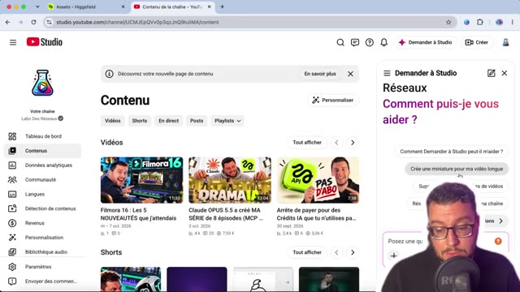  
  *⏱️ 00:06:51 — Vue globale du tableau de bord YouTube Studio avec le panneau latéral 'Demander à Studio' affichant la suggestion de prompt pour créer une miniature.*
-   
  *⏱️ 00:07:00 — Gros plan sur le panneau de chat de YouTube Studio montrant la validation du prompt et le message 'Obtention des détails spécifiques pour cette vidéo...'.*
- 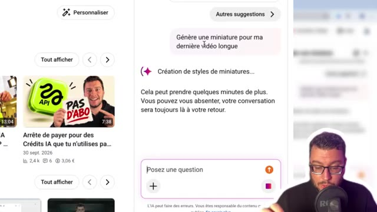  
  *⏱️ 00:07:08 — Gros plan sur le panneau de chat montrant la progression avec le message 'Création de styles de miniatures...' indiquant que l'analyse est en cours.*

---

### ⏱️ `[00:07:10 - 00:07:47]` | Segment #19

**🔊 Audio (Transcription Intégrale Mot pour Mot en Français) :**
> Donc généralement, reprendre notre tête en image référence et le sujet de la vidéo pour nous proposer quelque chose, ça permet d'avoir des propositions toutes prêtes. Alors ça ne vaut pas encore une miniature qu'on a travaillée de notre côté, mais franchement il y a une évolution. donc bon ma tête est pas parfaite mais il a compris le sujet de ma dernière vidéo, il m'a marqué un titre, il m'a mis les logos, il m'a mis le personnage principal et moi qui explique comment j'ai créé une vidéo sur les backrooms, donc voilà pas encore parfait mais à noter que ça commence vraiment à s'améliorer du côté de Google et de YouTube et que bientôt peut-être on aura la possibilité de générer des miniatures de très bonne qualité en automatique depuis notre compte YouTube.

**👁️ Analyse Visuelle d'Écran (gemini-3.5-flash-lite) :**
**Interface & Outils** : Navigateur web / Générateur d'images par IA.
**Contenu textuel & Code** : Miniature de vidéo YouTube avec le texte « SÉRIE IA », des visuels de personnages (smartphone et gros plan), des icônes d'applications et un panneau latéral de configuration ou de génération.
**Action / Démonstration** : Le créateur présente une proposition de miniature générée automatiquement en utilisant une image référence de son visage et le sujet de la vidéo.

**Captures d'écran :**
- 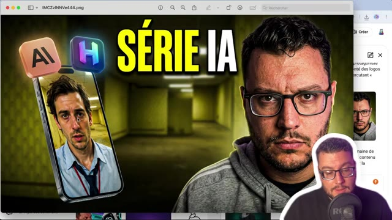  
  *⏱️ 00:07:28 — Aperçu d'une miniature générée par IA pour la vidéo « SÉRIE IA », montrant un visuel type Backrooms avec des personnages incrustés et des logos d'applications.*
-   
  *⏱️ 00:07:45 — Vue similaire sur la proposition de miniature générée par IA, accompagnée de l'incrustation vidéo du créateur dans le coin inférieur droit.*

---

### ⏱️ `[00:07:47 - 00:08:09]` | Segment #20

**🔊 Audio (Transcription Intégrale Mot pour Mot en Français) :**
> Retour sur nos tests pour tester le maximum d'entrées. Donc ici avec les 14 entrées. 13 objets plus ma fiche personnage. Pour les mettre en scène dans une composition originale. Donc les 14 objets sont là. Après la composition, j'ai une tête un petit peu bizarre je trouve. Plus le fait d'avoir les tableaux à côté. Là on est sur Nano Banana 2. Ça c'est le résultat que j'ai eu avec GPT Image 2.5 Sunburst.

**👁️ Analyse Visuelle d'Écran (gemini-3.5-flash-lite) :**
**Interface & Outils** : Navigateur web, interface de l'outil Higgsfield AI.
**Contenu textuel & Code** : Panneau latéral affichant le prompt « Met en scènes l'ensemble de ces images dans une composition originale » avec les vignettes des 14 objets source, et miniatures des résultats.
**Action / Démonstration** : Présentation des résultats de génération d'images avec le modèle Nano Banana 2 et comparaison des différentes compositions.

**Captures d'écran :**
- 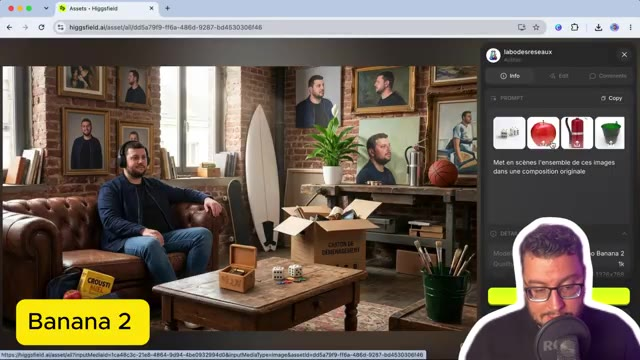  
  *⏱️ 00:07:48 — Affichage de l'interface de l'outil d'IA sur le navigateur avec une image générée montrant le créateur sur un canapé entouré de divers objets et tableaux au mur.*
- 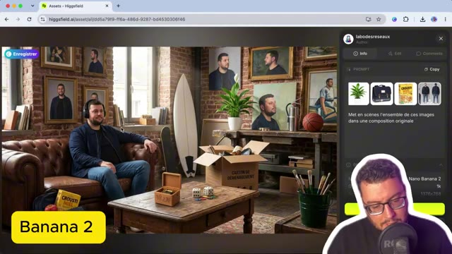  
  *⏱️ 00:07:58 — Nouvelle variante de l'image générée par le modèle d'IA affichée à l'écran, montrant une composition similaire dans le salon.*
- 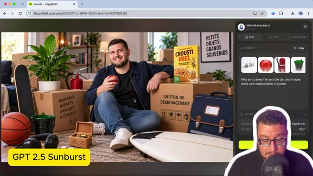  
  *⏱️ 00:08:08 — Autre génération d'image montrant le créateur au sol entouré de cartons de déménagement et d'objets divers avec l'étiquette 'GPT 2.5 Sunburst'.*

---

### ⏱️ `[00:08:10 - 00:08:43]` | Segment #21

**🔊 Audio (Transcription Intégrale Mot pour Mot en Français) :**
> Où la tête n'a pas du tout été prise en compte. Mais la composition, on voit encore que le modèle est très très fort. et sachant que lui il peut aller au delà de 14 images, et 2.1, encore une fois, le personnage n'est pas ressemblant à 100%, mais pour le coup ici la composition est beaucoup plus naturelle, vraiment pas trop mal. Et dernier exemple, là où Google annonce vraiment un gap, c'était sur tout ce qui était génération d'infographie, donc Nano Banana 2, ici sur une infographie sur la révolution française, on voit qu'il nous mélange le français et l'anglais, qu'on a quelque chose qui est pas terrible, ça c'est la version faite avec GPT Image 2.5 Sunburst,

**👁️ Analyse Visuelle d'Écran (gemini-3.5-flash-lite) :**
**Interface & Outils** : Navigateur web, interface de génération d'images (Higgsfield), webcam du présentateur en bas à droite.
**Contenu textuel & Code** : Prompt : "Une infographie expliquant la révolution française", paramètres du modèle (Nano Banana 2 / GPT Image 2.5 Flare).
**Action / Démonstration** : Le présentateur compare les différentes infographies générées par les modèles d'IA.

**Captures d'écran :**
- 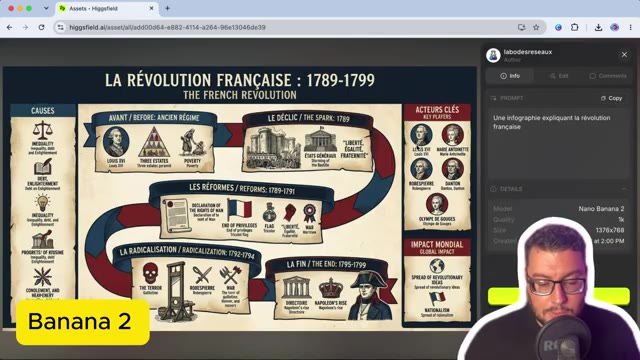  
  *⏱️ 00:08:27 — Interface d'un générateur affichant une infographie sur la Révolution française générée par le modèle Nano Banana 2.*
- 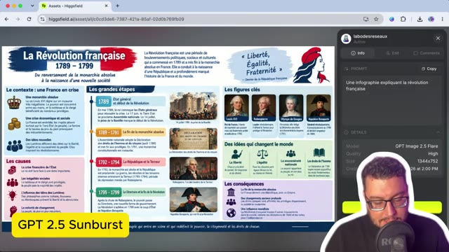  
  *⏱️ 00:08:42 — Interface du même générateur affichant une infographie alternative sur la Révolution française générée par le modèle GPT Image 2.5 Flare.*

---

### ⏱️ `[00:08:43 - 00:09:02]` | Segment #22

**🔊 Audio (Transcription Intégrale Mot pour Mot en Français) :**
> Très très complet, beaucoup de texte, peut-être un petit peu chargé mais au moins tout est là. Et ça c'est la version Nano Banana 2.1 et pour le coup je trouve vraiment pas mal. En termes de composition, en termes de lecture, tout est en français parfaitement, on n'a pas du mélange français-anglais. On a une logique qui est beaucoup plus claire donc vraiment à tester sur des infographies.

**👁️ Analyse Visuelle d'Écran (gemini-3.5-flash-lite) :**
**Interface & Outils** : Navigateur web, plateforme d'IA Higgsfield, panneau latéral de détails du prompt et du modèle.
**Contenu textuel & Code** : Infographie complète sur la Révolution française (1789-1799), texte en français, prompt « Une infographie expliquant la révolution française », modèle Nano Banana 2.1.
**Action / Démonstration** : Le créateur présente et analyse une infographie générée par IA en français, soulignant la qualité de la composition et du texte.

**Captures d'écran :**
- 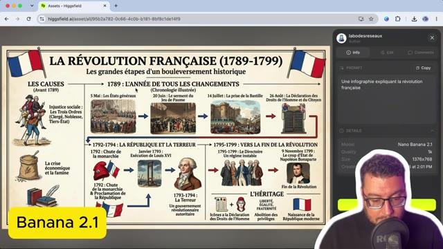  
  *⏱️ 00:08:53 — Interface d'un générateur affichant une infographie détaillée sur la Révolution française générée avec le modèle Nano Banana 2.1.*
- 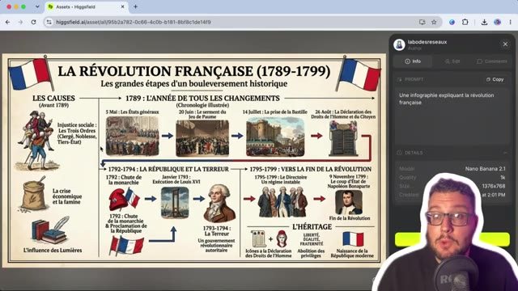  
  *⏱️ 00:09:01 — Vue similaire de l'infographie de la Révolution française avec le présentateur commentant le résultat à l'écran.*

---

### ⏱️ `[00:09:02 - 00:09:24]` | Segment #23

**🔊 Audio (Transcription Intégrale Mot pour Mot en Français) :**
> Je pense que c'est là que le modèle va prendre tout son sens et sera le meilleur. Voilà pour cette petite mise à jour. C'est un petit peu comme ce qu'on a eu avec le modèle vidéo Omni Flash 1.1. On est vraiment sur du léger ajustement. En attendant, je pense, les grosses annonces de Google et notamment Gemini 4 Argon qui devrait arriver prochainement accompagné de belles promesses.

**👁️ Analyse Visuelle d'Écran (gemini-3.5-flash-lite) :**
**Interface & Outils** : Navigateur web affichant une page officielle du blog Google.
**Contenu textuel & Code** : Titre 'Gemini 4 Argon : notre prochaine ère d'intelligence de pointe' avec un texte explicatif sur ses performances.
**Action / Démonstration** : Le présentateur commente l'annonce prochaine de ce nouveau modèle de Google en affichant l'article à l'écran.

**Captures d'écran :**
- 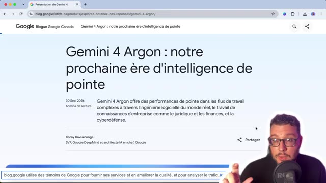  
  *⏱️ 00:09:13 — Affichage d'un article du Blog Google Canada intitulé 'Gemini 4 Argon : notre prochaine ère d'intelligence de pointe'.*
- 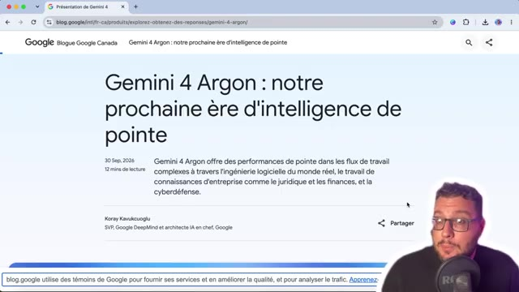  
  *⏱️ 00:09:22 — Vue similaire sur le même article de blog de Google présentant le futur modèle Gemini 4 Argon.*

---

### ⏱️ `[00:09:24 - 00:09:29]` | Segment #24

**🔊 Audio (Transcription Intégrale Mot pour Mot en Français) :**
> Merci d'avoir suivi cette vidéo. C'était Marco. Je te dis à très bientôt sur le Labo des Réseaux pour d'autres tutos.

**👁️ Analyse Visuelle d'Écran (gemini-3.5-flash-lite) :**
**Interface & Outils** : Présentation orale ou séquence sans interface partagée.
**Contenu textuel & Code** : Explications et conseils de création de contenu / IA.
**Action / Démonstration** : Démonstration et mise en contexte pratique.

---
