# 🎬 Filmora 16 : Les 5 NOUVEAUTÉS que j'attendais

> **Chaîne** : [Labo Des Réseaux](https://www.youtube.com/@labodesreseaux)  
> **Lien YouTube** : [https://www.youtube.com/watch?v=4mhrPQfCkJk](https://www.youtube.com/watch?v=4mhrPQfCkJk)  
> **Date de publication** : 20261009  
> **Durée** : 11:29  
> **Identifiant vidéo** : `4mhrPQfCkJk`  
> **Modèles** : Audio: `whisper-v3-large-turbo` | Vision: `gemini-3.5-flash-lite`  

---

## 📌 Synthèse Exécutive & Outils

### 💡 Résumé
**La vidéo de la chaîne « Labo Des Réseaux » propose une exploration approfondie de Filmora 16, la toute dernière version du célèbre logiciel de montage vidéo de Wondershare.** L'analyste y met en avant une dizaine de nouveautés majeures conçues pour optimiser drastiquement le flux de travail des créateurs de contenu, en mettant l'accent sur le gain de temps et l'accroissement des libertés créatives et d'édition.

**À travers des cas pratiques basés sur des projets de danse et de tutoriels, le créateur démontre l'efficacité concrète de fonctionnalités clés telles que l'analyse média par intelligence artificielle, les dossiers multimédias intelligents et le suivi de caméra automatisé.** Ces outils permettent de transformer des tâches chronophages — comme le tri des rushes ou le recadrage dynamique — en actions instantanées, tout en propulsant la précision du montage à un niveau supérieur.

**En conclusion, l'adoption de Filmora 16 s'avère particulièrement stratégique pour les monteurs cherchant à allier rapidité et professionnalisme.** Les options avancées de masques de couleur, d'animations combinées et de correction intelligente de texte confirment que le logiciel s'adresse aussi bien aux débutants qu'aux créateurs exigeants souhaitant dynamiser leurs productions sans alourdir leur charge de travail.

### 🛠️ Outils, Modèles & Logiciels Présentés
- **Filmora 16** (Logiciel de montage vidéo principal par Wondershare)**
- **Analyse média par IA** (Outil d'indexation automatique de fichiers et de génération de mots-clés)**
- **Dossier multimédia intelligent** (Fonction d'organisation par règles conditionnelles)**
- **Outil de cadrage et de suivi automatique** (Suivi de caméra par tête, corps ou personnalisé)**
- **Masque de couleur et Calque d'étalonnage** (Outils de correction colorimétrique localisée avec formes géométriques)**
- **Menu Animation (Option Combo)** (Application d'animations d'entrée et de sortie combinées sur la durée totale d'un clip)**
- **Correction intelligente du texte** (Fonction d'automatisation et de correction des sous-titres et légendes dynamiques)**
- **Enregistreur d'écran et multi-écran PC** (Outil intégré pour le streaming, la capture de jeux, de voix off et de webcam)**

### 🔑 Points Clés & Enseignements Stratégiques
- Gain de temps au dérochage** : L'analyse média par IA permet d'analyser des dizaines de fichiers en un clic pour générer automatiquement des noms, durées, mots-clés, descriptions de scènes et suggestions de montage.
- Recherche textuelle optimisée** : Grâce aux tags générés par l'IA, il devient possible de retrouver instantanément des plans précis dans sa bibliothèque en tapant de simples mots-clés (ex: "danse").
- Organisation automatisée des rushes** : La création de dossiers multimédias intelligents permet de trier les fichiers selon des critères stricts (nom, résolution, type ou images par seconde) pour alimenter la timeline en un clin d'œil.
- Suivi de caméra intelligent** : L'outil de suivi automatique (tête, corps ou personnalisé) simplifie le tracking des sujets en mouvement et s'avère indispensable pour les réajustages en format vertical (9:16).
- Étalonnage ciblé par masques** : L'utilisation de calques d'étalonnage géométriques (rectangles, ellipses ou formes libres) permet d'appliquer des filtres ou des ambiances colorimétriques uniquement sur une zone spécifique de l'image.
- Créativité accrue avec les animations combo** : L'option d'animation combinée permet de lier des mouvements (comme une rotation) sur toute la longueur d'une vidéo ou de les positionner précisément au cœur d'une séquence charnière.
- Correction de texte automatisée** : La fonction de correction intelligente évite des heures de relecture sur les sous-titres longs, couplée à des modèles dynamiques variés (rétro, surlignage, lueur, etc.).
- Studio d'enregistrement intégré** : L'outil de capture d'écran, de jeux vidéo, de webcam et de multi-écran PC intégré à Filmora 16 facilite grandement la création de tutoriels et de contenus live sans recourir à des logiciels tiers.
- Flexibilité de mise à niveau** : Les utilisateurs disposant déjà d'une version précédente de Filmora peuvent effectuer une mise à jour directe vers la version 16 depuis l'interface du logiciel.
- Modèle d'essai et licences** : Filmora 16 propose une version d'essai gratuite avec filigrane (watermark) et s'articule autour de différentes offres d'abonnement adaptées aux besoins des monteurs.

---

## ⏱️ Chronologie & Transcription Complète Audio & Visuelle (Mot pour Mot)

### ⏱️ `[00:00:00 - 00:00:20]` | Segment #01

**🔊 Audio (Transcription Intégrale Mot pour Mot en Français) :**
> Filmora vient de lancer sa toute nouvelle version Filmora 16. Avec celle-ci, une dizaine de nouvelles fonctionnalités voient le jour. Exemple, ici c'était les dossiers de rush que je devais trier avant Filmora 16. Et maintenant, avec cette nouvelle version, ça se fait en un seul clic. C'est d'ailleurs un petit peu la thématique commune à toutes ces nouvelles fonctionnalités.

**👁️ Analyse Visuelle d'Écran (gemini-3.5-flash-lite) :**
**Interface & Outils** : Explorateur de fichiers macOS (Finder)
**Contenu textuel & Code** : Fichiers vidéo au format .mp4 (ex: 2248534-uhd_3840_2160_24fps.mp4), création et renommage d'un dossier
**Action / Démonstration** : Le créateur montre un dossier de rushs non triés avant l'utilisation des fonctionnalités de Filmora 16.

**Captures d'écran :**
- 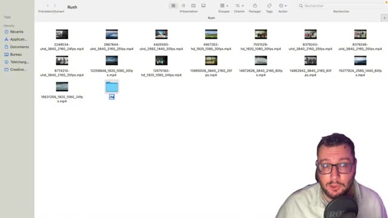  
  *⏱️ 00:00:10 — Le dossier 'Rush' du système d'exploitation avec de multiples fichiers vidéo et un dossier en cours de tri par le créateur.*

---

### ⏱️ `[00:00:20 - 00:00:43]` | Segment #02

**🔊 Audio (Transcription Intégrale Mot pour Mot en Français) :**
> Elles vont notamment nous permettre de gagner beaucoup de temps, mais il y a aussi des nouvelles fonctionnalités qui nous permettent d'avoir encore plus la main côté édition et côté aussi créativité. Justement, dans cette vidéo, je te propose qu'on explore ensemble 5 nouveautés que j'ai sélectionnées et qui vont s'intégrer parfaitement à ton workflow. Et on va voir via des exemples complets comment moi j'ai adopté ces nouvelles fonctionnalités à travers mes différents projets.

**👁️ Analyse Visuelle d'Écran (gemini-3.5-flash-lite) :**
**Interface & Outils** : Navigateur web affichant le site officiel de Wondershare Filmora (filmora.wondershare.fr).
**Contenu textuel & Code** : Menus de navigation du site Wondershare Filmora avec les boutons "Télécharger gratuitement" et "Voir les tarifs et les offres".
**Action / Démonstration** : Le créateur introduit les nouvelles fonctionnalités du logiciel de montage Filmora et navigue sur le site officiel.

**Captures d'écran :**
- 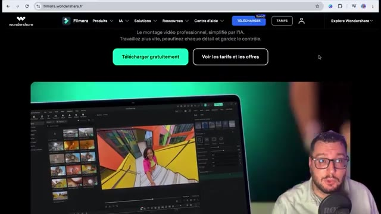  
  *⏱️ 00:00:32 — Le présentateur présente le site web de Wondershare Filmora montrant l'interface du logiciel de montage vidéo.*
- 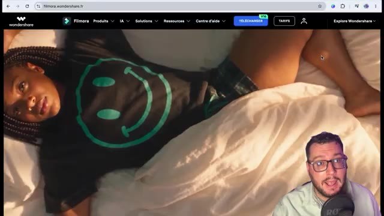  
  *⏱️ 00:00:42 — Le site web de Wondershare Filmora affiche une vidéo promotionnelle en arrière-plan avec le présentateur en incrustation.*

---

### ⏱️ `[00:00:43 - 00:01:03]` | Segment #03

**🔊 Audio (Transcription Intégrale Mot pour Mot en Français) :**
> Pour rappel, tu peux télécharger et essayer gratuitement Filmora 16 en passant par le lien disponible en description et en commentaire épinglé. Ensuite, si le logiciel te plaît, il te faudra une licence pour pouvoir télécharger 100 watermarks. Tu as différents abonnements avec différents offres qui sont proposées. Je te laisse parcourir celui qui t'ira le mieux.

**👁️ Analyse Visuelle d'Écran (gemini-3.5-flash-lite) :**
**Interface & Outils** : Navigateur web affichant le site officiel de Wondershare Filmora.
**Contenu textuel & Code** : Textes de présentation de Filmora 16, boutons « Télécharger gratuitement » et « Voir les tarifs », ainsi que les différentes offres d'abonnement (Plan Premium Annuel, Trimestriel, Perpétuel).
**Action / Démonstration** : Le présentateur montre les différentes options de téléchargement et présente les offres d'abonnements disponibles pour le logiciel.

**Captures d'écran :**
- 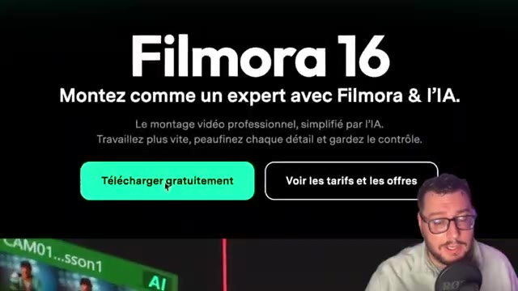  
  *⏱️ 00:00:44 — Page d'accueil officielle de Filmora 16 avec les options de téléchargement et de tarification.*
- 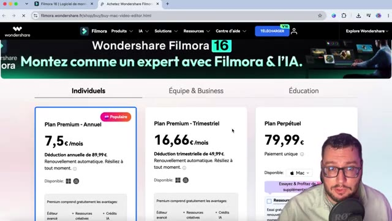  
  *⏱️ 00:00:53 — Grille tarifaire de Wondershare Filmora montrant les abonnements Individuels, Équipe & Business, et Éducation.*
- 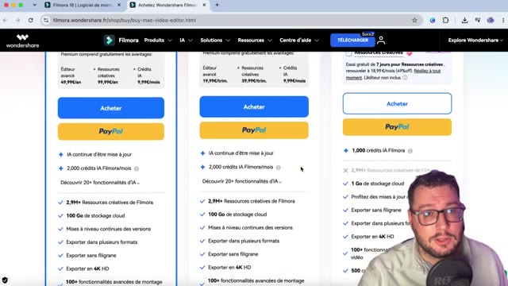  
  *⏱️ 00:01:01 — Suite de la page des tarifs avec le détail des fonctionnalités incluses dans chaque formule d'abonnement.*

---

### ⏱️ `[00:01:03 - 00:01:25]` | Segment #04

**🔊 Audio (Transcription Intégrale Mot pour Mot en Français) :**
> Et petite info, si tu as déjà Filmora installé sur ton ordinateur, tu peux mettre à jour la version Filmora 16 en te rendant juste ici et en téléchargeant cette dernière mise à jour. On va donc commencer avec un outil qui va nous aider dans le dérochage. Ça va être l'analyse média par IA. Alors ici, j'ai uploadé les différents plans que je vais utiliser pour mon projet.

**👁️ Analyse Visuelle d'Écran (gemini-3.5-flash-lite) :**
**Interface & Outils** : Wondershare Filmora (interface de démarrage et espace de montage)
[DESC_IMAGE_3] Notification de mise à jour vers Filmora 16 et grille de clips média dans l'espace de travail du logiciel.
**Contenu textuel & Code** : Explications et conseils de création de contenu / IA.
**Action / Démonstration** : Le créateur montre comment mettre à jour le logiciel et présente l'interface avec les fichiers multimédias importés pour l'analyse par IA.

**Captures d'écran :**
- 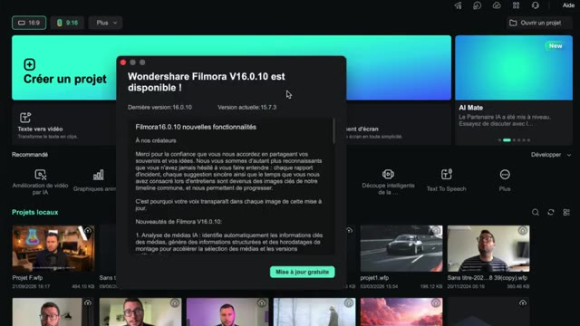  
  *⏱️ 00:01:14 — Fenêtre de notification de Wondershare Filmora V16.0.10 affichant les nouveautés et la possibilité d'effectuer une mise à jour gratuite.*
- 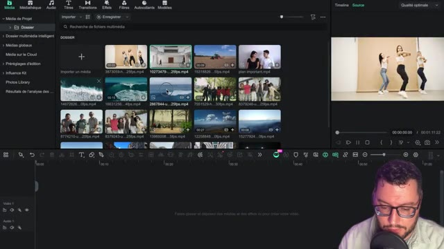  
  *⏱️ 00:01:23 — Interface principale du logiciel Filmora avec le chutier contenant différents clips vidéo importés et la timeline en bas.*

---

### ⏱️ `[00:01:25 - 00:01:43]` | Segment #05

**🔊 Audio (Transcription Intégrale Mot pour Mot en Français) :**
> On peut voir qu'il y en a beaucoup. Mais maintenant, on va pouvoir, en sélectionnant les plans souhaités, donc ici, je vais mettre l'ensemble de mes plans, faire un clic droit et aller dans la nouveauté, analyser les médias paris. Ici, ça me coûtera un petit peu en crédit. On voit que les 18 fichiers ont été analysés.

**👁️ Analyse Visuelle d'Écran (gemini-3.5-flash-lite) :**
**Interface & Outils** : Filmora (logiciel de montage vidéo)
**Contenu textuel & Code** : Bibliothèque de clips vidéo, menu contextuel avec l'option "Analyse des médias par IA", et panneau des tâches en cours.
[DESC_IMAGE_3] Le créateur montre l'utilisation de l'outil d'analyse par IA sur l'ensemble des plans sélectionnés.
**Action / Démonstration** : Démonstration et mise en contexte pratique.

**Captures d'écran :**
- 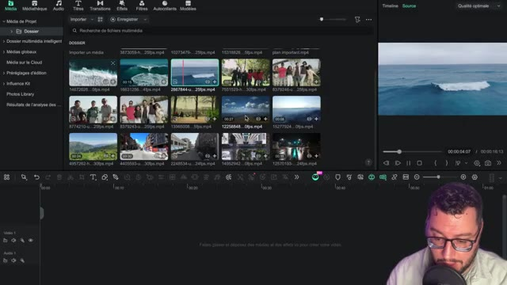  
  *⏱️ 00:01:26 — Interface du logiciel de montage affichant la bibliothèque de médias contenant plusieurs clips vidéo.*
- 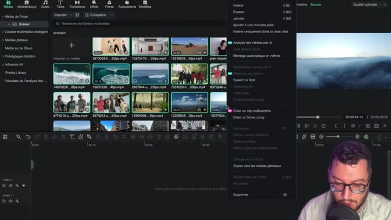  
  *⏱️ 00:01:34 — Menu contextuel ouvert sur un clic droit, mettant en avant l'option d'analyse des médias par IA.*
- 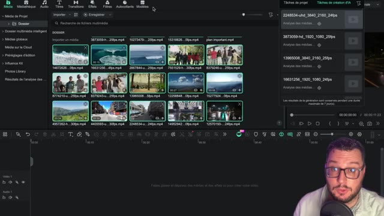  
  *⏱️ 00:01:41 — Panneau latéral affichant les tâches de création et l'analyse des médias en cours de traitement.*

---

### ⏱️ `[00:01:43 - 00:02:03]` | Segment #06

**🔊 Audio (Transcription Intégrale Mot pour Mot en Français) :**
> Et maintenant, si je vais dans résultat de l'analyse des fichiers, on va voir ici l'ensemble de ceux-ci, où nous avons le nom, la durée, mais surtout les mots-clés. et si on se balade, le sujet principal, la scène, est une description de ce qui se passe, ainsi qu'une suggestion de montage.

**👁️ Analyse Visuelle d'Écran (gemini-3.5-flash-lite) :**
**Interface & Outils** : Wondershare Filmora (Résultats de l'analyse des fichiers)
**Contenu textuel & Code** : Tableaux avec colonnes Progression, Média, Nom, Durée, Mots-clés, Sujet principal, Scène/lieu, Description et Suggestions de montage.
**Action / Démonstration** : Le présentateur parcourt l'interface pour montrer les métadonnées et analyses automatiques générées pour chaque fichier vidéo.

**Captures d'écran :**
- 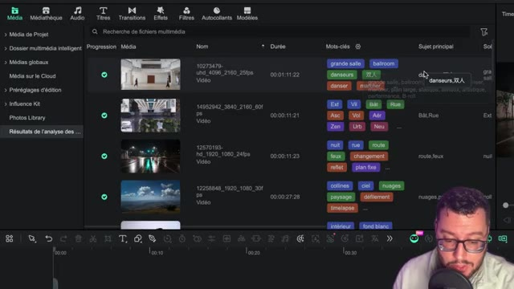  
  *⏱️ 00:01:53 — Affichage des résultats de l'analyse des fichiers multimédias avec les colonnes de progression, noms, durées et mots-clés associés.*
- 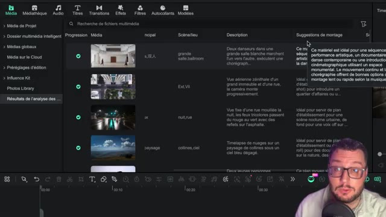  
  *⏱️ 00:02:01 — Navigation dans le tableau pour afficher les colonnes détaillant le sujet principal, la scène/lieu, la description et les suggestions de montage.*

---

### ⏱️ `[00:02:03 - 00:02:36]` | Segment #07

**🔊 Audio (Transcription Intégrale Mot pour Mot en Français) :**
> Par exemple, pour la première scène avec mes danseurs, j'ai grande salle, danseurs, danser, deux danseurs dans une grande salle blanche qui marchent l'un vers l'autre et exécutent une chorégraphie, parfait. Et ce matériel est idéal pour une séquence de performance artistique, un documentaire sur la danse contemporaine. C'est génial. Donc par exemple maintenant, si j'ai besoin de retrouver mes plans par rapport à la danse, je peux aller ici dans la recherche et taper le mot clé danse pour ainsi avoir les deux vidéos qui comportent les tags et le sujet de la danse.

**👁️ Analyse Visuelle d'Écran (gemini-3.5-flash-lite) :**
**Interface & Outils** : Présentation orale ou séquence sans interface partagée.
**Contenu textuel & Code** : Explications et conseils de création de contenu / IA.
**Action / Démonstration** : Démonstration et mise en contexte pratique.

---

### ⏱️ `[00:02:36 - 00:03:04]` | Segment #08

**🔊 Audio (Transcription Intégrale Mot pour Mot en Français) :**
> Ainsi, j'ai une deuxième vidéo qui s'affiche juste ici. Et c'est exactement ça. On voit que nous avons une vidéo d'une durée de 3 secondes dans un studio fond beige avec des danseuses et la description des 3 femmes en tenue qui sont en train de faire une chorégraphie. Donc ça, c'est vraiment très très bien si en tout notre dossier qu'il n'a pas été trié et en une seule seconde, l'IA nous met des tags, des descriptions et on va pouvoir retrouver au fur et à mesure nos plans pour pouvoir faire notre séquence de montage.

**👁️ Analyse Visuelle d'Écran (gemini-3.5-flash-lite) :**
**Interface & Outils** : Logiciel de montage vidéo (type Wondershare Filmora avec panneau Média et recherche textuelle).
**Contenu textuel & Code** : Panneau de recherche avec le terme "danse", affichant deux clips vidéo avec leurs descriptions détaillées ("Trois femmes en tenue...").
**Action / Démonstration** : Le créateur montre la fonction d'analyse automatique des médias et de description textuelle des vidéos.

**Captures d'écran :**
- 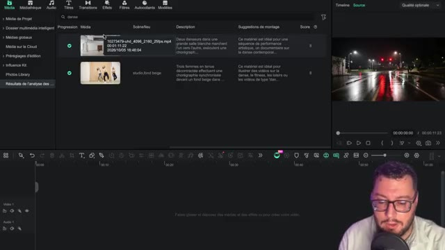  
  *⏱️ 00:03:03 — Interface du logiciel montrant les résultats d'analyse des médias avec la description des clips vidéo.*

---

### ⏱️ `[00:03:04 - 00:03:31]` | Segment #09

**🔊 Audio (Transcription Intégrale Mot pour Mot en Français) :**
> A noter aussi qu'on a une petite nouveauté qui nous permet de ne pas passer par l'IA, qui se trouve ici, dossier multimédia intelligent. Ce petit menu va nous permettre de créer des dossiers manuellement, mais ici en fait ce qu'on va faire c'est que par exemple, on va créer ici danse, et après on va automatiquement lier l'ensemble des fichiers qui soit contiennent le mot danse avec une règle.

**👁️ Analyse Visuelle d'Écran (gemini-3.5-flash-lite) :**
**Interface & Outils** : Interface de l'application de montage vidéo Wondershare Filmora.
**Contenu textuel & Code** : Fenêtre modale "Nouveau dossier multimédia intelligent" avec options de nommage et critères de correspondances (Nom de fichier, Content, etc.).
**Action / Démonstration** : Le créateur renomme le dossier intelligent pour y lier automatiquement les fichiers correspondants.

**Captures d'écran :**
- 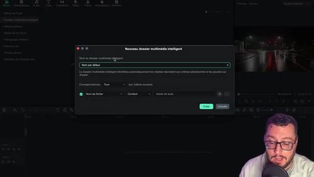  
  *⏱️ 00:03:17 — Fenêtre de création d'un "Nouveau dossier multimédia intelligent" avec le nom par défaut.*
- 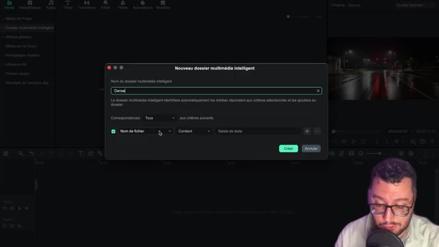  
  *⏱️ 00:03:29 — Le même menu de création de dossier intelligent avec le nom "Danse" saisi par le créateur.*

---

### ⏱️ `[00:03:31 - 00:03:51]` | Segment #10

**🔊 Audio (Transcription Intégrale Mot pour Mot en Français) :**
> Donc par exemple ici, si on a nom du fichier contient dense, on pourra créer pour avoir ainsi notre fichier qui s'est mis automatiquement. Donc j'avais juste un seul de mes roches qui s'appelait dense, il est arrivé ici. Mais par exemple, imaginons, je crée un nouveau dossier intelligent et ici en fait, je vais l'appeler FPS.

**👁️ Analyse Visuelle d'Écran (gemini-3.5-flash-lite) :**
**Interface & Outils** : Logiciel de montage vidéo (Wondershare Filmora)
**Contenu textuel & Code** : Dossier intelligent 'Danse', fichier vidéo 'danse.mp4', aperçu vidéo à droite et le présentateur en incrustation en bas à droite.
**Action / Démonstration** : Le créateur montre le fonctionnement d'un dossier intelligent qui trie automatiquement les fichiers en fonction de leur nom.

**Captures d'écran :**
- 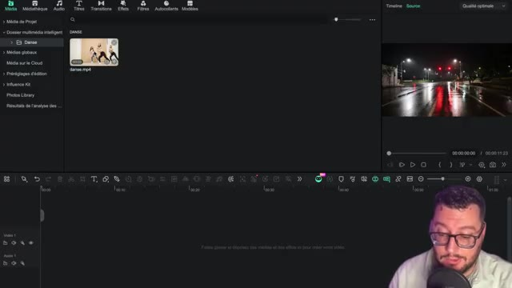  
  *⏱️ 00:03:41 — Interface du logiciel montrant le dossier multimédia intelligent 'Danse' avec un fichier vidéo importé automatiquement.*

---

### ⏱️ `[00:03:52 - 00:04:15]` | Segment #11

**🔊 Audio (Transcription Intégrale Mot pour Mot en Français) :**
> Et je vais choisir cette fois-ci parmi toutes les options disponibles. Donc on a type, durée, résolution, image par seconde. on va prendre image par seconde et on va choisir tous nos fichiers qui sont en 24 fps. Ou on peut dire n'est pas en 24 fps pour avoir les autres ou même ici régler les fps. Bien sûr, on peut aussi additionner des règles pour pouvoir avoir des dossiers intelligents un petit peu plus complets.

**👁️ Analyse Visuelle d'Écran (gemini-3.5-flash-lite) :**
**Interface & Outils** : DaVinci Resolve, fenêtre de création de dossier multimédia intelligent
**Contenu textuel & Code** : Menus déroulants de critères (Nom de fichier, Type, Durée, Résolution, Images par seconde, etc.) et champs de configuration conditionnelle.
**Action / Démonstration** : Le créateur configure les règles de filtrage intelligent basées sur la fréquence d'images (fps) des médias.

**Captures d'écran :**
- 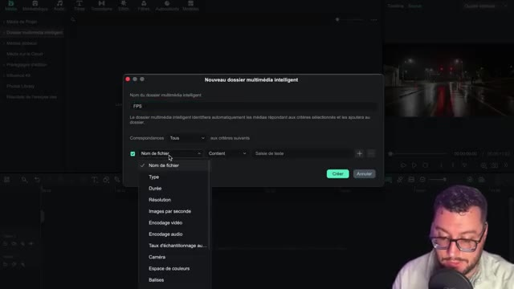  
  *⏱️ 00:03:53 — Sélection du critère 'Images par seconde' dans le menu déroulant du dossier multimédia intelligent de DaVinci Resolve.*
- 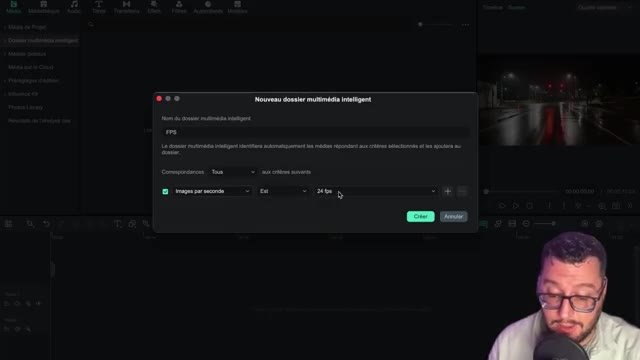  
  *⏱️ 00:04:04 — Configuration de la règle sur les images par seconde fixée à 24 fps.*
- 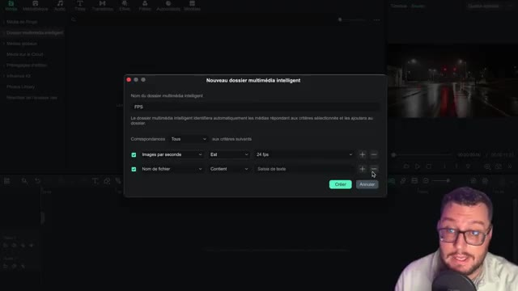  
  *⏱️ 00:04:14 — Ajout d'une règle supplémentaire en cliquant sur le bouton plus pour cumuler les critères de filtrage.*

---

### ⏱️ `[00:04:16 - 00:04:36]` | Segment #12

**🔊 Audio (Transcription Intégrale Mot pour Mot en Français) :**
> Si je fais ça, j'aurai ainsi la vidéo qui est en 24 fps qui s'affiche directement en raccourci et je pourrai ainsi la charger sur ma timeline. Une façon donc simple de s'organiser manuellement pour gagner du temps ou encore plus simple avec l'IA qui nous permet d'aller très très vite et d'utiliser ainsi des mots-clés pour avoir ce qu'on souhaite en un seul clic.

**👁️ Analyse Visuelle d'Écran (gemini-3.5-flash-lite) :**
**Interface & Outils** : Logiciel de montage vidéo (type Filmora) avec panneau de médias, timeline et écran de prévisualisation.
**Contenu textuel & Code** : Dossiers multimédias, fichiers vidéo 24 fps, timeline de montage et onglet "Résultats de l'analyse des..." avec des descriptions de scènes.
**Action / Démonstration** : Le créateur montre comment charger un fichier vidéo dans la timeline puis utilise une fonction de recherche par IA basée sur des mots-clés.

**Captures d'écran :**
- 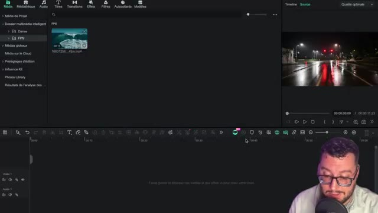  
  *⏱️ 00:04:17 — Interface du logiciel de montage affichant un chutier avec un dossier FPS et une vidéo de vagues.*
- 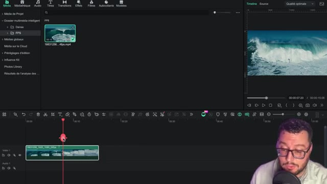  
  *⏱️ 00:04:26 — La vidéo de vagues sélectionnée est maintenant positionnée sur la timeline principale du logiciel.*
- 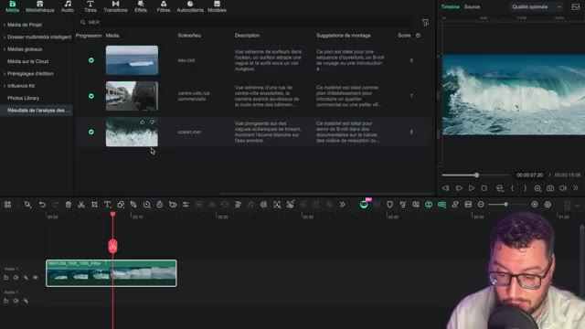  
  *⏱️ 00:04:35 — Affichage des résultats d'analyse intelligente par IA avec des suggestions de montage basées sur des mots-clés.*

---

### ⏱️ `[00:04:37 - 00:05:04]` | Segment #13

**🔊 Audio (Transcription Intégrale Mot pour Mot en Français) :**
> Ensuite, revenons sur notre projet qui était en lien avec la danse. Donc ici sur notre timeline, on a chargé notre projet et justement ici, on va utiliser une nouveauté que j'attendais personnellement. C'est l'outil de cadrage et de suivi automatique. C'est-à-dire que si je fais double clic sur ma timeline, j'arrive sur mon menu vidéo et dans le menu suivi, je vais avoir le suivi de caméra qui va être disponible.

**👁️ Analyse Visuelle d'Écran (gemini-3.5-flash-lite) :**
**Interface & Outils** : Interface du logiciel de montage vidéo Wondershare Filmora.
**Contenu textuel & Code** : Menus de recherche de médias, timeline de montage et panneau de réglages 'Suivi' avec les options 'Suivi de la caméra', 'Tête' et 'Corps'.
**Action / Démonstration** : Le créateur importe un projet lié à la danse sur la timeline et accède au menu vidéo pour présenter l'outil de cadrage et de suivi automatique.

**Captures d'écran :**
- 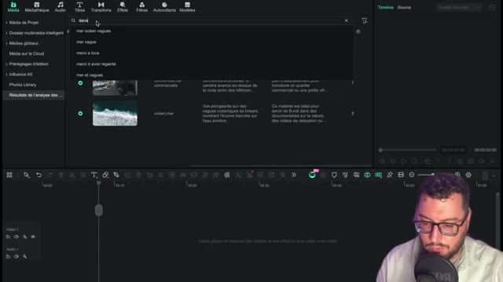  
  *⏱️ 00:04:38 — Recherche de médias avec le mot-clé 'danse' dans le logiciel de montage.*
- 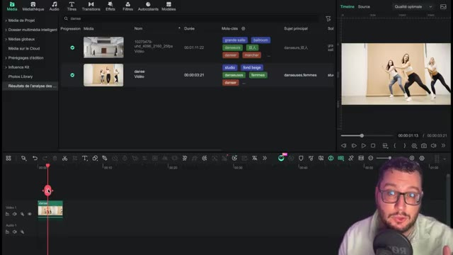  
  *⏱️ 00:04:51 — Intégration du clip vidéo de danse dans la timeline de montage et aperçu du rendu.*
- 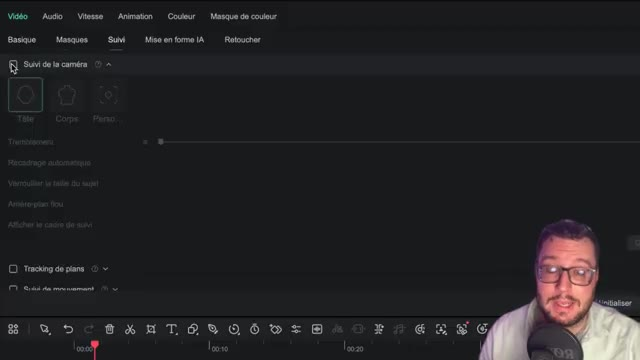  
  *⏱️ 00:05:03 — Affichage du menu des paramètres vidéo et du sous-menu de suivi automatique de la caméra.*

---

### ⏱️ `[00:05:05 - 00:05:29]` | Segment #14

**🔊 Audio (Transcription Intégrale Mot pour Mot en Français) :**
> Alors en le cochant ici, je vais pouvoir sélectionner parmi les trois options tête, corps ou personnalisé. Ici, j'ai les trois têtes qui ont été présélectionnées et la tête de la danseuse principale qui est sélectionnée. Je peux changer le suivi de caméra et passer sur une des autres danseuses pour décider du suivi. Je peux le faire aussi avec les corps qui seront automatiquement reconnus ou tout simplement personnalisés ou ce que la caméra devra suivre.

**👁️ Analyse Visuelle d'Écran (gemini-3.5-flash-lite) :**
**Interface & Outils** : Logiciel de montage vidéo (Wondershare Filmora)
**Contenu textuel & Code** : Menus "Suivi de la caméra", options Tête, Corps, Personnalisé, boutons "Commencer" et "OK"
**Action / Démonstration** : Le créateur montre comment sélectionner et modifier les cibles de suivi de caméra (têtes des danseuses) dans le logiciel.

**Captures d'écran :**
- 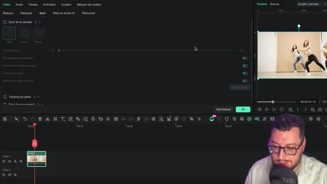  
  *⏱️ 00:05:06 — Interface du logiciel de montage affichant les options de suivi de caméra avec les choix Tête, Corps et Personnalisé.*
- 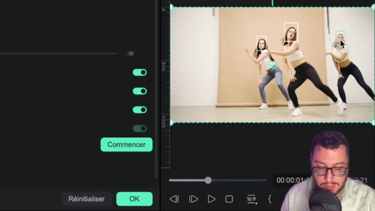  
  *⏱️ 00:05:17 — Gros plan sur la fenêtre de prévisualisation montrant trois danseuses avec des cadres de détection faciale.*
- 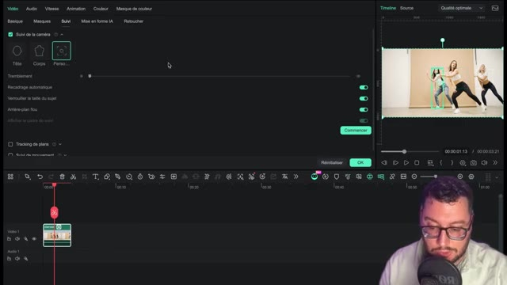  
  *⏱️ 00:05:27 — Interface montrant la sélection de l'option de suivi personnalisé dans les réglages de suivi de caméra.*

---

### ⏱️ `[00:05:29 - 00:05:48]` | Segment #15

**🔊 Audio (Transcription Intégrale Mot pour Mot en Français) :**
> Ici, si on fait plutôt corps et qu'on sélectionne la danseuse du milieu, on va pouvoir régler le tremblement, sélectionner les options cadrage automatique, verrouillage et arrière-plan flou pour pouvoir commencer à voir un traitement et ainsi un suivi de caméra qui est focus sur la danseuse principale.

**👁️ Analyse Visuelle d'Écran (gemini-3.5-flash-lite) :**
**Interface & Outils** : Logiciel de montage vidéo (type CapCut)
**Contenu textuel & Code** : Options de suivi activées par des curseurs verts, cadre vert de sélection sur la danseuse du milieu, et bouton 'Effacer le suivi de cible'.
**Action / Démonstration** : Le créateur montre comment appliquer un suivi de cible et configurer les options de cadrage et d'effets sur une danseuse spécifique.

**Captures d'écran :**
- 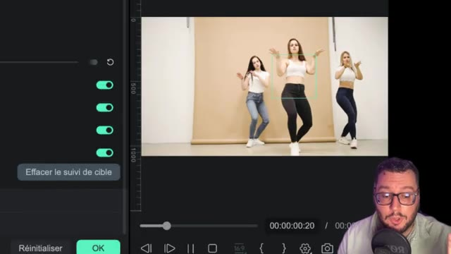  
  *⏱️ 00:05:47 — Interface du logiciel montrant le suivi de cible (tracking) sur la danseuse centrale avec des options activées.*

---

### ⏱️ `[00:05:48 - 00:06:12]` | Segment #16

**🔊 Audio (Transcription Intégrale Mot pour Mot en Français) :**
> Ça c'est très pratique par exemple si on rebasculait en format 9-16ème, qu'on décidait de réajuster la caméra et surtout tout au long de la vidéo de sélectionner exactement la danseuse qu'on souhaite suivre. Donc par exemple ici si je disais de sélectionner plutôt la danseuse de gauche, ainsi j'aurais mon suivi de caméra qui est focus sur cette danseuse là.

**👁️ Analyse Visuelle d'Écran (gemini-3.5-flash-lite) :**
**Interface & Outils** : Logiciel de montage vidéo (type Wondershare Filmora) avec panneau de suivi, timeline et prévisualisation.
**Contenu textuel & Code** : Menus de suivi de la caméra, options de recadrage automatique, curseurs de tremblement et de flou d'arrière-plan.
**Action / Démonstration** : Le créateur montre comment passer en format vertical 9:16 et sélectionner une danseuse spécifique à suivre grâce à l'outil de suivi IA.

**Captures d'écran :**
- 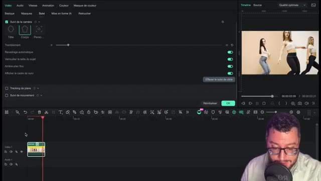  
  *⏱️ 00:05:49 — Interface du logiciel de montage montrant l'outil de suivi de la caméra avec trois danseuses en arrière-plan.*
- 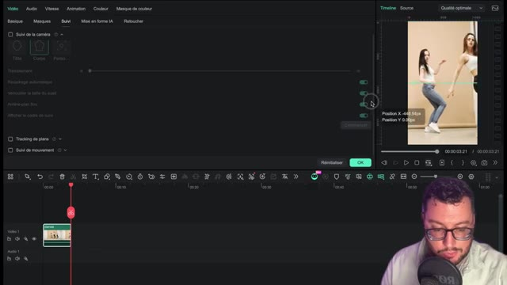  
  *⏱️ 00:06:00 — Ajustement du format et recadrage automatique centré sur la danseuse.*
- 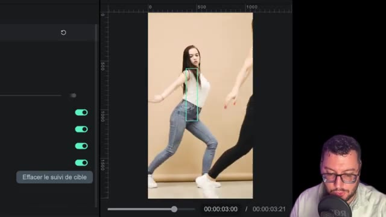  
  *⏱️ 00:06:11 — Sélection précise et zoom sur une danseuse spécifique avec un cadre de suivi actif.*

---

### ⏱️ `[00:06:12 - 00:06:34]` | Segment #17

**🔊 Audio (Transcription Intégrale Mot pour Mot en Français) :**
> On repasse toujours sur notre projet de danse, cette fois-ci en 16 neuvième, pour pouvoir explorer, pareil avec un double clic, une nouveauté qui va nous permettre ici, dans Masque de couleur, d'ajouter un calque d'étalonnage. Celui-ci en fait va nous permettre d'ajouter un calque, donc nous avons la possibilité d'ajouter un calque rectangle, une ellipse, ou alors de dessiner.

**👁️ Analyse Visuelle d'Écran (gemini-3.5-flash-lite) :**
**Interface & Outils** : Logiciel de montage vidéo (type Wondershare Filmora).
**Contenu textuel & Code** : Menus 'Couleur', 'Masque de couleur', 'Calques', boutons d'outils de masquage (Ellipse, Rectangle, Pinceau).
**Action / Démonstration** : Le créateur navigue dans le logiciel, sélectionne l'onglet des masques de couleur et ajoute un calque d'étalonnage pour la correction colorimétrique.

**Captures d'écran :**
- 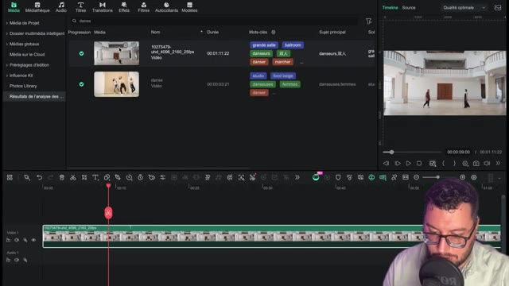  
  *⏱️ 00:06:13 — Interface du logiciel de montage montrant la médiathèque avec des clips vidéo de danse et la timeline principale.*
- 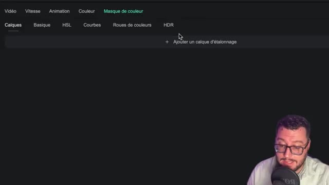  
  *⏱️ 00:06:23 — Panneau des paramètres de couleur et onglet 'Masque de couleur' avec l'option d'ajouter un calque d'étalonnage.*
- 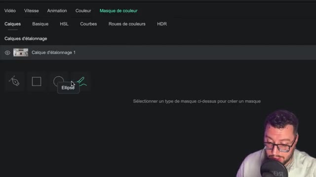  
  *⏱️ 00:06:33 — Panneau affichant le calque d'étalonnage créé et les différents outils de masquage disponibles (rectangle, ellipse, pinceau).*

---

### ⏱️ `[00:06:34 - 00:06:56]` | Segment #18

**🔊 Audio (Transcription Intégrale Mot pour Mot en Français) :**
> Ici, par exemple, on va faire un rectangle qu'on va dessiner vraiment au milieu. Ici, le but, c'est qu'ils changent de couleur quand ils vont se réunir. Et ainsi, nous allons pouvoir, en sélectionnant ce calque, aller ensuite soit dans Basique pour sélectionner un filtre, soit directement dans les courbes ou les roues de couleur pour définir l'ambiance de ce cadre.

**👁️ Analyse Visuelle d'Écran (gemini-3.5-flash-lite) :**
**Interface & Outils** : Logiciel de montage vidéo (type Filmora / CapCut) avec panneau d'étalonnage des couleurs, timeline et fenêtre de prévisualisation.
[DESC_IMAGE_3] Paramètres de couleur : Calques, Basique, HSL, Courbes, Roues de couleurs, HDR, avec les sections Ombres, Tons moyens, Tons clairs.
**Contenu textuel & Code** : Explications et conseils de création de contenu / IA.
**Action / Démonstration** : Le créateur trace un masque rectangulaire au milieu de l'image et montre comment accéder aux roues de couleurs pour modifier l'ambiance.

**Captures d'écran :**
- 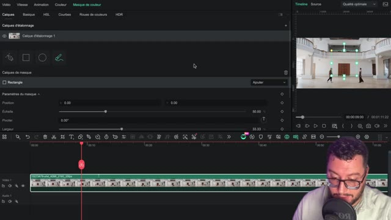  
  *⏱️ 00:06:35 — Interface du logiciel de montage montrant l'application d'un masque rectangulaire au centre de la vidéo.*
- 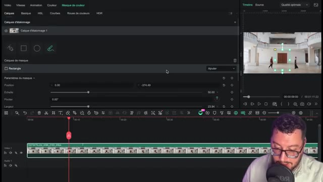  
  *⏱️ 00:06:45 — Ajustement de la position et de la taille du masque rectangulaire sur l'interface d'étalonnage.*
- 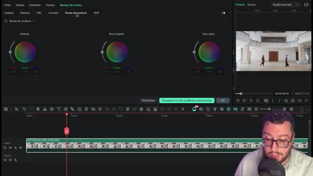  
  *⏱️ 00:06:55 — Navigation dans les onglets de couleur pour sélectionner les roues de couleurs et ajuster l'ambiance du calque.*

---

### ⏱️ `[00:06:56 - 00:07:26]` | Segment #19

**🔊 Audio (Transcription Intégrale Mot pour Mot en Français) :**
> Par exemple ici, en basique, si on mettait une intensité, on va dire, de 90 films de stock, en fait, qu'est-ce que ça va nous donner ? Ça va nous donner... C'est un petit peu mal cadré, on va juste le remettre comme ceci, parfait. Ça va nous donner cet effet-là, des deux danseurs qui arrivent, et une fois qu'ils sont dans cette zone, le masque de couleur va s'appliquer, et ainsi, au montage, on a cet effet-là.

**👁️ Analyse Visuelle d'Écran (gemini-3.5-flash-lite) :**
**Interface & Outils** : Logiciel de montage vidéo (type CapCut) avec panneau de prévisualisation et curseurs de réglage.
**Contenu textuel & Code** : Fenêtre de prévisualisation vidéo affichant deux danseurs dans une grande salle, un effet lumineux rose encadrant une porte, et des paramètres de réglage à gauche.
**Action / Démonstration** : Le créateur montre le rendu visuel après l'application de l'effet et du masque sur la vidéo.

**Captures d'écran :**
- 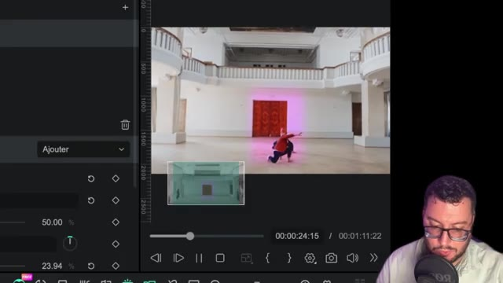  
  *⏱️ 00:07:24 — Aperçu du logiciel de montage vidéo montrant la scène avec deux danseurs et un effet de masque de couleur rose sur une porte.*

---

### ⏱️ `[00:07:26 - 00:07:46]` | Segment #20

**🔊 Audio (Transcription Intégrale Mot pour Mot en Français) :**
> Ce masque de couleur, il peut aussi servir à corriger des défauts. Par exemple, un ciel un petit peu gris, ou alors pourquoi pas nous servir pour faire une mise en avant d'un de nos personnages pendant la séquence. Bref, une possibilité en plus dans n'importe lequel de vos projets. Ensuite, une nouveauté, en sélectionnant une séquence dans notre menu animation. Avant, nous avions les animations d'entrée et de sortie.

**👁️ Analyse Visuelle d'Écran (gemini-3.5-flash-lite) :**
**Interface & Outils** : Filmora (ou logiciel de montage équivalent)
**Contenu textuel & Code** : Menus Animation, Préréglages de mouvement (Entrée, Sortie, Combo), timeline avec piste vidéo et audio, moniteur de prévisualisation avec une scène intérieure lumineuse.
**Action / Démonstration** : Le créateur montre comment sélectionner une séquence et applique des préréglages d'animation/mouvement.

**Captures d'écran :**
- 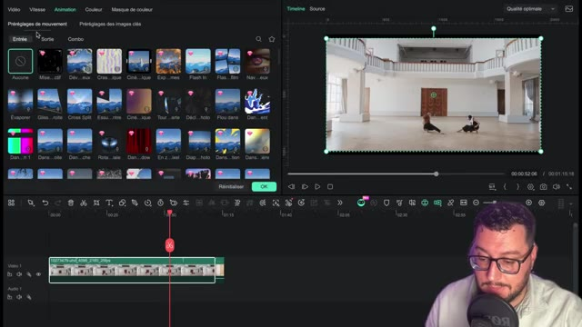  
  *⏱️ 00:07:45 — Image 2 montre l'interface complète du logiciel de montage avec le panneau d'animation, la timeline, le moniteur et le présentateur.*

---

### ⏱️ `[00:07:47 - 00:08:06]` | Segment #21

**🔊 Audio (Transcription Intégrale Mot pour Mot en Français) :**
> Et maintenant, nous pouvons appliquer l'option combo, qui va vous nous permettre de combiner l'animation en entrée et en sortie et sur la totalité de notre vidéo. Par exemple ici, la durée de l'animation rotation que j'ai sélectionnée va durer pendant toute la vidéo pour faire cet effet danse en rotation, en entrée et en sortie.

**👁️ Analyse Visuelle d'Écran (gemini-3.5-flash-lite) :**
**Interface & Outils** : Présentation orale ou séquence sans interface partagée.
**Contenu textuel & Code** : Explications et conseils de création de contenu / IA.
**Action / Démonstration** : Démonstration et mise en contexte pratique.

---

### ⏱️ `[00:08:07 - 00:08:31]` | Segment #22

**🔊 Audio (Transcription Intégrale Mot pour Mot en Français) :**
> Mais si je souhaite, je peux aussi faire commencer l'animation un petit peu plus loin ou la faire arrêter avant la sortie pour avoir mon animation au milieu de ma séquence. Par exemple, le moment où les deux danseurs se rencontrent pour avoir ainsi un effet de rotation au moment de la rencontre et proposer quelque chose d'original en entrée et en sortie jusqu'à la fin de la chorégraphie.

**👁️ Analyse Visuelle d'Écran (gemini-3.5-flash-lite) :**
**Interface & Outils** : Présentation orale ou séquence sans interface partagée.
**Contenu textuel & Code** : Explications et conseils de création de contenu / IA.
**Action / Démonstration** : Démonstration et mise en contexte pratique.

---

### ⏱️ `[00:08:32 - 00:09:07]` | Segment #23

**🔊 Audio (Transcription Intégrale Mot pour Mot en Français) :**
> A parcourir donc pour ajouter beaucoup plus de créativité, ce qui est bien justement, c'est qu'on va pouvoir mettre ces animations au milieu d'une vidéo pour pouvoir créer un effet. On en a plusieurs à disponibilité. Et bien sûr, on peut toujours rester en entrée et en sortie d'animation sur notre séquence ou alors d'aller dans Préréglage des images clés pour pouvoir sélectionner parmi les effets les plus populaires et les glisser directement sur notre timeline pour ainsi ici les mettre où l'on souhaite avec la possibilité de changer les keyframes et ainsi espacer le mouvement pour pouvoir dicter le rythme

**👁️ Analyse Visuelle d'Écran (gemini-3.5-flash-lite) :**
**Interface & Outils** : Logiciel de montage vidéo (Wondershare Filmora).
**Contenu textuel & Code** : Menu "Animation" avec les sous-onglets "Préréglages de mouvement" et "Préréglages des images clés", affichant diverses icônes d'effets (fondu, zoom, vortex, glisser).
**Action / Démonstration** : Le créateur présente l'onglet des préréglages d'images clés pour ajouter des animations créatives sur une séquence vidéo.

**Captures d'écran :**
- 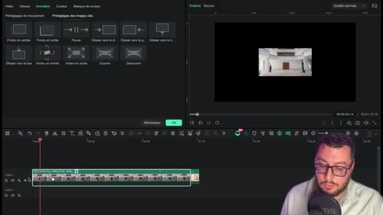  
  *⏱️ 00:09:06 — Interface du logiciel de montage montrant les préréglages des images clés et le panneau de prévisualisation.*

---

### ⏱️ `[00:09:07 - 00:09:26]` | Segment #24

**🔊 Audio (Transcription Intégrale Mot pour Mot en Français) :**
> comme par exemple ici sur un zoom. Pour le dernier exemple on a changé de projet parce que pour montrer cette nouveauté il me fallait du texte. En effet, en sélectionnant mon rush, en allant dans titre et dans sous-titres, je vais pouvoir bien sûr gérer mes légendes dynamiques.

**👁️ Analyse Visuelle d'Écran (gemini-3.5-flash-lite) :**
**Interface & Outils** : Logiciel de montage vidéo (type Wondershare Filmora).
**Contenu textuel & Code** : Menus 'Titres', 'Sous-titres IA', 'Légende dynamique' et paramètres de transcription.
**Action / Démonstration** : Le créateur montre la navigation vers l'onglet 'Titres' et l'option 'Sous-titres' pour gérer les légendes dynamiques.

**Captures d'écran :**
- 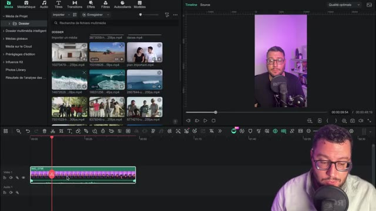  
  *⏱️ 00:09:16 — Vue d'ensemble du logiciel de montage avec la bibliothèque de médias et la timeline active.*
- 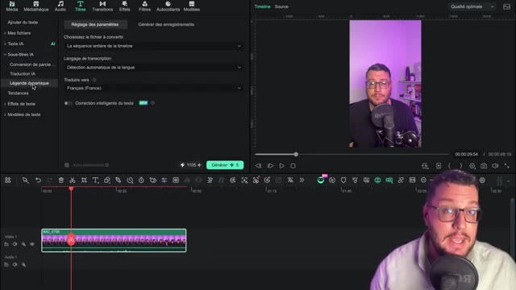  
  *⏱️ 00:09:24 — Navigation dans les menus de sous-titres et sélection de l'option 'Légende dynamique'.*

---

### ⏱️ `[00:09:26 - 00:09:45]` | Segment #25

**🔊 Audio (Transcription Intégrale Mot pour Mot en Français) :**
> Mais la nouveauté, c'est que je vais avoir maintenant une correction intelligente du texte. Donc ça ne coûte pas cher en crédit et ça permet de ne pas repasser des heures, surtout quand les vidéos sont longues, pour pouvoir changer ceci. Ainsi, le traitement va se faire, mes sous-titres vont être appliqués et corrigés automatiquement sans que je n'aie à repasser dessus.

**👁️ Analyse Visuelle d'Écran (gemini-3.5-flash-lite) :**
**Interface & Outils** : Logiciel de montage vidéo (type Wondershare Filmora).
**Contenu textuel & Code** : Fenêtre pop-up "Détection de voix" avec une barre de progression à 100%, options de transcription et correction intelligente du texte visible dans le panneau latéral gauche.
**Action / Démonstration** : Le créateur montre le traitement en cours de la détection vocale et de la correction automatique des sous-titres.

**Captures d'écran :**
- 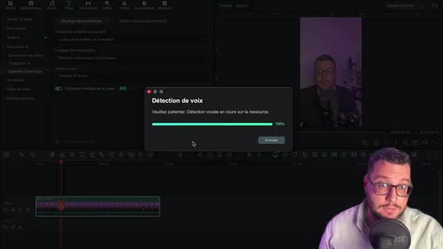  
  *⏱️ 00:09:36 — Capture d'écran montrant l'interface d'un logiciel de montage vidéo avec une fenêtre de progression de détection de voix.*

---

### ⏱️ `[00:09:45 - 00:10:04]` | Segment #26

**🔊 Audio (Transcription Intégrale Mot pour Mot en Français) :**
> Bien sûr, en double-clic dessus, je pourrais aller dans Modèles pour pouvoir changer les modèles et sélectionner peut-être les templates qui m'iront le mieux. On en a plusieurs, simple, en lueur, en rétro, en surlignage, en rythme, en esthétique. Bref, n'hésite pas à les parcourir et de sélectionner celui qui tira le mieux.

**👁️ Analyse Visuelle d'Écran (gemini-3.5-flash-lite) :**
**Interface & Outils** : Filmora (logiciel de montage vidéo)
**Contenu textuel & Code** : Menus de sous-titres, modèles, options de style (lueur, rétro, surlignage), timeline vidéo et prévisualisation.
**Action / Démonstration** : Le créateur montre comment accéder aux modèles de sous-titres et naviguer parmi les différents styles disponibles.

**Captures d'écran :**
-   
  *⏱️ 00:09:46 — Interface du logiciel de montage Filmora affichant les options de sous-titres et la timeline principale.*
- 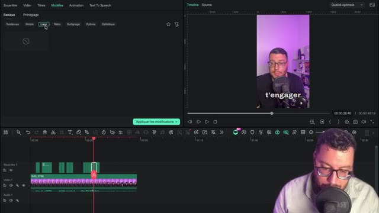  
  *⏱️ 00:09:54 — Navigation dans l'onglet des modèles de sous-titres avec les catégories visibles (Simple, Lueur, Rétro, etc.).*
- 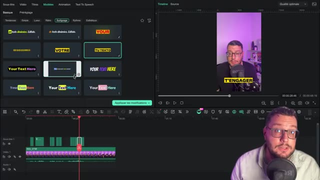  
  *⏱️ 00:10:02 — Sélection du modèle "Surlignage" montrant les différentes options de templates de texte dynamique disponibles.*

---

### ⏱️ `[00:10:04 - 00:10:23]` | Segment #27

**🔊 Audio (Transcription Intégrale Mot pour Mot en Français) :**
> Et ça, ce n'est qu'une partie des nouveautés, c'est les 5 que j'ai directement intégrées à mon workflow. Mais je sais aussi qu'il y a une super option maintenant qui permet, ça se passe directement ici dans Média, c'est juste là, c'est ça, de pouvoir enregistrer l'écran et même multi-écran de son PC. Donc on va pouvoir streamer ses jeux vidéo, c'est-à-dire s'enregistrer en même temps qu'on enregistre le jeu.

**👁️ Analyse Visuelle d'Écran (gemini-3.5-flash-lite) :**
**Interface & Outils** : CapCut (logiciel de montage vidéo)
**Contenu textuel & Code** : Onglet Média, boutons 'Importer', 'Enregistrer', liste de clips multimédias (danse, vagues, etc.), et menu déroulant avec les options : 'Enregistrer l'écran du PC', 'Enregistrer voix off', 'Enregistrer depuis la webcam'.
**Action / Démonstration** : Le créateur montre la fonctionnalité d'enregistrement d'écran intégrée au logiciel de montage CapCut.

**Captures d'écran :**
- 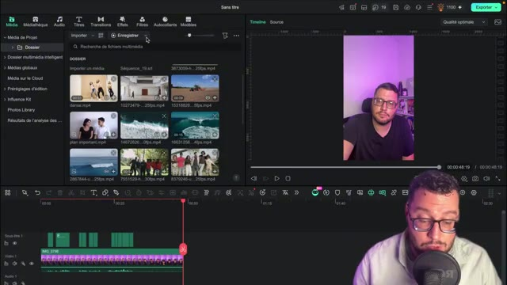  
  *⏱️ 00:10:13 — Vue générale de l'interface du logiciel de montage CapCut avec le panneau média ouvert.*
- 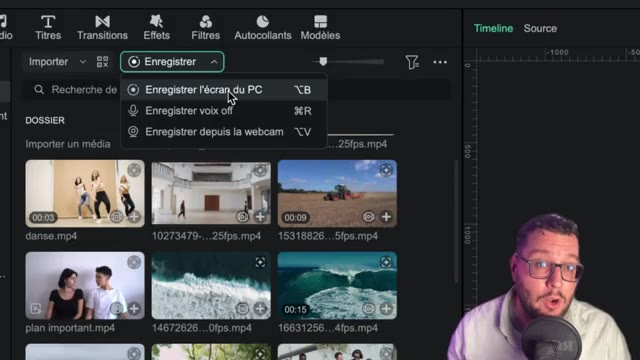  
  *⏱️ 00:10:21 — Zoom sur le menu déroulant 'Enregistrer' dans l'onglet Média du logiciel CapCut, affichant les options d'enregistrement d'écran, voix off et webcam.*

---

### ⏱️ `[00:10:23 - 00:10:44]` | Segment #28

**🔊 Audio (Transcription Intégrale Mot pour Mot en Français) :**
> Enregistrer la voix off ou enregistrer depuis la webcam. Par exemple ici, si je fais enregistrement de l'écran PC, je vais avoir ici ma petite barre d'enregistrement que je vais pouvoir mettre où je veux sur mon PC. Je vais pouvoir sélectionner les fenêtres que je souhaite enregistrer et après démarrer l'enregistrement. J'ai aussi ma petite icône Filmora qui va se mettre ici pour savoir où j'en suis sur mon enregistrement.

**👁️ Analyse Visuelle d'Écran (gemini-3.5-flash-lite) :**
**Interface & Outils** : Navigateur web, site officiel de Filmora et barre d'outils d'enregistrement.
**Contenu textuel & Code** : Barre d'enregistrement avec options "Zone", "Fenêtre", micro, webcam et bouton de démarrage.
**Action / Démonstration** : Le créateur montre la barre d'outils flottante permettant de configurer l'enregistrement d'écran.

**Captures d'écran :**
- 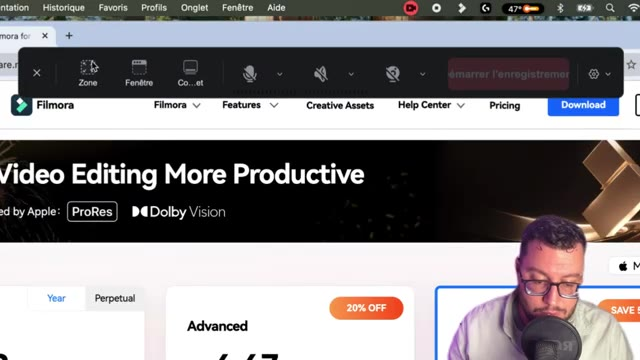  
  *⏱️ 00:10:33 — Capture d'écran montrant le site web de Filmora avec la barre d'outils d'enregistrement superposée et le présentateur en bas à droite.*
-   
  *⏱️ 00:10:42 — Vue similaire affichant la barre d'outils d'enregistrement de l'écran avec les options de sélection de zone et de fenêtre.*

---

### ⏱️ `[00:10:44 - 00:11:03]` | Segment #29

**🔊 Audio (Transcription Intégrale Mot pour Mot en Français) :**
> Donc voilà c'est plutôt sympa et moi je pense je vais l'utiliser pour enregistrer mes tutos à l'avenir. On a aussi des petites nouveautés qui nous permettent de télécharger directement d'un seul coup en plusieurs formats, qui nous permettent aussi de changer les raccourcis si on avait des habitudes de travail différentes de Filmora et qu'on souhaite garder les mêmes raccourcis que l'on utilisait avant.

**👁️ Analyse Visuelle d'Écran (gemini-3.5-flash-lite) :**
**Interface & Outils** : Logiciel de montage vidéo Filmora
**Contenu textuel & Code** : Menus d'exportation par lot, options de résolution (720P, 1080P, 2K, 4K), fenêtre de gestion et de création de raccourcis clavier personnalisés (« Create Shortcut Preset »).
**Action / Démonstration** : Le créateur présente les nouvelles fonctionnalités de Filmora, notamment l'exportation multi-format en un clic et la personnalisation des raccourcis clavier.

**Captures d'écran :**
-   
  *⏱️ 00:10:53 — Interface de Filmora montrant le panneau d'exportation par lot avec différentes résolutions sélectionnables (720P, 1080P, 2K, 4K).*
-   
  *⏱️ 00:11:01 — Interface de Filmora affichant les raccourcis clavier et la fenêtre de création d'un préréglage personnalisé (« Create Shortcut Preset »).*

---

### ⏱️ `[00:11:03 - 00:11:26]` | Segment #30

**🔊 Audio (Transcription Intégrale Mot pour Mot en Français) :**
> Une possibilité de changer les plans de caméra en 360, ça ça a l'air incroyable. Bref, il y a plein de nouveautés à tester avec cette version 16. Pour rappel, tu peux télécharger et essayer gratuitement Filmora 16 en te rendant dans le lien disponible en description et en commentaire épinglé. N'hésite pas donc à les parcourir et si tu veux plus de tutos autour de Filmora, il s'affiche juste à l'écran.

**👁️ Analyse Visuelle d'Écran (gemini-3.5-flash-lite) :**
**Interface & Outils** : Filmora 16
**Contenu textuel & Code** : Menus latéraux incluant 'Suivi de la caméra', 'Masque de couleur', 'Recadrage vidéo à 360°', 'Analyse de médias IA' et description textuelle de la fonctionnalité.
**Action / Démonstration** : Démonstration de la fonction de recadrage à 360 degrés sur une vidéo de rue.

**Captures d'écran :**
-   
  *⏱️ 00:11:04 — Interface de Filmora 16 présentant la fonctionnalité de recadrage vidéo à 360° avec un aperçu d'une rue parisienne.*
-   
  *⏱️ 00:11:14 — Même interface de Filmora 16 avec une icône animée '360' au centre de l'aperçu vidéo pour illustrer la fonction de changement de plan.*

---

### ⏱️ `[00:11:26 - 00:11:29]` | Segment #31

**🔊 Audio (Transcription Intégrale Mot pour Mot en Français) :**
> C'était Marco, merci et à très bientôt sur le Labo des Réseaux.

**👁️ Analyse Visuelle d'Écran (gemini-3.5-flash-lite) :**
**Interface & Outils** : Aucun élément d'interface, logiciel ou site web affiché.
**Contenu textuel & Code** : Aucun texte, prompt ou réglage visible (simple plan de fin de vidéo).
**Action / Démonstration** : Le créateur s'adresse directement au public pour conclure la vidéo ("merci et à très bientôt sur le Labo des Réseaux").

---
