# 🎬 Créer un influenceur IA en 3 clics !

> **Chaîne** : [Labo Des Réseaux](https://www.youtube.com/@labodesreseaux)  
> **Lien YouTube** : [https://www.youtube.com/watch?v=i3ybzy9qVow](https://www.youtube.com/watch?v=i3ybzy9qVow)  
> **Date de publication** : 20261011  
> **Durée** : 6:49  
> **Identifiant vidéo** : `i3ybzy9qVow`  
> **Modèles** : Audio: `whisper-v3-large-turbo` | Vision: `gemini-3.5-flash-lite`  

---

## 📌 Synthèse Exécutive & Outils

### 💡 Résumé
**Les réseaux sociaux traversent une mutation profonde avec l'émergence fulgurante des influenceurs virtuels générés par intelligence artificielle.** Contrairement aux standards de beauté lisses et parfaits observés par le passé, la nouvelle tendance privilégie des looks excentriques, loufoques et singuliers qui se démarquent des créateurs humains traditionnels. Ce phénomène s'accompagne surtout d'une révolution technique majeure portée par les modèles de vidéo-édition par IA, capables d'intégrer des avatars de synthèse au cœur de contenus viraux existants.

**Le tutoriel central de la vidéo démontre comment exploiter la plateforme Xfield pour concevoir de toutes pièces un influenceur virtuel en quelques clics.** Grâce à un générateur intuitif basé sur l'assemblage de tags (gabarit, genre, coupe de cheveux, accessoires) ou via l'utilisation de références visuelles textuelles et faciales, la création d'avatar devient instantanément accessible. Le processus se poursuit en transférant cet influenceur dans le modèle de génération vidéo *Genjutsu*, permettant de le mettre en scène dans des mèmes ou des challenges populaires en reprenant simplement une vidéo de référence d'une durée maximale de 30 secondes.

**Au-delà de la prouesse technique, cette démocratisation soulève des questions fondamentales sur l'avenir des plateformes et la propriété intellectuelle.** Le créateur analyse les parallèles possibles avec le phénomène du "brain rot" et met en garde contre l'uniformisation des contenus face à la facilité de duplication. Pour réussir durablement, la valeur ajoutée ne résidera plus dans la simple reproduction de chorégraphies ou de trends, mais dans l'originalité narrative, l'incarnation vocale et la singularité créative conférée à ces nouveaux avatars numériques.

### 🛠️ Outils, Modèles & Logiciels Présentés
- **Xfield :** Plateforme principale de génération d'influenceurs IA et d'édition vidéo (incluant le générateur d'avatars et l'outil de redimensionnement de référence).**
- **Genjutsu (par Xfield) :** Modèle phare d'édition et de génération vidéo par IA pour animer les influenceurs et remplacer les personnages dans un plan.**
- **Cling Motion :** Modèle d'IA vidéo spécialisé dans l'édition et la réutilisation de mouvements.**
- **Seed Dance 2.5 :** Modèle de génération et d'édition vidéo avancé utilisé pour transposer des chorégraphies ou des mouvements.**
- **ChatGPT Image 2.5 :** Modèle de génération d'images alternatif pour concevoir des avatars personnalisés en amont.**
- **Nano Banana 2.1 :** Modèle image alternatif mentionné pour la création libre d'influenceurs virtuels.**

### 🔑 Points Clés & Enseignements Stratégiques
- Changement esthétique majeur :** La tendance actuelle des influenceurs IA s'oriente vers des looks décalés et imparfaits pour rompre avec l'uniformité visuelle du passé.
- Génération modulaire sur Xfield :** Le générateur d'influenceurs permet d'assembler des caractéristiques variées (gabarit, coupe, barbe, accessoires) ou d'utiliser la fonction "Reset All" pour une création totalement aléatoire.
- Personnalisation avancée par référence :** Il est possible d'injecter une tenue personnalisée (ex: tenue de glacier) ou de baser l'avatar sur un visage de référence existant (comme "Marco").
- Modération des paramètres :** Il est conseillé de doser les modifications lors de l'utilisation d'un visage de référence pour éviter de dénaturer complètement l'identité visuelle du personnage créé.
- Fonctionnement de Genjutsu :** Ce modèle vidéo accepte des fichiers de référence allant jusqu'à 30 secondes (avec un outil de découpe/redimensionnement intégré si la vidéo source est plus longue).
- Multiplication des avatars :** La plateforme permet de synchroniser plusieurs influenceurs créés (ex: quatre personnages) pour correspondre exactement au nombre de sujets présents dans la vidéo de tendance source.
- Diversité des cas d'usage :** Au-delà du remplacement de personnages dans des mèmes ou des danses ("Toc toc qui frappe à ma porte"), l'outil permet d'insérer des produits ou de modifier des tenues sur un plan existant.
- Modèles alternatifs d'édition :** En complément de Genjutsu, l'utilisation de *Seed Dance 2.5* (en mode édition) et de *Cling Motion* offre des alternatives puissantes pour animer les créations.
- Émancipation des modèles images :** La création d'avatars peut s'affranchir de l'outil natif d'Xfield en s'appuyant sur des générateurs d'images externes comme *ChatGPT Image 2.5* ou *Nano Banana 2.1*.
- Enjeux de propriété intellectuelle :** L'utilisation de vidéos tierces comme simples "références" pour animer des IA bouscule les notions traditionnelles de droit d'auteur et de vol de contenu sur les réseaux sociaux.
- Risque de saturation des flux :** La facilité d'exécution (génération en 3 clics) menace d'inonder les plateformes de contenus clones automatisés enchaînant uniquement des challenges visuels.
- Nécessité d'une voix et d'un lore :** Pour survivre et émerger durablement, les créateurs doivent doter leurs influenceurs IA d'une voix, d'une histoire (lore) et d'une réelle originalité stratégique plutôt que de se limiter à de simples chorégraphies.

---

## ⏱️ Chronologie & Transcription Complète Audio & Visuelle (Mot pour Mot)

### ⏱️ `[00:00:01 - 00:00:21]` | Segment #01

**🔊 Audio (Transcription Intégrale Mot pour Mot en Français) :**
> Les réseaux sociaux sont en train de changer avec l'arrivée des influenceurs IA. Alors les influenceurs IA, ça n'a rien de nouveau. Ce qui est nouveau, en revanche, c'est la place qu'ils ont pris ces dernières semaines.

**👁️ Analyse Visuelle d'Écran (gemini-3.5-flash-lite) :**
**Interface & Outils** : Studio vidéo personnel avec équipement d'enregistrement audio et éclairage LED.
**Contenu textuel & Code** : Aucun élément d'interface ou texte affiché à l'écran, uniquement le présentateur en plan fixe.
**Action / Démonstration** : Le youtubeur introduit le sujet de la vidéo en parlant face caméra et en changeant d'apparence.

---

### ⏱️ `[00:00:21 - 00:00:43]` | Segment #02

**🔊 Audio (Transcription Intégrale Mot pour Mot en Français) :**
> Et il y a deux raisons à ça. La première, c'est une tendance à leur donner des looks un peu bizarres. Des looks qui sortent justement de la beauté parfaite que l'IA produisait jusqu'ici. Et disons-le, qui changent aussi du look des influenceurs classiques qui commencent à se ressembler un petit peu. Mais le plus gros changement, c'est l'évolution des modèles IA vidéo d'édition.

**👁️ Analyse Visuelle d'Écran (gemini-3.5-flash-lite) :**
**Interface & Outils** : Interface de logiciel de montage vidéo génératif.
**Contenu textuel & Code** : Fenêtre de prévisualisation vidéo avec portrait d'influenceur, timeline de montage colorée et texte 'L'ÉVOLUTION DES MODÈLES VIDÉO IA'.
**Action / Démonstration** : Présentation de l'évolution des modèles de génération vidéo par intelligence artificielle.

**Captures d'écran :**
- 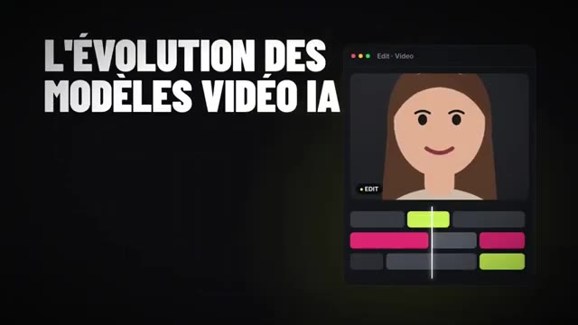  
  *⏱️ 00:00:42 — Interface de montage vidéo affichant un modèle de visage généré par IA et une timeline.*

---

### ⏱️ `[00:00:44 - 00:01:04]` | Segment #03

**🔊 Audio (Transcription Intégrale Mot pour Mot en Français) :**
> Clingmotion, Seed Dance 2.5 ou encore Genjutsu de Xfield, ce sont des modèles capables de reprendre facilement en référence des memes, des challenges, des trends, des scènes cultes, pour y mettre en scène tes propres influenceurs IA. C'est ce qui fonctionne en ce moment sur les réseaux, et dans cette vidéo, on voit comment le faire en 3 clics sur Xfield.

**👁️ Analyse Visuelle d'Écran (gemini-3.5-flash-lite) :**
**Interface & Outils** : Kling Motion
**Contenu textuel & Code** : Modèles vidéo d'édition, Kling Motion - Transfert de mouvement
**Action / Démonstration** : Présentation des outils de transfert de mouvement pour intégrer des influenceurs IA dans des vidéos existantes.

**Captures d'écran :**
- 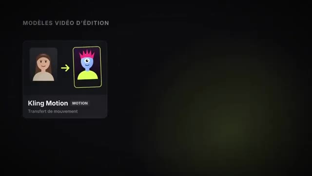  
  *⏱️ 00:00:45 — Interface montrant le modèle Kling Motion pour le transfert de mouvement.*

---

### ⏱️ `[00:01:05 - 00:01:25]` | Segment #04

**🔊 Audio (Transcription Intégrale Mot pour Mot en Français) :**
> On est donc sur Xfield, je te mets le lien pour accéder à la page pour créer ton influenceur IA en description et commentaire épinglé. Et sur cette page, tu vas avoir à gauche un générateur d'influenceurs IA. Tu vas pouvoir assembler plusieurs éléments ensemble pour créer ton influenceur un peu loufoque. Gabarit, forme, taille, genre, couleur de cheveux, coupe de cheveux, barbe, accessoires.

**👁️ Analyse Visuelle d'Écran (gemini-3.5-flash-lite) :**
**Interface & Outils** : Site web Xfield (interface de génération d'influenceurs IA).
**Contenu textuel & Code** : Menus de sélection de personnages (Average, Bold, Extreme, Insect, Frog, Cat, etc.), genres (Female, Male, Non-binary), boutons de génération et vignettes de prévisualisation vidéo.
**Action / Démonstration** : Le présentateur navigue sur la plateforme Xfield et montre les options de personnalisation pour créer un influenceur IA loufoque.

**Captures d'écran :**
- 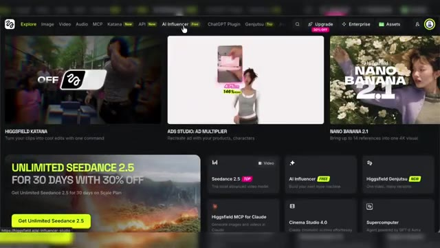  
  *⏱️ 00:01:06 — Page d'accueil du site Xfield montrant les différentes fonctionnalités d'intelligence artificielle disponibles.*
- 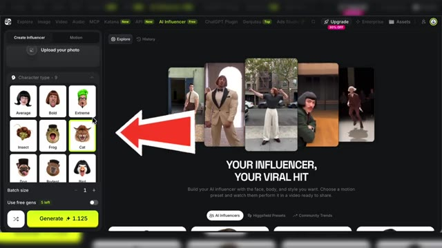  
  *⏱️ 00:01:15 — Panneau latéral gauche du générateur d'influenceur IA permettant de sélectionner le type de personnage (gabarit, têtes loufoques).*
- 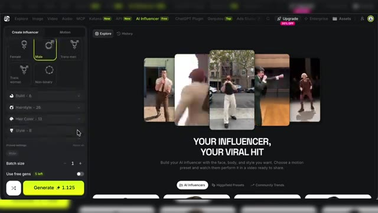  
  *⏱️ 00:01:24 — Menu de configuration du panneau latéral permettant de choisir le genre, la corpulence, la coiffure et le style de l'influenceur.*

---

### ⏱️ `[00:01:26 - 00:01:44]` | Segment #05

**🔊 Audio (Transcription Intégrale Mot pour Mot en Français) :**
> On retrouve énormément d'éléments et de combinaisons possibles. Tu peux en sélectionner autant que tu veux, tu n'es pas obligé de tout sélectionner non plus. et une fois que tu as fini de sélectionner les différentes caractéristiques de ton influenceur, tu as l'ensemble de ces caractéristiques qui sont résumées par les tags ici et tu n'as qu'à lancer la création.

**👁️ Analyse Visuelle d'Écran (gemini-3.5-flash-lite) :**
**Interface & Outils** : Interface web de génération d'influenceurs virtuels (style plateforme d'intelligence artificielle vidéo).
**Contenu textuel & Code** : Menus de sélection de style et d'accessoires, aperçus vidéo d'influenceurs, tags résumant les caractéristiques sélectionnées, bouton de génération en bas à gauche.
**Action / Démonstration** : Le créateur montre comment sélectionner différentes combinaisons d'éléments et d'accessoires pour configurer un influenceur virtuel avant de lancer la génération.

**Captures d'écran :**
- 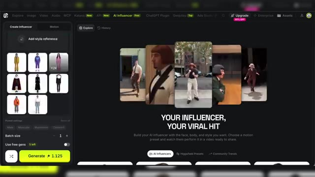  
  *⏱️ 00:01:27 — Interface du générateur d'influenceur virtuel montrant les options de style vestimentaire et les exemples de vidéos générées.*
- 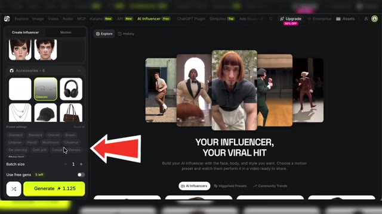  
  *⏱️ 00:01:42 — Interface du générateur d'influenceur virtuel montrant les accessoires et la zone de résumé des tags avec une flèche rouge pointant vers les paramètres sélectionnés.*

---

### ⏱️ `[00:01:44 - 00:02:02]` | Segment #06

**🔊 Audio (Transcription Intégrale Mot pour Mot en Français) :**
> Selon ton compte, il se peut que tu aies quelques générations gratuites. Bon, et sinon, c'est seulement quelques crédits. En fait, la génération d'influenceurs IA, c'est pas vraiment ce qui va nous coûter le plus cher en crédit. C'est plutôt avec la vidéo qu'on va dépenser nos crédits. Encore que le modèle qu'on va utiliser, Genjutsu, s'en sort pas trop mal niveau coût.

**👁️ Analyse Visuelle d'Écran (gemini-3.5-flash-lite) :**
**Interface & Outils** : Interface web d'un outil de création d'influenceurs IA et de génération multimédia.
**Contenu textuel & Code** : Menus de création d'influenceurs, accessoires, bouton 'Generate Free', options de batch size et compteur de générations gratuites.
**Action / Démonstration** : Le créateur lance la génération gratuite d'un personnage influenceur IA et consulte le résultat obtenu.

**Captures d'écran :**
- 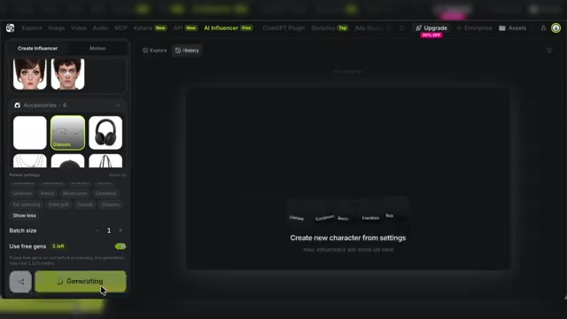  
  *⏱️ 00:01:45 — Interface du générateur d'influenceurs IA montrant le bouton 'Generate Free' et les options de personnalisation avec un compteur de 5 générations gratuites.*
- 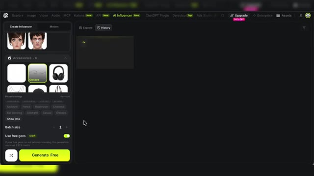  
  *⏱️ 00:01:53 — L'interface en cours de génération avec le compteur qui passe à 4 générations gratuites restantes et un aperçu en chargement dans l'historique.*
- 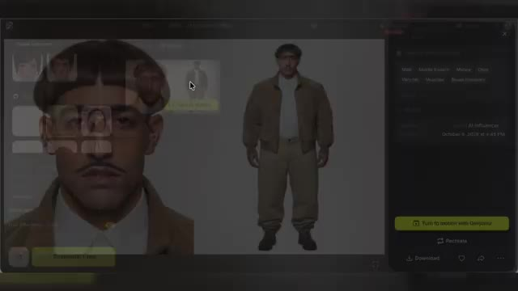  
  *⏱️ 00:02:01 — Visualisation du résultat généré montrant un personnage influenceur IA en pied avec ses détails et l'option de conversion vidéo 'Turn to motion with Genjutsu'.*

---

### ⏱️ `[00:02:02 - 00:02:20]` | Segment #07

**🔊 Audio (Transcription Intégrale Mot pour Mot en Français) :**
> Donc là, tu vois, j'ai mon premier influenceur. Quelques détails sur la création d'influenceur que je voulais aussi te montrer. La possibilité de choisir une tenue personnalisée. Par exemple, pour mon prochain influenceur, je lui ai donné en référence une tenue de glacier qu'on avait utilisé sur un autre projet. Et autre possibilité, tu peux donner en référence un visage.

**👁️ Analyse Visuelle d'Écran (gemini-3.5-flash-lite) :**
**Interface & Outils** : Générateur d'influenceur virtuel par IA (interface web avec onglets Explore, AI Influencer, History).
**Contenu textuel & Code** : Menus de configuration de personnage, options de tenues personnalisées, galerie de générations précédentes.
**Action / Démonstration** : Le créateur montre un exemple d'influenceur généré et explique comment choisir une tenue personnalisée à partir d'une référence.

**Captures d'écran :**
- 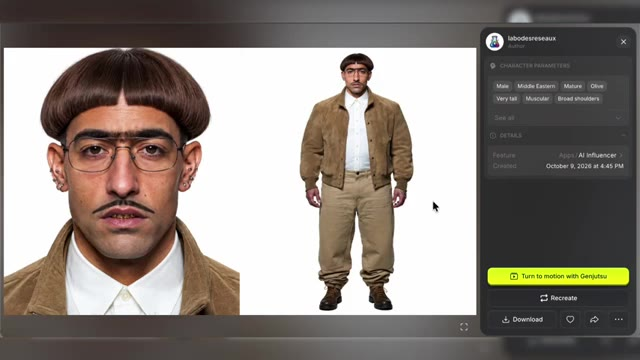  
  *⏱️ 00:02:03 — Visualisation détaillée du premier influenceur virtuel généré avec ses paramètres de caractérisation.*
- 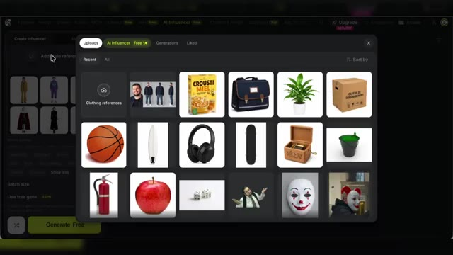  
  *⏱️ 00:02:11 — Fenêtre de sélection des fichiers importés (uploads) montrant différentes références d'objets et de vêtements.*
- 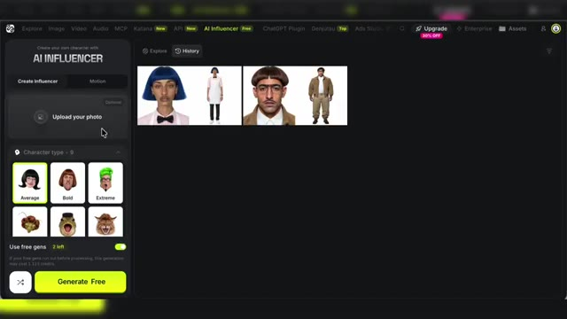  
  *⏱️ 00:02:19 — Interface principale du générateur d'influenceurs virtuels affichant l'historique des créations et les options de design.*

---

### ⏱️ `[00:02:21 - 00:02:41]` | Segment #08

**🔊 Audio (Transcription Intégrale Mot pour Mot en Français) :**
> Donc moi, par exemple, avec ce nouvel influenceur, je vais lui donner Marco en référence. Et après, je peux modifier son aspect, son style avec les différentes options. Bon, là, je te conseille d'y aller mollo avec les éléments. sinon ça ne ressemblera plus vraiment à ton personnage de référence. Voilà, ça c'est mon marco un peu modifié. Et enfin, tu peux aussi laisser faire le hasard.

**👁️ Analyse Visuelle d'Écran (gemini-3.5-flash-lite) :**
**Interface & Outils** : Application web de génération d'influenceurs virtuels par IA (interface "AI Influencer").
**Contenu textuel & Code** : Menus de configuration (Gender, Build, options de morphologie), boutons "Generate", aperçus de personnages générés sous différents angles.
**Action / Démonstration** : Le créateur montre le résultat du personnage de référence "Marco" sous plusieurs angles, puis présente l'interface permettant de modifier ses paramètres et son style.

**Captures d'écran :**
- 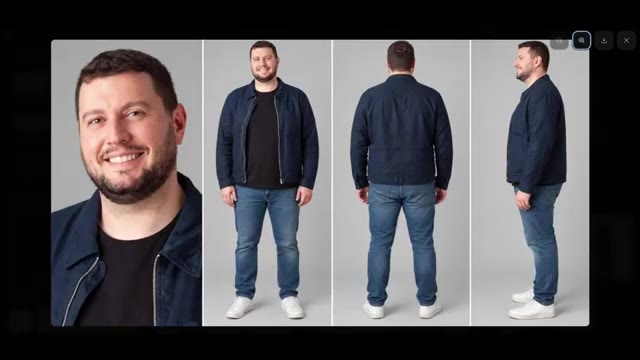  
  *⏱️ 00:02:22 — Affichage en gros plan de quatre vues différentes (visage, plein pied de face, de dos et de profil) du personnage de référence nommé Marco généré par l'IA.*
- 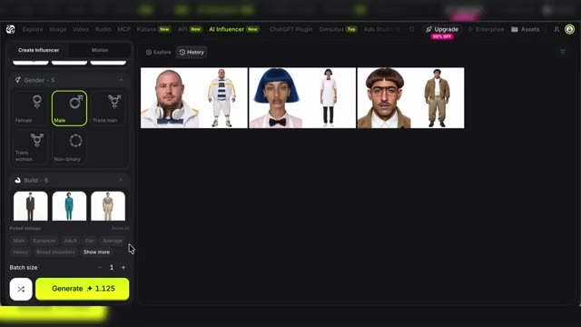  
  *⏱️ 00:02:39 — Interface de l'outil de création d'influenceurs virtuels par IA montrant les options de personnalisation du genre, de la corpulence (build) et les boutons de génération.*

---

### ⏱️ `[00:02:41 - 00:03:00]` | Segment #09

**🔊 Audio (Transcription Intégrale Mot pour Mot en Français) :**
> Là, je vais en bas de la fenêtre de génération. J'efface à l'ensemble des tags sélectionnés en cliquant sur Reset All. Et après, je peux sélectionner la génération automatique qui va me choisir aléatoirement des éléments pour créer mon influenceur IA. Je vais m'amuser comme ça à créer quelques influenceurs IA. Le but, ça va être ensuite de les mettre en scène ensemble.

**👁️ Analyse Visuelle d'Écran (gemini-3.5-flash-lite) :**
**Interface & Outils** : Interface web de génération d'influenceurs IA (outil en ligne avec onglet 'AI Influencer').
**Contenu textuel & Code** : Menu latéral 'Create Influencer', sélections de visages, accessoires, tags sélectionnés, bouton 'Reset all', et aperçus de personnages générés aléatoirement dans la zone principale.
**Action / Démonstration** : Le créateur montre le processus de génération aléatoire et la gestion des tags pour créer différents influenceurs IA.

**Captures d'écran :**
- 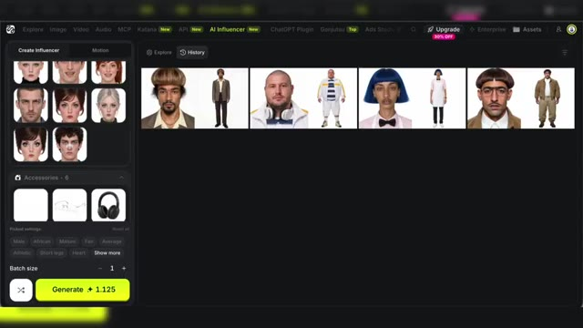  
  *⏱️ 00:02:59 — Interface du générateur d'influenceurs IA montrant les options de création de personnages et l'historique des générations aléatoires.*

---

### ⏱️ `[00:03:00 - 00:03:22]` | Segment #10

**🔊 Audio (Transcription Intégrale Mot pour Mot en Français) :**
> Et pour ça, il me suffit d'en sélectionner un et de cliquer sur Turn to Motion with Genjutsu. Je suis redirigé en fait sur la fenêtre de génération vidéo avec le modèle Genjutsu de sélectionner. Ce modèle fonctionne avec une vidéo de référence. Ça va être jusqu'à 30 secondes max pour la vidéo de référence. Et pas de souci, si tu as une vidéo de plus de 30 secondes, tu peux la charger sur Xfield.

**👁️ Analyse Visuelle d'Écran (gemini-3.5-flash-lite) :**
**Interface & Outils** : Interface web d'un générateur d'IA (type outil de création d'influenceurs virtuels / Higgsfield Genjutsu).
**Contenu textuel & Code** : Menus de configuration (Proportions, Head shape, Motion), grille de personnages générés et fenêtre de sélection de vidéo de référence.
**Action / Démonstration** : Le créateur montre comment passer de la création de personnages au transfert de mouvement via Genjutsu en important une vidéo.

**Captures d'écran :**
- 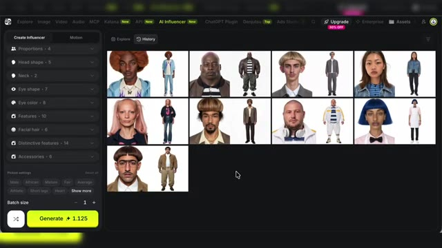  
  *⏱️ 00:03:01 — Interface principale du générateur d'influenceurs virtuels affichant une grille de personnages personnalisables.*
- 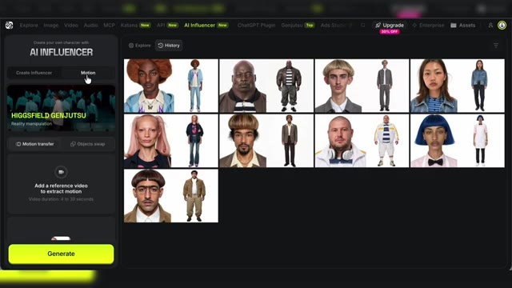  
  *⏱️ 00:03:11 — Basculement vers l'onglet Motion avec l'option d'ajout d'une vidéo de référence pour le modèle Genjutsu.*
- 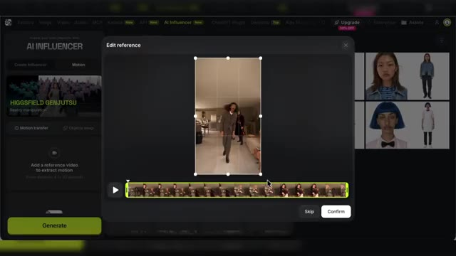  
  *⏱️ 00:03:20 — Fenêtre d'édition et de recadrage de la vidéo de référence avec timeline de découpage (jusqu'à 30 secondes max).*

---

### ⏱️ `[00:03:22 - 00:03:47]` | Segment #11

**🔊 Audio (Transcription Intégrale Mot pour Mot en Français) :**
> Il faudra juste ensuite sélectionner les 30 secondes que tu souhaites en référence pour que Xfield la resize. Donc moi ici pour mon exemple, je vais utiliser en référence une vidéo de la trend « Toc toc qui frappe à ma porte » que tu as sûrement dû voir passer sur les réseaux sociaux. Et en référence, j'ajoute mes influenceurs. Donc vu qu'il y a 4 personnes dans ma vidéo de référence, et bien tout simplement, je vais sélectionner 4 de mes influenceurs hier.

**👁️ Analyse Visuelle d'Écran (gemini-3.5-flash-lite) :**
**Interface & Outils** : Interface web de Higgsfield AI (outil AI Influencer / Genjutsu)
**Contenu textuel & Code** : Galerie d'influenceurs virtuels, bouton "Turn to motion", aperçu vidéo de référence, bouton de génération "Generate + 91"
**Action / Démonstration** : Sélection et ajout de plusieurs influenceurs virtuels pour les intégrer dans la vidéo de référence du trend de mouvement.

**Captures d'écran :**
- 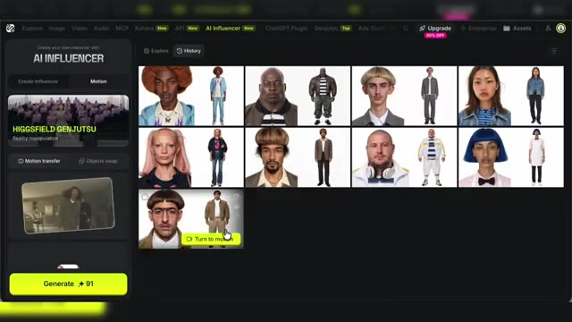  
  *⏱️ 00:03:35 — Interface du générateur montrant la grille d'influenceurs IA et le panneau de sélection de mouvement.*
- 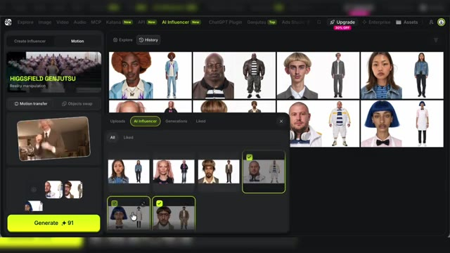  
  *⏱️ 00:03:46 — Affichage de la fenêtre modale permettant de sélectionner et d'ajouter plusieurs influenceurs IA comme référence.*

---

### ⏱️ `[00:03:48 - 00:04:09]` | Segment #12

**🔊 Audio (Transcription Intégrale Mot pour Mot en Français) :**
> Voilà le résultat. C'est vraiment bluffant. Alors je te le disais en intro, les possibilités sont assez grandes. tu peux choisir des vidéos de chorégraphie, des mèmes internet, des vidéos virales que tu as vu que tu aimerais recréer avec tes personnages IA.

**👁️ Analyse Visuelle d'Écran (gemini-3.5-flash-lite) :**
**Interface & Outils** : Interface web de génération vidéo par IA (type Higgsfield Genjutsu / AI Influencer).
**Contenu textuel & Code** : Menu de sélection des personnages "AI Influencer", boutons de création, onglets "Motion transfer", "Objects swap", et bouton "Generate".
**Action / Démonstration** : Le créateur montre l'interface de sélection des personnages et des styles pour illustrer les possibilités de création de vidéos virales avec l'IA.

**Captures d'écran :**
- 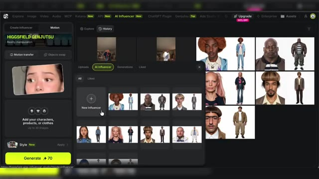  
  *⏱️ 00:04:07 — Capture d'écran de l'interface du générateur vidéo par IA montrant les différents personnages disponibles ("AI Influencer") et les options de génération.*

---

### ⏱️ `[00:04:09 - 00:04:28]` | Segment #13

**🔊 Audio (Transcription Intégrale Mot pour Mot en Français) :**
> En fait, n'importe quelle vidéo de 30 secondes, tu peux la reprendre pour y mettre en scène tes influenceurs IA. Comme tu le vois à l'écran, j'ai fait plusieurs tests avec à chaque fois d'excellents résultats. Et ici, je me suis concentré sur le remplacement de personnages, mais rien ne t'empêche aussi d'ajouter un produit sur un plan existant ou tout simplement changer la tenue d'un personnage.

**👁️ Analyse Visuelle d'Écran (gemini-3.5-flash-lite) :**
**Interface & Outils** : Vidéos comparatives (split-screen) intégrées dans le montage du tutoriel.
**Contenu textuel & Code** : Séquences vidéo montrant divers personnages et influenceurs virtuels générés ou modifiés par l'IA.
**Action / Démonstration** : Le créateur présente plusieurs exemples concrets de remplacement de personnages dans des vidéos existantes.

---

### ⏱️ `[00:04:28 - 00:04:49]` | Segment #14

**🔊 Audio (Transcription Intégrale Mot pour Mot en Français) :**
> C'est aussi des choses possibles avec Jenjutsu. Et si Genjutsu est un super modèle d'édition IA qui en plus ne coûte pas très cher en crédit, il y a d'autres modèles de vidéos spécialisés dans l'édition disponibles sur Xfield. On peut notamment citer Seed Dance 2.5 en mode édition ou encore Cling Motion. Et là aussi, tu pourras avec ces modèles facilement y utiliser tes influenceurs IA.

**👁️ Analyse Visuelle d'Écran (gemini-3.5-flash-lite) :**
**Interface & Outils** : Interface web de la plateforme Xfield (générateur de vidéo IA).
**Contenu textuel & Code** : Menus de sélection de modèles IA ('Seedance 2.5 Edit', 'Kling Motion'), panneau de prompt, paramètres de résolution (1080p, Bitrate High) et bouton 'Generate'.
**Action / Démonstration** : Le créateur montre l'interface d'édition vidéo et parcourt la liste des différents modèles de génération et d'édition disponibles sur Xfield.

**Captures d'écran :**
- 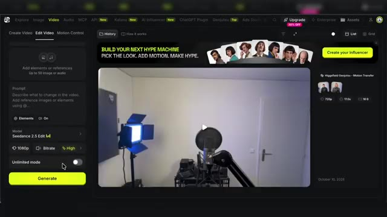  
  *⏱️ 00:04:39 — Interface de la plateforme Xfield avec l'onglet 'Edit Video' ouvert, montrant le modèle 'Seedance 2.5 Edit' sélectionné et l'aperçu d'une pièce avec un micro.*
- 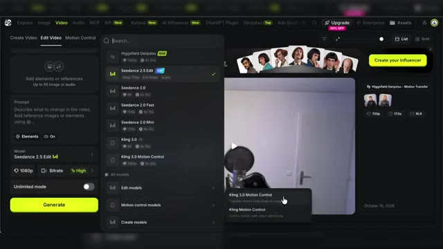  
  *⏱️ 00:04:48 — Menu déroulant des modèles d'édition vidéo sur Xfield, affichant Seedance, Kling et Higgsfield Genjutsu.*

---

### ⏱️ `[00:04:49 - 00:05:15]` | Segment #15

**🔊 Audio (Transcription Intégrale Mot pour Mot en Français) :**
> Et pareil pour la création des influenceurs IA, tu peux le faire aussi à l'aide de modèles images classiques Et tu pourras avoir de bons résultats avec par exemple JGPT Image 2.5 ou encore Nano Banana 2.1. C'est aussi une option qui t'offre un peu plus de liberté malgré le fait que le générateur d'influenceurs IA d'XField est vraiment bien fait et on voit, ils ont tout à fait compris la traîne d'actuel autour de ces influenceurs IA.

**👁️ Analyse Visuelle d'Écran (gemini-3.5-flash-lite) :**
**Interface & Outils** : Interface web de génération d'images et de modèles d'influenceurs virtuels (GPT Image 2).
**Contenu textuel & Code** : Panneau latéral avec le prompt « est ce que tu peux me faire avec la coupe de cheveux la moustache et le look du deuxième personnage en ref », miniatures de référence et sélecteur de modèle.
**Action / Démonstration** : Démonstration de la création et de la personnalisation d'un influenceur IA multi-angles à l'aide d'un modèle d'image.

**Captures d'écran :**
- 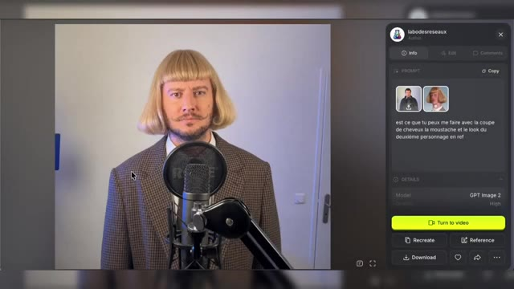  
  *⏱️ 00:04:50 — Interface d'un générateur d'images montrant un personnage virtuel généré avec le modèle GPT Image 2.*
-   
  *⏱️ 00:05:02 — Même interface de génération d'images, affichant le panneau latéral de configuration avec le prompt textuel et les images de référence.*
- 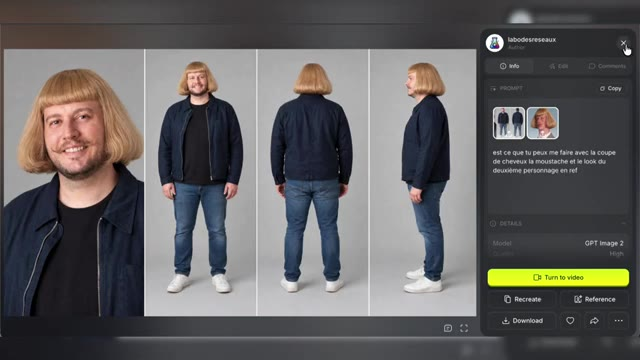  
  *⏱️ 00:05:14 — Visualisation de quatre angles de vue différents d'un influenceur virtuel complet généré par l'outil d'intelligence artificielle.*

---

### ⏱️ `[00:05:15 - 00:05:36]` | Segment #16

**🔊 Audio (Transcription Intégrale Mot pour Mot en Français) :**
> Bon alors, qu'est-ce que vont devenir les réseaux sociaux ? Ces influenceurs IA, ils me rappellent un autre phénomène qu'on a connu il y a quelques mois, le brain rot. Des personnages IA mis en scène dans différentes situations, avec un lore autour de ces personnages, des histoires qui s'entremêlaient, des codes, une vraie notoriété, et beaucoup de créateurs qui voulaient surfer sur cette tendance.

**👁️ Analyse Visuelle d'Écran (gemini-3.5-flash-lite) :**
**Interface & Outils** : Studio vidéo YouTube (Labo Des Réseaux) avec incrustation d'infographies animées.
**Contenu textuel & Code** : Textes : 'POUR CONCLURE', 'QUE VONT DEVENIR', 'BRAINROT', listes à puces avec coches vertes détaillant les caractéristiques du phénomène (personnages IA, lore, histoires liées, codes, notoriété, créateurs).
**Action / Démonstration** : Présentation du sujet par le créateur face caméra, illustré par des graphiques animés séquentiels.

---

### ⏱️ `[00:05:37 - 00:06:03]` | Segment #17

**🔊 Audio (Transcription Intégrale Mot pour Mot en Français) :**
> Et bien avec ces influenceurs IA, on est peut-être au début d'une trend du même genre. Le souci, c'est que ces influenceurs repoussent ici un peu plus la notion de propriété intellectuelle sur les réseaux. Une notion qui a déjà été bien mise à mal avec l'arrivée du format vertical sur les réseaux, Et la question se pose, est-ce qu'utiliser une vidéo déjà existante, mais seulement comme référence pour sa création IA, sera considéré comme du vol de contenu ?

**👁️ Analyse Visuelle d'Écran (gemini-3.5-flash-lite) :**
**Interface & Outils** : Studio vidéo et graphismes animés du Labo Des Réseaux
**Contenu textuel & Code** : Textes explicatifs, graphismes et schémas conceptuels sur la propriété intellectuelle et les influenceurs IA
**Action / Démonstration** : Présentation orale du sujet par le créateur avec appui visuel graphique

---

### ⏱️ `[00:06:03 - 00:06:22]` | Segment #18

**🔊 Audio (Transcription Intégrale Mot pour Mot en Français) :**
> Est-ce que les influenceurs IA vont réussir à s'installer dans le temps ? Est-ce que les réseaux vont se remplir d'avatar IA qui enchaînent les challenges et les corées ? Je n'ai pas une boule de cristal, en tout cas on voit bien des influenceurs IA aujourd'hui émerger. Mais comme les créateurs à succès d'aujourd'hui, il faudra que ces influenceurs arrivent à proposer autre chose que des corées.

**👁️ Analyse Visuelle d'Écran (gemini-3.5-flash-lite) :**
**Interface & Outils** : Aucun logiciel ou interface technique n'est affiché.
**Contenu textuel & Code** : Texte à l'écran : 'LES INFLUENCEURS IA', 'COMME', 'CRÉATEURS À SUCCÈS', 'INFLUENCEURS IA'.
**Action / Démonstration** : Le créateur présente le sujet face caméra en s'appuyant sur des illustrations graphiques.

---

### ⏱️ `[00:06:22 - 00:06:42]` | Segment #19

**🔊 Audio (Transcription Intégrale Mot pour Mot en Français) :**
> En tout cas, s'ils veulent durer dans le temps. Donc les modèles vidéo IA d'édition, c'est très bien pour ton influenceur. Mais n'hésite pas à lui donner une voix pour lui faire faire autre chose que ce que tout le monde propose. Car proposer un contenu original n'a jamais été aussi important qu'à une époque où tout le monde peut recopier la même chose en 3 clics.

**👁️ Analyse Visuelle d'Écran (gemini-3.5-flash-lite) :**
**Interface & Outils** : Vidéo YouTube face caméra avec habillage graphique animé (incrustations textuelles et illustrations).
**Contenu textuel & Code** : Textes animés : 'CRÉATEURS À SUCCÈS', 'INFLUENCEURS IA', 'TON INFLUENCEUR IA', 'LES MODÈLES D'ÉDITION', 'DONNE-LUI UNE VOIX'.
[HONEST_NOTE] Le segment montre uniquement le présentateur face caméra avec des graphismes animés illustrant ses propos, sans interface logicielle ni outil technique réel.
**Action / Démonstration** : Démonstration et mise en contexte pratique.

---

### ⏱️ `[00:06:42 - 00:06:49]` | Segment #20

**🔊 Audio (Transcription Intégrale Mot pour Mot en Français) :**
> Si tu veux tester la création d'influenceurs IA, je te remets le lien en description, en commentaire épinglé. Merci et à bientôt sur le Labo des Réseaux.

**👁️ Analyse Visuelle d'Écran (gemini-3.5-flash-lite) :**
**Interface & Outils** : Navigateur web, site Higgsfield (section AI Influencer).
**Contenu textuel & Code** : Menu supérieur avec les onglets Explore, Image, Video, Audio, MCP, Katana, API, AI Influencer Free, ChatGPT Plugin, Genjutsu, et une flèche rose de redirection vers le lien en description.
**Action / Démonstration** : Le créateur montre l'interface de la plateforme Higgsfield et indique l'emplacement du lien en description pour tester la création d'influenceurs IA.

**Captures d'écran :**
- 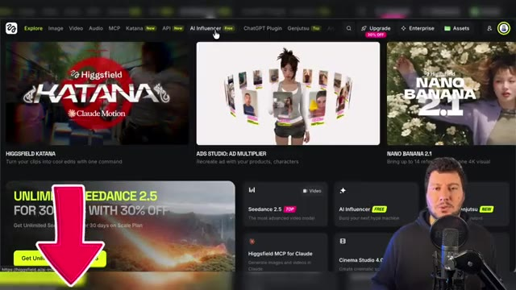  
  *⏱️ 00:06:46 — Interface du site web Higgsfield affichant le menu 'AI Influencer' et une flèche rose pointant vers le lien en bas.*
- 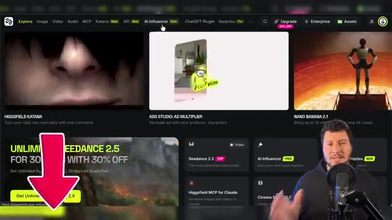  
  *⏱️ 00:06:48 — Vue légèrement modifiée de l'interface du site web Higgsfield sur le menu 'AI Influencer' avec la flèche rose de redirection.*

---
