# 🎬 J'ai créé un jeu d'enquête où les personnages IA me parlent (Claude + Fish Audio)

> **Chaîne** : [Labo Des Réseaux](https://www.youtube.com/@labodesreseaux)  
> **Lien YouTube** : [https://www.youtube.com/watch?v=_UBCQAy9kG8](https://www.youtube.com/watch?v=_UBCQAy9kG8)  
> **Date de publication** : 20261012  
> **Durée** : 11:59  
> **Identifiant vidéo** : `_UBCQAy9kG8`  
> **Modèles** : Audio: `whisper-v3-large-turbo` | Vision: `gemini-3.5-flash-lite`  

---

## 📌 Synthèse Exécutive & Outils

### 💡 Résumé
**Dans cette vidéo, le créateur de la chaîne "Labo Des Réseaux" présente la conception d'un jeu d'enquête interactif de type "point-and-click" inspiré des classiques des années 90, entièrement développé à l'aide de l'intelligence artificielle.** L'originalité du projet réside dans le fait que tous les suspects et domestiques du manoir disposent d'un cerveau textuel et d'une voix de synthèse, permettant au joueur de leur poser n'importe quelle question à l'oral ou à l'écrit et d'obtenir des réponses dynamiques et contextuelles en temps réel.

**Le tutoriel détaille pas à pas l'architecture technique et méthodologique nécessaire pour assembler un tel projet rapidement sans compétences avancées en programmation traditionnelle.** Le créateur s'appuie sur Claude Code et l'API d'Anthropic pour générer la logique du jeu en local et piloter la personnalité des personnages, sur GPT-Image 2.5 pour produire les actifs visuels à partir de prompts automatisés, et sur l'API Fish Audio pour doter chaque protagoniste d'une voix réaliste et nuancée adaptée à son rôle.

**L'expérience démontre l'énorme potentiel de l'immersion narrative permise par l'alliance des grands modèles de langage et de la synthèse vocale ultra-réaliste.** Bien qu'il s'agisse d'un projet personnel et démonstratif non destiné à la commercialisation, cette expérimentation prouve qu'il est désormais possible de prototyper des applications narratives complexes et interactives en un temps record, ouvrant la voie à de multiples cas d'usage dans le jeu vidéo indépendant et les interfaces conversationnelles.

### 🛠️ Outils, Modèles & Logiciels Présentés
- **Claude Code / Claude Opus 5.5 (Anthropic) :** Assistant de développement et modèle LLM utilisé pour coder l'application en local et alimenter le cerveau des PNJ.**
- **Fish Audio (S2.1 Pro) :** Plateforme de synthèse vocale et d'API audio utilisée pour générer les voix des personnages, les échantillons et gérer le contrôle émotionnel via des balises.**
- **GPT-Image 2.5 (ChatGPT) :** Modèle de génération d'images utilisé pour concevoir les assets graphiques et décors du jeu de type point-and-click.**
- **macOS / Finder :** Environnement de bureau utilisé pour stocker et structurer les fichiers locaux du projet.**

### 🔑 Points Clés & Enseignements Stratégiques
- Architecture hybride cerveau-voix :** Associer un LLM (comme Claude Opus) pour la logique conversationnelle et une API de synthèse vocale (Fish Audio) permet de créer des PNJ capables de simuler une véritable personnalité.
- Gratuité temporaire des API :** Le modèle Fish Audio S2.1 Pro est accessible gratuitement en API jusqu'en novembre 2026, constituant une opportunité économique majeure pour les développeurs indépendants.
- Génération automatisée des assets :** Demander au LLM de rédiger directement les prompts graphiques destinés à une IA de génération d'images (comme ChatGPT) simplifie grandement la création cohérente des décors.
- Immersion par le dialogue libre :** Permettre au joueur de poser des questions textuelles sans limites prédéfinies renforce considérablement l'immersion par rapport à des arbres de dialogue figés.
- Gestion aléatoire du coupable :** Désigner le coupable de manière aléatoire à chaque début de partie garantit une rejouabilité et oblige le joueur à analyser les contradictions des témoignages.
- Recoupement des indices :** Le gameplay repose sur l'investigation pure : les suspects mentent ou se protègent, forçant le joueur à croiser les déclarations (par exemple, le alibi du cuisinier contredit par la bonne).
- Contrôle des émotions vocales :** L'utilisation de guides de balises audio permet d'injecter des nuances tonales et émotionnelles dans les réponses vocales des personnages pour coller à leurs réactions (agacement, connivence).
- Sélection granulaire des voix :** Générer des échantillons vocaux locaux via l'API permet de tester et d'attribuer facilement une voix spécifique et crédible à chaque personnage du manoir.
- Prototypage ultra-rapide en local :** Centraliser tous les fichiers dans un dossier sur le bureau via un assistant de code permet de monter une application fonctionnelle en quelques heures seulement.

---

## ⏱️ Chronologie & Transcription Complète Audio & Visuelle (Mot pour Mot)

### ⏱️ `[00:00:01 - 00:00:20]` | Segment #01

**🔊 Audio (Transcription Intégrale Mot pour Mot en Français) :**
> Allez, cette fois-ci, je vais me diriger vers le salon. On va aller questionner la comtesse. Et on va tenter un truc. Vous avez une belle tête de coupable. On va voir comment elle va réagir. Oula ! Je vous demande pardon ?

**👁️ Analyse Visuelle d'Écran (gemini-3.5-flash-lite) :**
**Interface & Outils** : Jeu d'enquête textuelle et visuelle sur navigateur ou application.
**Contenu textuel & Code** : Texte de dialogue entre le détective et la Comtesse Irene de Saint-Aymar, options de questions et champ de saisie du joueur.
**Action / Démonstration** : Le créateur navigue dans le jeu, sélectionne un personnage à interroger et tape une phrase provocquante dans l'interface de discussion.

**Captures d'écran :**
- 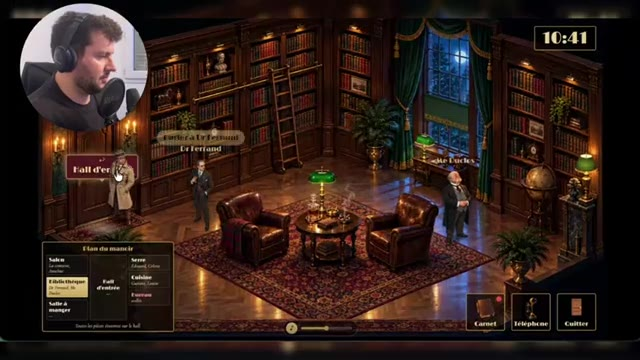  
  *⏱️ 00:00:02 — Vue d'ensemble de la bibliothèque du manoir dans le jeu d'enquête interactive avec les différents personnages disponibles.*
- 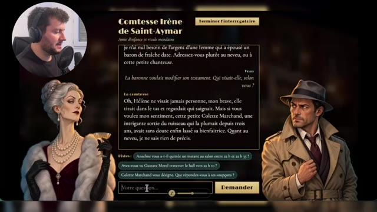  
  *⏱️ 00:00:10 — Écran d'interrogatoire avec la Comtesse Irene de Saint-Aymar, affichant les dialogues et les options de questions.*
- 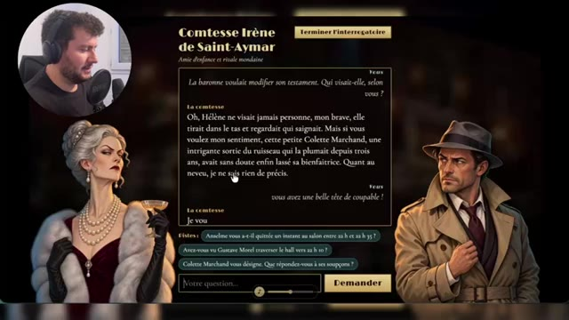  
  *⏱️ 00:00:18 — Poursuite de l'interrogatoire de la comtesse où le joueur tape une réplique provocquante dans l'interface de discussion.*

---

### ⏱️ `[00:00:20 - 00:00:39]` | Segment #02

**🔊 Audio (Transcription Intégrale Mot pour Mot en Français) :**
> Surveillez votre langage, mon brave. Vous ne parlez pas à une fille de cuisine. Une tête de coupable ? Voilà donc les méthodes de la police judiciaire. Le préfet dîne chez les Rochoirs jeudi. et je doute qu'il goûte votre sens de la physionomie. Oula, le préfet, je vais me retrouver dans la sauce. Je rigolais, je rigolais.

**👁️ Analyse Visuelle d'Écran (gemini-3.5-flash-lite) :**
**Interface & Outils** : Présentation orale ou séquence sans interface partagée.
**Contenu textuel & Code** : Explications et conseils de création de contenu / IA.
**Action / Démonstration** : Démonstration et mise en contexte pratique.

---

### ⏱️ `[00:00:40 - 00:00:59]` | Segment #03

**🔊 Audio (Transcription Intégrale Mot pour Mot en Français) :**
> Bon, je ne suis pas en train de lancer une carrière de streamer. Je teste simplement le jeu que j'ai créé avec Claude et Fichodio. Sur le papier, ça ressemble à un jeu d'enquête classique. Plusieurs suspects, je dois trouver le coupable en les interrogeant. Sauf qu'il y a une particularité. Tous les personnages me répondent à l'oral en temps réel en fonction des questions que je leur pose.

**👁️ Analyse Visuelle d'Écran (gemini-3.5-flash-lite) :**
**Interface & Outils** : Interface de jeu vidéo d'enquête, webcam du créateur, graphiques animés.
**Contenu textuel & Code** : Jeu d'enquête avec suspects, interface d'interrogatoire textuelle/vocale, nom du personnage Colette Marchand, options de questions.
**Action / Démonstration** : Le créateur présente et teste le jeu d'enquête interactif qu'il a conçu, montrant l'exploration de la scène de crime et l'interrogatoire des suspects.

**Captures d'écran :**
- 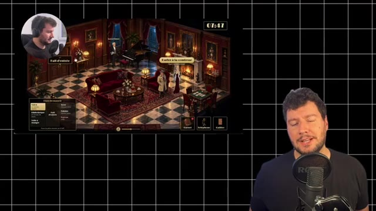  
  *⏱️ 00:00:41 — Le créateur présente l'interface du jeu d'enquête créé avec Claude et Fichodio, montrant une pièce avec des suspects et l'horloge en haut à droite.*
- 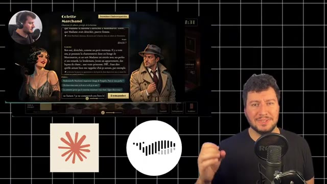  
  *⏱️ 00:00:57 — Le créateur montre l'interface d'interrogatoire d'un suspect (Colette Marchand) avec des options de dialogue et des graphiques audio en bas.*

---

### ⏱️ `[00:00:59 - 00:01:20]` | Segment #04

**🔊 Audio (Transcription Intégrale Mot pour Mot en Français) :**
> Pourquoi ce geste ? Vous et la baronne avez eu une liaison, je ne comprends pas bien le geste. Une liaison ? Et madame ? On ne me l'avait jamais faite, mon chou ! Dans cette vidéo, je vais te présenter le projet et t'expliquer comment j'ai donné une voix et un cerveau au personnage de mon jeu.

**👁️ Analyse Visuelle d'Écran (gemini-3.5-flash-lite) :**
**Interface & Outils** : Interface du jeu vidéo d'enquête (fenêtre de dialogue avec illustrations de personnages, choix de questions et bouton de validation).
**Contenu textuel & Code** : Textes de dialogue entre l'enquêteur (Vous) et le PNJ Colette Marchand, avec les options de questions (« Pistes ») situées en bas.
**Action / Démonstration** : Le créateur présente une séquence de gameplay interactif de son jeu vidéo, montrant le système de discussion textuelle avec le personnage intelligent.

**Captures d'écran :**
- 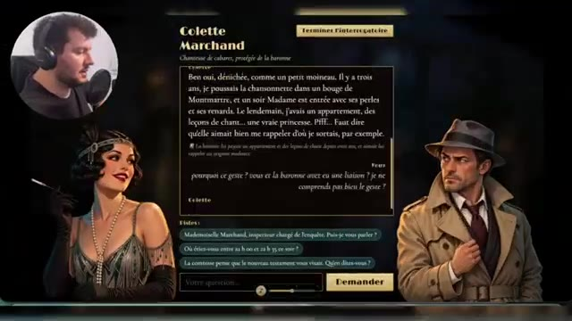  
  *⏱️ 00:01:00 — Interface du jeu montrant le personnage de Colette Marchand en discussion avec l'enquêteur.*
- 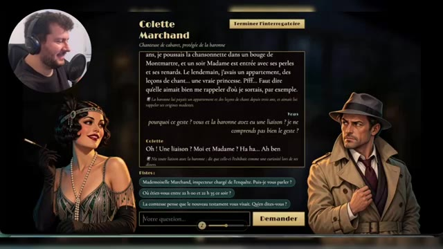  
  *⏱️ 00:01:09 — Suite du dialogue de l'interrogatoire avec la réaction du personnage Colette Marchand.*

---

### ⏱️ `[00:01:20 - 00:01:42]` | Segment #05

**🔊 Audio (Transcription Intégrale Mot pour Mot en Français) :**
> Pour ce projet, j'ai utilisé trois outils. Cloud Code pour le développement, avec aussi l'API de Claude, on y reviendra. GPT Image 2.5 pour les assets graphiques du jeu et Fiches Audio qui sponsorisent cette vidéo. C'est d'ailleurs l'élément clé du projet parce que c'est grâce à l'API de Fiche Audio que tous mes personnages vont prendre vie. Fiche Audio, c'est une plateforme de synthèse vocale avec beaucoup de fonctionnalités.

**👁️ Analyse Visuelle d'Écran (gemini-3.5-flash-lite) :**
**Interface & Outils** : Interface web de Fish Audio, infographie animée de présentation.
**Contenu textuel & Code** : Noms des 3 outils : Claude Code (Développement), GPT Image 2.5 (Assets graphiques), Fish Audio (Voix des personnages, Sponsor). Dashboard Fish Audio avec options Texte en parole, Créer une voix, Image et vidéo.
**Action / Démonstration** : Présentation des trois outils technologiques utilisés pour concevoir le projet de jeu vidéo.

**Captures d'écran :**
- 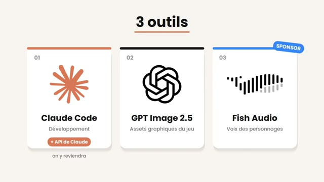  
  *⏱️ 00:01:31 — Infographie présentant les trois outils utilisés pour le projet : Claude Code, GPT Image 2.5 et Fish Audio.*
- 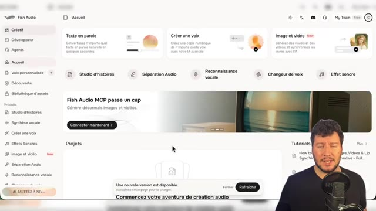  
  *⏱️ 00:01:40 — Capture d'écran du tableau de bord de la plateforme Fish Audio avec le créateur en bas à droite.*

---

### ⏱️ `[00:01:42 - 00:02:04]` | Segment #06

**🔊 Audio (Transcription Intégrale Mot pour Mot en Français) :**
> Génération de voix IA avec une large bibliothèque, création de voix sur mesure, changement de voix, création d'effets sonores, séparation de voix. Il y a même un accès à des modèles IA de génération d'images et vidéos, la possibilité de créer des agents vocaux. Bref, un outil très complet. Ce qui nous intéresse aujourd'hui, c'est la partie développeur. utiliser Fiche Audio en API pour donc donner une voix à nos personnages.

**👁️ Analyse Visuelle d'Écran (gemini-3.5-flash-lite) :**
**Interface & Outils** : Interface Web de Fish Audio (plateforme de génération audio, image et vidéo par IA).
[DESC_IMAGE_3] Menus du tableau de bord développeur, graphiques d'utilisation, options de clés API et d'équilibre.
**Contenu textuel & Code** : Explications et conseils de création de contenu / IA.
**Action / Démonstration** : Le créateur présente les différentes fonctionnalités de la plateforme Fish Audio, en insistant sur la partie développement et API.

**Captures d'écran :**
- 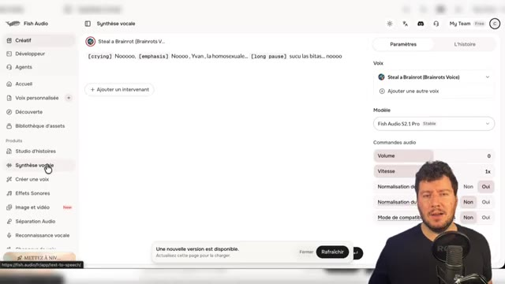  
  *⏱️ 00:01:43 — Interface de synthèse vocale de Fish Audio montrant un champ de texte avec des balises d'émotion et les paramètres de voix à droite.*
- 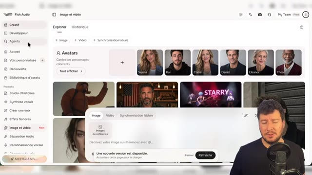  
  *⏱️ 00:01:53 — Interface de génération d'images et vidéos avec des avatars pré-sélectionnés (Sienna, Kai, Claire, Daniel, etc.) et une fenêtre pop-up pour les images de référence.*
- 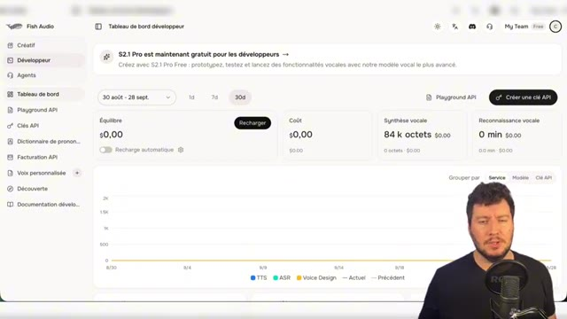  
  *⏱️ 00:02:02 — Tableau de bord développeur de Fish Audio présentant les statistiques d'utilisation, les coûts ($0,00), la synthèse vocale (84k octets) et les options d'API.*

---

### ⏱️ `[00:02:04 - 00:02:24]` | Segment #07

**🔊 Audio (Transcription Intégrale Mot pour Mot en Français) :**
> Et bonne nouvelle, le modèle Fiche Audio S21 Pro est entièrement gratuit en accès en API jusqu'à la fin novembre 2026. Pour mon projet, il m'a suffi de créer un compte gratuitement sur Fiche Audio, d'aller dans l'espace développeur et de créer une clé API. J'ai obtenu toutes les voix de mon jeu sans dépenser un seul centime. Si comme moi tu veux en profiter, le lien est en description et commentaire épinglé.

**👁️ Analyse Visuelle d'Écran (gemini-3.5-flash-lite) :**
**Interface & Outils** : Site web et tableau de bord développeur de Fish Audio (Fish Audio S21 Pro).
**Contenu textuel & Code** : Titres de pages annonçant "Fish Audio S21 Pro: Free Text-to-Speech API for Developers" et fenêtre modale "Créer une clé API" avec les champs "Nom de la clé" (saisi: api key) et options d'expiration.
**Action / Démonstration** : Le créateur montre la page d'annonce de la gratuité du service puis illustre la procédure de création d'une clé API sur la plateforme Fish Audio.

**Captures d'écran :**
- 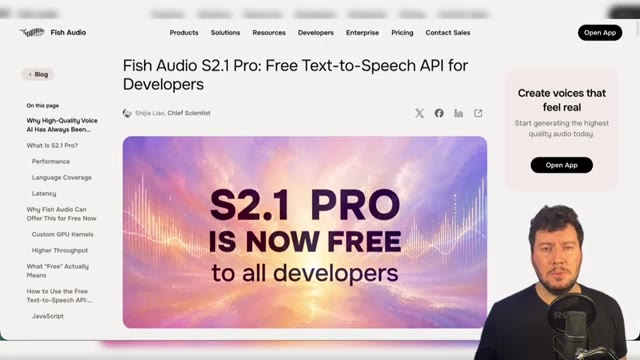  
  *⏱️ 00:02:05 — Capture d'écran du site Fish Audio présentant l'article sur la gratuité de l'API S21 Pro pour les développeurs.*
- 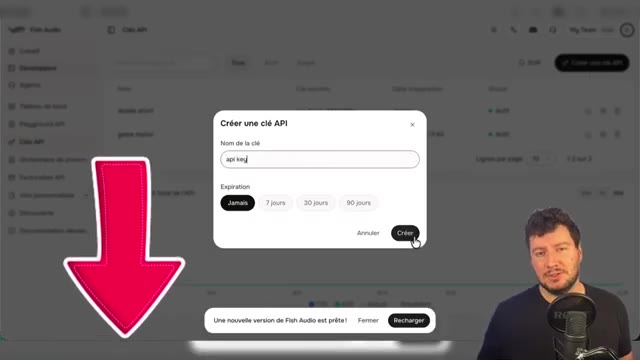  
  *⏱️ 00:02:23 — Interface du tableau de bord Fish Audio affichant la fenêtre modale de création d'une clé API avec une flèche rose de signalisation.*

---

### ⏱️ `[00:02:24 - 00:02:43]` | Segment #08

**🔊 Audio (Transcription Intégrale Mot pour Mot en Français) :**
> L'idée de mon jeu est la suivante. Tu incarnes un inspecteur de police qui enquête sur un meurtre qui vient d'avoir lieu dans un manoir, celui de la baronne Van Bergen. Le but, interroger tous les suspects encore sur place pour trouver le coupable. Et pour ça, il faut donner à chaque personnage la capacité de nous répondre.

**👁️ Analyse Visuelle d'Écran (gemini-3.5-flash-lite) :**
**Interface & Outils** : Présentation vidéo au format graphique épuré avec incrustation du présentateur.
**Contenu textuel & Code** : Textes explicatifs du concept du jeu : "L'idée du jeu", "Inspecteur de police", "Meurtre", "Manoir de la baronne Van Bergen".
[DESC_IMAGE_3] Le créateur présente visuellement le concept narratif du jeu d'enquête interactive.
**Action / Démonstration** : Démonstration et mise en contexte pratique.

---

### ⏱️ `[00:02:43 - 00:03:07]` | Segment #09

**🔊 Audio (Transcription Intégrale Mot pour Mot en Français) :**
> Et pour qu'un personnage puisse nous répondre, il lui faut deux choses, un cerveau et une voix. Le cerveau, ça sera Claude Opus 5.5 via API, et la voix, ça sera l'API de fiche audio. Ensuite, chaque personnage a sa personnalité, son histoire, ses relations avec les autres personnages. Le gameplay est plutôt simple, on se balade dans le manoir pour interroger chaque personnage, on pose les questions qu'on veut sans aucune limite, et le personnage nous répond en temps réel.

**👁️ Analyse Visuelle d'Écran (gemini-3.5-flash-lite) :**
**Interface & Outils** : Graphismes animés et schémas explicatifs intégrés dans la vidéo YouTube.
**Contenu textuel & Code** : Texte 'Le gameplay simple', grille de pièces/personnages, question posée 'Où étiez-vous hier soir ?' et animation d'onde sonore bleue.
**Action / Démonstration** : Le créateur illustre visuellement le fonctionnement des interactions et du gameplay du projet basé sur l'IA.

**Captures d'écran :**
- 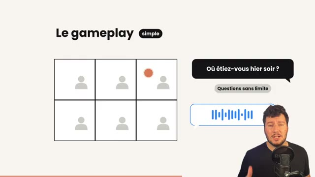  
  *⏱️ 00:03:06 — Schéma explicatif du 'gameplay simple' avec une grille de personnages et une bulle de discussion audio 'Où étiez-vous hier soir ?'.*

---

### ⏱️ `[00:03:08 - 00:03:31]` | Segment #10

**🔊 Audio (Transcription Intégrale Mot pour Mot en Français) :**
> A chaque début de partie, un coupable est désigné de façon aléatoire, donc impossible de savoir à l'avance qui c'est. Le coupable va chercher à nous mentir, ce sera donc nos compétences d'inspecteur et notre capacité à poser les bonnes questions qui vont nous permettre de l'identifier en recoupant les témoignages. On a 40 minutes pour poser autant de questions qu'on veut, et dès qu'on a une idée du coupable, on appelle le commissaire pour lui donner le nom du suspect.

**👁️ Analyse Visuelle d'Écran (gemini-3.5-flash-lite) :**
**Interface & Outils** : Graphismes animés et éléments textuels intégrés sur fond blanc, accompagnés du présentateur en incrustation vidéo.
**Contenu textuel & Code** : Textes explicatifs sur le jeu, icônes de personnages, bulle de dialogue barrée avec la mention 'MENSONGE', chronomètre et icône de téléphone.
[DESC_IMAGE_3] Le présentateur explique les mécaniques de jeu, notamment le rôle du coupable, le mensonge, l'utilisation des compétences d'inspecteur et le temps limité pour enquêter.
**Action / Démonstration** : Démonstration et mise en contexte pratique.

**Captures d'écran :**
- 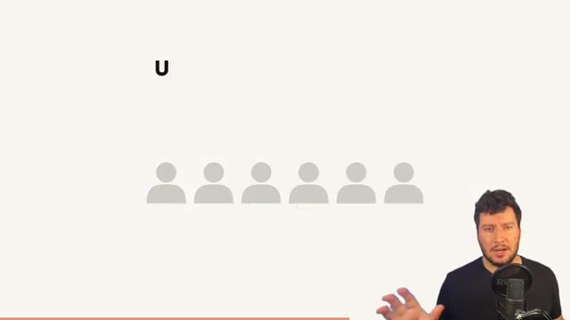  
  *⏱️ 00:03:09 — Animation représentant l'attribution aléatoire d'un coupable parmi un groupe de personnages.*
- 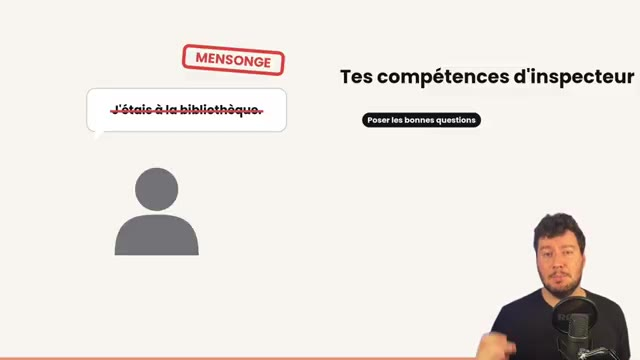  
  *⏱️ 00:03:19 — Illustration du mensonge d'un suspect avec un texte barré et le label 'MENSONGE', aux côtés du texte 'Tes compétences d'inspecteur'.*
- 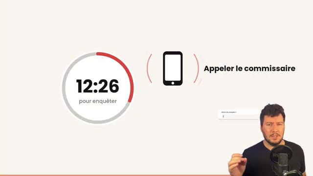  
  *⏱️ 00:03:30 — Affichage d'un chronomètre circulaire avec un temps restant et l'option 'Appeler le commissaire'.*

---

### ⏱️ `[00:03:32 - 00:03:52]` | Segment #11

**🔊 Audio (Transcription Intégrale Mot pour Mot en Français) :**
> Deux essais possibles, on a gagné, on reçoit une médaille, on s'est trompé, on est viré. J'ai déjà élaboré mon prompt pour guider Claude Code dans la réalisation du jeu. Il est plutôt long, donc je ne vais pas le détailler ici, mais si tu veux le récupérer, je mets le lien en description. Je précise, j'ai demandé à Claude de créer le jeu en local, donc tous les fichiers sont créés et stockés dans un même dossier sur mon bureau.

**👁️ Analyse Visuelle d'Écran (gemini-3.5-flash-lite) :**
**Interface & Outils** : Interface de notes/éditeur de texte et explorateur de fichiers macOS.
**Contenu textuel & Code** : Texte du prompt structuré (1. Cadre, 2. Déroulé d'une partie) et arborescence de dossiers du projet du jeu.
**Action / Démonstration** : Le créateur montre le prompt complet et l'arborescence des fichiers générés pour le jeu.

**Captures d'écran :**
- 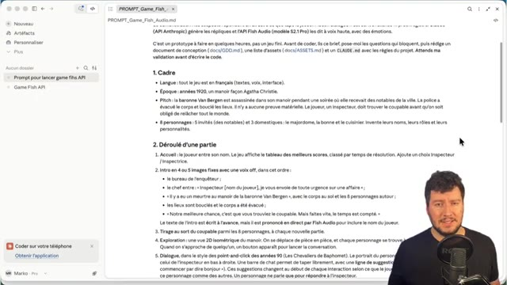  
  *⏱️ 00:03:42 — Affichage du prompt détaillé du jeu d'enquête (« Meurtre au manoir ») élaboré pour Claude Code avec le présentateur en bas à droite.*
- 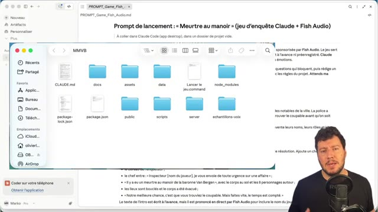  
  *⏱️ 00:03:51 — Affichage d'une fenêtre de gestion de fichiers du projet (dossiers docs, assets, data, server, etc.) par-dessus le prompt.*

---

### ⏱️ `[00:03:52 - 00:04:16]` | Segment #12

**🔊 Audio (Transcription Intégrale Mot pour Mot en Français) :**
> Pour que le jeu soit beau, j'ai également demandé à Claude de me préparer des prompts pour mes assailles. Et côté style et gameplay, je voulais quelque chose inspiré des point and click des années 90, style les chevaliers de Baphomet. C'est joli et ça a l'avantage d'être léger en animation et en affichage. J'ai précisé à Claude que les prompts étaient destinés à GPT-Image 2.5 et tu vois, il m'a préparé un fichier avec tous les prompts directement dans le dossier du jeu.

**👁️ Analyse Visuelle d'Écran (gemini-3.5-flash-lite) :**
**Interface & Outils** : Interface web de Claude / Assistant IA avec une fenêtre de prévisualisation de jeu.
**Contenu textuel & Code** : Texte de prompt destiné à générer des images dans le style des jeux d'aventure des années 90, avec une image de jeu en surimpression montrant des personnages en discussion dans un salon chaleureux.
**Action / Démonstration** : Le créateur montre le résultat de la génération de prompts pour le style artistique et l'intégration des graphismes dans le jeu vidéo.

**Captures d'écran :**
- 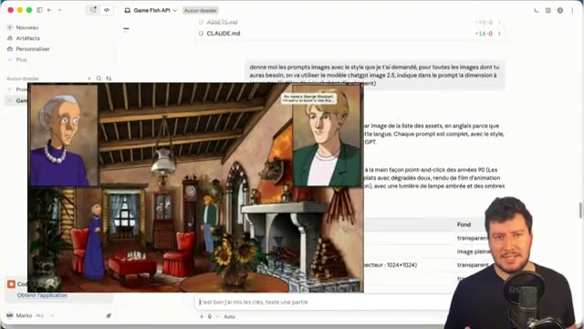  
  *⏱️ 00:04:04 — Capture d'écran montrant une interface de discussion avec l'assistant Claude et une fenêtre de jeu intégrée affichant un style visuel de type point-and-click des années 90, semblable aux Chevaliers de Baphomet.*

---

### ⏱️ `[00:04:16 - 00:04:36]` | Segment #13

**🔊 Audio (Transcription Intégrale Mot pour Mot en Français) :**
> je n'ai eu qu'à donner ce fichier à ChatGPT pour qu'il me crée tous les assets. Et pendant que ChatGPT me générait mes assets, j'ai demandé à Claude de commencer à me coder le jeu. Après quelques minutes de travail, j'ai eu une première version. Ce n'est pas mal, même si pour l'instant rien ne fonctionne vraiment, parce que je n'ai pas encore donné accès aux API qui alimentent les conversations avec les personnages.

**👁️ Analyse Visuelle d'Écran (gemini-3.5-flash-lite) :**
**Interface & Outils** : Système de fichiers macOS, interface de l'assistant IA Claude, navigateur web (localhost:3000).
[DESC_IMAGE_3]
**Contenu textuel & Code** : Fichiers Markdown du projet, interface de génération de code Claude, interface du jeu 'Meurtre au Manoir Van Bergen' affichant les faits établis par la police.
**Action / Démonstration** : Le créateur montre l'arborescence des fichiers du projet, le code généré par l'IA et teste le jeu d'enquête interactive dans le navigateur.

**Captures d'écran :**
- 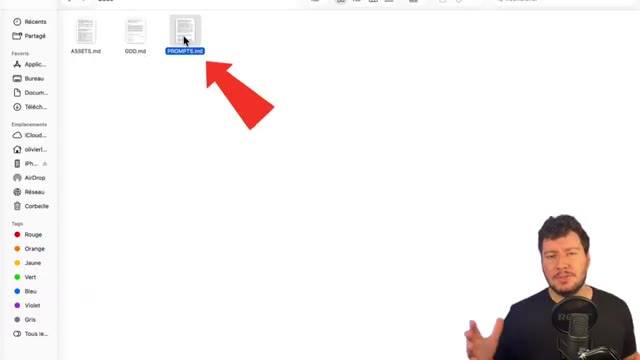  
  *⏱️ 00:04:17 — Explorateur de fichiers montrant les différents dossiers du projet (ASSETS.md, GDD.md, PROMPTS.md).*
- 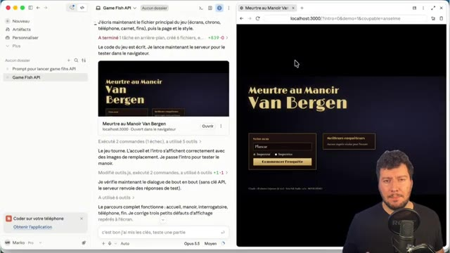  
  *⏱️ 00:04:26 — Interface de Claude affichant le code du jeu et un aperçu du site web 'Meurtre au Manoir Van Bergen' en cours de test sur localhost:3000.*
- 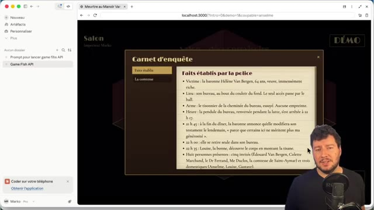  
  *⏱️ 00:04:35 — Aperçu dans le navigateur du jeu de rôle textuel et d'enquête 'Meurtre au Manoir Van Bergen' montrant le carnet d'enquête.*

---

### ⏱️ `[00:04:36 - 00:04:56]` | Segment #14

**🔊 Audio (Transcription Intégrale Mot pour Mot en Français) :**
> Mais côté gameplay, on a déjà une bonne première impression. Entre temps, ChatGPT a fini par créer tous mes assets. Le style est très sympa, je suis plutôt content du résultat. ChatGPT m'a préparé un zip avec l'ensemble des assets. Je donne simplement ce zip à Claude pour qu'il intègre les assets dans le dossier du jeu et qu'il attribue chaque asset à l'élément correspondant.

**👁️ Analyse Visuelle d'Écran (gemini-3.5-flash-lite) :**
**Interface & Outils** : Navigateur web, interface de ChatGPT et environnement de développement de type IDE/assistant IA.
**Contenu textuel & Code** : Menus de sélection de personnages, instructions en markdown, liste de fichiers modifiés (`characters.json`, `cases.json`, `case.js`) et génération d'images.
**Action / Démonstration** : Le créateur présente le jeu en cours de développement, montre la génération des assets par ChatGPT et l'intégration des fichiers dans le projet.

**Captures d'écran :**
- 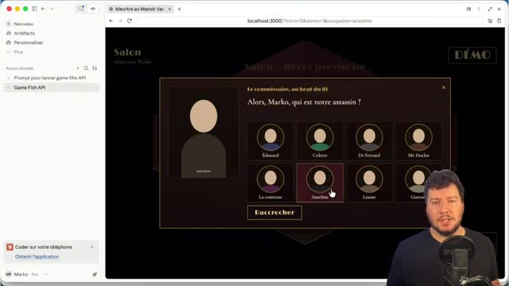  
  *⏱️ 00:04:37 — Interface du jeu en cours de test, affichant la liste des suspects et l'interface de sélection du coupable.*
- 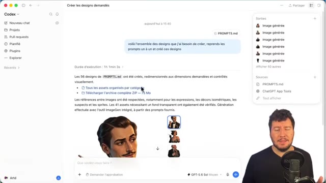  
  *⏱️ 00:04:46 — Interface de ChatGPT montrant la génération et l'organisation des 56 designs demandés pour le jeu.*
- 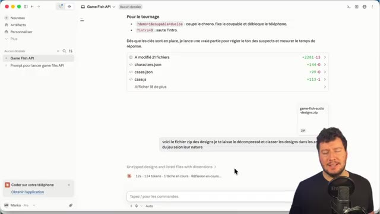  
  *⏱️ 00:04:54 — Interface de l'outil de développement montrant le transfert et le traitement du fichier zip contenant les assets du jeu.*

---

### ⏱️ `[00:04:56 - 00:05:15]` | Segment #15

**🔊 Audio (Transcription Intégrale Mot pour Mot en Français) :**
> J'ai maintenant mon gameplay, mes assets, et il ne me reste plus qu'à donner vie à mes personnages. Pour ça, je donne à Claude Code un accès à l'API d'Opus 5.5. Très facile, il te suffit de créer une clé API depuis ton compte Claude Platform. A noter, tu auras aussi besoin de créditer un peu ton compte pour que cette clé API fonctionne.

**👁️ Analyse Visuelle d'Écran (gemini-3.5-flash-lite) :**
**Interface & Outils** : Claude Console (platform.claude.com)
**Contenu textuel & Code** : Fenêtre de création de clé API avec les champs Nom, Expiration, Compte lié et Portée (Espace de travail par défaut), et le bouton « Créer une clé ».
**Action / Démonstration** : Le créateur montre comment générer une clé API depuis son compte Claude Platform.

**Captures d'écran :**
- 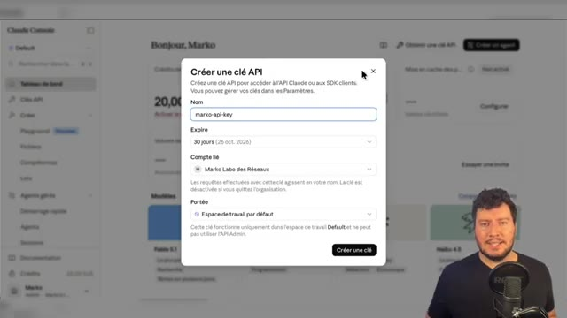  
  *⏱️ 00:05:06 — Interface de Claude Console montrant la fenêtre modale de création d'une clé API (« Créer une clé API ») avec un nom par défaut (« marko-api-key »).*
- 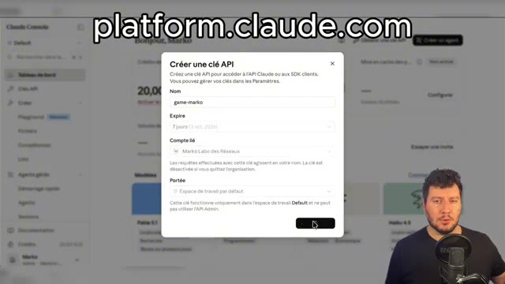  
  *⏱️ 00:05:14 — Même interface que l'image 2 avec l'URL « platform.claude.com » affichée en haut et le nom de la clé modifié en « game-marko ».*

---

### ⏱️ `[00:05:15 - 00:05:34]` | Segment #16

**🔊 Audio (Transcription Intégrale Mot pour Mot en Français) :**
> Moi j'ai mis 20$, ça devrait me suffire. Et pour donner une voix à mes personnages, cette fois-ci je vais utiliser l'API de Fiche Audio. Comme je te le disais, le modèle Fiche Audio S1.pro est gratuit en API jusqu'à fin novembre 2026. Tu te connectes à ton compte Fiche Audio, tu vas dans l'onglet développeur et tu crées une nouvelle clé API.

**👁️ Analyse Visuelle d'Écran (gemini-3.5-flash-lite) :**
**Interface & Outils** : Site web Fish Audio et interface du tableau de bord développeur.
**Contenu textuel & Code** : Textes "Fish Audio S2.1 Pro: Free Text-to-Speech API for Developers", menu développeur et options de création de clé API.
**Action / Démonstration** : Le créateur montre la documentation de l'API Fish Audio puis navigue vers le tableau de bord pour expliquer comment créer une clé API.

**Captures d'écran :**
- 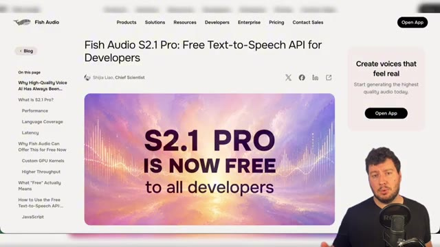  
  *⏱️ 00:05:25 — Page web de Fish Audio présentant l'API gratuite S2.1 Pro pour les développeurs.*
- 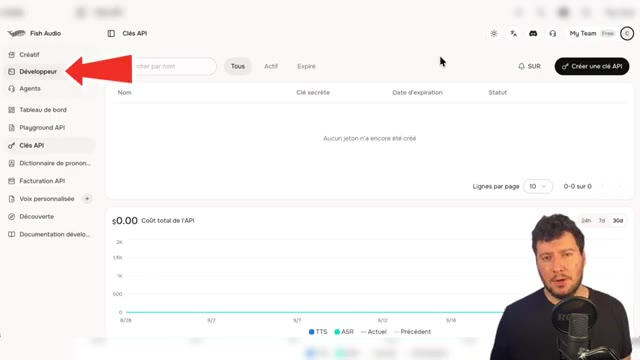  
  *⏱️ 00:05:32 — Interface de gestion de Fish Audio montrant l'onglet développeur et la section des clés API.*

---

### ⏱️ `[00:05:34 - 00:06:13]` | Segment #17

**🔊 Audio (Transcription Intégrale Mot pour Mot en Français) :**
> Le lien pour créer gratuitement ton compte Fiche Audio est en description et commentaire. Je donne ensuite directement cette clé API à Claude. Petite précision si tu t'inquiètes pour moi, toutes les clés API utilisées dans cette vidéo ont été supprimées depuis. Donc si tu envoies une s'afficher à l'écran, elle ne fonctionne plus au moment où tu regardes cette vidéo. En plus de la clé API fiche audio, j'ai donné de la documentation à Claude, notamment le guide édité par fiche audio sur le contrôle des émotions dans la voix et les tags audio. Ça va lui permettre de bien utiliser utiliser les tags avec mes personnages pour qu'ils répondent avec le ton adapté. Voilà j'ai tout ce qu'il me faut alors j'ai ouvert une première version du jeu pour faire quelques corrections.

**👁️ Analyse Visuelle d'Écran (gemini-3.5-flash-lite) :**
**Interface & Outils** : Dashboard de gestion de compte, fenêtre modale de création de clé API.
**Contenu textuel & Code** : Pop-up "Créer une clé API", champ "Nom de la clé", options d'expiration ("Jamais", "7 jours", "30 jours", "90 jours").
**Action / Démonstration** : Le créateur montre la procédure de génération d'une nouvelle clé API pour un service d'intelligence artificielle ou audio.

**Captures d'écran :**
- 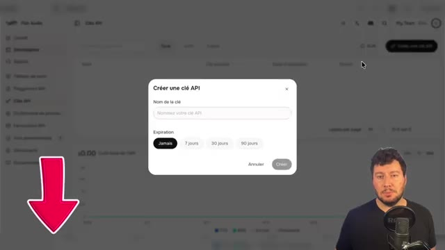  
  *⏱️ 00:05:35 — Interface web montrant la fenêtre modale de création d'une clé API avec le créateur en incrustation.*

---

### ⏱️ `[00:06:13 - 00:06:33]` | Segment #18

**🔊 Audio (Transcription Intégrale Mot pour Mot en Français) :**
> En effet Claude m'avait choisi des voix qui ne me plaisait pas forcément. Je lui ai demandé d'autres suggestions et ce qui est pratique c'est que toujours via l'API de fiche audio il m'a généré des échantillons dans le dossier du jeu. Je les ai écoutés et j'ai pu comme ça choisir de nouvelles voix. Alors j'ai demandé aussi quelques petites améliorations sur le gameplay au niveau de l'affichage.

**👁️ Analyse Visuelle d'Écran (gemini-3.5-flash-lite) :**
**Interface & Outils** : Interface de développement (type éditeur de code ou assistant IA type Claude/Cursor), Finder macOS, navigateur Web (localhost).
**Contenu textuel & Code** : Documentation de balises audio, liste de moments avec balises (Gustave, Louise, Colette), fichiers audio de test, aperçu du jeu vidéo.
**Action / Démonstration** : Le créateur montre comment l'API a généré et organisé des échantillons audio dans les dossiers du jeu pour tester différentes voix de personnages.

**Captures d'écran :**
- 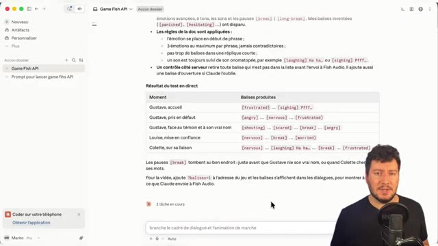  
  *⏱️ 00:06:14 — Interface d'une application de développement avec un panneau de code et un résultat de test en direct affichant des balises vocales.*
- 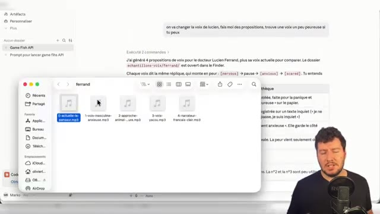  
  *⏱️ 00:06:23 — Fenêtre du Finder (macOS) superposée montrant un dossier contenant des fichiers audio MP3 d'échantillons de voix (ferrand).*
- 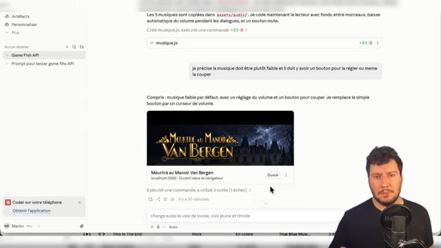  
  *⏱️ 00:06:32 — Interface de l'application montrant l'aperçu du jeu 'Meurtre au Manoir Van Bergen' hébergé localement sur localhost:3000.*

---

### ⏱️ `[00:06:33 - 00:06:52]` | Segment #19

**🔊 Audio (Transcription Intégrale Mot pour Mot en Français) :**
> Mon jeu fonctionne, je te propose, on lance une petite partie ensemble pour voir à quoi ça ressemble. On est sur l'écran du jeu, on va rentrer notre nom. On va choisir inspecteur Aspectrice. On va aller sur inspecteur Marco, let's go. Paris, octobre 1926. Il est presque minuit, qu'à des orfèvres.

**👁️ Analyse Visuelle d'Écran (gemini-3.5-flash-lite) :**
**Interface & Outils** : Interface graphique du jeu vidéo 'Meurtre au Manoir Van Bergen' avec incrustation webcam du créateur.
**Contenu textuel & Code** : Textes : "Meurtre au Manoir Van Bergen", "Votre nom : Marko", "Inspecteur", "Commencer l'enquête", et texte d'introduction "Paris, octobre 1926. Il est presque minuit, quai des Orfèvres...".
**Action / Démonstration** : Le créateur saisit son nom, sélectionne le rôle d'inspecteur et lance la partie pour découvrir l'introduction du jeu.

**Captures d'écran :**
- 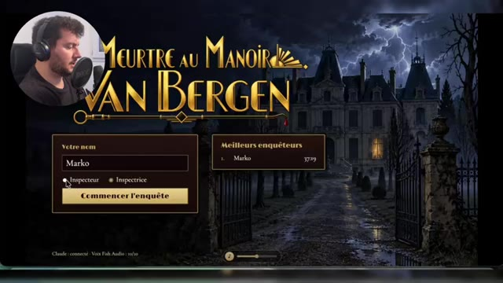  
  *⏱️ 00:06:43 — Écran de démarrage et de configuration du jeu 'Meurtre au Manoir Van Bergen' avec champ de saisie du nom et choix du genre.*
- 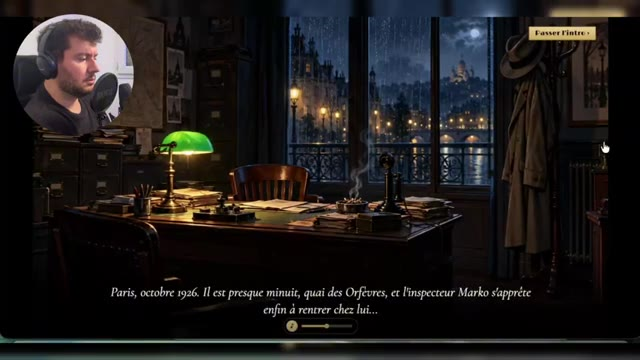  
  *⏱️ 00:06:50 — Scène d'introduction du jeu montrant un bureau sombre avec vue sur Paris en 1926 et du texte narratif en bas.*

---

### ⏱️ `[00:06:52 - 00:07:14]` | Segment #20

**🔊 Audio (Transcription Intégrale Mot pour Mot en Français) :**
> Et l'inspecteur Marco s'apprête enfin à rentrer chez lui. C'est cool, il a prononcé mon nom. Marco, laissez tomber votre paperasse. Je vous envoie de toute urgence sur une affaire. La baronne Van Bergen a été assassinée dans son manoir, en pleine réception. Cinq invités, trois domestiques, et l'un d'eux est notre assassin.

**👁️ Analyse Visuelle d'Écran (gemini-3.5-flash-lite) :**
**Interface & Outils** : Interface de jeu vidéo d'enquête textuelle et visuelle avec sous-titres et option "Passer l'intro".
**Contenu textuel & Code** : Texte des dialogues du commissaire introduisant l'affaire du meurtre de la baronne Van Bergen.
**Action / Démonstration** : Le créateur présente l'introduction et l'intrigue du jeu d'enquête qu'il teste.

**Captures d'écran :**
- 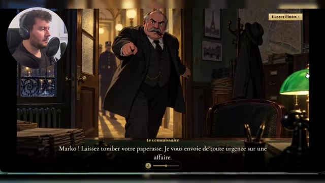  
  *⏱️ 00:07:03 — Scène narrative d'un jeu vidéo d'enquête avec le commissaire s'adressant au joueur.*
- 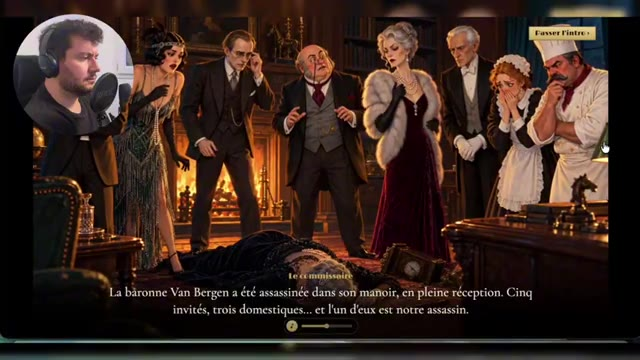  
  *⏱️ 00:07:13 — Scène narrative montrant les différents suspects autour du corps de la baronne assassinée.*

---

### ⏱️ `[00:07:18 - 00:07:37]` | Segment #21

**🔊 Audio (Transcription Intégrale Mot pour Mot en Français) :**
> Le corps a été emporté et nos hommes ont bouclé le périmètre. Mais sans la moindre preuve, impossible d'inculper qui que ce soit. Votre meilleure chance, c'est de trouver le coupable. Faites vite, on ne pourra pas les retenir éternellement. Vous avez 40 minutes. Allez, c'est parti.

**👁️ Analyse Visuelle d'Écran (gemini-3.5-flash-lite) :**
**Interface & Outils** : Jeu d'enquête interactive (type escape game / point-and-click)
**Contenu textuel & Code** : Textes de dialogue, plan du manoir, compte à rebours de 40:00, options Carnet, Téléphone, Quitter et indications de pièces (Salon, Bibliothèque, Salle à manger, Serre, Cuisine, Bureau).
**Action / Démonstration** : Le créateur découvre l'introduction narrative et accède au plateau de jeu principal du manoir pour démarrer l'enquête.

**Captures d'écran :**
- 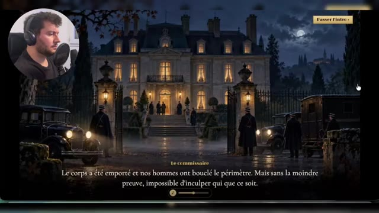  
  *⏱️ 00:07:19 — Introduction du jeu montrant le manoir la nuit avec les forces de l'ordre et un dialogue du commissaire.*
- 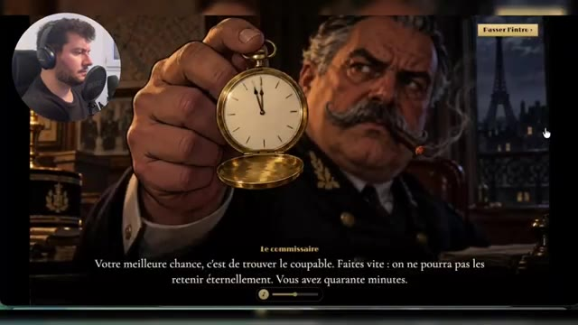  
  *⏱️ 00:07:27 — Gros plan sur le commissaire montrant une montre à gousset, illustrant la contrainte de temps.*
- 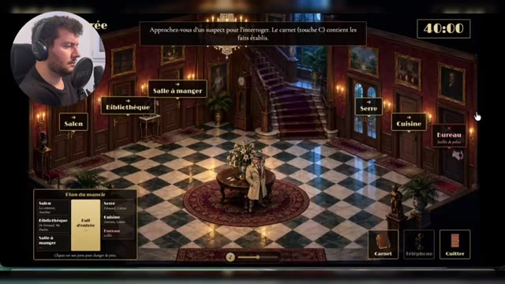  
  *⏱️ 00:07:36 — Interface principale du jeu montrant le hall d'entrée du manoir avec le compte à rebours de 40 minutes et les différentes pièces accessibles.*

---

### ⏱️ `[00:07:37 - 00:07:59]` | Segment #22

**🔊 Audio (Transcription Intégrale Mot pour Mot en Français) :**
> On a 40 minutes, on voit bien dans le coin le chronomètre s'afficher. On a notre inspecteur et on va pouvoir se déplacer dans les différentes pièces du manoir. On va commencer par le salon. Alors, je vais me diriger vers le premier personnage et on va lui parler. Bonsoir, Anselm, c'est ça ?

**👁️ Analyse Visuelle d'Écran (gemini-3.5-flash-lite) :**
**Interface & Outils** : Jeu d'enquête interactive / jeu narratif sur navigateur ou application.
**Contenu textuel & Code** : Plan du manoir, chronomètre (39:48), carnets, téléphone, options de dialogue (« Bonsoir Anselme, c'est ça ? »).
**Action / Démonstration** : Le créateur explore le salon du manoir et engage la conversation avec le premier personnage (Anselme le majordome).

**Captures d'écran :**
- 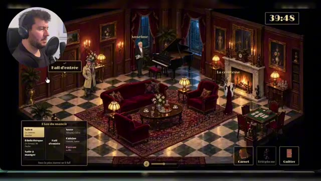  
  *⏱️ 00:07:48 — Vue d'ensemble du salon dans un jeu d'enquête interactive au manoir, avec le chronomètre affichant 39:48 et les personnages (l'inspecteur et Anselme) dans la pièce.*
- 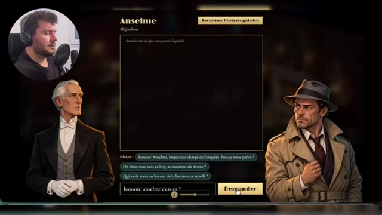  
  *⏱️ 00:07:57 — Interface de dialogue pour l'interrogatoire du personnage Anselme (le majordome) par l'inspecteur, montrant les options de discussion et le champ de saisie du joueur.*

---

### ⏱️ `[00:07:59 - 00:08:17]` | Segment #23

**🔊 Audio (Transcription Intégrale Mot pour Mot en Français) :**
> Bonsoir, monsieur l'inspecteur. Anselm, oui, pour vous servir. Majordome de cette maison depuis 35 ans, Si monsieur l'inspecteur veut bien s'asseoir, Anselme répondra de son mieux.

**👁️ Analyse Visuelle d'Écran (gemini-3.5-flash-lite) :**
**Interface & Outils** : Présentation orale ou séquence sans interface partagée.
**Contenu textuel & Code** : Explications et conseils de création de contenu / IA.
**Action / Démonstration** : Démonstration et mise en contexte pratique.

---

### ⏱️ `[00:08:17 - 00:08:36]` | Segment #24

**🔊 Audio (Transcription Intégrale Mot pour Mot en Français) :**
> Bon, c'est pas trop mal, ça répond vraiment presque du tac au tac. On va lui poser une autre question. Vous parlez toujours de vous la troisième personne. Pardonnez-moi monsieur l'inspecteur, c'est une vieille habitude de la maison.

**👁️ Analyse Visuelle d'Écran (gemini-3.5-flash-lite) :**
**Interface & Outils** : Présentation orale ou séquence sans interface partagée.
**Contenu textuel & Code** : Explications et conseils de création de contenu / IA.
**Action / Démonstration** : Démonstration et mise en contexte pratique.

---

### ⏱️ `[00:08:37 - 00:08:56]` | Segment #25

**🔊 Audio (Transcription Intégrale Mot pour Mot en Français) :**
> Madame la baronne n'aimait guère qu'un domestique dise « je ». Il faudra m'excuser, ce soir l'habitude revient toute seule. Ok ok bon allez on va aller interroger la deuxième personne la comtesse de Saint-Emmard. Bonsoir madame vous connaissiez bien la victime ?

**👁️ Analyse Visuelle d'Écran (gemini-3.5-flash-lite) :**
**Interface & Outils** : Jeu d'enquête textuel et visuel avec interface de manoir (salon, personnages interactifs comme Anselme et la comtesse).
**Contenu textuel & Code** : Éléments d'interface du jeu : plan du manoir, boutons d'interaction (« Parler à Anselme », « La comtesse »), chronomètre (36:33), et options en bas (« Carnet », « Téléphone », « Quitter »).
**Action / Démonstration** : Le créateur explore le salon du manoir et s'apprête à interroger la comtesse de Saint-Emmard.

**Captures d'écran :**
- 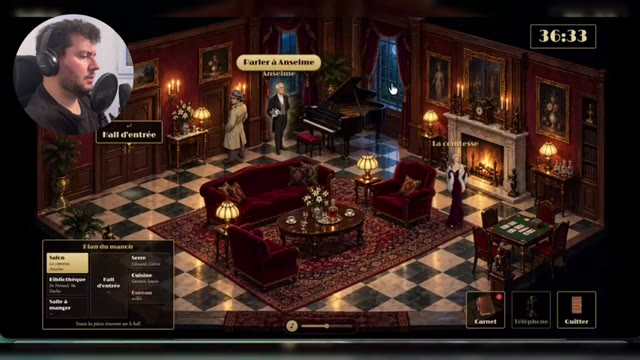  
  *⏱️ 00:08:46 — Capture d'écran montrant le jeu d'enquête interactif avec le créateur en incrustation vidéo dans le coin supérieur gauche.*

---

### ⏱️ `[00:08:56 - 00:09:21]` | Segment #26

**🔊 Audio (Transcription Intégrale Mot pour Mot en Français) :**
> Bonsoir mon brave si je connaissais Hélène nous avons usé les mêmes bancs de pensionnat il y a plus d'un demi-siècle. Nous nous voyons chaque semaine nous détestions cordialement et aucune de nous deux n'aurait su s'en passer. C'est ce qu'on appelle une amitié dans notre monde.

**👁️ Analyse Visuelle d'Écran (gemini-3.5-flash-lite) :**
**Interface & Outils** : Interface de jeu textuel interactif / jeu d'enquête inspiré d'IA.
**Contenu textuel & Code** : Noms des personnages (Comtesse Irène de Saint-Aymar, l'inspecteur), boîte de dialogue avec transcriptions de l'échange, liste de pistes disponibles en bas.
**Action / Démonstration** : Le joueur mène un interrogatoire textuel interactif avec un personnage de fiction dans un jeu d'enquête.

**Captures d'écran :**
- 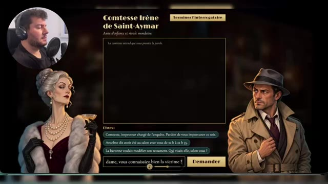  
  *⏱️ 00:08:57 — Interface du jeu d'enquête textuel affichant l'interrogatoire de la Comtesse Irène de Saint-Aymar avec une question prête à être posée.*
- 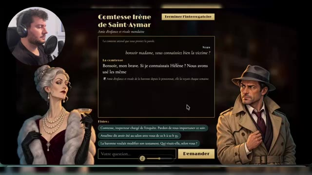  
  *⏱️ 00:09:08 — Affichage de la réponse en cours de la Comtesse dans l'interface de discussion du jeu d'enquête.*
- 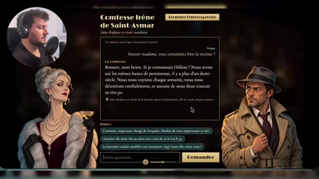  
  *⏱️ 00:09:19 — Continuation du dialogue de la Comtesse affichant l'historique et les indices de l'enquête policière.*

---

### ⏱️ `[00:09:21 - 00:09:40]` | Segment #27

**🔊 Audio (Transcription Intégrale Mot pour Mot en Français) :**
> Bon je vais pas te montrer les 40 minutes de gameplay. Alors j'ai vraiment interrogé tous les suspects. J'ai parlé à tout le monde. Ce qui est vraiment cool c'est qu'on peut vraiment leur poser n'importe quelle question. Alors selon les questions ils vont ou se braquer ou être collaboratifs. Ils vont pouvoir s'énerver aussi ça c'est super marrant. Ils ont tous une personnalité différente.

**👁️ Analyse Visuelle d'Écran (gemini-3.5-flash-lite) :**
**Interface & Outils** : Interface de jeu vidéo d'enquête narrative avec champ de texte libre pour poser des questions aux personnages.
**Contenu textuel & Code** : Écrans de dialogue d'interrogatoire, portraits illustrés des suspects (Maître Henri Duclos et Colette Marchand), l'inspecteur enquêteur, zone de saisie textuelle pour poser des questions, suggestions de pistes.
**Action / Démonstration** : Le créateur montre le gameplay du jeu en train d'interroger différents suspects en leur posant des questions textuelles.

**Captures d'écran :**
- 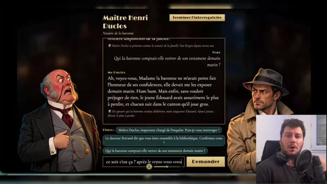  
  *⏱️ 00:09:30 — Interface du jeu montrant l'interrogatoire du suspect Maître Henri Duclos, avec la webcam du créateur en incrustation en bas à droite.*
- 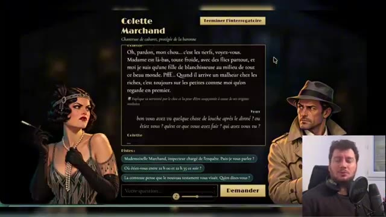  
  *⏱️ 00:09:38 — Interface du jeu montrant l'interrogatoire d'un autre suspect, Colette Marchand, avec la webcam du créateur en incrustation en bas à droite.*

---

### ⏱️ `[00:09:40 - 00:10:13]` | Segment #28

**🔊 Audio (Transcription Intégrale Mot pour Mot en Français) :**
> Et ils se balancent tous un petit peu les uns les autres avec des méfiances, des amitiés. Donc la dynamique est assez sympa. Et voilà je te résume un peu. A force de parler à tout le monde j'ai trouvé le coupable. En fait c'est le cuisinier. Gustave qui a fait le coup et en gros ce qu'il l'a trahi c'est qu'il m'a affirmé qu'il n'avait pas quitté la cuisine de toute la soirée. La bonne m'a dit qu'il est sorti fumer une cigarette mais qu'il n'est pas sorti par la porte de service qu'il prend d'habitude qu'il est sorti par le couloir. En recoupant les témoignages je l'ai ensuite reporté à mon commissaire et j'ai gagné

**👁️ Analyse Visuelle d'Écran (gemini-3.5-flash-lite) :**
**Interface & Outils** : Jeu vidéo d'enquête textuelle/graphique
**Contenu textuel & Code** : Texte affichant 'Affaire résolue', 'Bravo, inspecteur Marko', les détails de la résolution avec Gustave Morel comme coupable, et le temps de résolution en 32:34.
**Action / Démonstration** : Le créateur présente l'écran de fin et de résolution d'une enquête menée dans le jeu.

**Captures d'écran :**
-   
  *⏱️ 00:10:11 — Capture d'écran montrant l'interface d'un jeu vidéo d'enquête avec un écran de fin de partie intitulé 'Affaire résolue' et le youtubeur en incrustation.*

---

### ⏱️ `[00:10:13 - 00:10:47]` | Segment #29

**🔊 Audio (Transcription Intégrale Mot pour Mot en Français) :**
> j'ai été récompensé d'une médaille Bon alors sur ce projet il y aurait plein de choses à pousser. On pourrait ajouter des enquêtes découper en plusieurs actes et même intégrer d'autres mécanismes de point and click avec des objets, un inventaire, ajouter aussi des animations, mais c'est déjà beaucoup pour un projet monté aussi vite. Et surtout, pouvoir parler en direct avec les suspects et entendre de leur voix la réponse à mes questions niveau immersion, ça fait une vraie différence. Bien sûr, ce n'est qu'un projet parmi d'autres, je ne compte pas commercialiser ce jeu. Si c'était le but, j'aurais sûrement eu une approche différente. Ce projet sert à te montrer

**👁️ Analyse Visuelle d'Écran (gemini-3.5-flash-lite) :**
**Interface & Outils** : Studio vidéo et incrustation graphique de type présentation.
**Contenu textuel & Code** : Textes illustratifs de la conclusion du projet.
**Action / Démonstration** : Le créateur conclut sa présentation en faisant le bilan du projet.

---

### ⏱️ `[00:10:47 - 00:11:25]` | Segment #30

**🔊 Audio (Transcription Intégrale Mot pour Mot en Français) :**
> avant tout un exemple concret de l'utilisation de l'API de fiches audio. Mais avec cette API, on pourrait mener à bien d'autres projets, des applications, des outils pédagogiques et je pense à un dernier cas d'usage qu'on a vu récemment sur la chaîne, utiliser Claude Opus 5.5 pour créer des vidéos en motion design et ajouter l'API de fiches audio pour la voix off. Pour ce dernier cas d'usage, je ne résiste pas à faire un test rapide. J'ai demandé à Claude de me créer une vidéo verticale de 30 secondes en motion design sur les abeilles et je lui ai donné une clé api fiche audio en lui demandant de sélectionner une voix adaptée à la narration et d'utiliser

**👁️ Analyse Visuelle d'Écran (gemini-3.5-flash-lite) :**
**Interface & Outils** : Interface de Claude (Anthropic), interface de lecteur vidéo intégrée.
**Contenu textuel & Code** : Texte « UN DERNIER CAS D'USAGE », schémas d'association d'outils, notes sur les faits surprenants sur les abeilles avec des tags audio (ex: [curious], [soft tone], [break]), aperçu d'une vidéo MP4 nommée « Short abeilles miel v2 ».
**Action / Démonstration** : Le créateur illustre l'association de l'intelligence artificielle Claude Opus 5.5 avec la génération audio pour produire automatiquement des vidéos animées en motion design.

**Captures d'écran :**
-   
  *⏱️ 00:11:06 — Schéma illustrant le cas d'usage combinant Claude Opus 5.5 et une API audio pour créer des vidéos en motion design.*
-   
  *⏱️ 00:11:23 — Interface de l'assistant Claude affichant un projet sur les abeilles, avec du texte structuré, des balises audio et une fenêtre de prévisualisation vidéo.*

---

### ⏱️ `[00:11:25 - 00:11:59]` | Segment #31

**🔊 Audio (Transcription Intégrale Mot pour Mot en Français) :**
> les tags audio pour mettre la bonne émotion en fonction du texte voici le résultat cette goutte de miel représente le travail de toute une vie une abeille vit environ cinq semaines elle visite des milliers de fleurs et à la fin voilà ce qu'elle laisse un douzième de cuillère à café Pour remplir cette cuillère, il faut 12 abeilles. Alors la prochaine fois que tu mets du miel dans ton thé, tu sais que 12 abeilles y ont passé leur vie. A toi de jouer, je te rappelle l'API de Fiches Audio est gratuite jusqu'à la fin novembre 2026. Pour en profiter, le lien est en description et commentaire épingué. Merci et à bientôt sur le Labo des réseaux.

**👁️ Analyse Visuelle d'Écran (gemini-3.5-flash-lite) :**
**Interface & Outils** : Navigateur web affichant le site Fish Audio (Fish Audio S2.1 Pro).
**Contenu textuel & Code** : Page web avec le titre "Fish Audio S2.1 Pro: Free Text-to-Speech API for Developers" et une bannière colorée avec des ondes sonores.
**Action / Démonstration** : Le créateur présente l'outil Fish Audio et ses fonctionnalités text-to-speech gratuites pour les développeurs.

**Captures d'écran :**
-   
  *⏱️ 00:11:58 — Capture du site web de Fish Audio présentant l'API Text-to-Speech S2.1 Pro avec le présentateur en bas à droite.*

---
