# 🎬 Créer une Vidéo MOTION DESIGN avec Chat GPT

> **Chaîne** : [Labo Des Réseaux](https://www.youtube.com/@labodesreseaux)  
> **Lien YouTube** : [https://www.youtube.com/watch?v=9bPpTFAGlUo](https://www.youtube.com/watch?v=9bPpTFAGlUo)  
> **Date de publication** : 20261017  
> **Durée** : 5:07  
> **Identifiant vidéo** : `9bPpTFAGlUo`  
> **Modèles** : Audio: `whisper-v3-large-turbo` | Vision: `gemini-3.5-flash-lite`  

---

## 📌 Synthèse Exécutive & Outils

### 💡 Résumé
**La vidéo explore la nouvelle capacité de ChatGPT à générer des vidéos en motion design, une fonctionnalité autrefois dominée par des outils comme Claude (Opus 5.5). L'objectif est de comparer les deux plateformes en mettant en lumière les spécificités de ChatGPT, notamment son modèle Astra, et leur potentiel futur.** Le créateur souligne que si la qualité actuelle du motion design de ChatGPT n'égale pas encore celle de Claude, son avantage réside dans une rapidité de traitement considérablement réduite, rendant le workflow plus accessible pour les utilisateurs novices.

**Le tutoriel démontre la simplicité d'utilisation de ChatGPT pour créer des animations : sélection du modèle (Astra en Medium), fourniture d'un brief incluant un style artistique et des références visuelles, voire une vidéo d'introduction à refaire.** L'essai comparatif révèle que ChatGPT génère un résultat en motion design en 8 minutes, tandis que Claude nécessite 22 minutes pour une qualité supérieure, mais avec un workflow plus long. Un autre exemple, la fable du corbeau et du renard, montre ChatGPT produisant une vidéo en 2 minutes et une voix off en 3 minutes, contrastant avec 1h27 pour Claude, illustrant l'écart de performance et de qualité.

**Malgré les performances actuelles de Claude en matière de "léché" et de dynamisme, la vidéo projette un avenir prometteur pour OpenAI.** La capacité future d'intégrer les avancées de GPT-Image et Sora pourrait permettre à ChatGPT de rivaliser voire de surpasser Claude dans la création de vidéos et de motion design de A à Z. Les cas d'usage émergents pour ChatGPT, tels que la création d'infographies animées et la transformation d'images en courtes vidéos, sont également mis en avant comme des pistes intéressantes pour l'avenir de la plateforme.

### 🛠️ Outils, Modèles & Logiciels Présentés
- **ChatGPT**
- **Claude (Opus 5.5)**
- **Modèle Astra (ChatGPT)**
- **GPT-Image (2.5)**
- **Sora (mentionné pour ses compétences en animation)**
- **Xfield (via plugin/connecteur)**
- **Hyperframe (via MCP)**
- **Navigateur (interface d'accès)**

### 🔑 Points Clés & Enseignements Stratégiques
- ChatGPT propose désormais la création de vidéos en motion design avec son modèle Astra.
- La qualité actuelle du motion design de ChatGPT est inférieure à celle de Claude Opus 5.5, mais le workflow est plus simple.
- ChatGPT est significativement plus rapide que Claude pour générer des vidéos (8 min vs 22 min pour une intro, 2 min vs 1h27 pour une fable).
- Le créateur a comparé ChatGPT et Claude en utilisant des prompts similaires et des styles artistiques spécifiques.
- La génération d'une vidéo motion design avec ChatGPT implique de sélectionner le modèle, de fournir une description textuelle et potentiellement des images ou une vidéo d'origine.
- Il est possible de demander à ChatGPT de générer une introduction filmée en motion design avec un style artistique précis et des logos.
- Claude Opus 5.5 se distingue par un motion design plus "léché", propre et dynamique, un travail de professionnel.
- La différence de qualité entre les plateformes est liée au temps consacré par chacune à la tâche.
- ChatGPT est particulièrement rapide pour générer des vidéos complètes en motion design et ajouter une voix off.
- OpenAI pourrait rattraper son retard en intégrant des technologies comme GPT-Image et Sora pour améliorer le motion design et la génération de vidéos.
- ChatGPT Astra peut exceller dans la création d'infographies et de diagrammes animés.
- Il est possible de générer une image via ChatGPT puis de lui demander de l'animer de manière sommaire (environ 8 secondes).
- Pour des résultats plus aboutis, il est possible de lier des applications externes comme Xfield ou Hyperframe via les plugins (ChatGPT) ou connecteurs (Claude).
- L'intégration d'applications tierces via MCP permet de générer des images vidéo ou motion design.
- Claude reste pour l'instant supérieur en qualité de motion design, mais l'avenir pourrait voir OpenAI proposer de meilleurs résultats.

---

## ⏱️ Chronologie & Transcription Complète Audio & Visuelle (Mot pour Mot)

### ⏱️ `[00:00:00 - 00:00:20]` | Segment #01

**🔊 Audio (Transcription Intégrale Mot pour Mot en Français) :**
> Les vidéos motion design générées par Cloud ont envahi les réseaux. Normal, la promesse est belle, plus besoin de compétences pour créer une vidéo dynamique. Il suffit juste de prompter et pour les plus inspirés, ajouter un style artistique et des références visuelles. Mais alors devinez qui s'est réveillé pour nous proposer la même expérience ?

**👁️ Analyse Visuelle d'Écran (gemini-3.5-flash-lite) :**
**Interface & Outils** : Interface de génération de vidéo par IA (simulée).
**Contenu textuel & Code** : Texte : "MOTION DESIGN", "LE PHÉNOMÈNE CLAUDE", "Tout commence par une phrase.", "Crée une v", "UNE IDÉE → UNE INSTRUCTION → UNE ANIMATION".
**Action / Démonstration** : Présentation du concept de génération de motion design par IA via un prompt.

**Captures d'écran :**
- 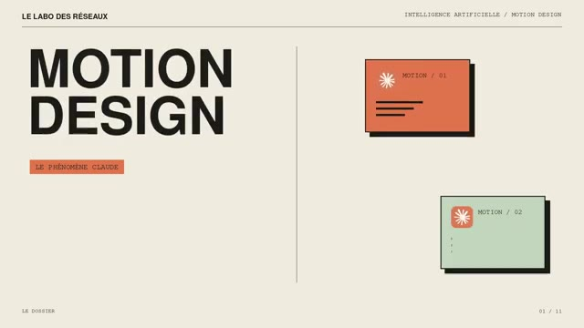  
  *⏱️ 00:00:01 — Écran titre du dossier "Motion Design - Le Phénomène Claude".*
- 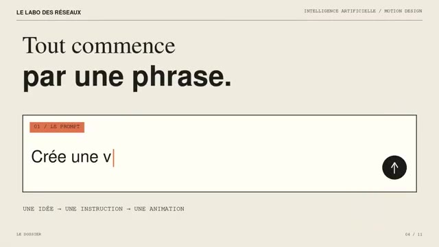  
  *⏱️ 00:00:10 — Démonstration de la génération d'une vidéo par IA à partir d'un prompt.*

---

### ⏱️ `[00:00:20 - 00:00:39]` | Segment #02

**🔊 Audio (Transcription Intégrale Mot pour Mot en Français) :**
> Il est maintenant possible de générer ces animations et motion design via ChatGPT et son modèle Astra. D'ailleurs cette introduction en est l'exemple. Et dans cette vidéo, on va faire le tour des possibilités. On ne pourra pas y échapper, on va comparer à Claude. Mais on verra quelques subtilités que ChatGPT a implantées et qui à l'avenir pourraient se montrer décisifs.

**👁️ Analyse Visuelle d'Écran (gemini-3.5-flash-lite) :**
**Interface & Outils** : ChatGPT, Le Labo des Réseaux (titre de la chaîne)
**Contenu textuel & Code** : Textes d'introduction, titres de sections, illustrations, logo ChatGPT.
**Action / Démonstration** : Présentation du sujet de la vidéo : la génération d'animations et de motion design avec ChatGPT. Exploration des possibilités et comparaison avec d'autres outils.

**Captures d'écran :**
- 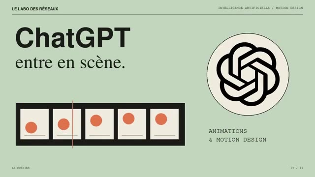  
  *⏱️ 00:00:21 — Diapositive d'introduction : "ChatGPT entre en scène." avec le logo ChatGPT et une illustration d'animations.*
- 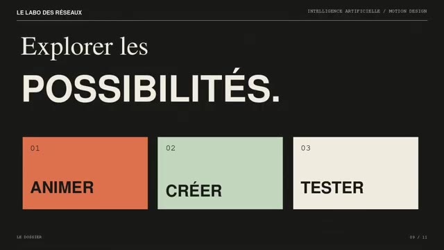  
  *⏱️ 00:00:30 — Diapositive titrée "Explorer les POSSIBILITÉS." avec trois blocs : "ANIMER", "CRÉER", "TESTER".*
- 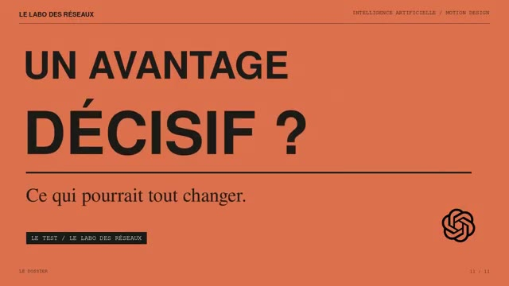  
  *⏱️ 00:00:38 — Diapositive titrée "UN AVANTAGE DÉCISIF ?" avec le sous-titre "Ce qui pourrait tout changer." et le logo ChatGPT.*

---

### ⏱️ `[00:00:40 - 00:01:09]` | Segment #03

**🔊 Audio (Transcription Intégrale Mot pour Mot en Français) :**
> Mais pour l'instant, tu l'as bien vu avec cette introduction, la qualité de motion design n'est vraiment pas la même qu'on peut avoir avec Opus 5.5. Par contre, en termes de workflow, super simple. Dans ChatGPT, tu sélectionnes ton modèle, ici Astra en Medium. Pour l'exercice, j'ai donc donné mon intro filmée. Et j'ai joint les logos de Claude et ChatGPT en précisant que je voulais que ChatGPT me refasse cette introduction en motion design en donnant un style artistique précis.

**👁️ Analyse Visuelle d'Écran (gemini-3.5-flash-lite) :**
**Interface & Outils** : ChatGPT
**Contenu textuel & Code** : Fichier "Intro.mp4", "Logo Claude.webp", "ChatGPT-Logo.svg.webp". Prompt : "Je veux que tu me refasses cette introduction en motion design, utilise les logos pour t'aider et je veux un style Cover Story, je voudrais que tu utilise un peu la vidéo, intro mais la plus part du temps fait seulement du motion design à l'écran."
**Action / Démonstration** : Utilisation de ChatGPT pour refaire une introduction en motion design en utilisant des logos et un style spécifique.

**Captures d'écran :**
- 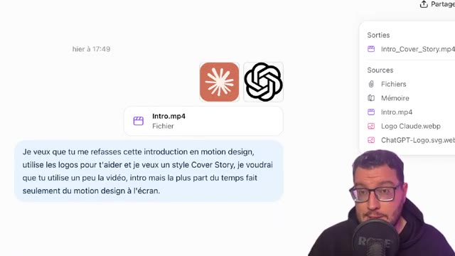  
  *⏱️ 00:00:54 — Capture d'écran de l'interface de ChatGPT montrant les fichiers sources, notamment "Intro.mp4", "Logo Claude.webp" et "ChatGPT-Logo.svg.webp", ainsi qu'un prompt décrivant une demande de refonte d'une introduction en motion design.*
- 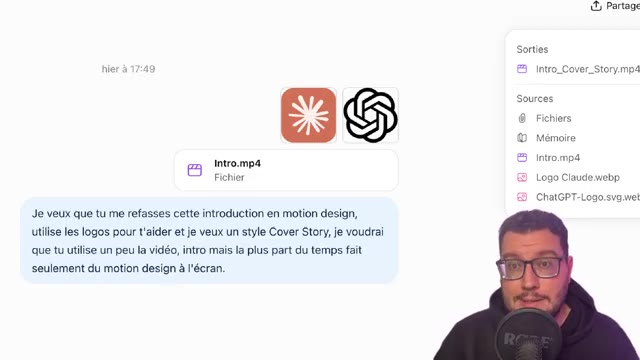  
  *⏱️ 00:01:07 — Capture d'écran de l'interface de ChatGPT montrant les fichiers sources, notamment "Intro.mp4", "Logo Claude.webp" et "ChatGPT-Logo.svg.webp", ainsi qu'un prompt décrivant une demande de refonte d'une introduction en motion design.*

---

### ⏱️ `[00:01:09 - 00:01:28]` | Segment #04

**🔊 Audio (Transcription Intégrale Mot pour Mot en Français) :**
> D'ailleurs, je t'affiche juste à l'écran les différents styles que tu peux explorer en motion design, que tu sois sur Claude ou sur ChatGPT. Et je lui ai demandé de me faire un mix entre les deux, le facecam, le motion design, pour avoir cette introduction dynamique. En point de comparaison, bien sûr, je l'ai fait avec Claude. Et donc, j'ai eu mon résultat sur ChatGPT au bout de 8 minutes.

**👁️ Analyse Visuelle d'Écran (gemini-3.5-flash-lite) :**
**Interface & Outils** : ChatGPT, Claude
**Contenu textuel & Code** : Prompts de discussion, noms de fichiers vidéo (Intro.mp4, Intro_Cover_Story.mp4), logos des IA, pourcentage de motion design, durée et résolution de la vidéo générée.
**Action / Démonstration** : Comparaison des réponses de ChatGPT et Claude concernant la création d'une introduction en motion design et affichage des résultats obtenus avec Claude.

**Captures d'écran :**
- 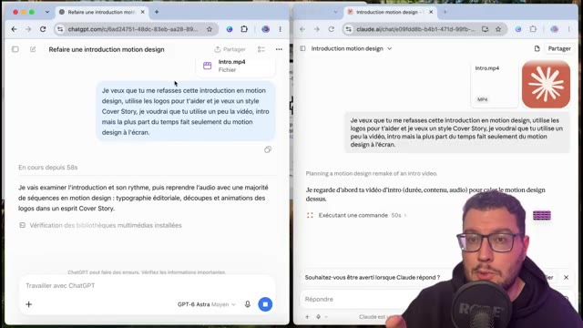  
  *⏱️ 00:01:19 — Affichage des résultats de génération d'une introduction en motion design par Claude, avec le prompt et les détails de la vidéo générée.*
- 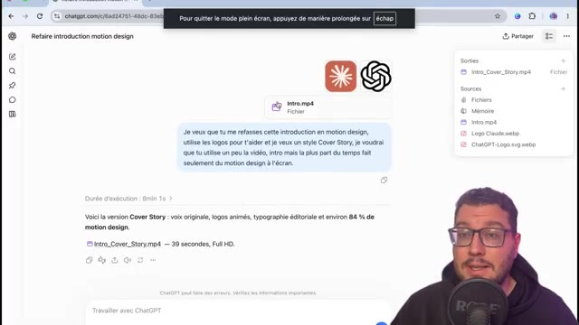  
  *⏱️ 00:01:27 — Démonstration à l'écran @ 00:01:27*

---

### ⏱️ `[00:01:29 - 00:01:50]` | Segment #05

**🔊 Audio (Transcription Intégrale Mot pour Mot en Français) :**
> C'est celui que tu as vu en introduction. Quand chez Claude, il m'a fallu 22 minutes pour avoir un résultat que tu peux voir s'afficher à l'écran. Il n'y a pas photo. Claude gagne le duel avec un motion design vraiment léché, très très propre et dynamique. Un travail de pro. Et la différence qu'on a en termes de qualité, ça va être sur le temps de travail que les deux vont consacrer à la tâche.

**👁️ Analyse Visuelle d'Écran (gemini-3.5-flash-lite) :**
**Interface & Outils** : ChatGPT, Navigateur Web
**Contenu textuel & Code** : Prompt : "Je veux que tu me refasses cette introduction de vidéo. Et pour ça, j'utilise les logos pour t'aider et je veux que ce soit pour la vidéo Cover Story. Je voudrai que tu utilise un peu plus la musique mais la plus part du temps seulement du motion design à l'écran."
**Action / Démonstration** : Utilisation de ChatGPT pour générer une introduction de motion design.

**Captures d'écran :**
- 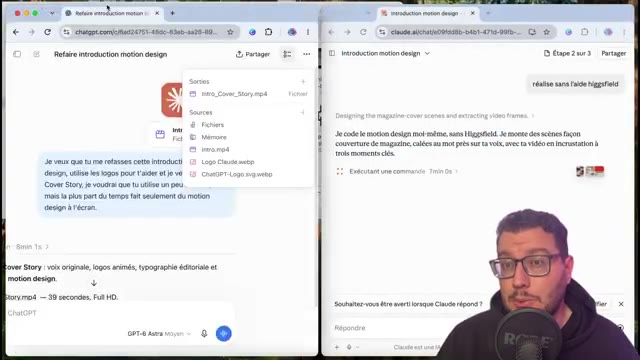  
  *⏱️ 00:01:30 — Interface de ChatGPT, avec le prompt pour refaire l'introduction d'un motion design et le début de la génération du résultat.*
- 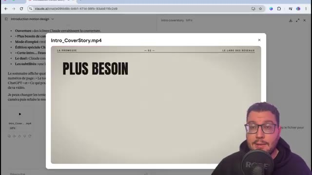  
  *⏱️ 00:01:39 — Capture d'un fichier vidéo MP4 nommé "Intro_CoverStory.mp4" affichant un visuel de couverture de magazine.*

---

### ⏱️ `[00:01:50 - 00:02:09]` | Segment #06

**🔊 Audio (Transcription Intégrale Mot pour Mot en Français) :**
> ChatGPT est très rapide. et sur un autre exemple d'une vidéo en total motion design, ici l'histoire du corbeau et du renard. Il m'a mis deux minutes pour me faire la première vidéo et ensuite trois minutes pour m'ajouter une voix off. Quand de ce côté, Claude pour le même prompt m'a mis 1h27 pour me réaliser la vidéo.

**👁️ Analyse Visuelle d'Écran (gemini-3.5-flash-lite) :**
**Interface & Outils** : ChatGPT, Claude AI
**Contenu textuel & Code** : Les interfaces montrent des résultats de génération vidéo (durée, nom de fichier, description), des prompts textuels, et des résumés de création.
**Action / Démonstration** : Comparaison des performances de ChatGPT et Claude AI pour la création de vidéos motion design à partir d'un prompt.

**Captures d'écran :**
- 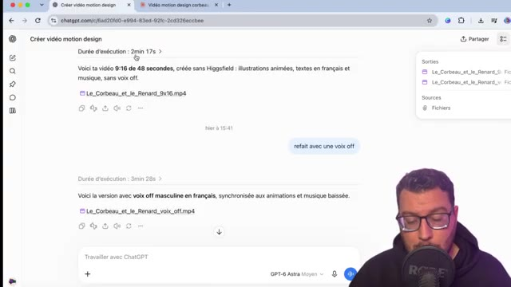  
  *⏱️ 00:02:00 — Capture d'écran de l'interface de ChatGPT montrant la génération d'une vidéo motion design, avec la durée d'exécution et le résultat de la première génération.*
- 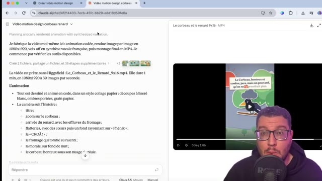  
  *⏱️ 00:02:08 — Capture d'écran de l'interface de Claude AI, montrant la description d'une vidéo motion design créée, avec des détails sur la création et un aperçu de la vidéo.*

---

### ⏱️ `[00:02:09 - 00:02:39]` | Segment #07

**🔊 Audio (Transcription Intégrale Mot pour Mot en Français) :**
> Par contre, on compare les deux, c'est le jour et la nuit. Alors qu'est-ce qui fait qu'on a un écart si important aujourd'hui et est-ce que OpenAI arrivera à rattraper son retard ?

**👁️ Analyse Visuelle d'Écran (gemini-3.5-flash-lite) :**
**Interface & Outils** : Interfaces graphiques d'applications d'apprentissage ou de narration basées sur des fables.
**Contenu textuel & Code** : Différentes illustrations stylisées de fables, accompagnées de titres et de leçons de morale adaptées à chaque version d'IA. Textes tels que "Pas besoin de grimper. Il suffit de flatter.", "L'odeur du fromage attire un rusé.", "Maître Corbeau, sur un arbre perché, tenait en son bec un fromage.", "Et si votre voix était aussi belle que vos plumes ?", "Sans mentir, si votre ramage se rapporte à votre plumage, vous êtes le Phénix des hôtes de ces bois,". Les noms des IA sont indiqués en bas de chaque image.
**Action / Démonstration** : Présentation des différences visuelles et de contenu des réponses de différentes IA face à des prompts liés à des fables.

**Captures d'écran :**
- 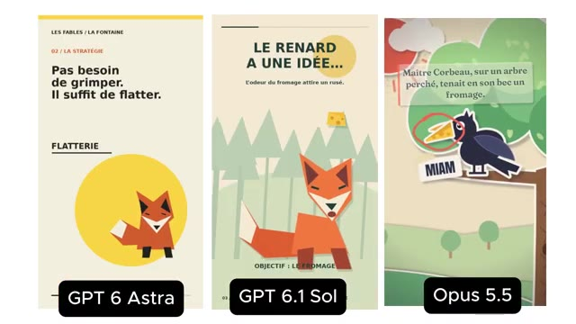  
  *⏱️ 00:02:24 — Comparaison des résultats de trois IA (GPT 6 Astra, GPT 6.1 Sol, Opus 5.5) pour la fable "Le Renard et le Corbeau".*
- 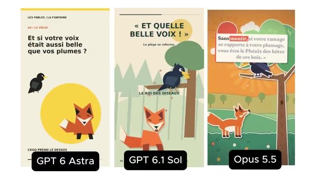  
  *⏱️ 00:02:38 — Comparaison des résultats de trois IA (GPT 6 Astra, GPT 6.1 Sol, Opus 5.5) pour la fable "Le Corbeau et le Renard".*

---

### ⏱️ `[00:02:39 - 00:03:16]` | Segment #08

**🔊 Audio (Transcription Intégrale Mot pour Mot en Français) :**
> Donc dans un premier temps, pour comprendre l'avantage de Cloud, il avait déjà en artefact un outil design basé sur le code avec Cloud Design. Opus 5 alors a cette compréhension en native qui lui permet de générer les images par code et de les animer avec beaucoup de fluidité et de dynamisme. Mais pour autant, on peut imaginer que dans l'avenir, si OpenAI arrive à tirer un maximum de ses assets, comme GPT-image ou même du point de vue de l'animation de la vidéo, pioché dans la data et les compétences qu'ils ont utilisées avec Sora, on peut imaginer deux prochains modèles plutôt doués dans l'animation, le motion design,

**👁️ Analyse Visuelle d'Écran (gemini-3.5-flash-lite) :**
**Interface & Outils** : Navigateur web avec ChatGPT.
**Contenu textuel & Code** : Prompt "créer une vidéo motion design sur le Corbeau et le Renard en utilisant les personnages 3D, vidéo vertical dynamique en utilisant du motion design et les références". Le résultat mentionne une vidéo de 9:16 secondes.
**Action / Démonstration** : Démonstration de la génération d'une vidéo motion design via ChatGPT.

**Captures d'écran :**
- 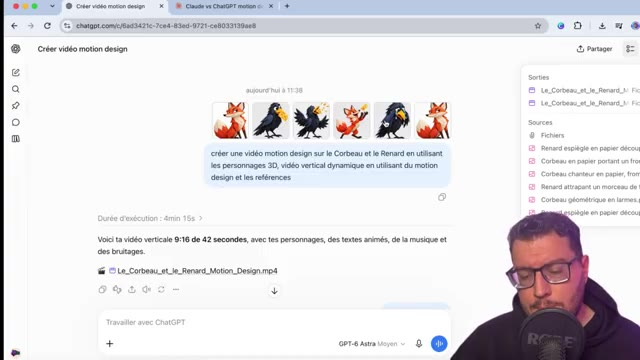  
  *⏱️ 00:02:58 — L'interface de ChatGPT est affichée, montrant le résultat d'une demande de création de vidéo motion design.*
- 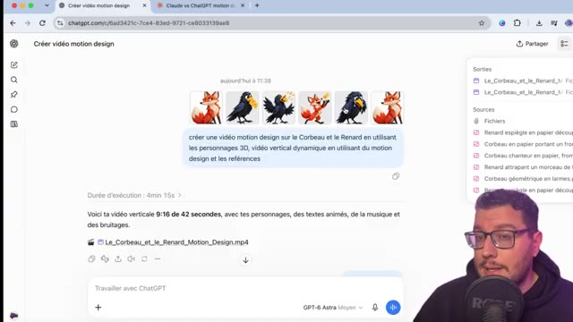  
  *⏱️ 00:03:14 — Démonstration à l'écran @ 00:03:14*

---

### ⏱️ `[00:03:16 - 00:03:37]` | Segment #09

**🔊 Audio (Transcription Intégrale Mot pour Mot en Français) :**
> et pourquoi pas la création de vidéos de A à Z. D'ailleurs, j'ai essayé avec le modèle GPT-Astra de refaire l'exercice, mais cette fois-ci en donnant en référence des images directement créées avec ChatGPT-image 2.5. Pour ainsi, après 4 minutes de travail, avoir un résultat en motion design, mais ça manque encore d'animation et de dynamisme.

**👁️ Analyse Visuelle d'Écran (gemini-3.5-flash-lite) :**
**Interface & Outils** : ChatGPT, interface de génération d'image et vidéo.
**Contenu textuel & Code** : Image de renard générée par IA, texte "LE RENARD A UNE IDÉE." et "Et si quelques compliments suffisaient ?", prompt éventuel : "Claude vs ChatGPT motion c".
**Action / Démonstration** : Le créateur montre les résultats d'une expérimentation avec un modèle IA pour la création de vidéos en motion design, en utilisant des images générées par ChatGPT-image 2.5 comme référence. Il mentionne que le résultat manque encore d'animation et de dynamisme.

**Captures d'écran :**
- 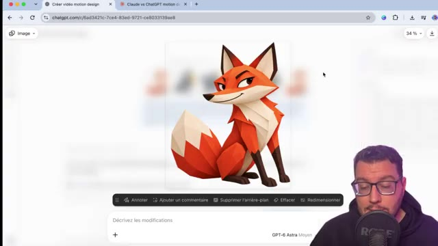  
  *⏱️ 00:03:27 — Capture d'écran d'une interface ChatGPT affichant une image générée par IA d'un renard stylisé.*
- 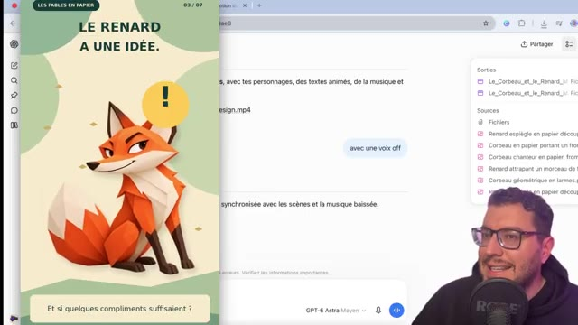  
  *⏱️ 00:03:36 — Capture d'écran d'une interface montrant une prévisualisation vidéo avec le même renard stylisé et une bulle de dialogue.*

---

### ⏱️ `[00:03:38 - 00:03:56]` | Segment #10

**🔊 Audio (Transcription Intégrale Mot pour Mot en Français) :**
> Par contre, là où GPT Astra va devenir intéressant, ça va être dans la création d'infographies ou de diagrammes en animation. Par exemple ici, une infographie sur un moteur de voiture qu'on peut par la suite demander à animer, et ainsi avoir le résultat suivant qui nous explique en mouvement le diagramme qu'on avait demandé.

**👁️ Analyse Visuelle d'Écran (gemini-3.5-flash-lite) :**
**Interface & Outils** : ChatGPT
**Contenu textuel & Code** : "Sur quoi souhaitez-vous travailler ?", "GPT-4 Astra Moyen", "Diagramme moteur voiture", "En cours depuis 22s", "Je te crée une infographie en coupe, avec les pièces du moteur et les quatre temps expliqués en français. J'utilise le skill de création d'images.", "anime moi ce diagramme", "LE MOTEUR ESSENCE", "Un cycle • 4 temps • 2 tours", "4 ÉCHAPPEMENT", "Bougie", "Piston", "Bielle", "Vilebrequin", "Le piston remonte et chasse le gaz brûlés."
**Action / Démonstration** : Création d'une infographie de moteur de voiture et animation de celle-ci par GPT Astra.

**Captures d'écran :**
- 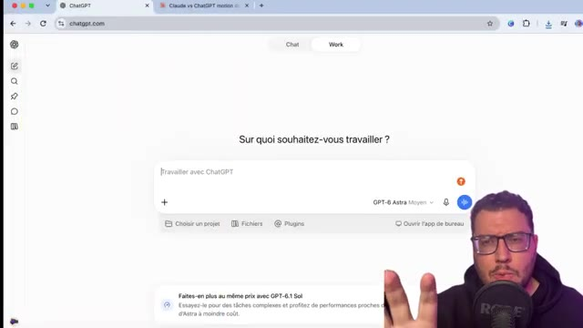  
  *⏱️ 00:03:39 — Interface de ChatGPT avec une demande de travail, et le sélecteur de modèle "GPT-4 Astra Moyen" visible.*
- 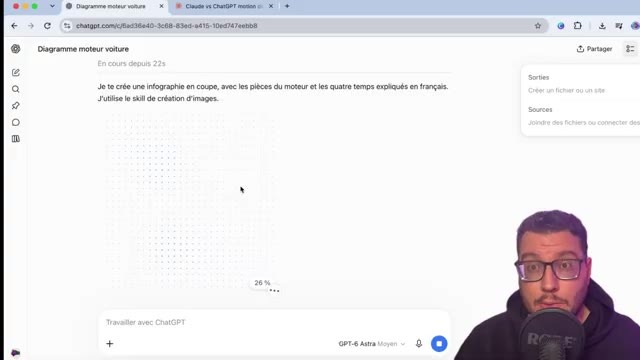  
  *⏱️ 00:03:47 — Interface de ChatGPT en cours de génération d'une infographie de moteur de voiture, avec une barre de progression affichant 26%.*
- 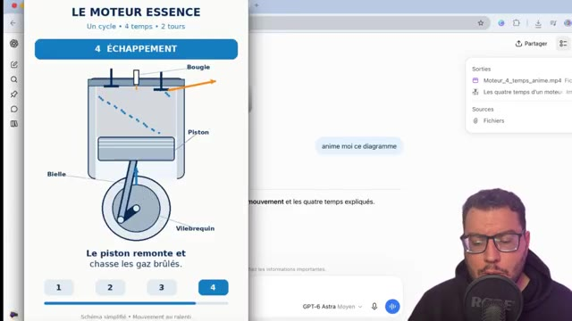  
  *⏱️ 00:03:55 — Interface de ChatGPT affichant une infographie animée d'un moteur essence avec le titre "LE MOTEUR ESSENCE", expliquant le cycle "4 ÉCHAPPEMENT". Un bouton "anime moi ce diagramme" est visible.*

---

### ⏱️ `[00:03:56 - 00:04:19]` | Segment #11

**🔊 Audio (Transcription Intégrale Mot pour Mot en Français) :**
> Donc une piste très intéressante à explorer, tout comme aussi la possibilité de générer notre image via ChatGPT et de demander à celui-ci de l'animer. Ça sera très sommaire, des animations de 8 secondes, mais on a un début de mouvement et qui sait peut-être par la suite, la possibilité de transformer une image en vidéo sur ChatGPT, à voir donc comment ça évolue.

**👁️ Analyse Visuelle d'Écran (gemini-3.5-flash-lite) :**
**Interface & Outils** : ChatGPT
**Contenu textuel & Code** : "anime moi ce diagramme", "Diagramme moteur voiture", "Moteur_4_temps_anime.mp4"
**Action / Démonstration** : Génération d'une animation à partir d'un diagramme via ChatGPT.

**Captures d'écran :**
- 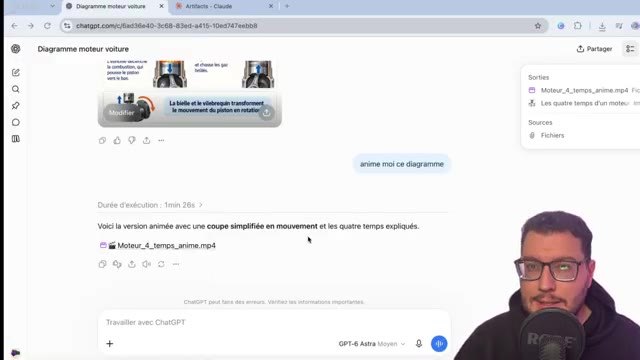  
  *⏱️ 00:03:57 — Interface de ChatGPT affichant une animation d'un moteur 4 temps et le prompt utilisé pour la générer.*
- 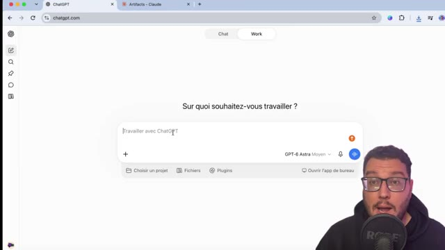  
  *⏱️ 00:04:17 — Interface de ChatGPT, page d'accueil, invitant l'utilisateur à indiquer sur quoi il souhaite travailler.*

---

### ⏱️ `[00:04:19 - 00:04:39]` | Segment #12

**🔊 Audio (Transcription Intégrale Mot pour Mot en Français) :**
> Bien sûr pour avoir un travail un petit peu plus abouti il y a toujours la possibilité que ça soit sur ChatGPT ou Cloud de lier une application comme Xfield via sur ChatGPT l'option plugin et dans Cloud l'option connecteur. Ainsi via une nouvelle conversation faire appel au MCP d'Xfield pour générer ces images vidéo ou motion design.

**👁️ Analyse Visuelle d'Écran (gemini-3.5-flash-lite) :**
**Interface & Outils** : AUCUNE
**Contenu textuel & Code** : AUCUNE
**Action / Démonstration** : AUCUNE

---

### ⏱️ `[00:04:39 - 00:05:04]` | Segment #13

**🔊 Audio (Transcription Intégrale Mot pour Mot en Français) :**
> On a déjà fait des vidéos sur le sujet je te renvoie à celle-ci. Et il y a aussi par exemple des applications comme Hyperframe, pareil on connecte via MCP, qui permettent ici de se focaliser sur le motion design. Voilà pour cette courte vidéo. Pour t'informer de la possibilité de créer ton motion design avec JGPT, Claude pour l'instant sera toujours meilleur, à l'avenir maintenant et à OpenAI, de nous proposer de meilleurs résultats.

**👁️ Analyse Visuelle d'Écran (gemini-3.5-flash-lite) :**
**Interface & Outils** : Aucun logiciel ou interface d'outil visible dans le segment pertinent.
**Contenu textuel & Code** : Illustration stylisée combinant des éléments architecturaux, des avions, des sièges d'aéroport et des sacs de courses.
**Action / Démonstration** : Le créateur de contenu mentionne des applications pour le motion design.

**Captures d'écran :**
- 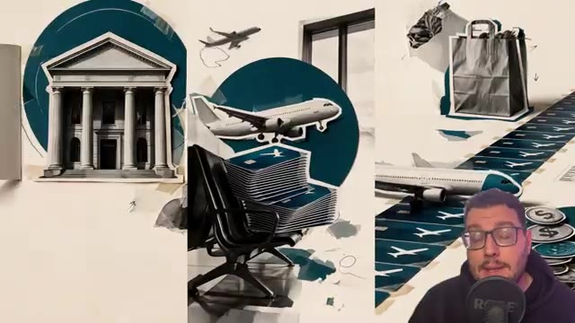  
  *⏱️ 00:04:40 — Visuel artistique présentant des éléments liés au voyage et au commerce, avec un bâtiment de style néoclassique, des avions, une salle d'attente et un sac de shopping.*

---

### ⏱️ `[00:05:04 - 00:05:07]` | Segment #14

**🔊 Audio (Transcription Intégrale Mot pour Mot en Français) :**
> C'était Marco, merci et à très bientôt sur le Labo des Réseaux.

**👁️ Analyse Visuelle d'Écran (gemini-3.5-flash-lite) :**
**Interface & Outils** : 
**Contenu textuel & Code** : 
**Action / Démonstration** : 

---
