# 🎬 Créer une Vidéo MOTION DESIGN avec Chat GPT

> **Chaîne** : [Labo Des Réseaux](https://www.youtube.com/@labodesreseaux)  
> **Lien YouTube** : [https://www.youtube.com/watch?v=9bPpTFAGlUo](https://www.youtube.com/watch?v=9bPpTFAGlUo)  
> **Date de publication** : 20261017  
> **Durée** : 5:07  
> **Identifiant vidéo** : `9bPpTFAGlUo`  
> **Modèles** : Audio: `whisper-v3-large-turbo` | Vision: `gemini-3.5-flash-lite`  

---

## 📌 Synthèse Exécutive & Outils

### 💡 Résumé
**La démocratisation de la création de vidéos en motion design par simple prompt connaît une accélération majeure avec l'arrivée de la fonctionnalité sur ChatGPT.** Alors que Claude s'est imposé comme la référence incontestée grâce à des rendus fluides, dynamiques et hautement professionnels via son outil Artifact et ses modèles avancés (comme Opus 5.5), son principal point faible reste le temps de traitement, qui peut atteindre plus d'une heure pour une seule vidéo. De son côté, **ChatGPT entre dans la danse avec son modèle Astra, misant sur une rapidité d'exécution redoutable** — générant des séquences en quelques minutes seulement — même si la qualité visuelle et le dynamisme brut restent pour l'instant en deçà des standards de son concurrent.

**Le test pratique mené par Marco démontre un contraste saisissant entre les deux IA tant sur le plan du workflow que sur les cas d'usage.** Pour une même introduction combinant facecam et motion design, ChatGPT produit un résultat en 8 minutes là où Claude en exige 22 avec un rendu beaucoup plus léché. Toutefois, l'analyse révèle que **la véritable force de ChatGPT ne réside pas seulement dans le divertissement visuel, mais dans sa capacité à générer rapidement des infographies et des diagrammes animés** (comme le mécanisme d'un moteur), ou à donner vie à des images fixes générées par ChatGPT Images 2.5. L'intégration d'outils tiers via des plugins, des connecteurs ou le protocole MCP (comme Xfield ou Hyperframe) offre également une passerelle d'optimisation incontournable pour les créateurs exigeants.

**En conclusion, Claude conserve une nette longueur d'avance en matière de qualité esthétique pure, mais OpenAI dispose d'un potentiel de progression considérable en capitalisant sur ses écosystèmes visuels et vidéo (notamment l'héritage de Sora).** Si ChatGPT propose aujourd'hui un compromis idéal axé sur la vitesse d'exécution et la vulgarisation technique à travers des schémas animés, l'avenir dépendra de la capacité d'OpenAI à combler l'écart qualitatif. Pour les créateurs de contenu et professionnels abonnés au *Labo des Réseaux*, le choix dépendra donc de l'arbitrage entre un rendu d'orfèvrerie chronophage (Claude) et une productivité instantanée aux ambitions graphiques plus modestes (ChatGPT).

### 🛠️ Outils, Modèles & Logiciels Présentés
- **Claude / Claude.ai** (Modèle Opus 5 / Opus 5.5, Claude Design, Artifact)**
- **ChatGPT** (Modèle Astra / Astra Medium, ChatGPT Images 2.5)**
- **Xfield** (Application connectée via plugins et MCP)**
- **Hyperframe** (Application de motion design connectée via MCP)**
- **GitHub** (Mentionné dans les métadonnées de recherche)**
- **Google Drive / Gmail** (Écosystèmes mentionnés dans le champ lexical global)**

### 🔑 Points Clés & Enseignements Stratégiques
- Prompts et direction artistique :** La création d'un motion design par IA repose sur un prompt textuel précis, enrichi d'un style artistique défini et de références visuelles (comme des logos ou des images d'entrée).
- Le duel de la vitesse :** ChatGPT Astra se distingue par une rapidité foudroyante (2 à 8 minutes de génération), tandis que Claude privilégie la profondeur de calcul pour un rendu léché (nécessitant souvent plus d'une heure pour des projets complexes).
- Supériorité esthétique de Claude :** Grâce à sa compréhension native du code pour générer et animer des images, Claude surclasse ChatGPT sur la fluidité, le dynamisme et le niveau de détail "professionnel".
- L'atout infographie de ChatGPT :** Même s'il pèche sur le motion design artistique pur, ChatGPT excelle dans la création et l'animation rapide de diagrammes et d'infographies techniques (ex: un moteur de voiture).
- Génération et animation d'images fixes :** Il est possible d'utiliser ChatGPT Images 2.5 pour produire des visuels sources, puis de demander à ChatGPT de les animer sur de courtes séquences d'environ 8 secondes.
- Le potentiel futur d'OpenAI :** En exploitant la data et les compétences technologiques issues de projets comme Sora, OpenAI possède le levier nécessaire pour rattraper son retard sur la génération vidéo de A à Z.
- Intégration d'applications tierces :** Pour contourner les limites natives des chatbots, l'utilisation de connecteurs, de plugins ou du protocole MCP permet d'intégrer des outils spécialisés comme Xfield ou Hyperframe.
- Hybridation des formats :** Il est possible de mixer des séquences réelles (facecam) et des éléments en motion design pour dynamiser une introduction de vidéo YouTube.
- Arbitrage workflow vs qualité :** Le choix de l'outil dépend de l'objectif : opter pour Claude pour un film d'animation ou un spot publicitaire haut de gamme, ou choisir ChatGPT pour du contenu éducatif rapide ou du prototypage d'infographies.

---

## ⏱️ Chronologie & Transcription Complète Audio & Visuelle (Mot pour Mot)

### ⏱️ `[00:00:00 - 00:00:20]` | Segment #01

**🔊 Audio (Transcription Intégrale Mot pour Mot en Français) :**
> Les vidéos motion design générées par Claude ont envahi les réseaux. Normal, la promesse est belle, plus besoin de compétences pour créer une vidéo dynamique. Il suffit juste de prompter et pour les plus inspirés, ajouter un style artistique et des références visuelles. Mais alors devinez qui s'est réveillé pour nous proposer la même expérience ?

**👁️ Analyse Visuelle d'Écran (gemini-3.5-flash-lite) :**
**Interface & Outils** : Présentation vidéo au design épuré, style éditorial minimaliste (type diapositives graphiques).
**Contenu textuel & Code** : Textes explicatifs : 'MOTION DESIGN', 'LE PHÉNOMÈNE CLAUDE', 'Tout commence par une phrase.', '01 / LE PROMPT', 'La même expérience ?', 'UN NOUVEAU JOUEUR ENTRE EN SCÈNE'.
**Action / Démonstration** : Introduction du sujet sur le motion design généré par IA et teasing sur l'arrivée d'un nouveau concurrent.

---

### ⏱️ `[00:00:20 - 00:00:39]` | Segment #02

**🔊 Audio (Transcription Intégrale Mot pour Mot en Français) :**
> Il est maintenant possible de générer ces animations et motion design via ChatGPT et son modèle Astra. D'ailleurs cette introduction en est l'exemple. Et dans cette vidéo, on va faire le tour des possibilités. On ne pourra pas y échapper, on va comparer à Claude. Mais on verra quelques subtilités que ChatGPT a implantées. Et qui à l'avenir pourraient se montrer décisifs.

**👁️ Analyse Visuelle d'Écran (gemini-3.5-flash-lite) :**
**Interface & Outils** : Diapositives graphiques de présentation vidéo (slides de motion design).
**Contenu textuel & Code** : Textes : 'ChatGPT entre en scène', 'Explorer les POSSIBILITÉS.', 'ANIMER', 'CRÉER', 'TESTER', 'UN AVANTAGE DÉCISIF ?', 'Ce qui pourrait tout changer'.
**Action / Démonstration** : Présentation visuelle structurée de l'introduction et du plan de la vidéo par le créateur.

**Captures d'écran :**
-   
  *⏱️ 00:00:21 — Diapositive de présentation introduisant le sujet 'ChatGPT entre en scène' avec une illustration de motion design et le logo de l'outil.*
-   
  *⏱️ 00:00:30 — Diapositive récapitulative listant les trois grands axes de la vidéo : 'ANIMER', 'CRÉER' et 'TESTER' pour explorer les possibilités.*
-   
  *⏱️ 00:00:38 — Diapositive de transition orange avec le titre 'UN AVANTAGE DÉCISIF ?' et la sous-mention 'Ce qui pourrait tout changer'.*

---

### ⏱️ `[00:00:40 - 00:01:09]` | Segment #03

**🔊 Audio (Transcription Intégrale Mot pour Mot en Français) :**
> Mais pour l'instant, tu l'as bien vu avec cette introduction. La qualité de motion design n'est vraiment pas la même qu'on peut avoir avec Opus 5.5. Par contre, en termes de workflow, super simple. Dans ChatGPT, tu sélectionnes ton modèle. Ici, Astra en Medium. Pour l'exercice, j'ai donc donné mon intro filmée. Et j'ai joint les logos de Claude et ChatGPT en précisant que je voulais que ChatGPT me refasse cette introduction en motion design en donnant un style artistique précis.

**👁️ Analyse Visuelle d'Écran (gemini-3.5-flash-lite) :**
**Interface & Outils** : Interface utilisateur de ChatGPT / Application IA avec panneau latéral de sources et sorties
**Contenu textuel & Code** : Prompt utilisateur : "Je veux que tu me refasses cette introduction en motion design, utilise les logos pour t'aider et je veux un style Cover Story..." ainsi que les fichiers joints (Intro.mp4, Logo Claude.webp, ChatGPT-Logo.svg.webp)
**Action / Démonstration** : Le créateur montre son prompt initial et les fichiers sources joints pour la génération de la vidéo par l'IA.

**Captures d'écran :**
-   
  *⏱️ 00:00:54 — Capture de l'interface montrant une conversation avec le prompt demandant de refaire l'introduction en motion design.*
-   
  *⏱️ 00:01:07 — Vue similaire de l'interface de l'outil conversationnel avec le prompt et les fichiers joints (logos Claude, ChatGPT et fichier vidéo).*

---

### ⏱️ `[00:01:09 - 00:01:28]` | Segment #04

**🔊 Audio (Transcription Intégrale Mot pour Mot en Français) :**
> D'ailleurs, je t'affiche juste à l'écran les différents styles que tu peux explorer en motion design, que tu sois sur Claude ou sur ChatGPT. Et je lui ai demandé de me faire un mix entre les deux, le facecam, le motion design, pour avoir cette introduction dynamique. En point de comparaison, bien sûr, je l'ai fait avec Claude. Et donc, j'ai eu mon résultat sur ChatGPT au bout de 8 minutes.

**👁️ Analyse Visuelle d'Écran (gemini-3.5-flash-lite) :**
**Interface & Outils** : Navigateur web, ChatGPT, Claude.
**Contenu textuel & Code** : Prompts de demande de refonte d'introduction en motion design, fichiers vidéo importés, résultats de génération.
**Action / Démonstration** : Le créateur montre la comparaison des interfaces ChatGPT et Claude pour la création de son introduction.

**Captures d'écran :**
-   
  *⏱️ 00:01:19 — Écran partagé comparant les interfaces de ChatGPT et de Claude avec les prompts et fichiers importés pour l'introduction en motion design.*
-   
  *⏱️ 00:01:27 — Interface de ChatGPT affichant le résultat de la génération avec le fichier vidéo final 'Intro_Cover_Story.mp4'.*

---

### ⏱️ `[00:01:28 - 00:01:50]` | Segment #05

**🔊 Audio (Transcription Intégrale Mot pour Mot en Français) :**
> C'est celui que tu as vu en introduction. Quand chez Claude, il m'a fallu 22 minutes pour avoir un résultat que tu peux voir s'afficher à l'écran. Il n'y a pas photo. Claude gagne le duel avec un motion design vraiment léché, très très propre et dynamique. Un travail de pro. Et la différence qu'on a en termes de qualité, ça va être sur le temps de travail que les deux vont consacrer à la tâche.

**👁️ Analyse Visuelle d'Écran (gemini-3.5-flash-lite) :**
**Interface & Outils** : Navigateur web, ChatGPT, Claude.ai, lecteur vidéo intégré
**Contenu textuel & Code** : Prompts textuels, code de motion design, fichiers générés (intro_CoverStory.mp4), habillage graphique style magazine
**Action / Démonstration** : Le créateur montre et compare les résultats du motion design généré par l'IA, mettant en valeur le rendu professionnel de Claude.

**Captures d'écran :**
-   
  *⏱️ 00:01:30 — Capture d'écran double affichant les interfaces de ChatGPT et Claude.ai côte à côte, avec un menu déroulant montrant des fichiers générés.*
-   
  *⏱️ 00:01:39 — Aperçu d'une vidéo générée (intro_CoverStory.mp4) affichant un design de magazine avec le texte 'PLUS BESOIN'.*
- 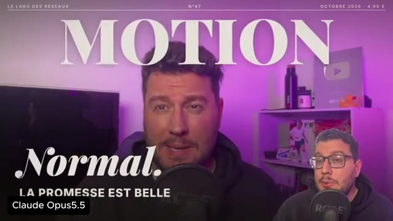  
  *⏱️ 00:01:48 — Résultat final du motion design de type magazine (style couverture de presse avec le texte 'MOTION' et 'Normal') avec un encart vidéo du créateur.*

---

### ⏱️ `[00:01:50 - 00:02:09]` | Segment #06

**🔊 Audio (Transcription Intégrale Mot pour Mot en Français) :**
> ChatGPT est très rapide. et sur un autre exemple d'une vidéo en total motion design, ici l'histoire du corbeau et du renard. Il m'a mis deux minutes pour me faire la première vidéo et ensuite trois minutes pour m'ajouter une voix off. Quand de ce côté, Claude pour le même prompt m'a mis 1h27 pour me réaliser la vidéo.

**👁️ Analyse Visuelle d'Écran (gemini-3.5-flash-lite) :**
**Interface & Outils** : Navigateur web, interface de ChatGPT, interface de Claude (claude.ai).
**Contenu textuel & Code** : Prompts de génération de vidéos en motion design ('Le_Corbeau_et_le_Renard_9x16.mp4'), durées d'exécution (2 min 17 s et 3 min 28 s sur ChatGPT).
**Action / Démonstration** : Comparaison des temps de génération et des fonctionnalités de création vidéo entre ChatGPT et Claude.

**Captures d'écran :**
-   
  *⏱️ 00:02:00 — Interface de ChatGPT montrant l'historique de génération d'une vidéo motion design sur le corbeau et le renard avec des durées d'exécution de 2 minutes et 3 minutes.*
-   
  *⏱️ 00:02:08 — Interface de Claude montrant le panneau de discussion et l'aperçu vidéo d'une animation du corbeau et du renard générée par l'IA.*

---

### ⏱️ `[00:02:09 - 00:02:36]` | Segment #07

**🔊 Audio (Transcription Intégrale Mot pour Mot en Français) :**
> Par contre, on compare les deux, c'est le jour et la nuit. Alors qu'est-ce qui fait qu'on a un écart si important aujourd'hui ?

**👁️ Analyse Visuelle d'Écran (gemini-3.5-flash-lite) :**
**Interface & Outils** : Interface de comparaison comparative de différents modèles de génération d'images/vidéos (présentation visuelle côte à côte).
**Contenu textuel & Code** : Illustrations graphiques de la fable 'Le Corbeau et le Renard' avec des styles différents, accompagnées de texte et des labels des IA (GPT 6 Astra, GPT 6.1 Sol, Opus 5.5).
**Action / Démonstration** : Le créateur compare les résultats visuels obtenus par différents modèles ou versions d'IA sur une même consigne narrative.

**Captures d'écran :**
- 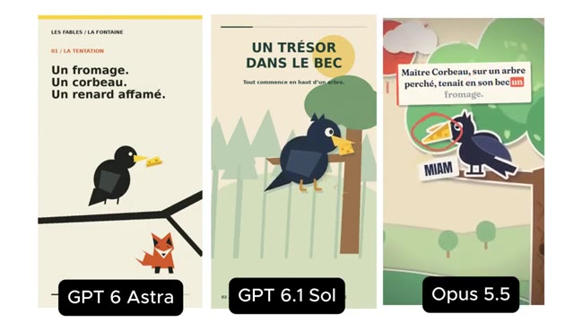  
  *⏱️ 00:02:23 — Comparaison de trois versions de génération visuelle (GPT 6 Astra, GPT 6.1 Sol, et Opus 5.5) illustrant la fable de La Fontaine 'Le Corbeau et le Renard' (introduction).*
- 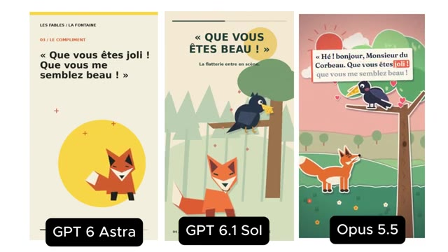  
  *⏱️ 00:02:34 — Comparaison des trois mêmes modèles (GPT 6 Astra, GPT 6.1 Sol, Opus 5.5) montrant une étape ultérieure de la fable ('Le Compliment').*

---

### ⏱️ `[00:02:36 - 00:02:56]` | Segment #08

**🔊 Audio (Transcription Intégrale Mot pour Mot en Français) :**
> Et est-ce que OpenAI arrivera à rattraper son retard ? Donc dans un premier temps, pour comprendre l'avantage de Cloud, il avait déjà en Artifact un outil design basé sur le code avec Cloud Design. Opus 5 alors a cette compréhension en native qui lui permet de générer les images par code et de les animer avec beaucoup de fluidité et de dynamisme.

**👁️ Analyse Visuelle d'Écran (gemini-3.5-flash-lite) :**
**Interface & Outils** : Claude Design (Artifact)
**Contenu textuel & Code** : Code CSS avec styles de cartes, balises HTML (`<h1>`, `<circle>`, `<button>`), graphiques d'animation (ease-in-out, 60 fps)
**Action / Démonstration** : Présentation des fonctionnalités de design et d'animation basées sur le code dans l'IA

**Captures d'écran :**
- 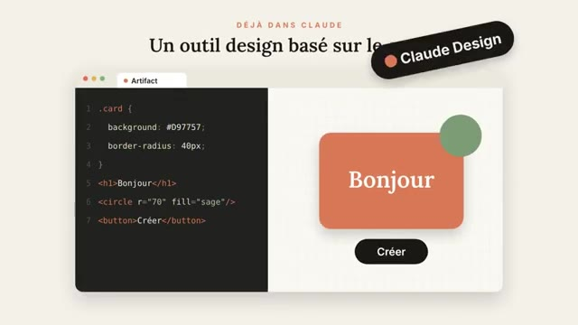  
  *⏱️ 00:02:46 — Illustration de l'outil Claude Design montrant le rendu visuel généré à partir de code CSS/HTML dans Artifact.*
- 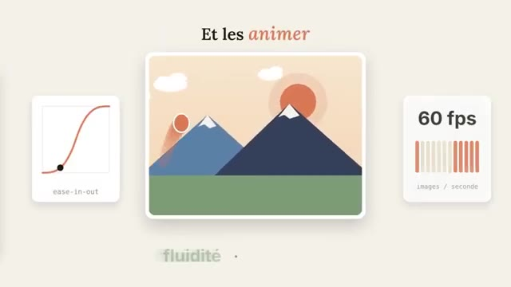  
  *⏱️ 00:02:54 — Illustration des capacités d'animation fluide avec des paramètres de courbe (ease-in-out) et un affichage à 60 fps.*

---

### ⏱️ `[00:02:56 - 00:03:19]` | Segment #09

**🔊 Audio (Transcription Intégrale Mot pour Mot en Français) :**
> Mais pour autant, on peut imaginer que dans l'avenir, si OpenAI arrive à tirer un maximum de ses assets, Comme GPT Images ou même du point de vue de l'animation de la vidéo, pioché dans la data et les compétences qu'ils ont utilisées avec Sora, on peut imaginer deux prochains modèles plutôt doués dans l'animation, le motion design, et pourquoi pas la création de vidéos de A à Z.

**👁️ Analyse Visuelle d'Écran (gemini-3.5-flash-lite) :**
**Interface & Outils** : Navigateur web affichant l'interface de ChatGPT.
**Contenu textuel & Code** : Prompt utilisateur demandant une vidéo motion design sur Le Corbeau et le Renard, images de personnages (renard et corbeau), fichier vidéo généré « Le_Corbeau_et_le_Renard_Motion_Design.mp4 ».
**Action / Démonstration** : Le créateur présente une interface de génération de vidéo par IA avec ChatGPT pour illustrer les capacités d'animation.

**Captures d'écran :**
- 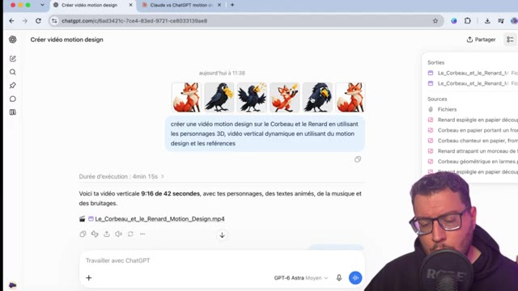  
  *⏱️ 00:02:57 — Interface de ChatGPT montrant un prompt pour créer une vidéo motion design sur Le Corbeau et le Renard avec des personnages 3D.*
- 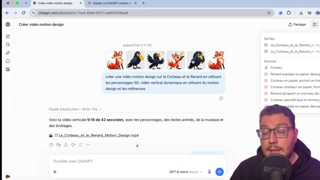  
  *⏱️ 00:03:07 — Interface de ChatGPT affichant le résultat de la génération d'une vidéo verticale 9:16 avec des personnages animés, de la musique et des bruitages.*
- 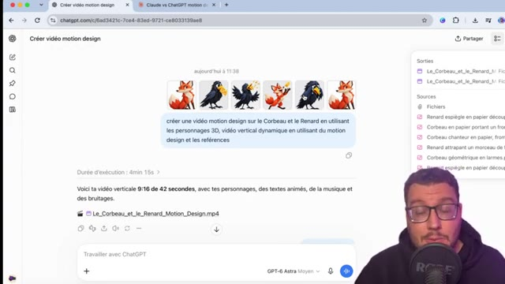  
  *⏱️ 00:03:17 — Interface de ChatGPT avec le panneau latéral détaillant les fichiers source et les sorties de la vidéo générée.*

---

### ⏱️ `[00:03:19 - 00:03:37]` | Segment #10

**🔊 Audio (Transcription Intégrale Mot pour Mot en Français) :**
> D'ailleurs, j'ai essayé avec le modèle GPT Astra de refaire l'exercice, mais cette fois-ci en donnant en référence des images directement créées avec ChatGPT Images 2.5. Pour ainsi, après 4 minutes de travail, avoir un résultat en motion design, mais ça manque encore d'animation et de dynamisme.

**👁️ Analyse Visuelle d'Écran (gemini-3.5-flash-lite) :**
**Interface & Outils** : Navigateur web, interface ChatGPT avec le modèle GPT-6 Astra et outil de prévisualisation vidéo.
**Contenu textuel & Code** : Image d'un renard en origami/low-poly, interface de génération de vidéo au format vertical, texte 'LE RENARD A UNE IDÉE' et 'Et si quelques compliments suffisaient ?', panneau latéral avec les fichiers sources.
**Action / Démonstration** : Présentation du résultat obtenu en motion design après l'utilisation du modèle GPT Astra avec des images générées par ChatGPT.

**Captures d'écran :**
-   
  *⏱️ 00:03:28 — Capture d'écran du navigateur montrant une image générée d'un renard stylisé avec des options d'édition (annoter, supprimer l'arrière-plan, etc.) sous l'interface ChatGPT.*
- 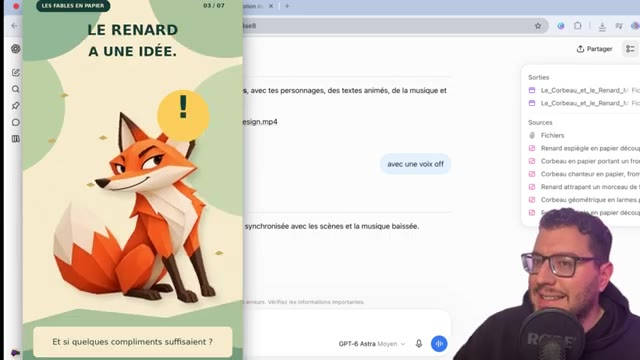  
  *⏱️ 00:03:36 — Capture d'écran montrant à gauche un aperçu vidéo vertical intitulé 'LES FABLES EN PAPIER' avec le personnage du renard et du texte, et à droite l'interface de discussion avec le modèle GPT-6 Astra.*

---

### ⏱️ `[00:03:38 - 00:03:56]` | Segment #11

**🔊 Audio (Transcription Intégrale Mot pour Mot en Français) :**
> Par contre, là où GPT Astra va devenir intéressant, ça va être dans la création d'infographies ou de diagrammes en animation. Par exemple ici, une infographie sur un moteur de voiture, qu'on peut par la suite demander à animer, et ainsi avoir le résultat suivant qui nous explique en mouvement le diagramme qu'on avait demandé.

**👁️ Analyse Visuelle d'Écran (gemini-3.5-flash-lite) :**
**Interface & Outils** : Navigateur web affichant l'interface de ChatGPT avec le modèle GPT-6 Astra
**Contenu textuel & Code** : Interface de chat IA, barre de texte 'Sur quoi souhaitez-vous travailler ?', génération en cours, infographie interactive d'un moteur essence (bougie, piston, bielle, vilebrequin)
**Action / Démonstration** : Le créateur démontre la génération et l'animation d'une infographie technique complexe d'un moteur à l'aide de l'intelligence artificielle

**Captures d'écran :**
- 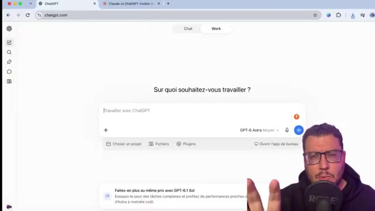  
  *⏱️ 00:03:39 — Interface de ChatGPT (GPT-6 Astra) avec la question initiale 'Sur quoi souhaitez-vous travailler ?'*
- 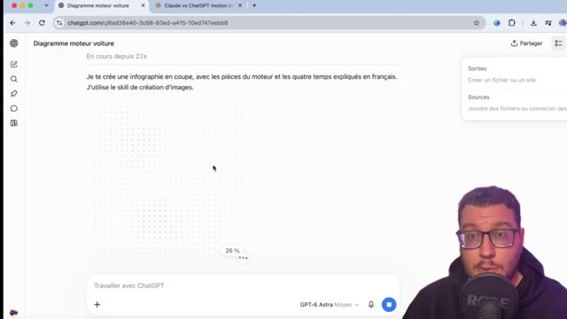  
  *⏱️ 00:03:47 — Génération en cours d'une infographie sur un moteur de voiture dans l'interface de l'IA (26%)*
- 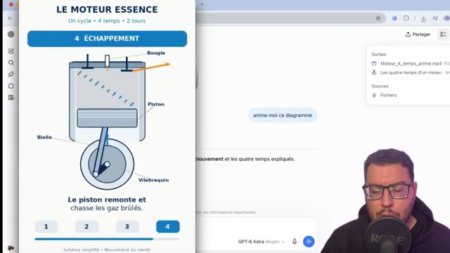  
  *⏱️ 00:03:55 — Affichage du diagramme animé final représentant le moteur essence à quatre temps avec ses composants*

---

### ⏱️ `[00:03:56 - 00:04:17]` | Segment #12

**🔊 Audio (Transcription Intégrale Mot pour Mot en Français) :**
> Donc une piste très intéressante à explorer, tout comme aussi la possibilité de générer notre image via ChatGPT et de demander à celui-ci de l'animer. Ça sera très sommaire, des animations de 8 secondes, mais on a un début de mouvement et qui sait peut-être par la suite la possibilité de transformer une image en vidéo sur ChatGPT.

**👁️ Analyse Visuelle d'Écran (gemini-3.5-flash-lite) :**
**Interface & Outils** : Navigateur web, interface de ChatGPT.
**Contenu textuel & Code** : Diagramme de moteur de voiture, prompt "anime moi ce diagramme", fichier vidéo généré "Moteur_4_temps_anime.mp4", et image plein écran d'un voilier sur l'eau.
**Action / Démonstration** : Le créateur présente des exemples d'utilisation de ChatGPT pour générer des images et demander leur animation.

**Captures d'écran :**
- 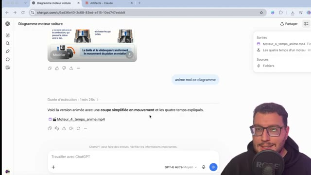  
  *⏱️ 00:03:57 — Interface ChatGPT affichant un diagramme de moteur de voiture et le résultat d'une animation vidéo générée.*
- 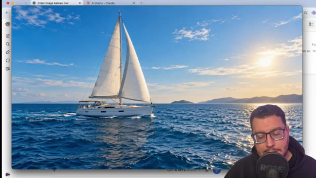  
  *⏱️ 00:04:07 — Interface de ChatGPT affichant une image générée d'un voilier naviguant sur la mer ensoleillée.*
- 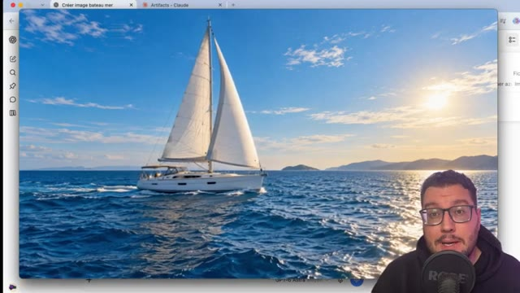  
  *⏱️ 00:04:15 — Même vue de l'interface de ChatGPT avec l'image du voilier, montrant une continuité visuelle dans la vidéo.*

---

### ⏱️ `[00:04:17 - 00:04:39]` | Segment #13

**🔊 Audio (Transcription Intégrale Mot pour Mot en Français) :**
> A voir donc comment ça évolue. Bien sûr, pour avoir un travail un petit peu plus abouti, il y a toujours la possibilité que ça soit sur ChatGPT ou Cloud de lier une application comme Xfield. via sur ChatGPT l'option plugin et dans Cloud l'option connecteur. Ainsi, via une nouvelle conversation, faire appel au MCP d'Xfield pour générer ces images, vidéos ou motion design.

**👁️ Analyse Visuelle d'Écran (gemini-3.5-flash-lite) :**
**Interface & Outils** : Navigateur web, interface de ChatGPT (chatgpt.com/plugins), interface de présentation vidéo.
[DESC_IMAGE_1] "Sur quoi souhaitez-vous travailler ?", champ de texte "Travailler avec ChatGPT", options "Choisir un projet", "Fichiers", "@ Plugins".
[DESC_IMAGE_2] Menu "Plugins", barre de recherche, liste des plugins installés et populaires (Gmail, Google Drive, Health, GitHub, etc.).
**Contenu textuel & Code** : Explications et conseils de création de contenu / IA.
**Action / Démonstration** : Le créateur montre l'interface d'accueil de ChatGPT puis navigue vers la section des plugins pour illustrer l'intégration d'outils externes.

**Captures d'écran :**
- 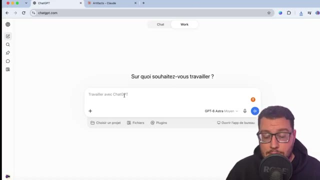  
  *⏱️ 00:04:18 — Interface principale de ChatGPT montrant la zone de saisie du prompt avec les options de fichiers et de plugins.*
- 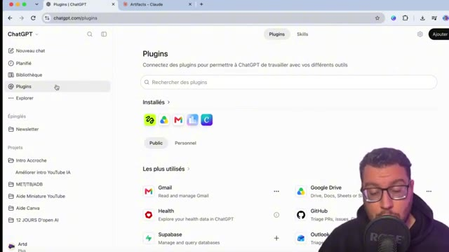  
  *⏱️ 00:04:28 — Page de gestion des plugins dans l'interface de ChatGPT permettant de connecter divers outils tiers.*
- 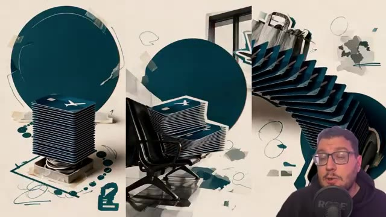  
  *⏱️ 00:04:37 — Visuels artistiques et graphiques générés ou présentés à l'écran, illustrant le sujet de la vidéo.*

---

### ⏱️ `[00:04:39 - 00:05:07]` | Segment #14

**🔊 Audio (Transcription Intégrale Mot pour Mot en Français) :**
> On a déjà fait des vidéos sur le sujet. Je te renvoie à celle-ci. Et il y a aussi par exemple des applications comme Hyperframe, pareil, on connecte via MCP qui permettent ici de se focaliser sur le motion design. Voilà pour cette courte vidéo. Pour t'informer de la possibilité de créer ton motion design avec JGPT, Claude, pour l'instant, sera toujours meilleur, à l'avenir maintenant et à OpenAI, de nous proposer de meilleurs résultats. C'était Marco, merci et à très bientôt sur le Labo des Réseaux.

**👁️ Analyse Visuelle d'Écran (gemini-3.5-flash-lite) :**
**Interface & Outils** : AUCUNE
**Contenu textuel & Code** : AUCUNE
**Action / Démonstration** : Le créateur s'adresse directement à son audience pour conclure le sujet.

---
