# 🎬 Créer un influenceur IA de A à Z avec Seedance 2.5 (Techniques inédites)

> **Chaîne** : [Labo Des Réseaux](https://www.youtube.com/@labodesreseaux)  
> **Lien YouTube** : [https://www.youtube.com/watch?v=G0dtF8wN0co](https://www.youtube.com/watch?v=G0dtF8wN0co)  
> **Date de publication** : 20261019  
> **Durée** : 12:17  
> **Identifiant vidéo** : `G0dtF8wN0co`  
> **Modèles** : Audio: `whisper-v3-large-turbo` | Vision: `gemini-3.5-flash-lite`  

---

## 📌 Synthèse Exécutive & Outils

### 💡 Résumé
**Cette vidéo de la chaîne Labo Des Réseaux explore en profondeur la création de bout en bout d'un influenceur virtuel grâce au modèle vidéo de pointe Seedance 2.5, accessible à moindre coût via la plateforme officielle Lumina.** Le créateur démontre comment concevoir des personnages cohérents, rédiger des prompts structurés au format JSON avec l'aide de l'assistant Claude, et dépasser le simple stade de la copie de tendances en proposant du contenu original et narratif.

**Le tutoriel détaille méthodiquement l'utilisation des différentes fonctionnalités de Seedance 2.5 : la création freestyle à partir d'images de référence, l'édition de vidéos existantes (mèmes, films) pour y insérer ses avatars, l'extension vidéo pour dynamiser un contenu viral, ainsi que la gestion des placements produits.** Un accent particulier est mis sur la synchronisation vocale et le contournement des barrières linguistiques du français en couplant Seedance à des voix de référence conçues sur ElevenLabs ou en exploitant des alternatives comme Wan 3.0.

**En conclusion, l'analyste rappelle que si la technique permet aujourd'hui une liberté créative totale (publicités, UGC, scénarisation complexe), le véritable défi réside dans l'acquisition de l'audience.** Pour y parvenir, il préconise des stratégies de cross-polloration de lore en faisant interagir ses personnages avec des influenceurs IA déjà établis, tout en soulignant le potentiel économique massif de ces outils pour la communication des marques et la création d'avatars personnalisés.

### 🛠️ Outils, Modèles & Logiciels Présentés
- **Seedance 2.5** (Modèle vidéo de pointe par ByteDance)**
- **Lumina** (Plateforme officielle partenaire, hébergeant Seedance, Seedream et autres modèles)**
- **Seedream** (Modèle de génération d'images)**
- **Claude** (Assistant conversationnel d'Anthropic utilisé pour la rédaction de prompts en JSON)**
- **ElevenLabs** (Outil de design et de clonage vocal pour assurer la cohérence des dialogues)**
- **Wan 3.0** (Modèle alternatif utilisé pour la génération de vidéos avec dialogues)**
- **Minimax H3** (Modèle mentionné dans la bibliothèque de Lumina)**
- **GPT Image 2.5 / Nano Banana** (Modèles de génération d'images alternatifs)**

### 🔑 Points Clés & Enseignements Stratégiques
- Choix de la plateforme :** Utiliser Lumina garantit un accès économique et en avant-première aux modèles de ByteDance (Seedance et Seedream) avec toutes leurs fonctionnalités natives.
- Génération de personnages persistants :** Créer d'abord des images de référence fixes (en combinant Seedream et Claude) pour conserver le même visage et le même look d'une vidéo à l'autre.
- Structuration des prompts :** S'aider de Claude en lui demandant de formuler les prompts en JSON pour assigner précisément les rôles et références (ex: `@image 1`, `@image 2`) de chaque personnage.
- Édition et détournement de mèmes :** Uploader des vidéos de référence sans audio (pour éviter les filtres anti-copyright) et demander à Claude de réécrire l'action plan par plan pour y intégrer ses propres influenceurs IA.
- Technique d'extension vidéo :** Reprendre une vidéo existante à fort trafic (comme l'a fait le créateur sur l'une de ses vidéos virales) et utiliser le mode extension de Seedance 2.5 pour y insérer de nouveaux personnages ou actions inattendues.
- Contournement des limites linguistiques :** Pour pallier les défauts de prononciation occasionnels de Seedance 2.5 en français, utiliser une voix de référence ElevenLabs et superposer l'audio propre lors du montage si nécessaire.
- Placement produit intégré :** Mettre en scène l'influenceur virtuel aux côtés d'objets modélisés (comme un flacon de parfum) pour simuler des campagnes publicitaires ultra-réalistes.
- Diversification des formats :** Maîtriser une palette complète allant de la création freestyle (9:16ème, résolutions 720p) aux spots publicitaires scénarisés intégrant des dialogues (notamment via Wan 3.0).
- Stratégie d'acquisition d'audience (Lore) :** Pour percer face à la concurrence, intégrer son propre personnage IA dans les vidéos de créateurs virtuels déjà célèbres afin de parasiter et capitaliser sur leur notoriété existante.
- B2B et applications professionnelles :** Au-delà des influenceurs personnels, ces compétences s'avèrent monétisables pour produire du contenu UGC, promouvoir des services/destinations, ou créer des avatars sur mesure pour des clients.

---

## ⏱️ Chronologie & Transcription Complète Audio & Visuelle (Mot pour Mot)

### ⏱️ `[00:00:00 - 00:00:28]` | Segment #01

**🔊 Audio (Transcription Intégrale Mot pour Mot en Français) :**
> Avoir une tête bizarre et un look décalé, ça ne suffit pas pour faire de toi un top influenceur IA. Pour percer et durer dans le temps, il faut aussi savoir proposer autre chose.

**👁️ Analyse Visuelle d'Écran (gemini-3.5-flash-lite) :**
**Interface & Outils** : Vidéo verticale de type Reels / TikTok illustrant des avatars ou personnages générés par IA.
**Contenu textuel & Code** : Personnages aux looks décalés et excentriques (costumes d'époque, perruques, monocle).
**Action / Démonstration** : Présentation visuelle d'exemples de personnages décalés pour illustrer le sujet des influenceurs IA.

---

### ⏱️ `[00:00:28 - 00:00:56]` | Segment #02

**🔊 Audio (Transcription Intégrale Mot pour Mot en Français) :**
> Et sortir un peu du cadre. Oublie les modèles IA qui ne permettent que de copier des trends. Le meilleur modèle pour faire de ton influenceur IA une star, c'est Seedance 2.5. Justement, Seedance 2.5 est accessible à moindre coût via la plateforme officielle de ByteDance.

**👁️ Analyse Visuelle d'Écran (gemini-3.5-flash-lite) :**
**Interface & Outils** : AUCUNE
**Contenu textuel & Code** : Aucun texte ou interface technique visible, seulement une génération vidéo de personnage virtuel.
[DESC_IMAGE_1] Démonstration visuelle d'une vidéo générée par intelligence artificielle illustrant un influenceur virtuel.
**Action / Démonstration** : Démonstration et mise en contexte pratique.

---

### ⏱️ `[00:00:56 - 00:01:27]` | Segment #03

**🔊 Audio (Transcription Intégrale Mot pour Mot en Français) :**
> Lumina, partenaire de cette vidéo. Et dans cette vidéo, je vais te montrer comment créer un influenceur IA qui aura le potentiel pour devenir une star des réseaux. Notre ami Gontran de Misanthrope a raison. Pour tes influenceurs IA et ton contenu IA en général, Seedance 2.5 est aujourd'hui le meilleur modèle vidéo que j'ai testé. Et l'idéal, c'est de l'utiliser via Lumina, le partenaire de cette vidéo.

**👁️ Analyse Visuelle d'Écran (gemini-3.5-flash-lite) :**
**Interface & Outils** : AUCUNE
**Contenu textuel & Code** : Logo Lumina et texte "Et l'idéal, c'est de l'utiliser via"
**Action / Démonstration** : Présentation du partenaire Lumina et de l'influenceur IA.

---

### ⏱️ `[00:01:27 - 00:01:49]` | Segment #04

**🔊 Audio (Transcription Intégrale Mot pour Mot en Français) :**
> Alors pourquoi Lumina ? D'abord parce que j'y retrouve toutes les fonctionnalités du modèle, y compris l'édition vidéo et l'extension vidéo. C'est d'ailleurs cette dernière fonctionnalité que j'ai utilisée pour faire entrer Gontran dans des vidéos existantes, comme tu l'as vu en intro. Ensuite, pour le prix. Lumina fait partie des plateformes les moins chères que j'ai trouvées pour utiliser SeedDance et SeedDream.

**👁️ Analyse Visuelle d'Écran (gemini-3.5-flash-lite) :**
**Interface & Outils** : Interface vidéo Lumina et présentation YouTube.
**Contenu textuel & Code** : Texte « L'une des plateformes les moins chères que j'ai trouvées » avec mention Seedance.
**Action / Démonstration** : Le créateur illustre l'intégration de Gontran dans des vidéos et présente les arguments tarifaires de l'outil.

**Captures d'écran :**
- 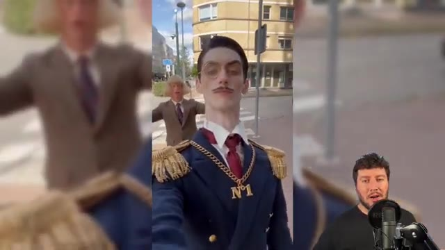  
  *⏱️ 00:01:38 — Démonstration vidéo montrant Gontran intégré dans un décor urbain.*
- 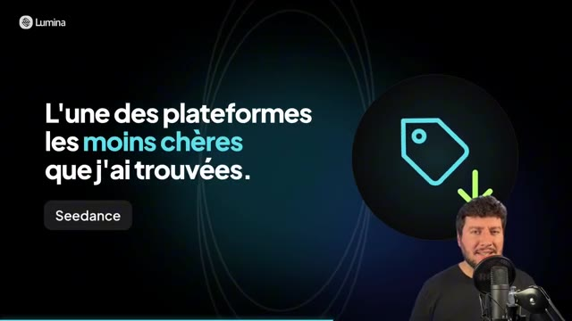  
  *⏱️ 00:01:48 — Écran de présentation textuel sur le prix avec le logo Lumina et une icône de prix.*

---

### ⏱️ `[00:01:50 - 00:02:13]` | Segment #05

**🔊 Audio (Transcription Intégrale Mot pour Mot en Français) :**
> Logique, car c'est une plateforme officielle de ByDance. Ils peuvent donc proposer des tarifs très compétitifs sur leur propre modèle. Je te laisse aller voir la page des tarifs pour les comparer par toi-même. Le lien est en description et en commentaire épinglé. Et dans cette vidéo, on va faire le tour de la plateforme avec un cas concret. On va prendre notre influenceur IA et je vais te montrer tout ce qu'on peut faire avec les modèles de Seedense 2.5.

**👁️ Analyse Visuelle d'Écran (gemini-3.5-flash-lite) :**
**Interface & Outils** : Site web de la plateforme Lumina et interface vidéo de présentation avec incrustation du présentateur.
**Contenu textuel & Code** : Tableaux des prix ($0.99, $9, $29, $49) avec détails des crédits, et texte "Le tour de la plateforme : Un cas concret - Notre influenceur IA, mis en scène de A à Z avec Seedance 2.5 sur Lumina".
**Action / Démonstration** : Le créateur montre la grille tarifaire pour illustrer les prix compétitifs, puis introduit la démonstration d'un cas concret sur la plateforme.

**Captures d'écran :**
- 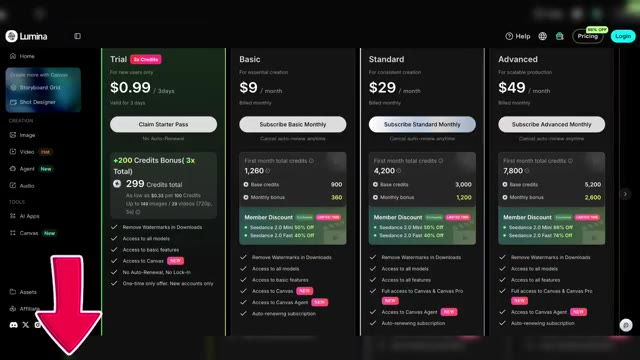  
  *⏱️ 00:02:01 — Capture d'écran de la page des tarifs du site web Lumina montrant différentes offres d'abonnement (Trial, Basic, Standard, Advanced).*
- 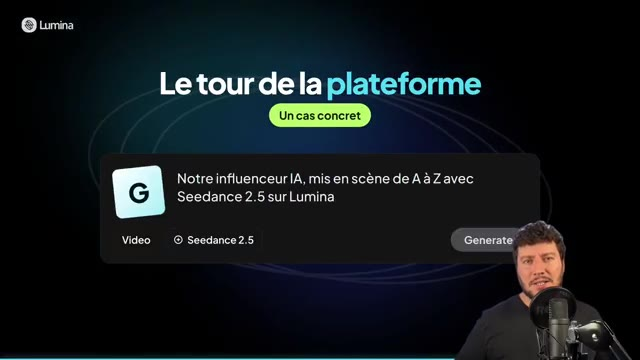  
  *⏱️ 00:02:12 — Écran de transition présentant le titre "Le tour de la plateforme" avec un encadré sur un cas concret et le youtubeur visible en bas à droite.*

---

### ⏱️ `[00:02:13 - 00:02:36]` | Segment #06

**🔊 Audio (Transcription Intégrale Mot pour Mot en Français) :**
> Je suis donc sur mon compte Lumina et je vais me rendre d'abord dans l'onglet images. C'est là où je vais pouvoir générer mes influenceurs IA. Alors comme tu le vois, j'en ai déjà généré un, c'est Gontran et je l'ai fait avec Seedream. Pour la rédaction de mes promptes, je me suis aidé de Claude. En référence image, j'utilise la tête d'un des influenceurs IA les plus connus du moment.

**👁️ Analyse Visuelle d'Écran (gemini-3.5-flash-lite) :**
**Interface & Outils** : Lumina (plateforme web d'intelligence artificielle)
**Contenu textuel & Code** : Modèle Seedream 5.0 Lite, prompt détaillé en anglais décrivant Gontran, zone de saisie de prompt avec modèle GPT Image 2.5 Sunburst, et image de référence.
[DESC_IMAGE_3] Navigation sur la plateforme, présentation d'un influenceur virtuel existant et démonstration de la génération basée sur une référence visuelle.
**Action / Démonstration** : Démonstration et mise en contexte pratique.

**Captures d'écran :**
- 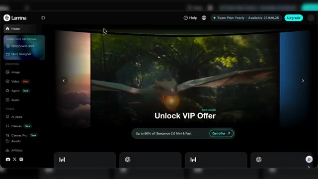  
  *⏱️ 00:02:14 — Vue d'ensemble de l'interface d'accueil de la plateforme Lumina.*
- 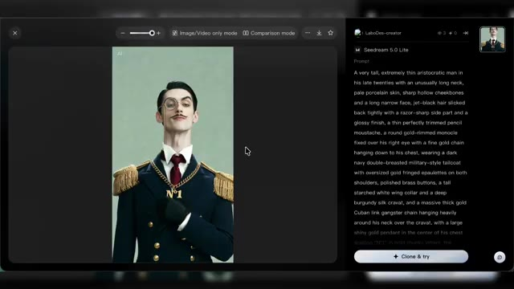  
  *⏱️ 00:02:25 — Affichage de l'influenceur IA généré nommé Gontran avec le modèle Seedream 5.0 Lite et son prompt détaillé.*
- 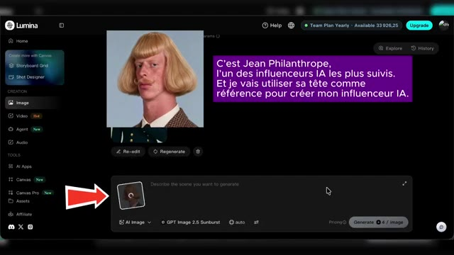  
  *⏱️ 00:02:35 — Interface de génération d'images avec le modèle GPT Image 2.5 Sunburst et l'utilisation d'une photo de référence.*

---

### ⏱️ `[00:02:37 - 00:02:56]` | Segment #07

**🔊 Audio (Transcription Intégrale Mot pour Mot en Français) :**
> Pour le modèle, ici je vais utiliser Seedream encore une fois. Et je vais choisir le ratio de sortie, 9,16 et c'est parti. Ok, j'ai mon résultat avec donc ce nouvel influenceur qui va incarner la copine de Jean Philanthrope. Et pour compléter, j'ai créé un troisième prompt.

**👁️ Analyse Visuelle d'Écran (gemini-3.5-flash-lite) :**
**Interface & Outils** : Application web Lumina, outil de génération d'images par IA.
**Contenu textuel & Code** : Interface utilisateur sombre avec des menus de création (Image, Video, Agent, Canvas), un champ de prompt textuel, et un bouton "Generate".
**Action / Démonstration** : Le créateur sélectionne les modèles et les prompts pour générer le portrait d'un nouvel influenceur virtuel.

**Captures d'écran :**
- 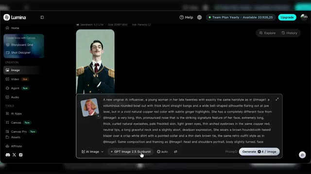  
  *⏱️ 00:02:38 — Interface du générateur d'images affichant le prompt textuel pour créer l'influenceuse IA.*
- 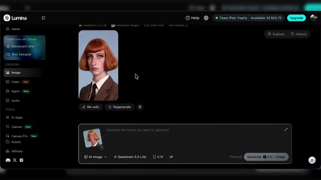  
  *⏱️ 00:02:54 — Résultat de la génération affichant le portrait du personnage féminin avec les paramètres sélectionnés.*

---

### ⏱️ `[00:02:56 - 00:03:15]` | Segment #08

**🔊 Audio (Transcription Intégrale Mot pour Mot en Français) :**
> C'est pour recréer l'influenceur Jean Philanthrope, mais cette fois-ci de plein pied. Et pour ça, je vais utiliser un autre modèle. Donc tu vois, il y a aussi les modèles Nano Banana et les modèles GPT Image. Et moi, je vais utiliser GPT Image 2.5. C'est parti. Ok, j'ai donc bien mes trois influenceurs que je vais pouvoir utiliser en référence dans mes vidéos.

**👁️ Analyse Visuelle d'Écran (gemini-3.5-flash-lite) :**
**Interface & Outils** : Interface web de génération d'images (style générateur IA avec panneau de prompt latéral).
**Contenu textuel & Code** : Modèle utilisé : "GPT Image 2.5 Sunburst". Prompt détaillé décrivant l'homme en pied avec costume en tweed marron, coupe au bol blonde et chaussures en cuir. Panneau latéral affichant les trois influenceurs de référence.
**Action / Démonstration** : Le créateur présente l'image générée en pied d'un influenceur virtuel en utilisant GPT Image 2.5.

**Captures d'écran :**
- 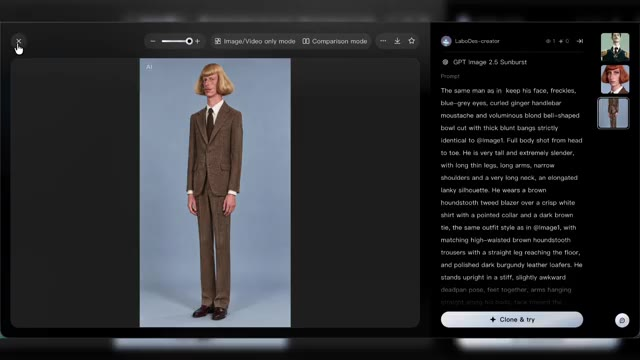  
  *⏱️ 00:03:14 — Interface du générateur d'images montrant le résultat en pied de l'influenceur avec le modèle GPT Image 2.5 et son prompt descriptif.*

---

### ⏱️ `[00:03:16 - 00:03:41]` | Segment #09

**🔊 Audio (Transcription Intégrale Mot pour Mot en Français) :**
> Et j'ai aussi une bouteille de parfum, on va l'utiliser plus tard pour un exemple de placement produit avec un de nos influenceurs. On passe dans la partie vidéo, tu vois ici la liste des modèles. Quand je déplace le curseur sur Seed Dance 2.5, j'ai les différentes sous-catégories. Pour l'instant, nous on va rester en Freestyle Creation. Et à noter, on a aussi accès à WAN 3.0 et à Minimax H3, toutes les anciennes versions de Seed Dance.

**👁️ Analyse Visuelle d'Écran (gemini-3.5-flash-lite) :**
**Interface & Outils** : Lumina (plateforme de création vidéo et d'images par IA)
**Contenu textuel & Code** : Liste des modèles vidéo (Seedance 2.5, Wan 3.0, MiniMax H3, Seedance 2.0, etc.), sous-catégories (Freestyle Creation, Multi-frame Editing, Video Editing, Extend Video), et un prompt pour une bouteille de parfum de luxe.
**Action / Démonstration** : Le créateur navigue dans les menus de sélection de modèles vidéo et présente un exemple de visuel généré pour un placement produit.

**Captures d'écran :**
- 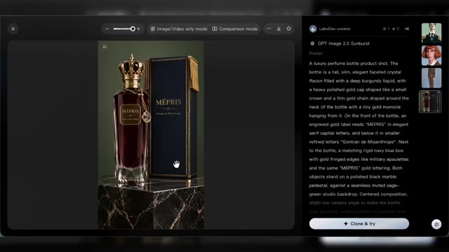  
  *⏱️ 00:03:17 — Image #1 montre l'interface de génération d'images avec un visuel de flacon de parfum de luxe et son prompt détaillé associé.*
- 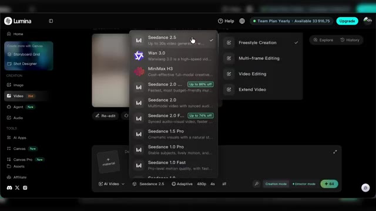  
  *⏱️ 00:03:28 — Image #2 montre l'interface vidéo de l'outil Lumina avec le menu déroulant des modèles de génération et les sous-catégories associées.*
- 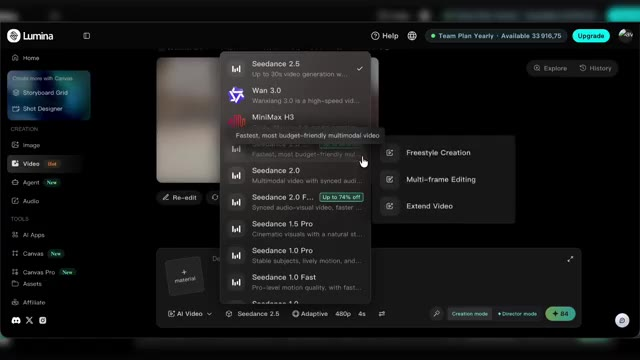  
  *⏱️ 00:03:39 — Image #3 montre une vue similaire de l'interface Lumina où le curseur se déplace sur les options de modèles vidéo.*

---

### ⏱️ `[00:03:41 - 00:04:18]` | Segment #10

**🔊 Audio (Transcription Intégrale Mot pour Mot en Français) :**
> On va rester sur la version 2.5 en Freestyle. Ici je peux lui donner mes références Donc je vais lui donner mes influenceurs Du coup Gontran, Jean-Phi et L on va l'appeler Philippine J'ai mes trois références Mon prompt encore une fois je me suis aidé de Claude pour le rédiger A noter je lui ai demandé de me faire ça en JSON Je le copie-colle Et par contre ici je fais bien attention de changer Parce que pour les références il m'a mis par défaut Arrobas image 1 Mais je vais devoir le changer manuellement et reselectionner arrobas et choisir la bonne référence parmi celles que j'ai données à SeedDance 2.5.

**👁️ Analyse Visuelle d'Écran (gemini-3.5-flash-lite) :**
**Interface & Outils** : Interface web de Claude (Anthropic).
**Contenu textuel & Code** : Code JSON contenant un bloc de configuration pour la génération vidéo : mode "reference_to_video", références @Image1, @Image2, @Image3, durée (15s), format (9:16), setting (salon parisien), et séquences de plans (shot_1, shot_2).
**Action / Démonstration** : Le créateur montre le prompt rédigé en JSON à l'aide de l'outil Claude avant de le copier.

**Captures d'écran :**
- 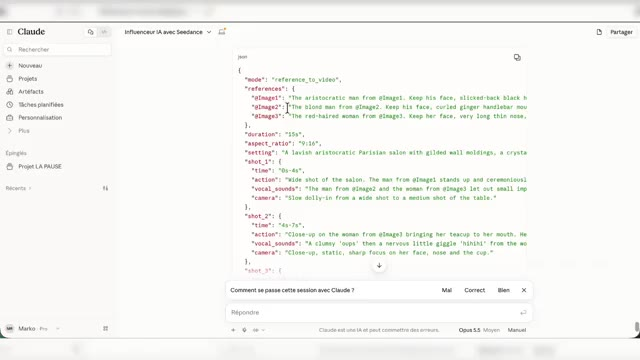  
  *⏱️ 00:03:59 — Affichage du prompt structuré au format JSON généré par l'assistant Claude pour définir les références des personnages et les plans vidéo.*

---

### ⏱️ `[00:04:20 - 00:04:42]` | Segment #11

**🔊 Audio (Transcription Intégrale Mot pour Mot en Français) :**
> Ok, une fois que c'est fait, je choisis le ratio et la résolution et on va rester sur un format 9-16ème pour les réseaux sociaux et on va aller jusqu'à 15 secondes. L'avantage sur SeedDance 2.5, comme tu le sais, c'est un modèle qui offre jusqu'à 30 secondes max de vidéos. Donc l'idée, là on est dans une création purement originale avec nos 3 IA influenceurs.

**👁️ Analyse Visuelle d'Écran (gemini-3.5-flash-lite) :**
**Interface & Outils** : Interface web de Lumina (outil de génération vidéo par IA)
**Contenu textuel & Code** : Menus de configuration vidéo, sélection du modèle Seeddance 2.5, formats d'image (9:16, 1:1, etc.), résolutions (480p, 720p, 1080p), curseur de durée réglé sur 15 secondes, et prompts textuels détaillés.
**Action / Démonstration** : Le créateur ouvre les paramètres vidéo, sélectionne le format 9:16 et règle la durée à 15 secondes avant de lancer la génération.

**Captures d'écran :**
- 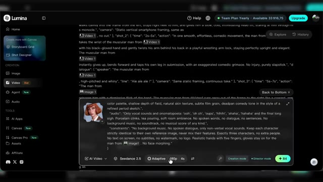  
  *⏱️ 00:04:21 — Interface de l'application Lumina affichant les options du modèle Seeddance 2.5 avec un curseur sur la barre d'outils inférieure.*
- 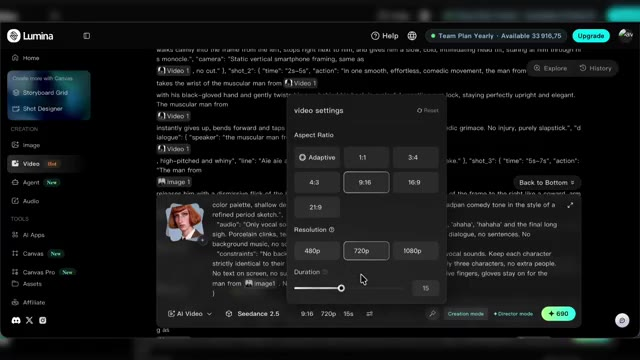  
  *⏱️ 00:04:31 — Fenêtre contextuelle "video settings" ouverte sur Lumina permettant de configurer le format (aspect ratio 9:16), la résolution et la durée.*
- 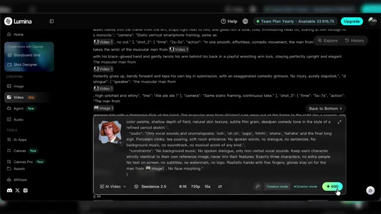  
  *⏱️ 00:04:41 — Interface de Lumina montrant le bouton de validation final avec le coût en crédits ("+ 690") pour générer la vidéo.*

---

### ⏱️ `[00:04:42 - 00:05:03]` | Segment #12

**🔊 Audio (Transcription Intégrale Mot pour Mot en Français) :**
> On va lancer la génération et voir ce que ça donne. Nouvel exemple, toujours avec Seed Dance 2.5 et en mode création.

**👁️ Analyse Visuelle d'Écran (gemini-3.5-flash-lite) :**
**Interface & Outils** : Interface de lecteur vidéo ou simple affichage visuel sans élément technique d'outil.
**Contenu textuel & Code** : Visuel généré par IA (Seed Dance 2.5) représentant un personnage au style baroque.
**Action / Démonstration** : Visualisation du résultat de la génération vidéo en cours.

---

### ⏱️ `[00:05:04 - 00:05:22]` | Segment #13

**🔊 Audio (Transcription Intégrale Mot pour Mot en Français) :**
> Dans le cas où tu veux mettre en scène ton influenceur avec un produit, tout simplement tu utilises en référence ton influenceur et le produit que tu souhaites qu'il mette en avant. Donc c'est pour ça qu'on avait créé ce parfum pour cet exemple. Et pareil, je me suis aidé de Claude pour réaliser mon spot de 10 secondes.

**👁️ Analyse Visuelle d'Écran (gemini-3.5-flash-lite) :**
**Interface & Outils** : Interface web de sélection d'images et interface de l'assistant IA Claude.
**Contenu textuel & Code** : Galerie d'images d'avatairs et de produits publicitaires ; code JSON de configuration de plan vidéo (« mode: reference_to_video », « duration: 10s », plans de caméra).
**Action / Démonstration** : Le créateur montre la sélection des images de référence (influenceur et parfum) puis présente le code de génération de la vidéo publicitaire avec Claude.

**Captures d'écran :**
- 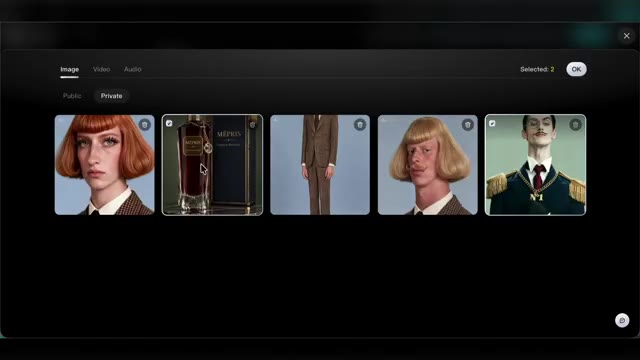  
  *⏱️ 00:05:13 — Interface de sélection de fichiers multimédias avec plusieurs images d'influenceurs virtuels et d'un flacon de parfum « Mépris » sélectionnées.*
- 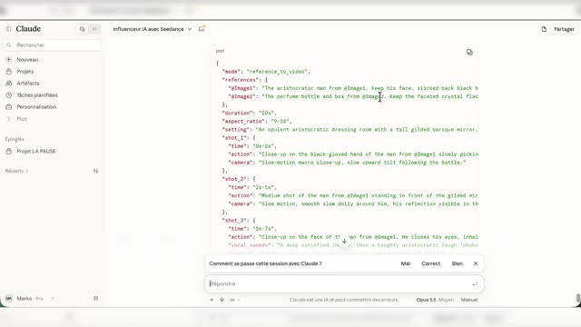  
  *⏱️ 00:05:21 — Interface de l'assistant IA Claude affichant un prompt au format JSON détaillé pour la création d'un spot publicitaire vidéo de 10 secondes.*

---

### ⏱️ `[00:05:22 - 00:05:46]` | Segment #14

**🔊 Audio (Transcription Intégrale Mot pour Mot en Français) :**
> Encore une fois, c'est en JSON. Je copie-colle et je vais changer mes références pour qu'elles correspondent. On va rester en 9-16ème et par contre, on va réduire à 10 secondes. C'est parti pour la génération. Donc ça, c'était pour de la création pure.

**👁️ Analyse Visuelle d'Écran (gemini-3.5-flash-lite) :**
**Interface & Outils** : Lumina (générateur vidéo par IA)
**Contenu textuel & Code** : Prompt textuel détaillé, indicateur de chargement « Generating 1% », options de format et de durée.
**Action / Démonstration** : Le créateur lance la génération d'une vidéo après avoir configuré les paramètres et collé le prompt textuel.

**Captures d'écran :**
- 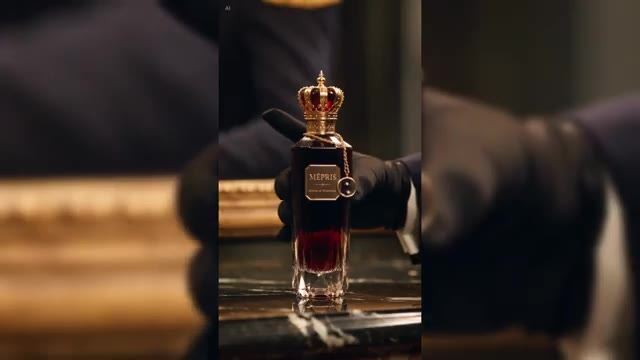  
  *⏱️ 00:05:34 — Aperçu vertical d'une vidéo générée montrant une bouteille de parfum luxueuse avec un bouchon en forme de couronne.*
- 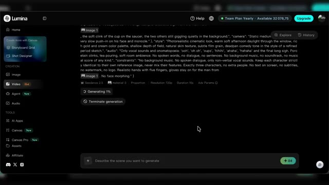  
  *⏱️ 00:05:45 — Interface de l'outil de génération vidéo Lumina montrant un prompt détaillé en cours de génération (à 1%).*

---

### ⏱️ `[00:05:47 - 00:06:07]` | Segment #15

**🔊 Audio (Transcription Intégrale Mot pour Mot en Français) :**
> Maintenant, pour de l'édition et notamment si tu veux reprendre des trends, des mèmes, des passages de films en y incluant tes influenceurs. Là aussi, tu vas pouvoir le faire très simplement avec Seed Dance 2.5. Mais cette fois-ci, on va sélectionner la fonctionnalité vidéo editing. Tu auras donc besoin de ta vidéo de référence.

**👁️ Analyse Visuelle d'Écran (gemini-3.5-flash-lite) :**
**Interface & Outils** : Seed Dance 2.5
**Contenu textuel & Code** : Lecteur vidéo intégré avec barre de contrôle, zone de texte pour le prompt, sélecteurs de modèle (Seedance 2.5), résolution (480p), proportion et bouton de génération.
**Action / Démonstration** : Le créateur montre l'utilisation de l'outil pour importer et configurer une vidéo de référence en vue de son édition.

**Captures d'écran :**
- 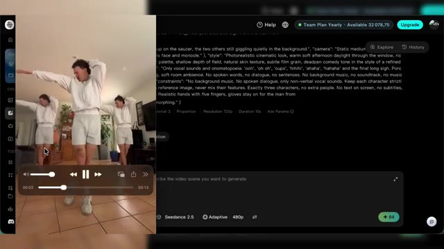  
  *⏱️ 00:06:05 — Interface du générateur vidéo Seed Dance 2.5 montrant l'importation d'une vidéo de référence avec son lecteur multimédia et les paramètres textuels associés.*

---

### ⏱️ `[00:06:07 - 00:06:31]` | Segment #16

**🔊 Audio (Transcription Intégrale Mot pour Mot en Français) :**
> Nous, on va partir sur celle-là. Et par contre, pour éviter de déclencher un filtre copyright sur SiteDance, je te conseille d'uploader ta vidéo de référence sans l'audio, notamment s'il y a une musique sur la vidéo en question. Et là aussi, je me suis aidé de Claude pour la rédaction du prompt. Et tout simplement, je lui ai donné une capture de la vidéo et je lui ai demandé de m'écrire le prompt pour qu'il remplace chaque personnage par un de mes influenceurs.

**👁️ Analyse Visuelle d'Écran (gemini-3.5-flash-lite) :**
**Interface & Outils** : Interface web de Claude (Anthropic)
**Contenu textuel & Code** : Fenêtre de discussion affichant une image intégrée d'un homme dansant, avec du texte de prompt textuel associé sur le côté.
**Action / Démonstration** : Le créateur montre comment il a utilisé une capture d'écran de référence dans Claude pour rédiger son prompt.

**Captures d'écran :**
- 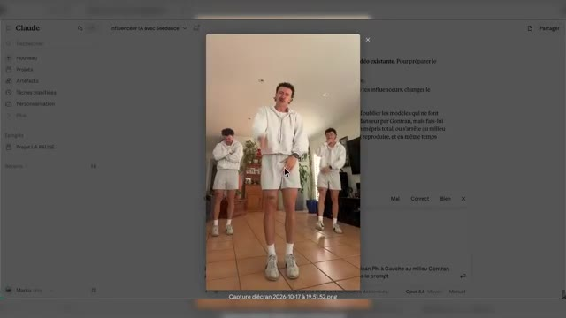  
  *⏱️ 00:06:29 — Capture d'écran de l'interface de l'assistant IA Claude montrant une image de référence pour la rédaction d'un prompt.*

---

### ⏱️ `[00:06:31 - 00:06:50]` | Segment #17

**🔊 Audio (Transcription Intégrale Mot pour Mot en Français) :**
> Bon là, une seule capture a suffi, mais pour des vidéos plus complexes, n'hésite pas à lui donner plusieurs captures de la vidéo en question pour qu'il t'aide à rédiger le bon prompt. J'oublie pas en plus de ma vidéo de référence, de mettre en référence mes influenceurs. Donc dans l'ordre de mon prompt, en image 1, Jean-Pierre, en image 2, Gontran, en image 3, Philippine.

**👁️ Analyse Visuelle d'Écran (gemini-3.5-flash-lite) :**
**Interface & Outils** : Interface web de l'application Lumina (générateur de vidéo IA).
**Contenu textuel & Code** : Menus de téléchargement, timeline avec vignettes de personnages, options de modèle (Seedance 2.5, Adaptive, 720p).
**Action / Démonstration** : Le créateur montre l'ajout progressif d'images de référence (influenceurs) dans l'interface de l'outil.

**Captures d'écran :**
- 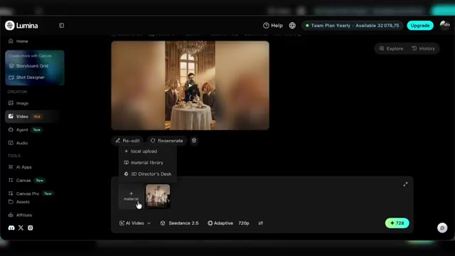  
  *⏱️ 00:06:41 — Interface de l'outil Lumina montrant l'importation de fichiers multimédias pour la génération de vidéo par IA.*
- 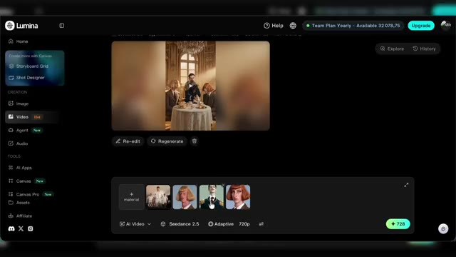  
  *⏱️ 00:06:49 — Interface de l'outil Lumina affichant plusieurs images de référence de personnages intégrées dans la timeline.*

---

### ⏱️ `[00:06:50 - 00:07:20]` | Segment #18

**🔊 Audio (Transcription Intégrale Mot pour Mot en Français) :**
> Et ensuite, je n'ai plus qu'à bien modifier les références et ne pas oublier non plus d'indiquer la référence vidéo. Et donc vu qu'on est dans l'édition, on pourra pas choisir le ratio ni la longueur de la vidéo. Par contre, on peut choisir la résolution. Nous, on va rester sur du 720. Le résultat est assez bluffant.

**👁️ Analyse Visuelle d'Écran (gemini-3.5-flash-lite) :**
**Interface & Outils** : Lecteur vidéo ou aperçu de génération.
**Contenu textuel & Code** : Vidéo verticale montrant un homme habillé en officier ou barman avec une chaîne en or "N°1", souriant dans un décor de bar.
**Action / Démonstration** : Le créateur montre le résultat vidéo finalisé obtenu après application des réglages de génération.

**Captures d'écran :**
- 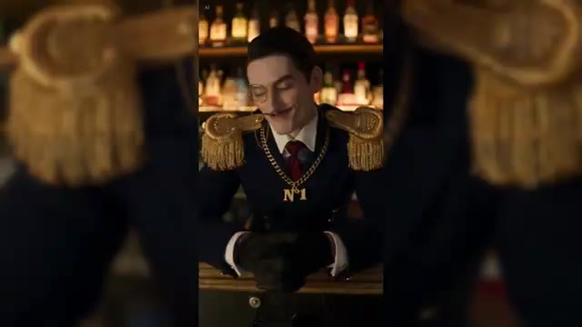  
  *⏱️ 00:07:18 — Aperçu de la vidéo générée par l'IA représentant un personnage en uniforme auvergnat dans un bar.*

---

### ⏱️ `[00:07:20 - 00:07:44]` | Segment #19

**🔊 Audio (Transcription Intégrale Mot pour Mot en Français) :**
> T'as dû voir plein de vidéos comme ça sur les réseaux circuler ces derniers temps. Je te mets quelques autres exemples à l'écran. Et c'est vrai que pour la viralité de ton influenceria, c'est sûrement le type de vidéo qui va le mieux marcher au départ. Et si tu veux faire preuve d'un peu plus d'originalité, Il y a une fonctionnalité sympa à utiliser avec Seed Dance 2.5 comme on l'a fait avec les vidéos de notre introduction.

**👁️ Analyse Visuelle d'Écran (gemini-3.5-flash-lite) :**
**Interface & Outils** : Vidéos issues de réseaux sociaux, sans interface logicielle visible.
**Contenu textuel & Code** : Exemples de vidéos courtes générées par intelligence artificielle présentées pour illustrer la viralité.
[DESC_ACTION] Le créateur illustre son propos en montrant à l'écran des exemples de vidéos virales du même type.
**Action / Démonstration** : Démonstration et mise en contexte pratique.

---

### ⏱️ `[00:07:44 - 00:08:03]` | Segment #20

**🔊 Audio (Transcription Intégrale Mot pour Mot en Français) :**
> Donc je suis toujours dans mon onglet vidéo et cette fois-ci je vais sélectionner Seed Dance 2.5 en mode extension. J'ai donc repris la vidéo la plus connue de Jean-Phi, une vidéo qui a fait plusieurs millions de vues. Alors je n'ai pas pris toute la vidéo, j'ai juste pris 10 secondes de celle-ci jusqu'à la fin et je l'ai mis en référence sur mon modèle Seed Dance 2.5.

**👁️ Analyse Visuelle d'Écran (gemini-3.5-flash-lite) :**
**Interface & Outils** : Lumina (générateur vidéo IA)
**Contenu textuel & Code** : Menus de création vidéo, sélection du modèle Seed Dance 2.5, zone de prompt textuel et intégration de la vidéo de référence de Jean-Phi.
**Action / Démonstration** : Importation d'un extrait de 10 secondes de la vidéo de Jean-Phi comme référence et configuration de la génération avec Seed Dance 2.5.

**Captures d'écran :**
- 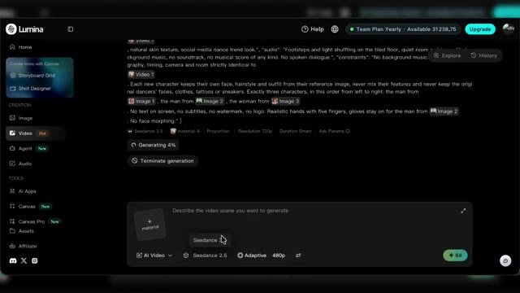  
  *⏱️ 00:07:45 — Interface de l'application Lumina affichant le générateur vidéo Seed Dance 2.5 en cours de génération avec un prompt textuel.*
- 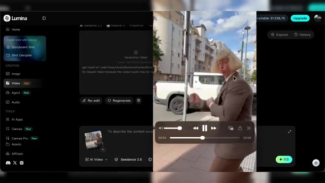  
  *⏱️ 00:07:54 — Affichage de l'interface Lumina avec un aperçu vidéo intégré montrant Jean-Phi dansant dans la rue.*
- 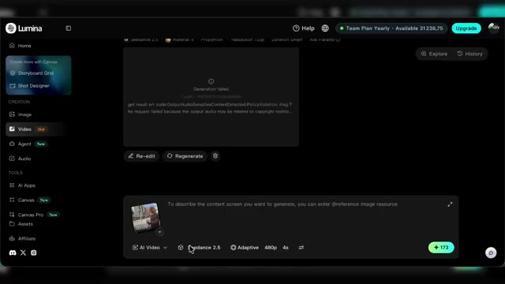  
  *⏱️ 00:08:02 — Gros plan sur la zone de saisie de prompt et les options de Seed Dance 2.5 avec l'extrait vidéo importé en référence.*

---

### ⏱️ `[00:08:03 - 00:08:23]` | Segment #21

**🔊 Audio (Transcription Intégrale Mot pour Mot en Français) :**
> En plus, en référence, j'ai également donné Gontran qui intervient donc dans la vidéo pour prendre le portable de Jean-Phi. Et pour plus de personnalité, j'ai également donné un audio de référence pour que Seed Dance 2.5 utilise la même voix dans toutes les vidéos. Et là en l'occurrence, j'ai designé une voix sur Eleven Labs.

**👁️ Analyse Visuelle d'Écran (gemini-3.5-flash-lite) :**
**Interface & Outils** : ElevenLabs (plateforme de synthèse vocale par IA)
**Contenu textuel & Code** : Text to Speech, champ de texte avec la voix 'Gontran' et le dialogue 'Bonjour, je suis Gontran, qu'est ce que vous regardez ?', modèle Eleven v4, paramètres de voix et de stabilité
**Action / Démonstration** : Le créateur montre la création et la configuration de la voix du personnage 'Gontran' sur ElevenLabs pour l'utiliser ensuite dans la vidéo

**Captures d'écran :**
- 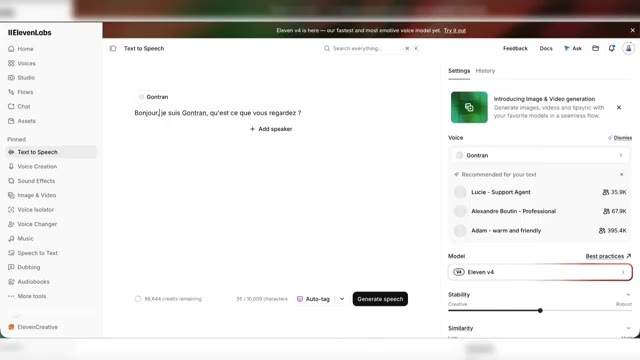  
  *⏱️ 00:08:13 — Interface d'ElevenLabs affichant le générateur de texte en parole (Text to Speech) avec la voix de Gontran configurée et le texte 'Bonjour je suis Gontran, qu'est ce que vous regardez ?'*
- 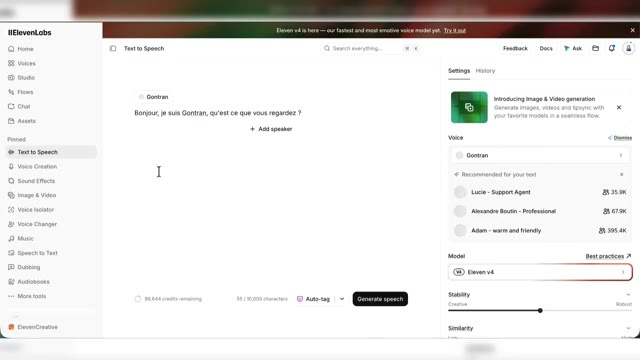  
  *⏱️ 00:08:22 — Même vue de l'interface d'ElevenLabs avec le curseur de la souris visible sur la zone de texte pour la génération de voix*

---

### ⏱️ `[00:08:24 - 00:08:46]` | Segment #22

**🔊 Audio (Transcription Intégrale Mot pour Mot en Français) :**
> J'ai ensuite créé une référence courte, simple, et je l'ai transmise à Seed Dance 2.5. Et cette référence audio, je l'utiliserai à chaque fois que je voudrais faire parler Gontran dans une de mes vidéos pour qu'il garde donc la même voix. Alors comme d'hab, j'ai expliqué ce que je voulais niveau référence et j'ai également donné des petites captures à Claude pour qu'il m'aide à écrire mon prompt.

**👁️ Analyse Visuelle d'Écran (gemini-3.5-flash-lite) :**
**Interface & Outils** : Lumina (générateur vidéo IA) et Claude (assistant conversationnel IA)
**Contenu textuel & Code** : Interface de Lumina avec aperçu vidéo, modèle Seedance 2.5 et options de format ; interface de Claude montrant un prompt JSON avec des références @Video1, @Image1 et @Audio1.
**Action / Démonstration** : Le créateur montre la configuration des références multimédias (image, audio et vidéo) dans l'interface de Lumina et la génération du prompt structuré via l'assistant Claude.

**Captures d'écran :**
- 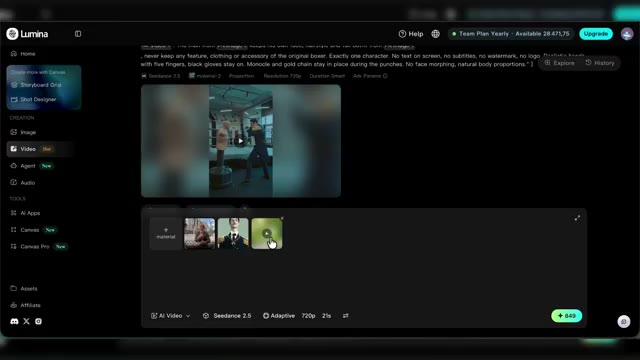  
  *⏱️ 00:08:35 — Interface de l'outil de génération vidéo Lumina montrant un aperçu vidéo en cours de lecture et des éléments de référence sélectionnés en bas.*
- 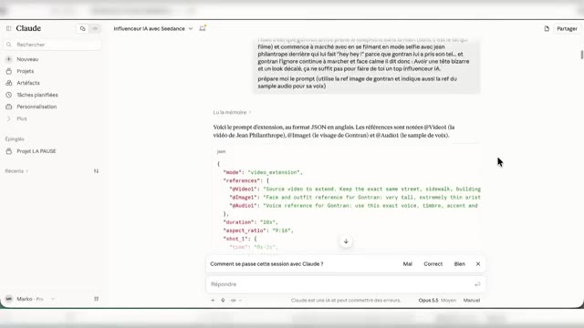  
  *⏱️ 00:08:45 — Interface de l'assistant IA Claude affichant une conversation textuelle avec la génération d'un prompt au format JSON intégrant les références vidéo, image et audio.*

---

### ⏱️ `[00:08:46 - 00:09:06]` | Segment #23

**🔊 Audio (Transcription Intégrale Mot pour Mot en Français) :**
> Et ensuite j'ai simplement copié-collé et changé les références et le résultat tu l'as eu en intro de la vidéo. Avoir une tête bizarre et un look décalé, ça ne suffit pas pour faire de toi un top influenceur IA.

**👁️ Analyse Visuelle d'Écran (gemini-3.5-flash-lite) :**
**Interface & Outils** : Lumina (générateur vidéo IA)
**Contenu textuel & Code** : Code JSON / prompt détaillé avec des références (mode: video_extension, references, Video1, Image1, Audio1, Seedance 2.5)
**Action / Démonstration** : Le créateur montre l'interface de l'outil IA où il a modifié les références textuelles pour générer la vidéo finale.

**Captures d'écran :**
- 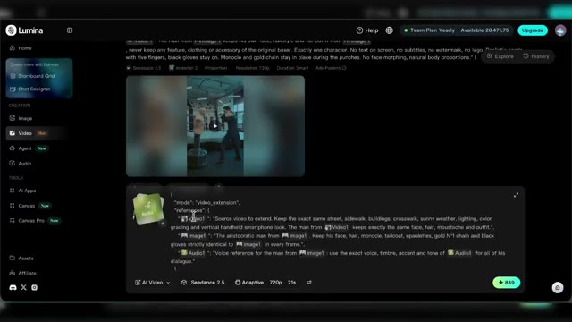  
  *⏱️ 00:08:47 — Capture d'écran de l'interface du générateur vidéo Lumina montrant un prompt technique et un aperçu vidéo.*

---

### ⏱️ `[00:09:07 - 00:09:37]` | Segment #24

**🔊 Audio (Transcription Intégrale Mot pour Mot en Français) :**
> Alors ce qui est intéressant avec ma technique d'utiliser cet audio de référence Eleven Labs, c'est que parfois avec le français, Cidense 2.5 a des légers soucis. Donc même si tu mets bien ton dialogue dans ton prompt, il va pouvoir avoir des problèmes de prononciation. Et du coup le fait d'utiliser en référence une voix Eleven Labs, ça veut dire aussi que je peux générer cette voix si j'en ai besoin sur Eleven Labs et ensuite l'ajouter à mon montage pour masquer les défauts occasionnels que je pourrais avoir lors de mes générations Seed Dance 2.5.

**👁️ Analyse Visuelle d'Écran (gemini-3.5-flash-lite) :**
**Interface & Outils** : Graphismes animés et interfaces simulées de présentation vidéo (Lumina, Seedance 2.5, Timeline de montage).
**Contenu textuel & Code** : Textes explicatifs, blocs de prompts, avertissements et représentation graphique d'une timeline audio/vidéo.
**Action / Démonstration** : Explication de la technique d'utilisation conjointe de Seedance 2.5 et d'un audio Eleven Labs pour contourner les problèmes de prononciation en français.

**Captures d'écran :**
- 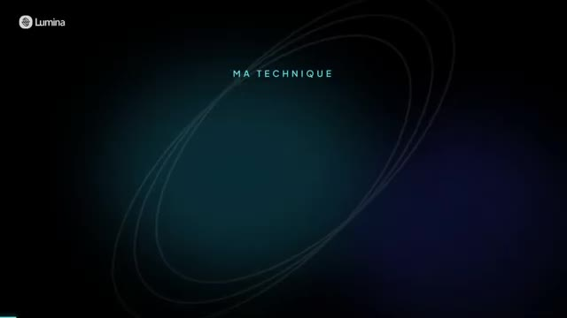  
  *⏱️ 00:09:08 — Écran de titre avec le logo Lumina et le texte 'MA TECHNIQUE' sur fond abstrait sombre.*
- 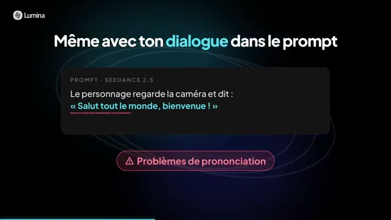  
  *⏱️ 00:09:22 — Illustration avec un exemple de prompt Seedance 2.5 montrant un dialogue et un avertissement sur les problèmes de prononciation.*
- 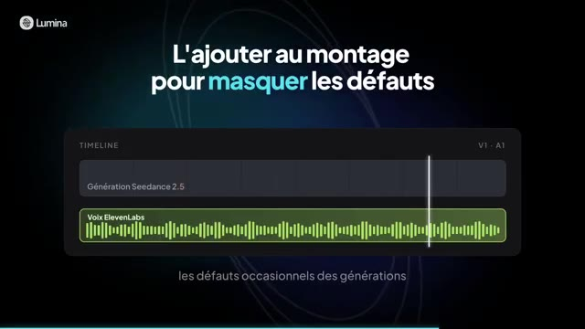  
  *⏱️ 00:09:35 — Illustration d'une timeline de montage vidéo montrant la superposition d'une piste vidéo Seedance 2.5 et d'une piste audio ElevenLabs.*

---

### ⏱️ `[00:09:37 - 00:09:59]` | Segment #25

**🔊 Audio (Transcription Intégrale Mot pour Mot en Français) :**
> Et d'ailleurs je l'ai fait sur deux de mes vidéos en introduction et ça camoufle sans soucis et les paroles prononcées par mon influenceur IA restent cohérentes. Et d'ailleurs quand t'as besoin de faire parler de ton personnage, il y a un autre modèle qui s'en sort bien, c'est One 3.0. Donc là par exemple je vais l'utiliser en freestyle. Je lui ai donné en ref, Gontran, le parfum et la voix de Gontran.

**👁️ Analyse Visuelle d'Écran (gemini-3.5-flash-lite) :**
**Interface & Outils** : Lumina (générateur vidéo IA)
**Contenu textuel & Code** : Prompts textuels pour publicité de parfum, menus de création, paramètres de génération (Seedance 2.5, Wan 3.0, Adaptive, 480p, 4s), et barre de progression (générant à 11% puis 13%).
**Action / Démonstration** : Le créateur présente l'utilisation du modèle Wan 3.0 sur la plateforme Lumina pour générer du contenu vidéo à partir de prompts et de visuels de référence.

**Captures d'écran :**
- 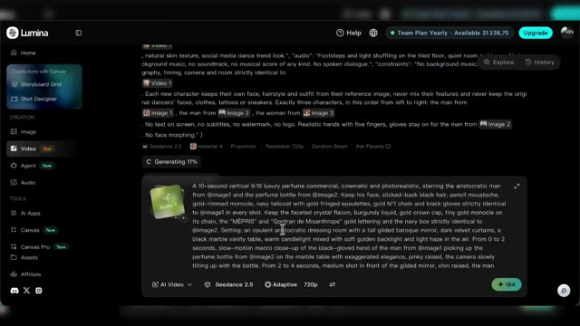  
  *⏱️ 00:09:48 — Interface de la plateforme Lumina montrant un générateur vidéo en cours de génération à 11% avec un prompt textuel détaillé.*
- 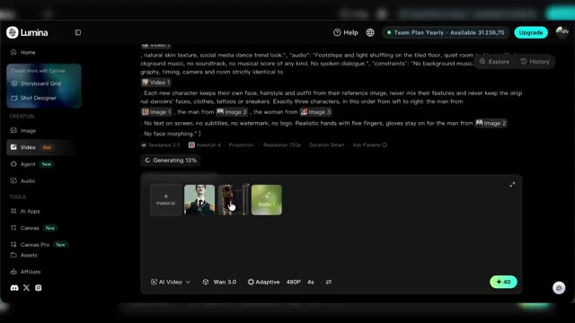  
  *⏱️ 00:09:57 — Interface de Lumina montrant la suite de la génération avec le modèle Wan 3.0 et des vignettes de personnages et d'audio intégrées.*

---

### ⏱️ `[00:09:59 - 00:10:22]` | Segment #26

**🔊 Audio (Transcription Intégrale Mot pour Mot en Français) :**
> Là encore, je me suis aidé de Claude pour la rédaction du prompt. Et j'ai créé un prompt pour une nouvelle pub, mais cette fois avec un dialogue. On remplace bien les références pour le ratio en 9,16, 720p et 10 secondes. Et on va générer. Et voilà le résultat. Oh, mépris. Le parfum de ceux qui vous regardent de haut.

**👁️ Analyse Visuelle d'Écran (gemini-3.5-flash-lite) :**
**Interface & Outils** : Interface web de Claude et interface du générateur vidéo Lumina
**Contenu textuel & Code** : Prompt détaillé pour une publicité de parfum de luxe, paramètres de format (9:16, 720p, durée) et personnage généré par IA
**Action / Démonstration** : Rédaction du prompt avec l'aide de Claude, configuration des paramètres de génération vidéo dans Lumina et visionnage du résultat final généré

**Captures d'écran :**
- 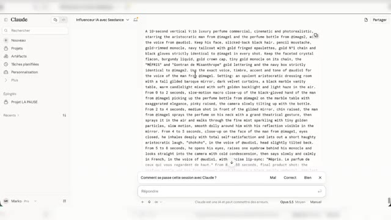  
  *⏱️ 00:10:00 — Interface de l'assistant Claude affichant le prompt détaillé en anglais pour générer la publicité du parfum.*
- 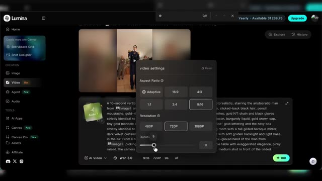  
  *⏱️ 00:10:10 — Interface de l'outil de génération vidéo Lumina montrant les réglages (format 9:16, résolution 720p, durée).*
- 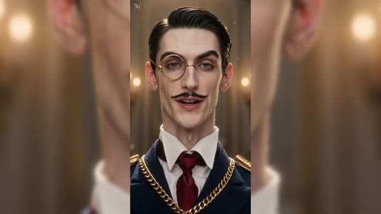  
  *⏱️ 00:10:20 — Résultat de la génération vidéo au format vertical montrant un personnage aristocratique parlant face caméra.*

---

### ⏱️ `[00:10:23 - 00:10:46]` | Segment #27

**🔊 Audio (Transcription Intégrale Mot pour Mot en Français) :**
> Voilà, avec Seed Dance 2.5, tu as une vraie palette de formats pour faire vivre ton influenceur IA. Vidéo à partir d'images de référence, reproduction d'une vidéo existante, extension, pub produit. Et c'est important car pour créer une audience et rassembler autour de ton influenceur, son look ne suffira pas, aussi étrange soit-il.

**👁️ Analyse Visuelle d'Écran (gemini-3.5-flash-lite) :**
**Interface & Outils** : Présentation vidéo animée avec graphismes de type Lumina.
**Contenu textuel & Code** : Titres de chapitres ou formats de l'outil Seed Dance 2.5 ('Vidéo à partir d'images de référence', 'Reproduction d'une vidéo existante').
**Action / Démonstration** : Le créateur présente les différents formats disponibles pour créer un influenceur IA.

**Captures d'écran :**
- 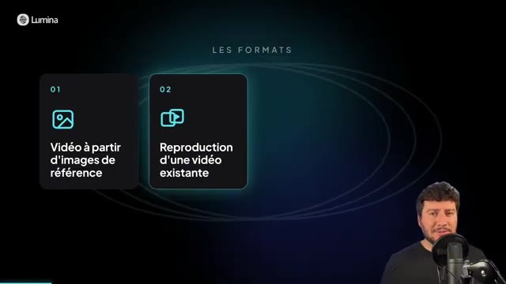  
  *⏱️ 00:10:35 — Écran présentant les formats disponibles : '01 Vidéo à partir d'images de référence' et '02 Reproduction d'une vidéo existante'.*

---

### ⏱️ `[00:10:46 - 00:11:08]` | Segment #28

**🔊 Audio (Transcription Intégrale Mot pour Mot en Français) :**
> Une fois que tu as cette audience, il te faut des modèles capables de faire autre chose que de l'imitation de trend. Des modèles qui te permettent de créer ton propre contenu, de donner une voix à ton influenceur et pourquoi pas lui faire faire des sponso. Et c'est d'ailleurs sans doute là que se trouve le vrai modèle économique derrière un influenceur IA.

**👁️ Analyse Visuelle d'Écran (gemini-3.5-flash-lite) :**
**Interface & Outils** : Inexistant (visuel de type motion design/gros plan)
**Contenu textuel & Code** : Texte à l'écran : "C'est sans doute là que se trouve le vrai modèle économique" avec un logo euro.
**Action / Démonstration** : Le créateur parle et fait des gestes pour illustrer son propos sur le modèle économique des influenceurs virtuels.

---

### ⏱️ `[00:11:08 - 00:11:33]` | Segment #29

**🔊 Audio (Transcription Intégrale Mot pour Mot en Français) :**
> Mais il faut être honnête, le plus dur ça sera de créer son audience. Car sans elle, tout le reste est compliqué. C'est pour ça que beaucoup de créateurs construisent pour leur personnage IA un lore autour d'un autre personnage IA déjà connu. pour pouvoir profiter un peu de leur notoriété. Et nous, c'est ce qu'on avait fait dans les exemples en introduction en faisant entrer Gontran dans des vidéos d'influenceurs IA déjà existantes.

**👁️ Analyse Visuelle d'Écran (gemini-3.5-flash-lite) :**
**Interface & Outils** : Graphismes animés et présentation vidéo de type tutoriel.
**Contenu textuel & Code** : Texte "Construire un lore autour d'un personnage" et "En faisant entrer Gontran dans des vidéos" avec des icônes et des cartes d'influenceurs IA.
**Action / Démonstration** : Le créateur explique sa stratégie de création d'audience en s'appuyant sur des personnages connus.

---

### ⏱️ `[00:11:33 - 00:11:52]` | Segment #30

**🔊 Audio (Transcription Intégrale Mot pour Mot en Français) :**
> Et si tu n'as pas envie de lancer ton propre influenceur IA, la maîtrise de ces modèles reste un outil très concret côté com. Créer du contenu UGC pour un client, promouvoir un service, un produit, un lieu, une destination et rien ne t'empêche non plus de créer un avatar à ton image ou celui de tes clients avec leur accord.

**👁️ Analyse Visuelle d'Écran (gemini-3.5-flash-lite) :**
**Interface & Outils** : Interface graphique de présentation vidéo / outil IA (Lumina)
**Contenu textuel & Code** : Texte affiché : 'Un avatar à ton image ou celui de tes clients', avec deux boutons interactifs 'À ton image' (icône utilisateur) et 'Tes clients' (icône groupe).
**Action / Démonstration** : Le présentateur explique les différentes applications possibles des avatars IA (personnel ou pour des clients) avec un support visuel illustratif.

**Captures d'écran :**
- 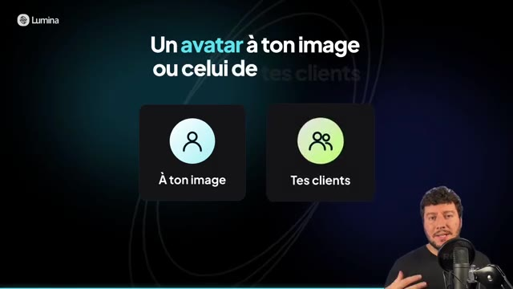  
  *⏱️ 00:11:50 — Illustration graphique avec le logo Lumina présentant deux options pour créer un avatar : 'À ton image' et 'Tes clients', pendant que le créateur parle en bas à droite.*

---

### ⏱️ `[00:11:52 - 00:12:17]` | Segment #31

**🔊 Audio (Transcription Intégrale Mot pour Mot en Français) :**
> de mettre cet avatar en scène dans les situations que tu veux. De mon côté c'est sur Lumina que j'utilise SeatDance 2.5 et c'est là qu'arriveront les prochains modèles SeatDance en avant première. Sur Lumina il y a aussi la présence d'autres modèles et d'autres outils, on aura peut-être l'occasion d'en parler sur la chaîne. En attendant je t'invite à faire un tour et tester par toi même, le lien est en description et commentaire épinglé. Merci et à bientôt sur le Labo des réseaux.

**👁️ Analyse Visuelle d'Écran (gemini-3.5-flash-lite) :**
**Interface & Outils** : Interface graphique de la plateforme Lumina
**Contenu textuel & Code** : Textes 'SUR LUMINA, AUSSI', sections 'CREATION' et 'TOOLS', puis 'Merci'
**Action / Démonstration** : Le créateur conclut la vidéo en présentant la plateforme Lumina et en remerciant son audience.

---
